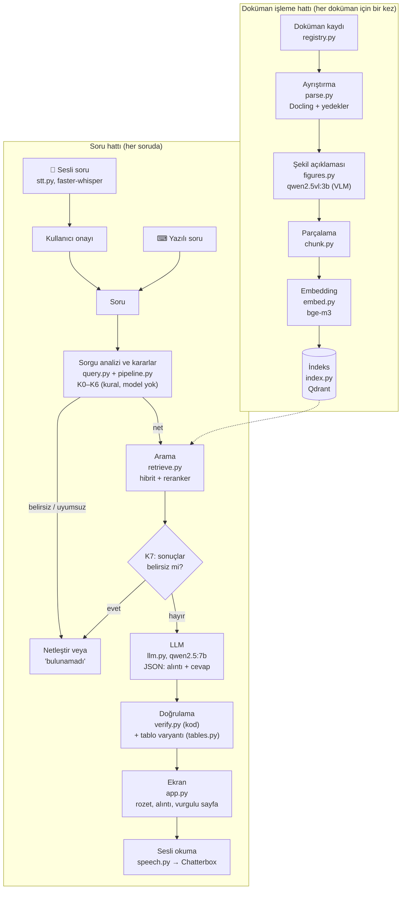
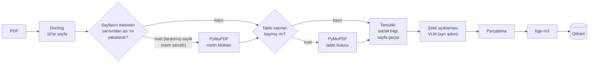
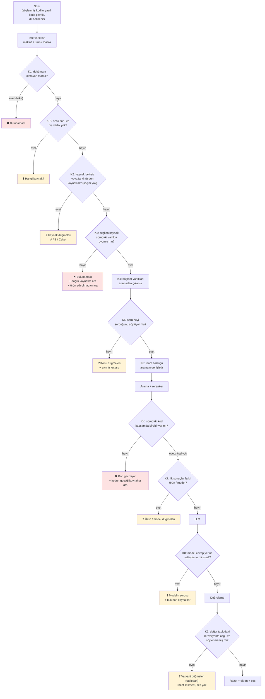
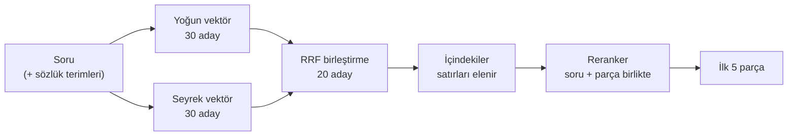
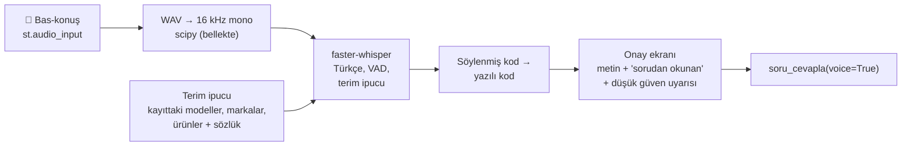
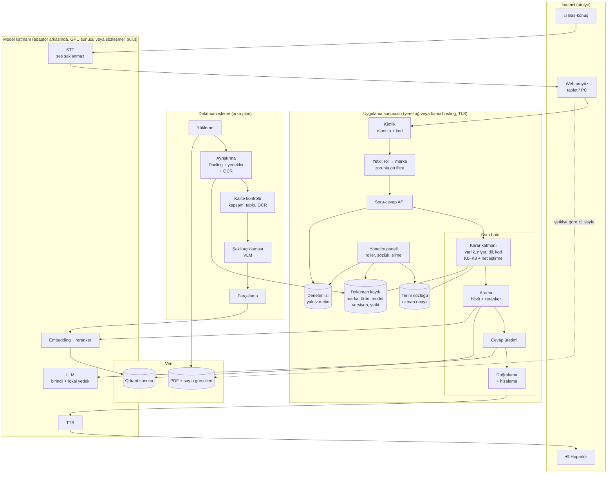
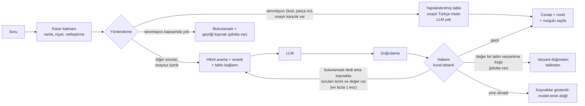
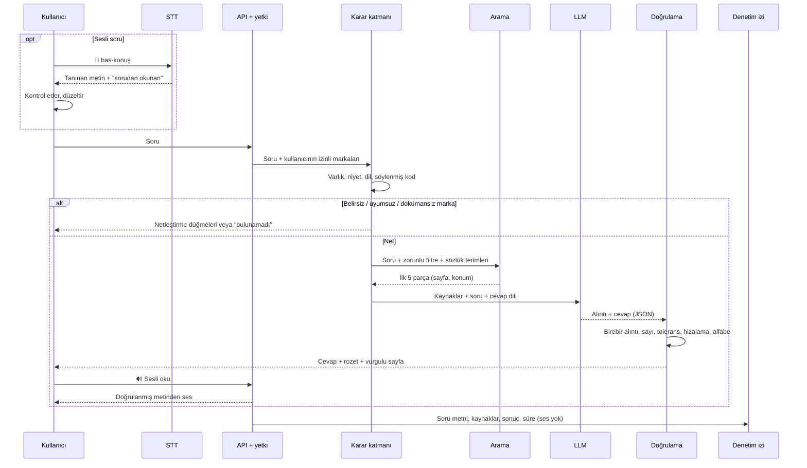
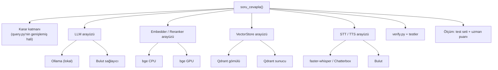
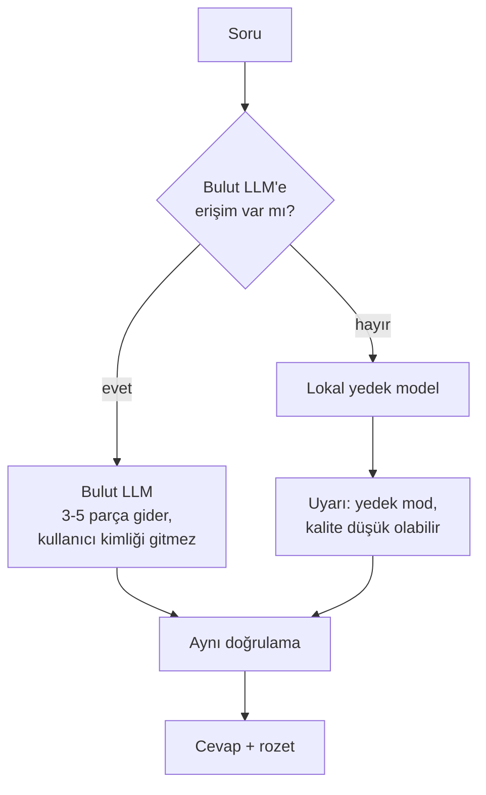

# Visual Agent: Mimari

> **A. Pilotun mimarisi:** Bugün çalışan sistem. Her aşamada ne yapılıyor, ne kullanılıyor, neden.
> **B. Önerilen hedef mimari:** Pilottan öğrenilenlerle gerçek sistemin nasıl olması gerektiği.
>
> **Son güncelleme:** 2026-10-16 · **İlgili:** [PILOT-RAPORU.md](PILOT-RAPORU.md) (ölçümler, sorunlar) · [UYGULAMA-PLANI.md](UYGULAMA-PLANI.md) (aşamalar) · [ARASTIRMA-SENTEZI.md](ARASTIRMA-SENTEZI.md) (araç seçimlerinin araştırma gerekçesi) · Kod: [pilot/](pilot/)

---

## İçindekiler

**A. Pilotun mimarisi**
[A1. Büyük resim](#a1-büyük-resim) · [A2. Aşamalar tek bakışta](#a2-aşamalar-tek-bakışta) · [A3. Doküman işleme hattı](#a3-doküman-işleme-hattı) · [A4. Soru hattı ve karar noktaları](#a4-soru-hattı-ve-karar-noktaları) · [A5. Arayüz](#a5-arayüz) · [A6. Örnek akışlar](#a6-örnek-akışlar) · [A7. Kural tabanlı kararlar ve sınırları](#a7-kural-tabanlı-kararlar-ve-sınırları) · [A8. Dosya haritası ve testler](#a8-dosya-haritası-ve-testler)

**B. Önerilen hedef mimari**
[B1. Pilottan mimariye](#b1-pilottan-mimariye) · [B2. Hedef mimari](#b2-hedef-mimari) ([B2.1 Modüler RAG](#b21-modüler-rag-soru-hattının-modülleri) · [B2.2 Doküman katmanları](#b22-doküman-katmanları-ortak-ve-ek-dokümanlar) · [B2.3 Motor ve içerik ayrımı](#b23-motor-ve-içerik-ayrımı)) · [B3. Hedef soru akışı](#b3-hedef-soru-akışı) · [B4. Bileşen bileşen: pilot → hedef](#b4-bileşen-bileşen-pilot--hedef) · [B5. Kod yapısı](#b5-kod-yapısı) · [B6. Çevrimdışı ve gizlilik](#b6-çevrimdışı-ve-gizlilik) · [B7. Açık kararlar](#b7-açık-kararlar)

---

# A. Pilotun mimarisi

## A1. Büyük resim

Sistem iki hattan oluşur: Dokümanları bir kez işleyip aranabilir hale getiren **doküman işleme hattı** ve her soruda çalışan **soru hattı**.

**Temel ilkeler:**

| İlke | Pilotta nasıl uygulanıyor |
|------|---------------------------|
| **Model ancak soru ve kaynak netse çalışır** | Belirsizlik, kaynak uyumsuzluğu, dokümanı olmayan marka gibi durumlar modelden önce kuralla yakalanır. Bu çıkışlar 0–60 sn sürer; CPU'da model çağrısı ise 1–3 dk |
| **Modelin beyanına güvenilmez** | Cevabı kod denetler: alıntı birebir mi, sayılar alıntıda mı, tolerans tam mı |
| **Sayfayı model yazmaz** | Model yalnız kaynak numarası verir, sayfa ve konum bilgisi parçanın kaydından gelir. Sayfa uydurulamaz |
| **Kararı kullanıcı verir** | Sistem emin değilse tahmin etmez, seçenek sunar: hangi model, hangi ürün, hangi konu |
| **Hat arayüzden bağımsız** | Tüm akış tek fonksiyon: `soru_cevapla()`. Arayüz, ölçüm betiği ve testler aynı fonksiyonu çağırır |

---

## A2. Aşamalar tek bakışta

| Aşama | Ne yapıyor | Kullanılan | Neden bu | Dosya |
|-------|-----------|------------|----------|-------|
| **Doküman kaydı** | Her PDF'in marka, ürün, tür, dil, eşanlamlılarını tutar | Python tablosu | Filtre, kaynak uyumu ve netleştirme bu bilgilere dayanır | [registry.py](pilot/pilot/registry.py) |
| **Ayrıştırma** | PDF → metin, başlık, tablo + sayfa ve konum | **Docling** (OCR kapalı) + **PyMuPDF** yedekleri | Docling yerel, MIT lisanslı, tablo yapısı ve konum veriyor. Yedekler Docling'in kaçırdığı sayfa ve tabloları kurtarıyor | [parse.py](pilot/pilot/parse.py) |
| **Şekil açıklaması** | Şekil → aranabilir metin (başlık + şekildeki yazılar + otomatik açıklama) | **qwen2.5vl:3b** (Ollama), CPU; aynı görsel bir kez | Çizimdeki bilgi metinde yok ("körük alttan açık"). Açıklama "kaynak metni değil" diye işaretli | [figures.py](pilot/pilot/figures.py) |
| **Parçalama** | Öğeler → arama parçaları | Başlık sınırlı, tablo satırı ayrı, şekil ayrı | Bir parça iki konuyu karıştırmasın, tek satır bulunup vurgulansın | [chunk.py](pilot/pilot/chunk.py) |
| **Embedding** | Parça → vektör | **bge-m3** (yoğun + seyrek), CPU | Çok dilli (TR soru ↔ EN kılavuz). Tek modelden hem anlam hem kelime vektörü | [embed.py](pilot/pilot/embed.py) |
| **İndeks** | Vektör ve kayıt saklama | **Qdrant**, gömülü mod | Kurulumsuz, yerel. Filtre ve hibrit arama yerleşik | [index.py](pilot/pilot/index.py) |
| **Sesli soru** | Ses → metin | **faster-whisper** small, CPU int8 + terim ipucu | Yerel, ses dışarı çıkmıyor. İpucuyla model kodları doğru | [stt.py](pilot/pilot/stt.py) |
| **Sorgu analizi** | Sorudaki makine, ürün, marka, dil; söylenmiş kodlar | Kural (eşanlamlı tablosu) | Hızlı, test edilebilir, nedeni görülebilir. Küçük model bu kararı güvenilir veremiyor | [query.py](pilot/pilot/query.py) |
| **Karar noktaları** | Netleştirme, kaynak uyumu, bulunamadı | Kural + kullanıcı seçimi | Yanlış kaynaktan cevap (R4, R14) modelden önce önlenir | [pipeline.py](pilot/pilot/pipeline.py) |
| **Terim sözlüğü** | Atölye terimi → kılavuz terimi (aramaya eklenir) | Elle yazılmış taslak sözlük (29 terim) | bge-m3 ve qwen jargonu bilmiyor (1/5, 0/5) | [terms.py](pilot/pilot/terms.py) |
| **Arama** | Soruya en uygun 5 parça | Hibrit (yoğun + seyrek, **RRF**) + **bge-reranker-v2-m3** | Kodlar (E050, S-7300A) kelime aramasıyla, anlam yoğun aramayla bulunur. Reranker isabeti artırıyor | [retrieve.py](pilot/pilot/retrieve.py) |
| **Cevap üretimi** | Alıntı + cevap + sesli metin | **qwen2.5:7b** (Ollama), JSON şeması | Bu makinelere sığan en iyi lokal model. Kalitesi yetersiz (B2) | [llm.py](pilot/pilot/llm.py), [prompts.py](pilot/pilot/prompts.py) |
| **Kod tam eşleşmesi** | Sorudaki kodu (E050) kapsamda birebir arar | Kural | Kelime araması benzer kodu (E05) getirebiliyor | [pipeline.py](pilot/pilot/pipeline.py) |
| **Doğrulama** | Cevabı kaynağa karşı denetler | Kod (kural) | Model yanılsa da yanlış değer "doğrulandı" diye gitmesin | [verify.py](pilot/pilot/verify.py) |
| **Tablo varyant kontrolü** | Değer tablodaki bir varyanta (model, tip, beden) özgüyse ve söylenmemişse seçenek sunar | Kural, seçenekler tablodan | Doğrulama "sayı kaynakta var mı"ya bakıyor, "doğru sütun mu"ya bakmıyor | [tables.py](pilot/pilot/tables.py) |
| **Sesli metin** | Sayı, tolerans, birim → okunacak kelime | Kural tablosu | Türkçe için hazır araç yok. Alan dar, test edilebilir | [speech.py](pilot/pilot/speech.py) |
| **Seslendirme** | Metin → ses | **Chatterbox Multilingual**, CPU, ayrı ortam | Yerel, Türkçe kalitesi iyi | [tools/tts_say.py](pilot/tools/tts_say.py) |
| **Arayüz** | Soru, netleştirme, cevap, vurgulu sayfa, ses | **Streamlit** + sayfa çizici (pypdfium2) | Pilot için en hızlı yol | [app.py](pilot/app.py), [render.py](pilot/pilot/render.py) |

---

## A3. Doküman işleme hattı

### A3.1 Doküman kaydı: [registry.py](pilot/pilot/registry.py)

Her PDF için: `doc_id`, dosya, **marka**, **ürün**, **tür** (`machine_manual`, `product_standard`, `tailoring_guide`), dil aralıkları (Bosch üç dilli) ve sorguda aranan **eşanlamlılar** ("ceket", "coat", "jacket"). Ayrıca:
- `BRAND_ALIASES`: makine markası → modelleri ("brother" → S-7300A, S-7300B).
- `CUSTOMER_BRANDS`: müşteri markası → şartnameleri ("us army" → ceket, pantolon).

**Neden:** Soru hattındaki bütün kararlar (filtre, netleştirme, kaynak uyumu) bu kayda dayanır. Gerçek sistemde bu tablo elle değil, doküman yükleme sırasında ve müşteri/yetki kaydından üretilir (B4).

### A3.2 Ayrıştırma: [parse.py](pilot/pilot/parse.py)

| Adım | Ne yapıyor | Neden |
|------|-----------|-------|
| **Docling**, OCR kapalı, tablo yapısı açık | Her öğe için `label`, `text`, `page` ve **konum** (`bbox_tl`, sol-üst orijin) | Vurgulu kaynak sayfa bu kutulardan çizilir. Pilottaki bütün PDF'lerde metin katmanı var, OCR gerekmedi |
| 10'ar sayfalık partiler, hata olursa sayfa sayfa | Okunamayan sayfa kaydedilir, belge düşmez | Tek bozuk sayfa bütün dokümanı kaybettirmesin |
| **Tablo satırları** | Her satır ayrı öğe: `"Başlık: değer \| Başlık: değer"` | Satır, sütun başlığıyla aranabilir ("Size: Medium \| Regular: 30-1/2"), tek satır vurgulanır. **Birleşik hücre** kapladığı bütün sütunların başlığını alır: `Weight \| MO-6804 & MO-6814S & MO-6816S: 28 kg` (2026-10-16); yalnız ilk sütunun başlığı yazılınca ortak değer tek modelinmiş gibi görünüyordu (JUKI) |
| **Metin katmanı yedeği** | Docling bir sayfanın metninin yarısından azını yakaladıysa sayfa PyMuPDF bloklarıyla değişir | Taranmış kitapta (Strickland) Docling sayfaların %94'ünü resim sandı. 143 sayfa kurtarıldı |
| **Tablo yedeği** | Satırların en az %15'inde ilk hücrede kod yok ama başka hücrede kod biçiminde kelime varsa (E051, S-7300A) tablo PyMuPDF'ten yeniden okunur | Docling arıza tablolarında kodu bir sonraki satıra kaydırmıştı ("...during sewing. \| Remedy: **E051**"). Diğer dokümanlarda yanlış alarm çıkmadı |
| **Üst/alt bilgi temizliği** | Sayfa kenarının %12'lik bandında, sayfaların yarısından fazlasında tekrar eden metin atılır | Sayfa başlıkları aramayı kirletmesin |
| **Sayfa geçişi** | Sayfa sonunda bölünen cümle birleşir, iki sayfanın kutuları korunur | Paragraf bütün kalsın, vurgu iki sayfada |
| **Basılı sayfa numarası** | Sayfa altındaki numara okunur | Kullanıcı basılı kılavuzla karşılaştırabilsin: "s.12 (PDF s.14)" |

Sonuç önbelleğe yazılır: `pilot/data/parsed/<doc_id>.json`.

### A3.3 Parçalama: [chunk.py](pilot/pilot/chunk.py)

| Öğe | Ne olur | Neden |
|-----|---------|-------|
| Başlık | Birikmiş paragraflar kapatılır. Başlık, sonraki parçaların `section` alanı olur | Bir parça iki konuyu karıştırmaz. Aynı satır iki bölümde geçebiliyor ("Sewing speed 220-3000": başlangıç ve bitiş geri dikişi); bölüm adı modele de verilir |
| Tablo satırı | Tek başına parça | Arama 50 satırlık tablonun tamamını değil, aranan satırı getirir |
| Paragraf / liste | 900 karaktere kadar birleştirilir. Dil değişince kapanır. Tek paragraf uzunsa cümle sınırından bölünür | Uzun paragrafta değer kayboluyordu (SPI) |
| Resim | VLM açıklaması varsa **`figure` parçası:** şekil başlığı + şekildeki yazılar (PDF'ten, kaynak metni) + otomatik açıklama (işaretli, `generated` alanında). Yoksa atlanır. Şekil parçaları dokümanın sonuna eklenir, metin parçalarının kimlikleri değişmez | Çizimdeki bilgi aranabilsin; model üretimi kısım doğrulamada kaynak sayılmasın |

**`embed_text`:** Vektöre çevrilen metin `"{marka} {ürün} | {bölüm}\n{metin}"` biçimindedir. "Ceket" kelimesi geçmeyen bir ceket şartnamesi satırı da ceket sorusuna yakın düşer.

Bugünkü indeks (2026-10-16): 9 doküman, **4.122 parça** (2.341 metin, 1.601 tablo satırı, 179 şekil). Şekil açıklaması olan dokümanlar: ceket, pantolon, kahve makinesi, Granovsky (JUKI'de işlem sürüyordu, Brother'da yok).

### A3.4 Embedding: [embed.py](pilot/pilot/embed.py)

**bge-m3** tek geçişte iki vektör üretir:
- **Yoğun (1024 boyut):** Anlam benzerliği. Türkçe soru ile İngilizce metni eşleştirir.
- **Seyrek:** Kelime ağırlıkları. "E133", "S-7300A", "SPI" gibi birebir geçmesi gereken kodlar.

**CPU'da** çalışır. Apple GPU'da (MPS) hata vermeden yanlış sonuç verdi: bütün benzerlikler 1,0 çıktı (R12).

### A3.5 İndeks: [index.py](pilot/pilot/index.py)

**Qdrant, gömülü mod:** Sunucu yok, `pilot/data/qdrant/` klasöründe dosya olarak duruyor. Tek koleksiyonda iki vektör (`dense`, `sparse`) var; parçanın bütün alanları kayıtla saklanıyor.

**Sınır:** Klasörü aynı anda tek süreç açabiliyor. Gerçek sistemde Qdrant sunucu olarak çalışır.

**Çalıştırma:**
- Tam indeks: `run_parse.py` → `run_index.py`.
- Bir ayrıştırma düzeltmesinden sonra yalnız etkilenen dokümanlar: `run_reindex_docs.py <doc_id>...`. Diğer dokümanlara dokunulmaz.
- Şekil açıklaması: `run_figures.py <doc_id>` (kaldığı yerden sürer), ardından `run_reindex_docs.py <doc_id>`. CPU'da şekil başına 78–150 sn.
- Uzun işlerin ilerlemesi log dosyasına yazdırılıp terminalden izlenebilir (`Get-Content <log> -Wait`).

---

## A4. Soru hattı ve karar noktaları

Kaynak: [pipeline.py](pilot/pilot/pipeline.py) (`soru_cevapla`), kurallar [query.py](pilot/pilot/query.py). **Sıra önemli:** Önce en ucuz ve en kesin kararlar verilir; model en sonda ve yalnızca soru netse çalışır.

Kırmızı ve sarı çıkışların hiçbirinde model çalışmaz (K8 ve K9 hariç: model çalışmış, sonucu soruya dönüşür).

### A4.1 Ön işlem: söylenmiş kodlar ve dil

| Adım | Ne yapıyor | Neden |
|------|-----------|-------|
| `spoken_codes` | "Es yetmiş üç yüz A'da E sıfır elli" → "S-7300A'da E050". Yalnız bir kod harfinden sonra gelen sayı kelimeleri çevrilir. "Yetmiş üç yüz" (konuşma dili) ve rakam rakam ("bir üç üç") desteklenir | Sesli soruda Whisper kodu kelimeyle yazdı, A tanınmadı. "Bir sorun", "on bir dikiş" gibi sıradan metin değişmez |
| `question_lang` | Sorunun dili: Türkçe harf ve sık kelimelere bakılır; emin olunamazsa Türkçe | Karar: cevap sorunun dilinde. Model İngilizce soruya da Türkçe cevap veriyordu |

### A4.2 K0: varlıklar (`analyze_query`)

Soru küçük harfe çevrilir (Türkçe I/İ dahil); boşluk, tire ve nokta atılır. Kayıttaki eşanlamlılar aranır. Bulunan her ifade bir **varlık** olur: `(ifade, tür, dokümanlar)`.

| Varlık türü | Nereden | Örnek |
|-------------|---------|-------|
| `makine` | Makine kılavuzu eşanlamlıları, makine markası, aile kodu | "s7300a", "brother", "s7300", "bosch" |
| `urun` | Ürün şartnamesi eşanlamlıları | "ceket", "coat", "pantolon", "pants" |
| `marka` | Müşteri markası (şartnamenin sahibi) | "us army", "gl-pd" |
| `rehber` | Genel kaynak | "strickland", "terzilik" |
| dokümansız marka | Bilinen marka listesi | "Nike", "Adidas", "H&M" |

"Brother", "S-7300" ve "US Army" gibi grup varlıklar birden çok dokümanı kapsar. Soruda daha belirgin bir eşleşme yoksa **belirsiz** sayılırlar.

### A4.3 K1, K-S, K2: modelden önce sorulanlar

| Karar | Ne zaman | Sonuç | Neden |
|-------|----------|-------|-------|
| **K1** | Soruda dokümanı olmayan marka var | Anında "bulunamadı" | Başka markanın şartnamesinden değer vermek yanlış değer (R4). Model 232 sn çalışıp JSON'u yarıda bırakıyordu |
| **K-S** | Sesli soru, hiçbir varlık yok | "Hangi kaynak için?" | Karar: sesli soruda kaynak sorulur. Yazılı soruda tüm dokümanlarda aranır |
| **K2** | Aynı türden birden çok doküman (S-7300 → A/B, US Army → ceket/pantolon) ya da farklı türden kaynaklar (makine + ürün) var ve seçim yapılmamış | Kaynak düğmeleri, "ikisi ayrı ayrı" | Model iki kılavuzu karıştırıyordu. Makine + ürün sorusunda seçim yapılmazsa arama ikisinde birden yapılıp K3 hiç çalışmıyordu ("S-7300A ceket ölçüsü 5 mm") |

### A4.4 K3: kaynak uyumu, varlık rolleri tablosu (`MUST_MATCH`)

Kullanıcı bir kaynak seçtiğinde her varlık için şu sorulur: **Bu tür kaynak, bu tür varlığa göre değişir mi?**

| Seçilen kaynak ↓ / Varlık → | makine | ürün | müşteri markası |
|---|---|---|---|
| **Makine kılavuzu** | **eşleşmeli** (aynı ailedeki model hariç) | **eşleşmeli**: Kılavuzda ürüne özgü bilgi olmaz | bağlam |
| **Ürün şartnamesi** | bağlam: Şartname makineden bağımsız | **eşleşmeli** | **eşleşmeli** |
| **Genel rehber** | bağlam | bağlam | bağlam |

- **Eşleşmeli** bir varlığın seçilen kaynakta karşılığı yoksa: "bulunamadı" + nedeni + doğru kaynak düğmesi.
- Ürün bir kılavuzda eşleşmezse ikinci bir düğme daha çıkar: **"Ürün adı olmadan bu kaynakta ara"**. Kullanıcı makine ayarını soruyor olabilir ("ceket dikerken iplik gerginliği").

**Neden tablo:** İlk kural "yalnız ürün engeller" diyordu; tek bir hatayı kapatıyordu, marka ve makine uyumsuzluklarını görmüyordu. Tablo, kararı **doküman türünün neyi içerdiğine** dayandırıyor. Yeni bir tür eklenince tabloya bir satır eklenir.

### A4.5 K4 ve K5: bağlam ve "soru neyi soruyor"

- **K4:** Seçilen kaynak için bağlam olan varlık (ceket şartnamesinde "Brother") arama sorgusundan ve modele giden sorudan çıkarılır. Arama alakasız parçaları öne almaz, model de "kaynak Brother için değil" diye reddetmez. Arayüz bunu yazar.
- **K5:** Sorudan varlık adları, genel kelimeler ("ölçü", "değer", "ayar", "dikiş") ve bağlaçlar çıkınca geriye kelime kalmıyorsa ("ceket ölçüsü"), model çalışmadan konu sorulur:
  - **Konu düğmeleri** yalnız seçilen kaynakta gerçekten geçen konulardan oluşur. Ceket için: dış görünür dikiş SPI, overlok SPI, ilik dikiş sayısı, dikiş tipi, punteriz, dikiş payı. Makine için: dikiş hızı, dikiş uzunluğu, iplik gerginliği, baskı ayağı, iğne.
  - **Ayrıntı kutusu:** Beden tablosu gibi konular için ("Medium Regular kol boyu").
  - **Neden:** Bu kontrol yokken arama rastgele beden satırları getiriyor, model boş ya da uydurma cevap veriyordu. SPI seçeneği dikiş türüne bölündü, çünkü değer dikişe göre değişiyor (11 (± 1), 10 (± 2), 8 (± 1)).

### A4.6 K6: terim sözlüğü ([terms.py](pilot/pilot/terms.py))

"Çağanoz" kılavuzda "rotary hook", "takılır" ise "installing" olarak geçer. Sözlük terimi bulursa arama sorgusuna kılavuz karşılığını ekler: `"S-7300A çağanoz tipi (rotary hook)"`. **Modele giden soru değişmez.** Sözlük 29 terimlik bir taslak, uzman onayı bekliyor. Neden sözlük: bge-m3 beş atölye teriminin birini, qwen hiçbirini doğru eşleyemedi.

### A4.7 Arama ([retrieve.py](pilot/pilot/retrieve.py))

| Adım | Neden |
|------|-------|
| Doküman/marka filtresi iki kola birden uygulanır | "S-7300A" sorusuna B kılavuzu gelmesin |
| **RRF**: skorlar değil sıralar birleştirilir | İki kolun skorları farklı ölçekte |
| İçindekiler elenir | Terimleri içerdikleri için üst sıralara çıkıyor, alıntı olarak bile kullanıldılar |
| Reranker | Soruyla parçayı birlikte okuyarak daha isabetli sıralama |
| "Bulunamadı" eşiği **kapalı** | Cevaplı ve cevapsız soruların skorları iç içe; güvenli eşik çıkmadı |

### A4.8 K7: arama sonrası belirsizlik

Soruda kaynak yoksa ve ilk 3 sonuç **farklı ürün şartnamelerinden** ("Dış görünür dikişlerde SPI?" → ceket mi, pantolon mu?) ya da **aynı ailenin modellerinden** ("Masura kovanı nasıl takılır?" → A mı, B mi?) geliyorsa model çalışmadan sorulur. İlk skor −7'nin altındaysa (alakasız sonuç) sorulmaz.

**KK: kod tam eşleşmesi (2026-10-16).** Soruda harf+rakam bir kod varsa (`E050`, `P41`; tireli model adları ve kayıttaki eşanlamlılar hariç) kapsamdaki parçalarda birebir aranır; harf ile rakam arasındaki tire/boşluk yok sayılır. Kapsamda hiç yoksa model çağrılmaz: "E050 kodu MO-6800S overlok makinesi içinde geçmiyor. Bu kod şu kaynakta geçiyor: S-7300A, S-7300B" + "o kaynakta ara" düğmeleri. Varsa ve arama getirmediyse (tablo satırı öncelikli) kaynakların başına eklenir. Neden: kelime araması "E050"yi "E05"e yakın buldu, model E05'i anlattı (JUKI J9).

### A4.9 Cevap üretimi ([prompts.py](pilot/pilot/prompts.py), [llm.py](pilot/pilot/llm.py))

| Ne | Nasıl | Neden |
|----|-------|-------|
| Girdi | Numaralı kaynaklar (doküman, marka, ürün, dil, **bölüm**) + `<cevap_dili>` + soru. Sayfa numarası verilmez | Bölüm adı aynı satırın hangi bağlamda olduğunu söylüyor. Sayfayı kod bilir |
| Talimat | Sadece kaynak · önce birebir alıntı (1–2 cümle) · toleransı düşürme · birim dönüştürme · her cümlede [n] · yanlış model/ürün kaynağını kullanma · çelişkiyi bildir · belirsizse sor · yalnız Latin alfabesi | Doğruluk güvencesi |
| **JSON şeması** | Alan sırası: `alintilar` (≤3 × 300 karakter) → `cevap` (≤600) → `sesli_metin` (≤250) → `celiski_var` → `netlestirme_sorusu` → `netlestirme_secenekleri` (≤6, 2026-10-16) → `bulunamadi` | Önce alıntı, sonra cevap. Uzunluk sınırları JSON'un token sınırında yarıda kalmasını önlüyor |
| Talimat eklemeleri (2026-10-16) | Değer bir ayrıntıya (beden, stil, model) göre değişiyorsa sor ve seçenekleri kaynakta yazdığı gibi ver; şekil parçasının otomatik açıklamasını değer için kullanma; çevrilen parça adının yanına kaynaktaki adı parantezle yaz ("kasnak (pulley)") | Cevaplanamayan sorular, şekilden değer, teknik terimin yanlış çevirisi |
| Ayarlar | `temperature=0`, bağlam 4096, çıktı ≤700 token | Tekrarlanabilirlik, süre |

**K8:** Model cevap yazmadan netleştirme sorusu yazarsa sonuç "doğrulanamadı" değil **netleştirme** olarak gösterilir; bulunan kaynaklar ve kaynakta geçen seçenekler düğme olur. Model cevapla birlikte soru da yazarsa: seçenekleri kaynakta geçiyorsa soru düğmelerle gösterilir, geçmiyorsa gösterilmez (`atlanan_netlestirme` olarak saklanır). Neden: SPI cevabının yanında "Hangi boy ceket için?" soruldu; SPI bedene göre değişmiyor, kullanıcı cevaplayamıyordu.

### A4.10 Doğrulama ([verify.py](pilot/pilot/verify.py))

Kod ile yapılır, LLM'e sorulmaz.

| Kontrol | Başarısızsa |
|---------|-------------|
| Alıntı var mı, kaynakta **birebir** geçiyor mu (boşluk/tırnak/tire farkı, sona eklenen [n] ve yarım kalan "[" yok sayılır). 300 karakter sınırına dayanan alıntıda kaynakla örtüşen baş kabul edilir, kuyruk ≤ 20 karakter (2026-10-16) | ✖ Doğrulanamadı |
| Alıntı şeklin **otomatik açıklamasından** mı | ⚠ Kısmen: "şekli kaynak sayfada kontrol edin" |
| Cevaptaki ve sesli metindeki **her sayı** alıntıda var mı (model/hata kodu rakamları ve adım numaraları sayılmaz) | ✖ |
| Kaynaktaki "N (± t)" toleransı cevapta tam mı | ✖ |
| Cevapta aynı cümle tekrar ediyor mu (model döngüsü) | ✖ |
| Cevapta başka alfabe var mı (Çince, Korece, Kiril...) | ✖ |
| Cevap boş mu ("bulunamadı" denmeden) | ✖ |
| Tolerans **sesli metinde** tam mı | Sert hata değil: Ses doğrulanmış cevaptan kodla üretilir (R15) |
| Geçerli [n] atfı var mı | ⚠ Kısmen doğrulandı |
| **K9 tablo varyantı** ([tables.py](pilot/pilot/tables.py)): değer tablodaki bir varyanta özgü mü, soru ya da cevap hangisi olduğunu söylüyor mu | ⚠ Kısmen + varyant düğmeleri, ses üretilmez |

**K9 ayrıntısı (2026-10-16).** Seçenekler tablonun kendisinden gelir; doküman kaydı ya da elle kural gerekmez.
- **Sütun varyantı:** Matris tablo satırında (`Overedge width | MO-6804: 1.5, 4.0 mm | MO-6814S: 3.0, 4.0 mm | ...`) değerler başlığa göre farklıysa ve cevaptaki sayı bu satırdan geliyorsa, soru ya da cevap sütun adını söylemeli.
- **Satır varyantı:** Kayıt biçimli tabloda (her satır bir alt model; `Model name: MO-6814S-BE6-40H | Maximum ...: 6500`) değerin geldiği sütun her satırda sayı içerip satırdan satıra değişiyorsa, ayırıcı sütunun (harf içeren, her satırda farklı) değeri söylenmeli.
- **Varyant sayılmayanlar:** birleşik hücredeki ortak değer; Min/Max gibi aralıklar (cevap bütün sütunları veriyorsa); öznitelik sütunları (değer türleri farklı: Setting value / Setting units / Initial value); sayı, kod ve tekrar eden başlıklar; hata kodu listesi gibi kayıt tabloları (açıklamaların çoğu sayısız). 1.601 tablo satırının 33'ü varyant sayılıyor.

**Neyi denetlemiyor:**
- **İlgililik:** Kaynağa sadık ama soruyla ilgisiz bir cevap geçer. Bu risk modelden önce K3 ve K5 ile azaltılıyor.
- **Sayı seçimi:** Doğru parçadaki başka bir sayıyı seçen cevap (Q03, Q13: "16") "kısmen" ile geçer. Tablo varyantı durumu K9 ile kısmen kapandı; düz metindeki yanlış sayı hâlâ açık.
- **Çeviri:** Türkçe cevabın anlamı denetlenmiyor ("pulley" → "düdük", aynı satırın iki farklı çevirisi).
- **Dil kalitesi:** Bozuk Türkçe ve sayı dışı uydurma geçer.

Bunlar B bölümünde öneri olarak duruyor.

### A4.11 Sesli metin ve seslendirme

- [speech.py](pilot/pilot/speech.py) kural tablosu:
  - atıflar okunmaz;
  - `11 (± 1)` → "on bir, artı eksi bir";
  - `10-14` → "on ile on dört arası";
  - `5/8` → "sekizde beş";
  - `5 mm'dir` → "beş milimetredir";
  - İngilizce binlik ayırıcı ve oran birimi: `7,000 sti/min` → "dakikada yedi bin dikiş" (2026-10-16; "0,125" ve "3,8" ondalık kalır).
  - İngilizce cevapta tolerans "plus or minus" olarak okunur.
- Model sesli metni farklı dilde yazar ya da toleransı düşürürse ses, doğrulanmış cevaptan üretilir.
- Doğrulanamayan cevap ve K9'a takılan cevap seslendirilmez (yanlış varyantın değeri yanlış değerdir).
- Seslendirme ([tools/tts_say.py](pilot/tools/tts_say.py)): Chatterbox Multilingual. Ayrı Python ortamında (`.venv-tts`) çalışır, çünkü kendi torch sürümünü sabitliyor. Çıktı `pilot/data/audio/` altına kaydedilir.

### A4.12 Sesli soru ([stt.py](pilot/pilot/stt.py))

STT hattın **önüne** eklenir; hattın kendisini değiştirmez.

| Karar | Neden |
|-------|-------|
| Bas-konuş, sürekli dinleme yok | Gürültüde yanlış tetikleme, gizlilik |
| Tanınan metin **otomatik gönderilmez** | R9: "A" → "B" tanınırsa yanlış kılavuzda aranır ve cevap o kılavuza göre "doğrulanır" |
| "Sorudan okunan" doküman onayda gösterilir | Kullanıcı sistemin ne anladığını görür |
| Terim ipucu kayıttan üretilir | İpucusuz Whisper kodları bozdu ("Esyettin Şerif'in şerifliği...") |
| Ses saklanmaz | Karar (KVKK). Kayıt bileşeni her çeviriden sonra sıfırlanır |
| CPU'da `small` (4 sn), GPU'da `large-v3-turbo` | Ölçüm: doğruluk aynı, turbo CPU'da 3,4 kat yavaş |
| Ses scipy ile çözülür | faster-whisper'ın PyAV çözücüsü Windows'ta hata verdi |

---

## A5. Arayüz

[app.py](pilot/app.py), Streamlit.

| Bölüm | Ne yapıyor |
|-------|-----------|
| **Bekleyen iş deseni** | "Sor" ya da bir seçenek düğmesi `start()` çağırır: Eski sonuç ve ses silinir, istek kaydedilir, sayfa yeniden çalışır. Yeni soruda eski cevap ekranda kalmaz |
| **Adım adım durum** | "Kaynaklar aranıyor → Cevap hazırlanıyor → Kaynakla kontrol ediliyor", süreleriyle |
| **Netleştirme ekranı** | Kaynak düğmeleri ("ikisi ayrı ayrı" dahil) veya konu düğmeleri + ayrıntı kutusu |
| **Cevap + netleştirme** (2026-10-16) | Cevabın altında modelin ya da K9'un sorusu, seçenek düğmeleri ve ayrıntı kutusu; seçim soruya eklenip yeniden çalıştırılır |
| **Şekil kaynağı** | Kaynak etiketinde "🖼 şekil" |
| **Sonuç ekranı** | Rozet, "sorudan okunan", sözlük ve bağlam notları, cevap, alıntılar (doküman, bölüm, sayfa), sorunlar, sesli metin ve "🔊 Sesli oku" |
| **Kaynak sayfa** | Sağda **yalnız cevabın dayandığı** kaynak, vurgulu sayfa görseliyle. Cevap doğrulanamadıysa başlık "Modelin gösterdiği kaynak (cevap doğrulanamadı)" |
| **"Bulunamadı" sonrası** | [Doğru kaynakta ara] · [Ürün adı olmadan ara] · [Diğer modelin kılavuzunda ara] (cevabın o model için olduğu uyarısıyla) · [Kodun geçtiği kaynakta ara] (KK) |
| **Başlatma** | [pilot/baslat.bat](pilot/baslat.bat): çift tıkla (Windows) |
| **Sesli soru** | 🎤 bileşeni, onay kutusu |
| **Kenar çubuğu** | Üretilen sesler |

---

## A6. Örnek akışlar

**"Brother marka A makinesi ceket ölçüsü"** (kullanıcı denemesinden)
1. K0: brother (makine, belirsiz) + ceket (ürün). K2: [S-7300A] [S-7300B] [Ceket]. 0 sn, model yok.
2. **S-7300A seçilirse** K3 devreye girer: "Seçilen kaynak (S-7300A) sorudaki 'ceket' için bilgi içermez. Bu bilgi şu kaynakta olabilir: Ceket." Düğmeler: [Ceket kaynağında ara] [Ürün adı olmadan ara].
3. **Ceket seçilirse** K4 "brother"ı aramadan çıkarır, K5 soruyor: "Hangi bilgi?" Altı konu düğmesi çıkar.
4. **"Dış görünür dikiş SPI" seçilirse:** "11 (± 1) inç başına dikiş", alıntı birebir.

| Soru | Yol | Sonuç |
|------|-----|-------|
| "S-7300'ün maksimum dikiş hızı?" | K2 | [S-7300A] [S-7300B] [ikisi ayrı] |
| "Dış görünür dikişlerde SPI?" | Arama → K7 | [Ceket] [Pantolon] |
| "Masura kovanı nasıl takılır?" | K6 ("installing") → arama → K7 | [S-7300A] [S-7300B]. Seçince takma bölümü ilk sırada |
| "Nike tişört yaka ribanası?" | K1 | Anında "Nike için doküman yok" |
| 🎤 "Es yetmiş üç yüz A'da E sıfır elli hatası" | Kod dönüştürücü → K0 | Onayda "S-7300A'da E050", filtre A |
| "How many stitches per inch for the trouser overedge seams?" | Dil: EN | "6-10 stitches per inch", ses İngilizce |
| "MO-6800S'te E050 hatası ne demek?" (2026-10-16) | K0 (JUKI) → arama → KK | Model yok: "E050 kodu MO-6800S içinde geçmiyor; S-7300A, S-7300B'de geçiyor" + düğmeler |
| "MO-6800S'te overlok genişliği kaç mm?" (2026-10-16) | … → LLM → doğrulama → K9 | Cevap + "Hangisi için? MO-6804 / MO-6814S / MO-6816S", rozet kısmen, ses yok |

---

## A7. Kural tabanlı kararlar ve sınırları

Pilotta K0–K7 kurallarla çalışıyor. Nedenleri:
- saniyeler içinde biter;
- test edilebilir (271 birim test);
- yanlış karar verdiğinde nedeni görülebilir.

Küçük model belirsizlikte "sor" demek yerine uydurmaya kayıyor. Kuralların sınırları:

| Kural | Sınırı | Hedef mimaride |
|-------|--------|----------------|
| Eşanlamlı listeleri | Elle yazılıyor; listede olmayan ürün/marka tanınmaz | Doküman kaydından ve müşteri/yetki kaydından otomatik |
| `MUST_MATCH` tablosu | Varlığın sorudaki **rolünü** (makine ayarı mı, ürün gereksinimi mi) bilmiyor; son karar düğmeyle kullanıcıda | **Soru niyeti** adımı (B3) |
| "Soru neyi soruyor" | Türkçe kelime başı eşleşmesi, elle yazılmış genel kelime listesi | Aynı kural + test setinde yanlış alarm oranı; gerekirse model |
| Konu listesi (`ASPECTS`) | Doküman türüne göre sabit | Şartnamelerin bölüm yapısından üretilir |
| Söylenmiş kod dönüştürücü | Harf okunuşları sınırlı ("Es", "Be"...) | Atölyedeki okunuşlarla genişletilir (açık soru Q10-a) |
| Dil tespiti | Kelime listesi | Hafif bir dil tanıma modeli |
| Doğrulama | İlgililik ve sayı seçimi denetlenmiyor | Cevap-alıntı hizalaması (B1) |
| K9 tablo varyantı | Varyant adının söylenip söylenmediği metin eşleşmesiyle bulunuyor; Türkçe karşılığıyla söylenirse ("en az", "Tip II") tanınmayabilir. Satır varyantı yalnız aynı sayfa ve bölümdeki satırları görüyor | Test setiyle yanlış alarm oranı ölçülür |
| KK kod eşleşmesi | Harf+rakam biçimli her kelime kod sayılır ("M10 cıvata"); dokümanda farklı yazılırsa ("M 10" dışında) yanlış "geçmiyor" olabilir | Yanlış alarm oranı ölçülür; gerekirse kod biçimi doküman kaydından |

---

## A8. Dosya haritası ve testler

| Dosya | Görevi | Model kullanır mı? |
|-------|--------|--------------------|
| [config.py](pilot/pilot/config.py) | Yollar ve sabitler, çevrimdışı ayarı | – |
| [registry.py](pilot/pilot/registry.py) | Doküman kaydı, makine aileleri, müşteri markaları | – |
| [parse.py](pilot/pilot/parse.py) | Ayrıştırma + yedekler + temizlik + basılı sayfa | Docling yerleşim modeli |
| [figures.py](pilot/pilot/figures.py) | Şekil seçimi, kırpma, VLM açıklaması, aynı görselin tekrar kullanımı | qwen2.5vl:3b |
| [chunk.py](pilot/pilot/chunk.py) | Parçalama (metin, tablo satırı, şekil) | – |
| [embed.py](pilot/pilot/embed.py) | bge-m3 ve reranker | ✔ |
| [index.py](pilot/pilot/index.py) | Qdrant'a yazma, kısmi yeniden indeksleme | ✔ |
| [retrieve.py](pilot/pilot/retrieve.py) | Hibrit arama, içindekiler filtresi, reranker | ✔ |
| [query.py](pilot/pilot/query.py) | Varlıklar, kaynak uyumu, "soru neyi soruyor", konu seçenekleri, söylenmiş kodlar, dil | – (kural) |
| [terms.py](pilot/pilot/terms.py) | Terim sözlüğü | – |
| [pipeline.py](pilot/pilot/pipeline.py) | `soru_cevapla()`: karar noktaları sırayla, KK kod tam eşleşmesi | LLM'i çağırır |
| [prompts.py](pilot/pilot/prompts.py), [llm.py](pilot/pilot/llm.py) | Talimat, şema, Ollama çağrısı | ✔ |
| [verify.py](pilot/pilot/verify.py) | Doğrulama, netleştirme seçeneklerinin kaynakta olup olmadığı | – |
| [tables.py](pilot/pilot/tables.py) | Tablo satırı biçimi, K9 tablo varyant kontrolü | – |
| [speech.py](pilot/pilot/speech.py) | Sesli metin kuralları | – |
| [stt.py](pilot/pilot/stt.py) | Sesli soru | ✔ |
| [render.py](pilot/pilot/render.py) | Sayfa görseli ve vurgu | – |
| [app.py](pilot/app.py) | Arayüz | – |
| [run_parse.py](pilot/run_parse.py), [run_index.py](pilot/run_index.py), [run_reindex_docs.py](pilot/run_reindex_docs.py) | İndeksleme | ✔ |
| [run_figures.py](pilot/run_figures.py) | Şekil açıklaması (kaldığı yerden sürer) | ✔ VLM |
| [run_eval.py](pilot/run_eval.py), [tools/measure_stt.py](pilot/tools/measure_stt.py), [tools/measure_rerank.py](pilot/tools/measure_rerank.py) | Ölçümler | ✔ |

| Test dosyası | Kapsadığı |
|--------------|-----------|
| [test_query.py](pilot/tests/test_query.py) | Varlıklar, belirsizlik, dokümansız marka, varlık rolleri, "soru neyi soruyor", söylenmiş kodlar, dil |
| [test_pipeline.py](pilot/tests/test_pipeline.py) | Karar noktalarının sırası, modelin çağrılıp çağrılmadığı, dil, ses |
| [test_verify.py](pilot/tests/test_verify.py) | Yanlış değer, tolerans, uydurma alıntı, atıf, döngü, alfabe, adım numaraları |
| [test_speech.py](pilot/tests/test_speech.py) | Sayı, tolerans, kesir, birim okunuşu |
| [test_terms.py](pilot/tests/test_terms.py) | Terim sözlüğü |
| [test_retrieve.py](pilot/tests/test_retrieve.py) | İçindekiler filtresi |
| [test_stt.py](pilot/tests/test_stt.py) | Ses çözme, terim ipucu, güven, kod dönüşümü |
| [test_parse_chunk.py](pilot/tests/test_parse_chunk.py) | Tablo satırı, tablo kayması, üst/alt bilgi, sayfa geçişi, harf aralıklı OCR, parçalama |
| [test_figures.py](pilot/tests/test_figures.py) | Şekil seçimi, başlık bulma, açıklama temizliği, şekil parçası |
| [test_tables.py](pilot/tests/test_tables.py) | Birleşik hücre, sütun ve satır varyantı, yanlış alarm durumları |

Toplam **271 test**; arama, LLM, VLM ve STT taklit edildiği için model ve PDF gerektirmez. Çalıştırma: [pilot/README.md](pilot/README.md).

---

# B. Önerilen hedef mimari

## B1. Pilottan mimariye

Her satır bir pilot bulgusunun gerçek sistemde hangi mimari karara dönüştüğünü gösteriyor. Bulguların ayrıntısı: [PILOT-RAPORU.md](PILOT-RAPORU.md).

| Pilotta öğrenilen | Hedef mimaride |
|-------------------|----------------|
| Arama sağlam (12/12), hataların çoğu küçük modelden | **Model katmanı adaptör arkasında, değiştirilebilir.** Güçlü model (bulut, sözleşmeli; ya da GPU'da büyük lokal model). Seçim aynı test setiyle |
| Belirsizlik ve kaynak uyumu modelden önce çözülünce hata azaldı | **Karar katmanı** (K0–K8) modelden bağımsız, ayrı bir bileşen olarak kalır. Model güçlense de korunur |
| Kurallar varlığın rolünü bilmiyor | Karar katmanına **soru niyeti** adımı eklenir: makine ayarı / ürün gereksinimi / arıza / hata kodu / prosedür |
| Doğrulama ilgililiği ve sayı seçimini denetlemiyor | **Cevap-alıntı hizalaması:** Cevaptaki her değer, alıntıda sorulan kavramın yanında mı? **Doğrulama modları:** atıfsız ama alıntı ve sayı doğruysa ayrı rozet |
| Atölye dili kılavuz diline eşlenmiyor | **Terim sözlüğü** yönetilen bir veri: uzman onaylar, LLM aday önerir, değişiklikler kayıtlı |
| Docling her tabloda güvenilir değil | **Doküman işlemede kalite kontrolleri** (kapsam, tablo kayması, OCR) ve yedek ayrıştırıcılar standart. Her doküman için kalite raporu |
| Şekiller aranamıyor | **VLM ile şekil açıklaması**, ayrı parça türü (`figure`). Pilotta denendi (2026-10-16): açıklamalar şartnamelerde isabetli, taranmış eski kitapta genel; CPU'da şekil başına 78–150 sn → arka planda, GPU'da |
| Görülmemiş doküman testi (JUKI, 2026-10-16) bilinen dokümanlarla yapılan ölçümün göstermediği 5 genel zayıflık buldu | **Motor ve içerik ayrımı** ([B2.3](#b23-motor-ve-içerik-ayrımı)); her geliştirme turu geliştirmede kullanılmamış dokümanlarla da ölçülür |
| Tablolar varyant bilgisi taşıyor (model, tip, beden sütunları); birleşik hücre kaybolunca ortak değer tek modelinmiş gibi görünüyor | Ayrıştırmada tablo yapısı (başlık, birleşik hücre, satır anahtarı) korunur; netleştirme seçenekleri tablodan okunur (K9) |
| Gerçek ses sentetikten farklı, kodlar kelimeyle yazılıyor | STT terim ipucu ve kod dönüştürücü **kayıttan** besleniyor. Kabul ölçümü ustaların sesiyle |
| GPU'suz makinede 3 dk, Mac'te 14,5 sn | Embedding, reranker, STT, TTS **GPU sunucuda**. LLM GPU'da ya da bulutta |
| Gömülü Qdrant tek süreç | **Qdrant sunucu** |
| MPS ve Windows'ta sessiz hatalar | Her ortamda **duman testi**, platformdan bağımsız kod |
| Yetki, denetim izi yok | **Yetki zorunlu ön filtre**, denetim izi, silme akışı (Aşama 4) |
| Aynı İngilizce satır farklı sorularda farklı (ve yanlış) Türkçeye çevrildi; tablo başlığı parçada olmadığı için model iki tabloyu ayırt edemedi (2026-10-16) | **Modüler RAG orkestrasyonu:** hata kodu soruları için onaylı tablodan yanıt, tablo bağlamı, kural tabanlı hakem ve bir kez yeniden arama ([B2.1](#b21-modüler-rag-soru-hattının-modülleri)) |
| Doküman eklemek geliştirici işi (kayıt ve eşanlamlılar elle) | **Ortak + ek doküman katmanları**, her modül elle hazırlık olmadan çalışır ([B2.2](#b22-doküman-katmanları-ortak-ve-ek-dokümanlar)) |

## B2. Hedef mimari

**Pilottan farkları:**
- **Karar katmanı ayrı bir bileşen.** Varlık, niyet, dil ve kod çözümlemesi bu katmanda. Doküman kaydı ve terim sözlüğü yönetilen veriler.
- **Yetki** aramadan önce, sunucuda zorunlu filtre. Yetkisiz içerik modele hiç ulaşmaz.
- **Doküman işleme** arka planda; kalite kontrolü ve şekil açıklaması içeriyor.
- **Bütün modeller adaptör arkasında**, GPU sunucuda ya da sözleşmeli bulutta. Senaryo B'de dokümanın tamamını işleyen adımlar kurum içinde kalır; buluta yalnız cevap üretimi için 3–5 parça gider ([ARASTIRMA-SENTEZI.md §6](ARASTIRMA-SENTEZI.md)).

### B2.1 Modüler RAG: soru hattının modülleri

**Ne:** Modüler RAG, RAG'i sabit bir "indeksle → ara → üret" zinciri olarak değil, değiştirilebilir **modüller** ve bu modülleri soruya göre sıralayan bir **orkestrasyon** (yönlendirme, zamanlama, hakem) olarak ele alır. Sınıflandırma: Naive → Advanced → Modular RAG ([ arXiv:2407.21059](https://arxiv.org/abs/2407.21059)).

**Neden:** Pilot, modül düzeyinde zaten büyük ölçüde modüler: hibrit arama, reranker, metadata filtresi, kural tabanlı doğrulama, "bulunamadı" ayrı modüller. Eksik olan **orkestrasyon**: Pilotta her soru aynı yoldan geçiyor ve LLM tek bir kez çağrılıyor. 2026-10-16 Windows denemesindeki iki hata, eksik modüllere doğrudan karşılık geliyor:
- **Aynı satır, iki farklı çeviri:** E050 satırı A ve B kılavuzunda aynı İngilizce metinle geçiyor. Model iki soruda iki farklı Türkçe yazdı ve ikisi de yanlıştı ("makine kafası geriye yatık" yerine "cilti geride eğimli"). `temperature: 0` olsa da modele giden kaynakların geri kalanı farklı olduğu için çıktı değişiyor.
- **Bulunamadı, ama kaynakta var:** Pantolon şartnamesinde iki iplik tablosu var: s.8 overedge 31-35, s.9 "Type II trouser only" overedge 40 / 39 / 16 / 24-27. Arama s.8 satırını doğru getirdi, ama tablo başlığı parçada olmadığı için model iki değeri ayırt edemedi ve "belirtilmemiş" dedi.

**Modüller (pilot → hedef):**

| Aşama | Modül | Pilot | Hedef | Gerekçe |
|-------|-------|-------|-------|---------|
| İndeksleme | **Small-to-big bağlam** | Tablo satırı tek başına parça (sütun adları satırda) | Arama satırda yapılır; LLM'e satırla birlikte tablo başlığı gider | Tex tablosu karışıklığı |
| İndeksleme | Yapısal düzen | Doküman → bölüm → sayfa. Birleşik hücre bütün sütunların başlığını alıyor (2026-10-16) | Aynı + tablo kimliği ve başlığı | Aynı |
| İndeksleme | **Çok kipli parça (şekil)** | VLM açıklaması, `figure` parçası, açıklama "kaynak metni değil" (2026-10-16) | Aynı, GPU'da ve arka planda | Çizimdeki bilgi |
| Arama öncesi | Sorgu genişletme | Terim sözlüğü, TR→EN | Aynı, sözlük yönetilen veri | R16 |
| Arama öncesi | **Tanımlayıcı tam eşleşme** | **Var (KK, 2026-10-16):** sorudaki kod kapsamda birebir aranır; yoksa model çağrılmadan "geçmiyor" + kodun geçtiği kaynak | Aynı + kod, parça no, model gibi kimlikli tablo satırları doküman işlemede yapılandırılır; onaylı çeviri varsa doğrudan kullanılır | Benzer kod karışması (E05 ~ E050), tutarlılık, hız |
| Arama | Hibrit arama + metadata filtresi | Var | Aynı | Pilotta 12/12 |
| Arama sonrası | Rerank, seçim | bge-reranker, ilk 5 | Aynı | |
| Üretim | Doğrulama, cevap vermeme | Kural tabanlı | Aynı + hizalama (B1) | |
| Üretim | **Tablo varyant kontrolü** | **Var (K9, 2026-10-16):** değer bir sütun/satır varyantına özgü ve söylenmemişse seçenekler tablodan sunulur | Aynı; yanlış alarm oranı test setiyle | Modele özgü değerin genel cevap gibi verilmesi (JUKI J3, J4) |
| Üretim | **Yeniden arama** | Yok | Hakem tetiklerse bir kez, genişletilmiş aramayla | "Bulunamadı ama kaynakta var" |
| Orkestrasyon | **Yönlendirme** | Yalnız netleştirme kuralları | Soru niyetine göre yol seçimi (aşağıda) | Hız ve tutarlılık |
| Orkestrasyon | **Hakem (judge)** | Kısmen: KK ve K9 kural tabanlı hakem gibi çalışıyor (cevabı soruya ya da "bulunamadı"ya çeviriyor) | **Kural tabanlı**, LLM değil; "bulunamadı ama kaynakta var" ve yeniden arama eklenir | Öngörülebilirlik, denetim izi |

**Hedef orkestrasyon:**

- **Tanımlayıcı yolu:** Yalnız hata kodları için değil, kod, parça numarası, model gibi her kimlik için genel. Onaylı karşılık varsa cevap saniyeler içinde gelir (pilotta CPU'da ~4 dk sürüyordu) ve aynı satır her zaman aynı Türkçeyi verir. Onaylı karşılık yoksa soru normal yola düşer; kimliğin birebir varlığı yine kontrol edilir (pilotta KK). Cevap yine kaynak sayfasıyla ve vurguyla gösterilir.
- **Hakem kural tabanlı:** Aynı soru aynı yoldan geçer, her adım denetim izine yazılır. Yeniden arama en fazla bir kez yapılır; gecikme bütçesi sınırlı.

**Bilerek eklenmeyen modüller:**

| Modül | Neden şimdi değil | Ne zaman yeniden bakılır |
|-------|-------------------|--------------------------|
| HyDE, alt sorgulara bölme | Her biri ek bir LLM çağrısı; CPU'da soru başına dakikalar | GPU veya bulut LLM ile, test setinde arama hatası görülürse |
| Retriever / generator ince ayarı | Etiketli veri yok | Müşteri verisi ve kullanıcı denemelerinden soru birikince |
| Bilgi grafiği | 7 doküman için fazla | Doküman sayısı ve dokümanlar arası soru ("A ile B'yi karşılaştır") artarsa |
| LLM hakem, çok adımlı plan (agentic RAG) | Küçük model tek talimatı bile her zaman uygulayamıyor; öngörülebilirlik azalır | Güçlü model kararından sonra, kural hakemin yetmediği soru türleri ölçülürse ([arastirma/05](arastirma/05-arayuz-ve-orkestrasyon.md)) |

### B2.2 Doküman katmanları: ortak ve ek dokümanlar

**Ne:** Dokümanlar iki katmanda tutulur:
- **Ortak katman:** Merkezde bakımı yapılan şartname ve kılavuzlar. Terimleri ve hata kodu çevirileri uzman onaylı.
- **Ek katman:** Kullanıcının veya ekibin yüklediği dosyalar. Otomatik işlenir ve "onaysız" olarak etiketlenir.

Arama iki katmanda birlikte, yetki filtresiyle yapılır. Cevapta kaynağın hangi katmandan geldiği görünür.

**Neden:** Kullanıcılar ana yapıya ek dosya ekleyebilecek. Pilotta doküman eklemek geliştirici işi: [registry.py](pilot/pilot/registry.py) elle düzenleniyor, eşanlamlılar elle yazılıyor, ardından ayrıştırma ve indeksleme gerekiyor.

**İlke: Her modül elle hazırlık olmadan da çalışır; uzman onayı yalnız iyileştirir.**

| Modül | Yeni yüklenen dokümanda |
|-------|-------------------------|
| Ayrıştırma, parçalama, tablo bağlamı, indeks | Otomatik |
| Doküman kaydı (marka, ürün, model, eşanlamlılar) | Yüklemede doldurulur, sonradan düzeltilebilir |
| Hibrit arama, rerank, doğrulama, hakem | Genel kurallar, otomatik |
| Kimlikli tablolar (hata kodu, parça no) | Otomatik çıkarılır ve tam eşleşme hemen çalışır. Onaylı Türkçe yoksa soru normal RAG yoluna düşer, cevap "çeviri onaysız" etiketi alır |
| Tablo varyant kontrolü, şekil açıklaması | Otomatik (şekiller arka planda, metinden sonra) |
| Terim sözlüğü | Genel sözlük çalışır; dokümana özgü terimler onaylandıkça eklenir |

Yeni doküman sistemi bozmaz. Onay gelene kadar hızlı ve onaylı yoldan değil, standart yoldan cevaplanır.

**Her cihazda ayrı RAG önerilmiyor:**
- **Donanım:** Her cihaz 16 GB+ RAM ve ~12 GB model ister; GPU'suz cihazda cevap dakikalar sürer.
- **Versiyon:** Ortak doküman güncellenince her cihazın indeksi yeniden üretilmeli. Eski indeksle verilen cevap, çelişen versiyon riskidir (R3).
- **Yetki ve denetim:** Merkezde tek noktada uygulanır.

Açık kararlar B7'de.

### B2.3 Motor ve içerik ayrımı

**Ne:** Sistem iki ayrı parçadan oluşur:
- **Motor:** Her dokümanda ve her departmanda aynı çalışan genel mekanizmalar: ayrıştırma ve kalite kontrolleri, parçalama, arama, tanımlayıcı tam eşleşme, doğrulama, tablo varyant kontrolü, hakem, ses.
- **İçerik profili:** Bir departmana ya da müşteriye özgü, **isteğe bağlı** veri: terim sözlüğü, eşanlamlılar, dokümansız markalar, varlık rolleri, konu listeleri, onaylı çeviriler.

Profil boşken de sistem çalışır; profil yalnız iyileştirir. İyileştirmeler önce motora yapılır; test dokümanına göre ayar (sözlüğe o dokümanın terimini eklemek, o dokümana kural yazmak) motor iyileştirmesi sayılmaz.

**Neden:** Gerçek dokümanlar pilot dokümanlarından farklı olacak ve bazı departmanlar sözlük gibi parçaları hiç kullanmayacak. Pilotta bu karışmış durumda; aşağıdaki bilgiler kodun içinde:

| Pilotta kodda | Ne | Hedefte |
|---------------|----|---------|
| [registry.py](pilot/pilot/registry.py) | Doküman listesi, eşanlamlılar, marka grupları, müşteri markaları | Doküman kaydı (yüklemede) + profil |
| [query.py](pilot/pilot/query.py) | `MUST_MATCH` varlık rolleri, `FOREIGN_BRANDS` (Nike ...), `ASPECTS` konu listeleri, `DETAIL_HINT`, `GENERIC_PREFIXES` (konfeksiyon kelimeleri) | Profil; boşken karar katmanı yalnız genel kurallarla çalışır |
| [terms.py](pilot/pilot/terms.py) | 29 terimlik konfeksiyon sözlüğü | Profil; yerine ya da yanında genel yol: sorgunun kaynak diline çevrilip birlikte aranması (ölçülerek) |

**Nasıl doğrulanır: görülmemiş doküman testi.** Geliştirmede kullanılmamış dokümanlar eklenir, profile hiçbir şey eklenmeden ayrı bir soru setiyle ölçülür. Pilotta ilk kez 2026-10-16'da yapıldı (JUKI MO-6800S overlok kılavuzu): birleşik hücre, modele özgü değer, benzer kod, binlik ayırıcı ve terim çevirisi olmak üzere 5 genel zayıflık çıktı, ilk dördünün motor çözümü eklendi ([PILOT-RAPORU.md §5.6](PILOT-RAPORU.md)). Test seti de ikiye ayrılır: geliştirme soruları ve görülmemiş doküman soruları.

**Motor için sıradaki genel iyileştirmeler** (pilot bulgularından, dokümandan bağımsız):

| # | İyileştirme | Bulgu |
|---|-------------|-------|
| 1 | Profil boşken çalışma testi: test seti boş profille de çalıştırılır | Sözlük ve kurallara bağımlılığın ölçülmesi |
| 2 | Ayrıştırma kalitesi: harf aralıklı başlık, yapısal içindekiler/dizin tespiti, ilk satırın başlık sanılması, birleşik başlık hücreleri, sayfa dilinin otomatik tespiti | Granovsky, JUKI, S-7300A s.99 |
| 3 | Arama dengesi: sonuçlarda metin ve şekil dengesi, aynı çizimin dil kopyalarının tekilleştirilmesi | Mr. Coffee G7 |
| 4 | Terim eşleşmesinin genel yolu (sözlüksüz) | Granovsky N1 |
| 5 | Tablo bağlamı (small-to-big), hakem ve bir kez yeniden arama | Tex sorusu, boş cevap |

## B3. Hedef soru akışı

## B4. Bileşen bileşen: pilot → hedef

| Bileşen | Pilot | Hedef | Gerekçe |
|---------|-------|-------|---------|
| **LLM** | qwen2.5:7b, lokal | Güçlü model: sözleşmeli bulut (veri saklamama, AB bölgesi) ya da GPU'da büyük lokal model. Lokal küçük model bağlantı kesintisinde yedek | 7B yetersiz (yanlış sayı, uydurma, dil kayması). Ağ kesilebilir (karar) |
| **Karar katmanı** | Kural + eşanlamlı listeleri | Aynı kurallar + **soru niyeti** + kayıttan beslenen varlıklar | Rol bilgisi eksikti (A7) |
| **Doküman kaydı** | Elle yazılmış Python tablosu | Yüklemede doldurulan kayıt: marka, ürün, model, **versiyon**, yetki | Ölçeklenme, çelişen versiyonlar (R3) |
| **Terim sözlüğü** | 29 terimlik taslak | Uzman onaylı, yönetim panelinden güncellenen veri | R16 |
| **Embedding / reranker** | bge-m3 + bge-reranker, CPU | Aynı modeller, GPU'da. Büyük embedding modelleri test setiyle karşılaştırılabilir | Gecikme bütçesi |
| **Vektör DB** | Qdrant gömülü | Qdrant sunucu | Çok kullanıcı, silme, yedekleme |
| **Ayrıştırma** | Docling + PyMuPDF yedekleri; birleşik hücre başlığı (2026-10-16) | Aynı + OCR (taranmış gerçek veri) + **kalite raporu** (kapsam, tablo kayması, başlık satırı, harf aralığı) | Gerçek dokümanların taranmış oranı bilinmiyor |
| **Şekil anlama** | qwen2.5vl:3b, CPU, şekil başına 78–150 sn; 4 doküman (2026-10-16) | VLM açıklaması, GPU'da, arka planda | Çizim olabilir (karar) |
| **Doğrulama** | Kural, katı | Aynı + **cevap-alıntı hizalaması** + doğrulama modları | Yanlış sayı seçimi "kısmen" geçiyordu |
| **STT** | faster-whisper small, CPU | GPU'da large-v3-turbo veya bulut STT. İpucu kayıttan | Gerçek seslerle ölçülecek |
| **TTS** | Chatterbox, CPU | GPU'da Chatterbox veya bulut TTS | 12 sn – 1 dk bekleme kabul edilemez |
| **Arayüz** | Streamlit | Özel web arayüzü: tablet, büyük düğme, ±1 sayfa kısıtı | Eldivenli kullanım, yetki |
| **Kimlik ve yetki** | Yok (marka filtresi arayüzde) | e-posta + kod, rol → marka, sunucuda zorunlu ön filtre | R8 |
| **Denetim izi** | Yok | Soru metni, kaynaklar, sonuç; ses yok; rol bazlı erişim | KVKK, kararlar |
| **Silme** | Elle | Doküman bazlı: parça, vektör, görsel, log alıntıları | Sözleşme bitişi (karar) |
| **Dil** | TR ve EN soru, cevap soruyla aynı dilde | Aynı + gerekirse TR→EN sorgu çevirisi (ölçülerek) | Karar: çift yönlü |
| **Orkestrasyon** | Sabit hat, tek LLM çağrısı | Niyete göre yönlendirme, kural tabanlı hakem, en fazla bir yeniden arama ([B2.1](#b21-modüler-rag-soru-hattının-modülleri)) | Çeviri tutarlılığı, "bulunamadı ama kaynakta var" |
| **Kimlikli tablolar** (hata kodu, parça no) | Normal parça, her soruda LLM çeviriyor; kodun birebir varlığı kontrol ediliyor (KK, 2026-10-16) | Doküman işlemede yapılandırılmış tabloya çıkarılır; onaylı Türkçe isteğe bağlı profil verisi | Tutarlılık, hız, benzer kod karışması |
| **Parçalama (tablo)** | Satır tek başına | Satır + tablo başlığı ve sütun adları (small-to-big) | Aynı dokümandaki benzer tablolar |
| **Netleştirme boyutları** | Kod: model/ürün belirsizliği. Model: serbest soru; seçenekleri kaynakta geçmiyorsa gösterilmez. **Tablo varyantı (K9):** boyut ve seçenekler tablonun başlıklarından/satırlarından, cevaptan sonra (2026-10-16) | Aynı tablo bilgisi **cevaptan önce** kullanılır: boyut soruda yoksa ve getirilen tablo satırı varyantlıysa karar katmanı LLM'den önce sorar. Doküman kaydında elle tanım gerekmez, istenirse profil ekler | Model SPI sorusunda gereksiz yere beden sordu; bedene ve modele bağlı değerlerde ise sorması gerekir |
| **Motor / içerik** | Konfeksiyon bilgisi koda gömülü (sözlük, varlık rolleri, konu listeleri) | Motor + isteğe bağlı departman profili ([B2.3](#b23-motor-ve-içerik-ayrımı)) | Departmanlar ve dokümanlar değişecek |
| **Doküman katmanları** | Tek katman, elle kayıt | Ortak (onaylı) + ek (kullanıcı/ekip, onaysız) katman ([B2.2](#b22-doküman-katmanları-ortak-ve-ek-dokümanlar)) | Kullanıcıların dosya eklemesi |

## B5. Kod yapısı

Hedef: aynı akışı koruyup bileşenleri **değiştirilebilir** ve **ölçülebilir** yapmak.

| Değişiklik | Neden |
|------------|-------|
| Adaptör arayüzleri (LLM, embedder, vektör DB, STT, TTS) | Lokal/bulut geçişi kodu değiştirmeden. Pilotta `llm.py` tek dosya, ama `pipeline.py` somut modüllere bağlı |
| Yapılandırma profilleri (`pilot`, `server`) | Aynı kod dizüstünde ve sunucuda çalışsın |
| Karar katmanının ayrı bir modül olması ve kendi test setinin olması | Kuralların yanlış alarm oranı ölçülsün |
| Test setinin 50–100 soruya çıkması, uzman puanı, kullanıcı denemelerinden gelen sorular | Pilotun en değerli hataları kullanıcı denemelerinden geldi |
| Faz 1 betiği ile `parse.py`'nin birleşmesi | Mantık tekrarı |

## B6. Çevrimdışı ve gizlilik

- **Kurum içinde kalan:** Doküman işleme, embedding, arama, karar katmanı, STT. Sesi ve dokümanın tamamını işleyen bileşenler bunlar.
- **Buluta gidebilen (sözleşmeye bağlı):** Yalnız cevap üretimi, soru başına 3–5 parça.
- **Pilotta doğrulanan:** Modeller önbellekteyse sistem internetsiz çalışıyor (`HF_HUB_OFFLINE`). Ses diske yazılmıyor.

## B7. Açık kararlar

Hedef mimariyi kesinleştirecek kararlar ve hangi aşamayı engelledikleri: [UYGULAMA-PLANI.md §9](UYGULAMA-PLANI.md). En önemlileri:
- müşteri sözleşmelerinin bulutta işlemeye izin verip vermediği (Q1);
- GPU ve bütçe (Q5);
- kabul edilebilir yanlış değer oranı;
- atölyede kodların nasıl okunduğu (Q10-a);
- kullanıcıların dosya ekleyip ekleyemeyeceği, eklenen dosyayı kimlerin göreceği ([B2.2](#b22-doküman-katmanları-ortak-ve-ek-dokümanlar));
- ek katmandaki bir dosya ortak şartnameyle çelişirse ne olacağı: ortak katman öncelikli mi, iki değer kaynaklarıyla mı gösterilir (R3).
