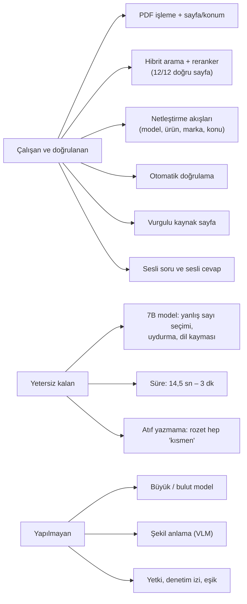
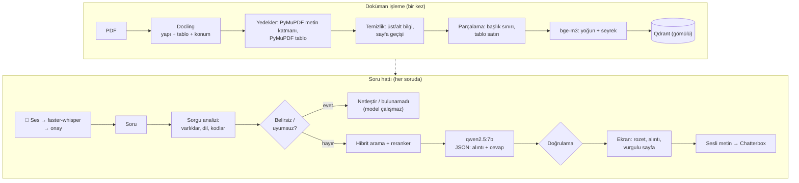

# Visual Agent: Pilot Raporu

> **Dönem:** 2026-10-10 – 2026-10-13 · **Ortam:** iki makine, tamamen lokal (Apple M4 Pro 24 GB; GPU'suz Windows dizüstü, i5-1335U, 32 GB)
> **Kapsam:** Pilotta ne kuruldu, hangi bileşenler denendi, ne ölçüldü, hangi sorunlar çıktı ve nasıl çözüldü, ne açık kaldı, gerçek sistem için ne öneriliyor.
> **İlgili belgeler:** Pilotun mimarisi ve önerilen hedef mimari: [MIMARI.md](MIMARI.md) · Uygulama aşaması: [UYGULAMA-PLANI.md](UYGULAMA-PLANI.md) · Araştırma: [ARASTIRMA-SENTEZI.md](ARASTIRMA-SENTEZI.md) · Kod ve çalıştırma: [pilot/README.md](pilot/README.md)

---

## İçindekiler

1. [Özet](#1-özet)
2. [Amaç ve kapsam](#2-amaç-ve-kapsam)
3. [Kurulan sistem](#3-kurulan-sistem)
4. [Denenen bileşenler ve sonuçları](#4-denenen-bileşenler-ve-sonuçları)
5. [Ölçümler](#5-ölçümler)
6. [Bulunan sorunlar ve çözümleri](#6-bulunan-sorunlar-ve-çözümleri)
7. [Açık kalanlar](#7-açık-kalanlar)
8. [Öğrenilenler ve öneriler](#8-öğrenilenler-ve-öneriler)
9. [Risk tablosu](#9-risk-tablosu)
10. [Sınırlar](#10-sınırlar)
11. [Ek: çalıştırma ve ham veriler](#11-ek-çalıştırma-ve-ham-veriler)

---

## 1. Özet

| | |
|---|---|
| **Soru** | Araştırmada önerilen mimari, lokal ve küçük bir makinede uçtan uca çalışıyor mu, nerede zorlanıyor? |
| **Kurulan** | 7 PDF (611 sayfa, 2.921 parça). Yazılı ya da sesli Türkçe/İngilizce soru → sorgu analizi ve netleştirme → hibrit arama + reranker → lokal LLM → otomatik doğrulama → vurgulu kaynak sayfa → sesli okuma |
| **Sonuç** | **Mimari çalışıyor, model yetersiz.** Son ölçümde arama, cevaplanabilir 12 sorunun **12'sinde** doğru sayfayı ilk 5'e getirdi. 18 sorunun **9'u** doğru. Hataların çoğu küçük modelden (qwen2.5:7b) geliyor: doğru parçadan yanlış sayı seçme, uydurma adım, Çinceye kayma, bozuk Türkçe |
| **Doğrulama** | Yanlış değerin "✔ Doğrulandı" rozetiyle geçtiği durum görülmedi. Uydurma alıntılar, yabancı alfabe, tekrar döngüsü ve düşen tolerans kodla yakalanıyor. **Kör nokta:** Model doğru parçadaki **başka bir sayıyı** seçerse (Q03, Q13) yalnızca "kısmen" rozeti çıkıyor |
| **Hız** | Mac (GPU): soru başına ~14,5 sn. GPU'suz Windows: ~3 dk (model ~2 dk). Hedef 5 sn. Model katmanı için GPU sunucu ya da bulut şart |
| **En önemli dersler** | 1) Model kalitesi asıl belirleyici, 7B yetmiyor. 2) Belirsizlik ve kaynak uyumu modele bırakılmamalı; kural ve kullanıcı seçimiyle **modelden önce** çözülmeli. 3) Atölye terimleri ve söylenmiş kodlar için terim sözlüğü ve dönüştürücü şart. 4) Doğrulama vazgeçilmez, ama ilgililiği ve sayı seçimini denetlemiyor |

---

## 2. Amaç ve kapsam

Pilot, ürün geliştirme değil, **araştırma sürecinin bir deneyidir.** Hedef akış uçtan uca kuruldu ve ölçüldü. Kapsam dışı bırakılanlar bilinçli bir tercih.

| Kapsamda | Kapsam dışı |
|----------|-------------|
| Yazılı ve **sesli** soru (Türkçe, İngilizce) | Gerçek müşteri dokümanları |
| 7 açık erişimli doküman (EN, kısmen FR/ES, ikisi taranmış) | Bulut LLM / bulut TTS (karar: önce yalnızca lokal) |
| Tamamen lokal çalışma, iki farklı makine | Yetkilendirme, kullanıcı girişi, denetim izi, silme |
| Netleştirme akışları, hibrit arama, reranker, kaynaklı cevap, doğrulama | Şekil/çizim açıklaması (VLM) |
| Vurgulu kaynak sayfa, sesli okuma | 50–100 soruluk test seti, uzman değerlendirmesi |
| 18 soruluk ölçüm, STT ölçümü, terim deneyi | "Bulunamadı" eşiğinin kalibrasyonu |

**Neden küçük tutuldu:** İlk denemede 30B model ve tüm doküman işleme GPU'da birlikte çalıştırılınca makinenin sınırı aşıldı (§6.1).

---

## 3. Kurulan sistem

Ayrıntılı anlatım (her aşamada ne kullanılıyor, neden, karar noktaları K0–K8): [MIMARI.md, Bölüm A](MIMARI.md).

| Büyüklük | Değer |
|----------|-------|
| Doküman | 7 PDF, 611 sayfa: 5 dijital, 2 taranmış. Diller: EN 2.516 parça, FR 203, ES 202 |
| Parça | 2.921 (metin 1.466, tablo satırı 1.455), ortalama 350 karakter |
| Yedek metin katmanına geçen sayfa | 143 / 611 (Strickland'da 121) |
| Kod | ~2.000 satır Python (kütüphane + arayüz + betikler), **204 birim test** (arama, LLM ve STT taklit edilerek) |

---

## 4. Denenen bileşenler ve sonuçları

✅ kullanıldı · ⚠ sınırlı · ❌ kullanılamadı

| Bileşen | Denenen | Durum | Sonuç |
|---------|---------|-------|-------|
| **LLM** | qwen2.5:7b (4,7 GB, Ollama) | ⚠ | Çalışıyor, kalite yetersiz: yanlış sayı seçimi, uydurma adım, [n] atfı yazmama, Çince/Korece karıştırma, bozuk Türkçe |
| **LLM** | qwen3:30b-a3b (18 GB) | ❌ | Mac'te GPU belleği aşıldı, ekran bozuldu (§6.1) |
| **Embedding** | bge-m3, CPU | ✅ | TR soru ↔ EN doküman eşleşmesi çalışıyor |
| **Embedding / reranker** | bge-m3 ve bge-reranker, Apple GPU (MPS) | ❌ | **Sessiz hata:** bütün benzerlikler 1,0 |
| **Reranker** | bge-reranker-v2-m3, CPU | ✅ | Doğru sıralama. Skor kalibre değil, eşik konamadı (§5.4) |
| **PDF işleme** | Docling, OCR kapalı | ✅ | 0,8–2,7 sn/sayfa, tablo satırı ve konum bilgisi |
| **PDF yedekleri** | PyMuPDF metin katmanı, PyMuPDF tablo bulucu | ✅ | Docling'in atladığı 143 sayfa ve kaydırdığı 7 arıza tablosu sayfası kurtarıldı |
| **Vektör DB** | Qdrant gömülü, RRF | ✅ | Kurulumsuz, filtre ve hibrit çalışıyor. Sınır: aynı anda tek süreç |
| **TTS** | Chatterbox Multilingual, CPU | ✅ | Türkçe kalite iyi (kullanıcı onayı). 5 sn ses için 12 sn (Mac) – 1 dk (Windows) |
| **TTS** | Chatterbox, MPS | ❌ | Bozuk çıktı |
| **STT** | faster-whisper small ve large-v3-turbo, CPU int8 | ✅ | Terim ipucuyla model kodları doğru. small 4 sn, turbo 14 sn (§5.5) |
| **Arayüz** | Streamlit | ✅ | Netleştirme düğmeleri, vurgulu sayfa, ses, mikrofon |
| **Sesli metin** | Kendi kural tablosu | ✅ | `11 (± 1)` → "on bir, artı eksi bir", `5 mm'dir` → "beş milimetredir" |

---

## 5. Ölçümler

### 5.1 18 soruluk ölçüm (son, 2026-10-13, GPU'suz Windows)

**Yöntem:** [pilot/eval/questions.json](pilot/eval/questions.json), tek çalıştırma, sıcaklık 0, qwen2.5:7b. Sorular yapay zekâ tarafından yazıldı, beklenen sayfa ve değerler PDF'ten doğrulandı. "Doğru" ölçütleri:
- **Cevaplanabilir soru:** beklenen sayfa ilk 5'te, beklenen değer cevapta ve doğrulama başarısız değil.
- **Belirsiz soru:** doğru netleştirme sorusu gelmiş ve seçenekler beklenen kaynakları içeriyor.
- **Cevapsız soru:** sistem reddetmiş.

| # | Tür | Soru | Sonuç | Ne oldu |
|---|-----|------|-------|---------|
| Q01 | değer | Ceket dış dikiş SPI | ✔ | 11 (± 1) |
| Q02 | değer | Pantolon dış dikiş SPI | ✔ | 10-14 |
| Q03 | değer | Ceket düğme iliği dikiş sayısı | ✖ | Doğru sayfa geldi, model **"16"** dedi (doğrusu 54 (± 2)) |
| Q04 | arıza | S-7300A üst iplik gergin değil | ✖ | Doğru sayfa, alıntı birebir değil |
| Q05 | tuzak | S-7300B dikiş atlıyor | ✖ | Doğru doküman, cevapta **Çince** (doğrulama yakaladı) |
| Q06 | alan dışı | Kahve makinesi temizliği | ✖ | Doğru sayfa, cevapta **Korece**, adım numaraları sayı sanıldı (düzeltildi) |
| Q07 | belirsiz | "Dış görünür dikişlerde SPI?" | ✔ | Model çalışmadan [Ceket] [Pantolon] |
| Q08 | cevapsız | Nike yaka dikişi | ✔ | Anında "Nike için doküman yok" |
| Q09 | cevapsız | Pantolon cep astarı kumaşı | ✖ | Cevap verdi (7,0–8,0 oz/sq yd). Beklenti belirsiz, **elle kontrol gerekir** |
| Q10 | cevapsız | Uçak motoru yağı | ✖ | Alakasız sonuçlar "hangi model?" sordurdu (düzeltildi, yeniden ölçülmedi) |
| Q11 | değer | Ceket overlok SPI | ✔ | 10 (± 2) |
| Q12 | tuzak | Pantolon overlok SPI | ✔ | 6-10, ceketle karışmadı, doğru sayfa ilk sırada |
| Q13 | değer | Ceket kuşgözü dikiş sayısı | ✖ | Doğru sayfa, model **"16"** dedi (doğrusu en az 4) |
| Q14 | kod | S-7300A E050 hatası | ✖ | Anlam doğru. Satır içi "1) 2) 3)" adım numaraları sayı sanıldı (düzeltildi, yeniden ölçülmedi) |
| Q15 | kod | S-7300A iğne tipi | ✖ | Doğru sayfa, model yanlış tip yazdı |
| Q16 | EN soru | Coat buttonholes SPI | ✔ | 54 (± 2), İngilizce cevap |
| Q17 | belirsiz | S-7300 maksimum hız | ✔ | Model çalışmadan [S-7300A] [S-7300B] |
| Q18 | cevapsız | Nike tişört yaka ribanası | ✔ | Anında "Nike için doküman yok" |

| Ölçüt | Sonuç |
|-------|-------|
| **Doğru sayfa ilk 5'te** (cevaplanabilir 12 soru) | **12 / 12** |
| Beklenen değer cevapta (değer beklenen 9 soru) | 6 / 9: Q03 ve Q13'te yanlış sayı, Q15'te yanlış tip |
| Doğru netleştirme | 2 / 2 |
| Doğru reddetme | 2 / 4: Q10 düzeltildi; Q09'un beklentisi belirsiz |
| **Genel** | **9 / 18** |
| "✔ Doğrulandı" rozeti alan cevap | 0. Model [n] atfını yazmıyor (R13) |
| Yanlış değerin "✔ Doğrulandı" ile geçmesi | 0. Ama yanlış sayılar (Q03, Q13) "⚠ Kısmen" ile geçti |
| Süre (model çalışan 13 soru) | Ortalama 177 sn: arama 53 sn, model 121 sn |

**İlk ölçümle karşılaştırma** (Mac, 10 soru, 2026-10-10: 5/10, 14,5 sn): Aynı 10 soruda bu kez 4/10. Q07 düzeldi (netleştirme). Q04 ve Q05 modelin bu çalıştırmadaki hatasıyla kayboldu: biri alıntı birebir değil, öbürü Çinceye kayma. Q11–Q18 sonradan eklendiği için ilk ölçümde yoktu; bu sekiz sorunun 6'sı doğru. **Yorum:** Hattın yönlendirme ve netleştirme tarafındaki iyileşmeler ölçüldü. Cevap kalitesi ise modele bağlı ve çalıştırmadan çalıştırmaya değişiyor.

### 5.2 Süreler

| | Mac M4 Pro (GPU) | Windows i5 (GPU yok) |
|--|------------------|----------------------|
| Arama + reranker | 5,5 sn | ~50 sn (ilk soruda model yükleme dahil daha uzun) |
| LLM | 9,0 sn | ~2 dk |
| **Soru başına toplam** | **14,5 sn** | **~3 dk** |
| İndeksleme (2.921 parça) | ~10 dk | ~1 saat |
| Sesli okuma (5 sn ses) | ~12 sn | ~1 dk |
| Sesli soru (3–4 sn kayıt, small) | – | 4 sn |

Netleştirme ve "bulunamadı" çıkışları model çalışmadığı için anında (0 sn) ya da yalnız arama süresinde (~30–60 sn) biter.

### 5.3 Atölye terimleri deneyi (R16)

Beş atölye teriminin kılavuzdaki karşılığı soruldu:

| Terim | Doğru | bge-m3 | qwen2.5:7b |
|-------|-------|--------|------------|
| çağanoz | rotary hook | needle ❌ | flywheel ❌ |
| masura | bobbin | presser foot ❌ | shuttle ❌ |
| baskı ayağı | presser foot | presser foot ✅ | treadle ❌ |
| transportör | feed dog | thread take-up lever ❌ | conveyor ❌ |
| dizlik | knee lifter | needle ❌ | bobbin ❌ |

Küçük LLM beş terimin beşini de **kendinden emin biçimde** yanlış çevirdi. Doğrulanmamış çeviri aramayı sessizce yanlış sayfaya götürür. Bu yüzden 29 terimlik bir **taslak sözlük** eklendi; uzman onayı bekliyor. Sözlükle "çağanoz" sorusu "Rotary hook" satırını, "masura kovanı nasıl takılır" sorusu takma bölümünü ilk sıraya getiriyor.

### 5.4 "Bulunamadı" eşiği

18 sorunun en iyi rerank skorları, model çağrılmadan ölçüldü:

| Grup | Skorlar |
|------|---------|
| Cevapsız | −5,49 · −5,81 · −6,31 · −8,06 |
| Cevaplı, en düşük | −5,40 · −6,28 · −6,87 |

Skorlar iç içe. Tek bir eşik, cevapsızları reddederken cevaplıları da reddeder. Bu yüzden eşik kapalı; kalibrasyon için 50–100 soru ve ek sinyaller gerekiyor. Yalnız arama sonrası netleştirme için kaba bir alt sınır (−7) kullanılıyor.

### 5.5 Sesli soru (STT)

5 sesli soru Chatterbox ile seslendirildi; sentetik ses olduğu için gerçek kullanıcı sesinin yerini tutmaz.

| | small | large-v3-turbo | small, terim ipucusuz |
|---|---|---|---|
| Doğru makine / ürün okundu | 4/5 | 4/5 | – |
| "S yetmiş üç yüz A/B" | S-7300A/B ✔ | ✔ | "S73'e", "Esyettin Şerif'in şerifliği ve şerifliği..." ✖ |
| Atölye terimi | 5/5 | 3/5 | "Masjora", "overlap" ✖ |
| Süre | **4,1 sn** | 13,8 sn | – |

**Bulgular:**
- **Terim ipucu şart:** İpucu olmadan model kodları bozuluyor.
- **Gerçek ses farklı:** Kullanıcının kendi sesinde Whisper kodu kelimeyle yazdı ("Es yetmiş üç yüz A'da E sıfır elli"). Bunun için söylenmiş kodları yazılı koda çeviren bir dönüştürücü eklendi.
- **Model seçimi:** CPU'da small yeterli. GPU'lu hedefte turbo gerçek seslerle karşılaştırılmalı.

---

## 6. Bulunan sorunlar ve çözümleri

Bütün sorunlar konuya göre gruplandı. **Durum:** ✅ çözüldü · 🟡 kısmen · 🔴 açık.

### 6.1 Donanım ve kurulum

**En önemli olay, GPU belleği (Mac):** 18 GB'lık 30B model; doküman işleme, embedding ve TTS ile aynı anda GPU'ya yüklendi. 24 GB birleşik belleğin GPU'ya ayrılabilen kısmı ~16–18 GB. Sonuç: `Insufficient Memory` hatası, ekranda titreme ve renk bozulması. **Ders:** Model boyutu toplam RAM'e göre değil, **GPU çalışma belleğine** ve aynı anda çalışan bileşenlere göre seçilmeli.

| Sorun | Çözüm | Durum |
|-------|-------|-------|
| 30B model 24 GB makineye sığmadı | 7B model, diğer her şey CPU'da | ✅ (kalite bedeli, B2) |
| Embedding, reranker ve TTS MPS'te sessizce yanlış sonuç veriyor | CPU'ya sabitlendi. Her ortamda duman testi | ✅ |
| Chatterbox kurulum sorunları (filigran modülü, ~13 GB fazla indirme) | `setuptools<81`, gereksiz dosyalar silindi | ✅ |
| Windows'ta dosyalar Türkçe kod sayfasıyla okunuyordu (`UnicodeDecodeError`) | Bütün okuma/yazmalar `encoding="utf-8"` | ✅ |
| Embedding kütüphanesi açılışta internete bağlanıyor | Modeller önbellekteyse `HF_HUB_OFFLINE=1` kendiliğinden. İlk kurulum çevrimiçi | ✅ |
| faster-whisper'ın ses çözücüsü (PyAV) Windows'ta hata veriyor | Ses scipy ile çözülüyor | ✅ |
| Gömülü Qdrant'ı aynı anda tek süreç açabiliyor | Kısmi yeniden indeksleme aracı. Sunucu modunda sorun yok | 🟡 pilota özgü |

### 6.2 Doküman işleme

| Sorun | Çözüm | Durum |
|-------|-------|-------|
| Docling taranmış kitabın (Strickland) %94'ünü resim sanıp atladı | Sayfa başına kapsam kontrolü, gerekirse PyMuPDF metin katmanı | ✅ |
| Uzun paragrafta (1.500+ karakter) SPI değeri aramada kayboluyordu | Cümle sınırından bölme, konum bilgisi korunur | ✅ |
| **Arıza tablolarında hücreler kaymış:** kod bir sonraki satırın "Remedy" hücresinde (S-7300A s.98–100, S-7300B s.105–108). Model bir açıklamayı yanlış koda bağlayabilirdi | Kayma tespiti (ilk hücrede kod yok, başka hücrede kod var) + PyMuPDF tablo bulucusundan yeniden okuma. Diğer dokümanlarda yanlış alarm yok, kod kaybı yok | ✅ |
| İçindekiler satırları ("Needle up/down ...... 32") arama sonuçlarının başına çıkıyor, alıntı olarak kullanıldı | Aramada eleniyor (13 parça). Noktalı gerçek tablo satırları korunuyor | ✅ |
| Tablo satırında başlık tekrarı ve çizim kodları | – | 🔴 |
| Kitapçık (Mr. Coffee) ve üç dilli (Bosch) düzende basılı sayfa numarası | – | 🔴 |
| Şekil ve çizimler aranamıyor | VLM açıklaması (Aşama 3) | 🔴 |

### 6.3 Soru yönlendirme: belirsizlik ve kaynak uyumu

Bu grup pilotun en çok öğreten kısmı oldu. Kullanıcı denemelerinde bulunan her hata, bir önceki kuralın yetmediği bir durumu gösterdi. Sonunda kararlar bir tabloya ve sırası belli karar noktalarına bağlandı ([MIMARI.md §A4](MIMARI.md)).

| Kullanıcı / ölçüm bulgusu | Neden | Çözüm |
|---------------------------|-------|-------|
| "S-7300A" sorusuna S-7300B sayfası geliyordu | Benzer kılavuzlar | Sorudaki model kodundan doküman filtresi |
| Nike sorusunda model 232 sn çalışıp JSON'u yarıda bıraktı | Dokümanı olmayan marka modele gidiyordu | Dokümansız marka: arama ve model yok, anında "doküman yok" |
| "S-7300'ün hızı?" sorusuna iki kılavuzdan karışık cevap | Model belirsizliği modele bırakılmıştı | **[S-7300A] [S-7300B] [ikisi ayrı]**, model çalışmadan |
| "Dış görünür dikişlerde SPI?" (ürün yok) | Ürün belirsizliği | Arama sonrası **[Ceket] [Pantolon]** |
| "Brother A makinesi ceket ölçüsü" + A → "5 mm" | Cevap kaynağa sadık ama soruyla ilgisiz | **Varlık rolleri tablosu:** Seçilen kaynak türüne göre varlık ya "eşleşmeli" ya "bağlam". Kılavuz ürüne özgü bilgi içermez → "bulunamadı" + [Ceket kaynağında ara] + [Ürün adı olmadan ara] |
| Aynı soru + Ceket → rastgele beden satırları | Soru neyi sorduğunu söylemiyor | **"Soru neyi soruyor" kontrolü:** Kaynakta geçen konular düğme olarak sunulur (dış görünür SPI, overlok SPI, ilik, punteriz...) + ayrıntı kutusu |
| "Brother **S-7300A** ceket ölçüsü" → "5 mm veya 7 mm" | Model adı yazılınca belirsizlik yoktu, uyum kontrolü çalışmadı | Makine ve ürün birlikte geçiyorsa model çalışmadan "Hangisinde arayalım?" |
| "Masura kovanı nasıl takılır?" → 158 sn sonra model "hangi model?" diye sordu | Aynı bölüm A ve B'de | Arama sonrası model belirsizliği de soruluyor (66 sn, model yok) |
| Ayrıntı kutusuna yazılan "a makinesi için" tanınmadı | Serbest yazı modele eşlenemiyor | Model netleştirme isterse bulunan kaynaklar düğme olarak sunuluyor |
| "Uçak motoru yağı" alakasız sonuçlarla "hangi model?" sordurdu | Netleştirme alakasız sonuçta da tetikleniyordu | İlk skor −7'nin altındaysa netleştirme sorulmuyor |
| "Çağanoz", "takılır" aramada eşleşmiyor | Atölye terimi ve fiil kılavuzda İngilizce | Taslak terim sözlüğü (29 terim), yalnız aramayı genişletiyor |
| İngilizce soru ("coat") pantolona gitti | Eşanlamlı eksikti | coat, jacket, pants eklendi |
| 🎤 "Es yetmiş üç yüz A'da E sıfır elli" → A tanınmadı | Whisper kodu kelimeyle yazdı | Söylenmiş kod dönüştürücüsü: "S-7300A'da E050". Sıradan sayı kelimelerine dokunmuyor |

**Bilinen sınır:** Kurallar varlığın sorudaki **rolünü** (makine ayarı mı soruluyor, ürün gereksinimi mi) bilmiyor; bu yüzden son karar kullanıcıya düğmeyle bırakılıyor. Gerçek sistemde soru niyeti sınıflandırması gerekiyor ([MIMARI.md §B](MIMARI.md)).

### 6.4 Model çıktısı ve doğrulama

| Sorun | Çözüm | Durum |
|-------|-------|-------|
| JSON şemasıyla model önce boş alıntı yazıp "bulunamadı" diyordu | Alan sırası: `bulunamadi` en sonda | ✅ |
| Cevapsız soruda JSON token sınırında yarıda kalıyordu | Şema uzunluk sınırları (3 alıntı, alıntı ≤300, cevap ≤600 karakter). Yarıda kalırsa anlaşılır uyarı | ✅ |
| Model kodundaki rakamlar ("S-7300B"nin 7300'ü) uydurma sayı sayılıyordu | Harf önekli kodlar sayı sayılmıyor | ✅ |
| Alıntı sonuna eklenen [1] ve 300. karakterde kalan yarım "[" alıntıyı "birebir değil" yapıyordu | Atıf işaretleri ve yarım atıf ayıklanıyor | ✅ |
| Aynı satır iki bölümde (başlangıç / bitiş geri dikiş hızı) | Modele bölüm başlığı veriliyor | ✅ |
| **Sesli metinde tolerans düşüyordu** (R15): ekranda "11 (± 1)", seste "on bir" | Cevap ve ses ayrı denetleniyor. Seste düşerse ses doğrulanmış cevaptan kodla üretiliyor | ✅ |
| Boş cevap "kısmen" geçiyordu | "Doğrulanamadı" | ✅ |
| Model aynı cümleyi döngüyle tekrarladı | Tekrar döngüsü kontrolü | ✅ |
| Cevapta Çince ve Korece metin | Talimat: "yalnız Latin alfabesi". Doğrulamada yabancı alfabe kontrolü. Kılavuzlardaki "・" işareti hariç | ✅ yakalanıyor |
| Adım numaraları ("4.", "1)") değer sayılıyordu | Liste numaraları ayıklanıyor | ✅ |
| İngilizce soruya Türkçe cevap | Sorunun dili koddan belirleniyor ve modele açıkça veriliyor. Ses de o dilde | ✅ |
| Model [n] atfı yazmıyor, rozet hiç "doğrulandı" olmuyor (R13) | – | 🔴 B2 |
| **Model doğru parçadan yanlış sayıyı seçiyor** (Q03, Q13: "16") | – | 🔴 B2. Doğrulama bunu yakalayamıyor |
| Sayı dışı uydurma ("yeşil ceket", "şapka parçası") | – | 🔴 C3 |
| Prosedür cevaplarında bozuk Türkçe ("dili", "wraps ettirdiğiniz") | – | 🔴 B2 |

### 6.5 Arayüz ve ses

| Sorun | Çözüm |
|-------|-------|
| Yeni soruda eski cevap ve sayfa ekranda kalıyordu | Her yeni çalıştırmada temizleniyor |
| Aramanın getirdiği 5 kaynağın hepsi açılır kutuda gösteriliyordu (yetki ilkesine aykırı) | Yalnız cevabın dayandığı kaynaklar gösteriliyor |
| "Aranıyor" mesajı dakikalarca değişmiyordu | Adım adım durum ve süreler |
| Doğrulanamayan cevapta sayfa "Cevabın kaynağı" diye gösteriliyordu | "Modelin gösterdiği kaynak (cevap doğrulanamadı)" |
| Üretilen sesler kayboluyordu | `data/audio/` altında kalıcı, kenar çubuğunda liste |
| "5 mm'dir" kısaltma olarak okunuyordu | Birimler kelimeye çevriliyor |

---

## 7. Açık kalanlar

| Grup | # | Konu | Nerede çözülür |
|------|---|------|----------------|
| **Karar veya donanım bekliyor** | B1 | Yanıt süresi (GPU'suz ~3 dk, Mac 14,5 sn, hedef 5 sn) | Aşama 0: GPU sunucu veya bulut |
| | B2 | Model kalitesi: yanlış sayı seçimi, atıf yazmama (R13), uydurma adım, dil kayması, bozuk Türkçe | Aşama 1: büyük/bulut model, doğrulama modları |
| | B3 | "Bulunamadı" eşiği | Aşama 1: 50–100 soru |
| **İncelenmeli** | C3 | Sayı dışı uydurma ve **yanlış sayı seçimi** doğrulamaya takılmıyor | Aşama 1: cevap-alıntı hizalama kontrolü |
| | C5 | Bölüm başlığının S-7300A hız sorusundaki etkisi, seçimden sonra yeniden denenmedi | Sonraki ölçüm |
| | – | Q10 ve Q14 düzeltmeleri yapıldı ama ölçüm yeniden çalıştırılmadı | Sonraki ölçüm |
| | – | Tablo satırı başlık tekrarı, kitapçık/üç dilli sayfa numarası | Aşama 3 |
| **Kapsam dışı (planda)** | | Şekil anlama (VLM), yetki ve denetim izi, soru niyeti sınıflandırması, gerçek seslerle STT ölçümü, kod okunuşu kuralları (açık soru Q10-a) | Aşama 1–5 |

**Bilerek bırakılanlar:** Seste "Ceketin → Tekitin" (C4), büyük ihtimalle TTS'nin ilk sesi kırpması. Kullanıcı kararıyla sorun sayılmadı.

**Çözülenler (önceden açıktı):** C1 (Q12'de doğru sayfa artık ilk sırada), C2 (arıza tablosu kayması, §6.2), R14 (belirsiz soru), R15 (seste tolerans), R16 (taslak sözlük).

---

## 8. Öğrenilenler ve öneriler

Önerilerin mimariye yansıması [MIMARI.md, Bölüm B](MIMARI.md)'de, zamanlaması [UYGULAMA-PLANI.md](UYGULAMA-PLANI.md)'de.

| # | Öğrenilen | Öneri |
|---|-----------|-------|
| 1 | Arama sağlam (12/12), hataların çoğu modelden | Önce **model katmanını** güçlendirmek: bulut referans + büyük lokal model aynı test setiyle (Aşama 1, kritik yol) |
| 2 | 7B model belirsizlikte "sor" demek yerine uyduruyor | Belirsizlik, kaynak uyumu, dokümansız marka **modelden önce kodla** çözülsün. Bu yapı model değişse de kalmalı |
| 3 | Kural tabanlı kararlar varlığın rolünü bilmiyor | **Soru niyeti** (makine ayarı / ürün gereksinimi / arıza / hata kodu) ayrı bir adım olsun. Kural ya da model, test setiyle ölçülerek |
| 4 | Doğrulama sadakati denetliyor, ilgililiği ve sayı seçimini denetlemiyor | **Cevap-alıntı hizalaması:** Cevaptaki her değer, alıntıda sorulan kavramın yanında mı? Ek olarak doğrulama modları (atıfsız ama alıntı ve sayı doğruysa ayrı rozet) |
| 5 | Atölye dili kılavuz diline eşlenmiyor, küçük model kendinden emin yanlış çeviriyor | **Uzman onaylı terim sözlüğü** ürünün parçası olsun. LLM yalnız aday önersin |
| 6 | Gerçek ses sentetik sesten farklı çıktı | STT kabul ölçümü **ustaların sesiyle ve atölye gürültüsünde** yapılsın. Ölçüt: genel kelime hatası değil, **varlık doğruluğu** |
| 7 | Docling her tabloda güvenilir değil, yedekler değerli | Doküman işlemede **kalite kontrolleri** (kapsam, tablo kayması) ve yedek ayrıştırıcı standart olsun; her yeni doküman setinde raporlansın |
| 8 | Sessiz hatalar (MPS) ve kodlama farkları (Windows) ortam değişince çıkıyor | Her ortamda **duman testi** ve platformdan bağımsız kod (UTF-8, ses çözme) |
| 9 | Kullanıcı denemeleri, otomatik ölçümün göstermediği hataları buldu | Test setine **kullanıcı denemelerinden gelen sorular** eklensin; her düzeltme birim testle korunsun (pilotta 204 test) |

---

## 9. Risk tablosu

| # | Risk | Pilottaki kanıt | Durum |
|---|------|-----------------|-------|
| **R4** | Yanlış veya uydurulmuş değer | Q03 ve Q13'te doğru parçadan yanlış sayı ("kısmen" geçti). Uydurma alıntılar yakalandı | 🔴 Model ve hizalama kontrolü gerekli |
| R1 | Tablo ve çizim ağırlıklı sayfalar | Tablo satırları ve tablo yedeği çalışıyor. Çizimler aranamıyor | 🟡 |
| R2 | Sesli okumada sayı/birim hatası | Kural tablosu çalışıyor. Kod okunuşu belirsiz (Q10-a) | 🟡 |
| R7 | OCR satır kaybı | Metin katmanı yedeği kısmen çözdü | 🟡 |
| R8 | Yetki sızıntısı | Pilotta yetki yok | 🔴 Gerçek sistemde ilk sırada |
| R9 | STT'de model kodu yanlış tanıma | İpucuyla doğru. Gerçek seste kodlar kelimeyle yazıldı → dönüştürücü eklendi. Onay ekranı var | 🟡 Gerçek seslerle ölçülmeli |
| R10 | Test setinin temsiliyeti | 18 soru, açık erişimli veri | 🟡 |
| R11 | Donanım sınırı | 30B sığmadı, GPU'suz makinede ~3 dk | 🔴 Q5 ve bütçe |
| R12 | Sessiz hata (MPS) | Benzerlikler 1,0 | ✅ CPU'ya sabitlendi, duman testi |
| R13 | Rozet hep "kısmen" | 0 tam doğrulama | 🔴 Model / doğrulama modu |
| R14 | Belirsiz soruda yanlış doküman | Q07, Q17 ve kullanıcı denemeleri | ✅ Netleştirme akışları. Açık: soru niyeti |
| R15 | Seste tolerans düşmesi | Q01 | ✅ |
| R16 | Atölye terimi eşleşmemesi | 5 terimden bge-m3 1'ini, qwen 0'ını bildi | 🟡 Taslak sözlük, uzman onayı bekliyor |
| **Yeni R17** | **Model dil kayması:** cevaba Çince/Korece karışıyor | Q05, Q06, kullanıcı denemesi | 🟡 Yakalanıyor, önlenemiyor. Model seçiminde ölçüt olmalı |

---

## 10. Sınırlar

- **Örneklem küçük:** 18 soru, tek çalıştırma. Oranlar yön gösterir; sonuçlar model çalıştırmadan çalıştırmaya değişebiliyor (Q04, Q05).
- **Yargıç otomatik:** "Doğru" ölçütü alt dizge eşleşmesi ve doğrulama durumundan türetiliyor. Uzman puanı yok. Q09'un beklenen sonucu elle kontrol edilmeli.
- **Sorular yapay zekâ tarafından yazıldı.** Gerçek kullanıcı soruları farklı olacak; kullanıcı denemeleri bunu gösterdi.
- **İki makine, tek model.** Süreler donanıma bağlı.
- **STT ölçümü sentetik sesle** yapıldı. Kullanıcı sesiyle yalnız birkaç deneme var.
- **Dokümanlar telifli olabilir:** [test-dokumanlari/](test-dokumanlari/) "yeniden dağıtılmayacak" notuyla toplandı ([envanter](calisma-notlari/notlar/manual-envanteri.md)). Repo herkese açık yapılacaksa bu karar yeniden verilmeli.

---

## 11. Ek: çalıştırma ve ham veriler

Kurulum ve çalıştırma (macOS ve Windows): [pilot/README.md](pilot/README.md).

| Ham veri | Dosya |
|----------|-------|
| Son ölçüm (18 soru) | [pilot/eval/sonuc.md](pilot/eval/sonuc.md) · [sonuc.json](pilot/eval/sonuc.json) |
| İlk ölçüm (Mac, 10 soru) | [pilot/eval/sonuc_onceki.md](pilot/eval/sonuc_onceki.md) |
| Rerank skorları (eşik ölçümü) | [pilot/eval/rerank_skorlari.json](pilot/eval/rerank_skorlari.json) |
| STT ölçümü | [pilot/eval/stt_sonuc_small.json](pilot/eval/stt_sonuc_small.json) · [stt_sonuc_large-v3-turbo.json](pilot/eval/stt_sonuc_large-v3-turbo.json) |
| Mac kurulum logu (boyut, süre, sorunlar) | [pilot/KURULUM-LOGU.md](pilot/KURULUM-LOGU.md) |
