# Visual Agent: Pilot Raporu

> **Tarih:** 2026-10-10 · **Aşama:** Araştırma sonrası küçük pilot · **Çalışma ortamı:** Apple M4 Pro, 24 GB bellek, tamamen lokal
> **Kapsam:** Pilotta ne kuruldu, neyi denedik, neyi deneyemedik, ne bozuldu, kod yapısı bugün nasıl, pilot sonrası nasıl olmalı, gerçek sistemde nasıl olmalı.
> **Okuma notu:** Diyagramlar [Mermaid](https://mermaid.js.org/) ile yazıldı, GitHub'da doğrudan görünür. Ham veriler: [KURULUM-LOGU.md](KURULUM-LOGU.md), [eval/sonuc.md](eval/sonuc.md).

---

## İçindekiler

1. [Tek bakışta](#1-tek-bakışta)
2. [Pilotun amacı ve sınırı](#2-pilotun-amacı-ve-sınırı)
3. [Kurulan sistem](#3-kurulan-sistem)
4. [Denediğimiz bileşenler ve modeller](#4-denediğimiz-bileşenler-ve-modeller)
5. [Deneyemediklerimiz](#5-deneyemediklerimiz)
6. [Ölçüm sonuçları](#6-ölçüm-sonuçları)
7. [Yaşanan problemler](#7-yaşanan-problemler)
8. [Koddaki yapı: bugün](#8-koddaki-yapı-bugün)
9. [Önerilen yapı değişiklikleri (pilot sonrası)](#9-önerilen-yapı-değişiklikleri-pilot-sonrası)
10. [Gerçek sistemde önerilen yapı](#10-gerçek-sistemde-önerilen-yapı)
11. [Alınan kararlar ve etkileri](#11-alınan-kararlar-ve-etkileri)
12. [Güncel risk tablosu](#12-güncel-risk-tablosu)
13. [Sonraki adımlar](#13-sonraki-adımlar)
14. [Sınırlar ve dürüst notlar](#14-sınırlar-ve-dürüst-notlar)
15. [Ek: çalıştırma ve dosya haritası](#15-ek-çalıştırma-ve-dosya-haritası)

---

## 1. Tek bakışta

| | |
|---|---|
| **Soru** | Araştırmada önerilen mimari, lokal ve küçük bir makinede uçtan uca çalışıyor mu, nerede zorlanıyor? |
| **Yapılan** | 7 PDF (611 sayfa) işlendi, 2921 parça indekslendi. Türkçe yazılı soru → hibrit arama → reranker → lokal LLM → otomatik doğrulama → vurgulu kaynak sayfa → isteğe bağlı sesli okuma |
| **Sonuç** | **10 soruda 5 doğru.** Arama ve kaynak gösterme iyi, **cevap üretimi 7B modelde yetersiz.** Otomatik doğrulama uydurma alıntıları ve sayıları yakaladı |
| **Hız** | Ortalama **14,5 sn** (ilk soru, soğuk başlangıç hariç 13,3 sn; hedef 5 sn). Arama 5,5 sn + model 9,0 sn |
| **En önemli bulgu** | 24 GB'lık makine, 30B modeli embedding ve reranker ile birlikte taşıyamıyor. Daha büyük model **donanım kararı** gerektiriyor |
| **Mimari** | Çekirdek akış çalışıyor, değişmesi gerekmiyor. Değişmesi gereken: model katmanı (GPU sunucu veya bulut), doğrulama sıkılığı, ölçüm altyapısı |

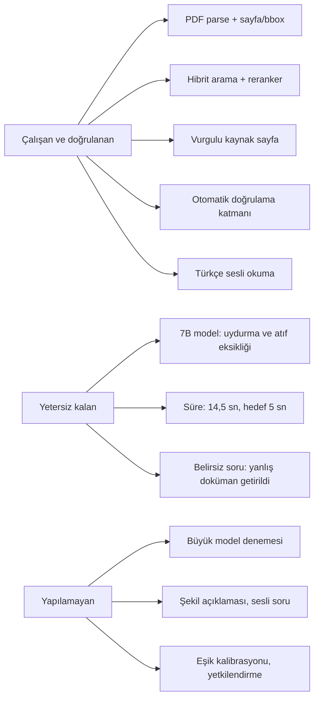

---

## 2. Pilotun amacı ve sınırı

**Kapsam kararı:** Pilot, ürün geliştirme değil, **araştırma sürecinin bir deneyidir.** Hedef akış (tasks.md) uçtan uca çalışıp ölçüldü. Kapsam dışı olanlar bilinçli bırakıldı.

| Kapsamda | Kapsam dışı (bilinçli) |
|----------|------------------------|
| Yazılı Türkçe soru | Sesli soru (STT) |
| 7 public doküman (EN, kısmen FR/ES, biri taranmış) | Gerçek müşteri dokümanları |
| Tamamen lokal çalışma | Bulut LLM / bulut TTS (karar: önce yalnızca lokal) |
| Hibrit arama, reranker, kaynaklı cevap, doğrulama | Yetkilendirme, kullanıcı girişi, admin paneli |
| Vurgulu kaynak sayfa, isteğe bağlı sesli okuma | Şekil/çizim açıklaması (VLM) |
| 10 soruluk ölçüm | Kapsamlı test seti (50–100 soru), uzman değerlendirmesi |

**Neden küçülttük:** İlk denemede 30B model ve tüm dokümanları GPU'da çalıştırınca makine sınırı aşıldı (bkz. §7.1). Pilot, "hafif ve başka bilgisayarda çalıştırılabilir" olacak şekilde yeniden kuruldu.

---

## 3. Kurulan sistem

### 3.1 Uçtan uca akış

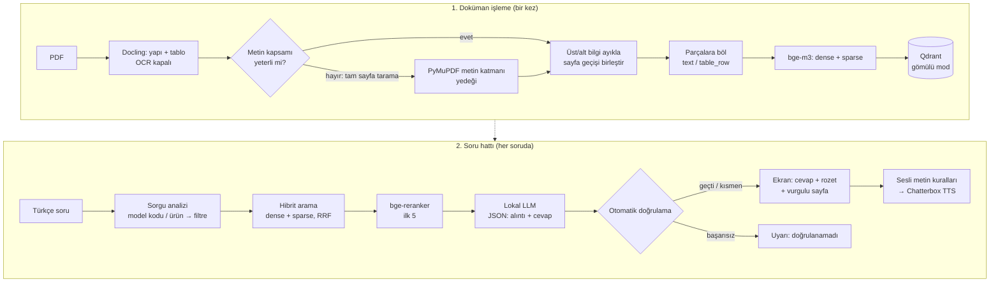

### 3.2 Doğrulama katmanı (kod tarafı, LLM değil)

Bu katman pilotun en değerli çıktısıdır: model hata yapsa da yanlış değer **"doğrulandı"** diye ekrana gitmiyor.

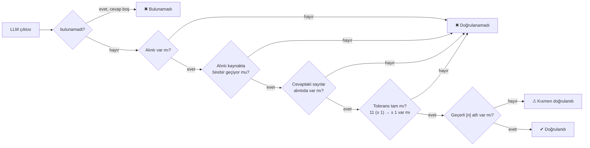

### 3.3 Sayısal özet

| Büyüklük | Değer |
|----------|-------|
| Doküman | 7 PDF, 611 sayfa (dijital 5, taranmış 2) |
| Parça (chunk) | 2921 (1466 metin, 1455 tablo satırı), ortalama 350 karakter |
| Dil | EN 2516, FR 203, ES 202 (Bosch üç dilli) |
| Yedek metin katmanına geçen sayfa | 143 / 611 (Strickland'da 121) |
| Vektör | 1024 boyutlu dense + sparse, Qdrant gömülü (36 MB) |

---

## 4. Denediğimiz bileşenler ve modeller

Durum: ✅ kullanıldı · ⚠ denendi, sınırlı · ❌ denendi, kullanılamadı

| Bileşen | Denenen | Durum | Sonuç |
|---------|---------|-------|-------|
| **LLM** | `qwen2.5:7b` (4,7 GB, Ollama) | ✅ | Makine rahat (%100 GPU, swap yok). Kalite: 10 soruda 5 doğru. Uyduruyor, atıf koymuyor |
| **LLM** | `qwen3:30b-a3b` Q4 (18 GB, MoE) | ❌ | Kısa test 25,5 token/sn. Uzun prompt ile Metal bellek hatası (`Insufficient Memory`), ekran bozulması. Bu makinede kullanılamaz |
| **Embedding** | bge-m3, CPU | ✅ | Doğru. TR soru ↔ EN doküman eşleşmesi çalışıyor (ilgili metin 0,65, ilgisiz 0,36–0,42) |
| **Embedding** | bge-m3, Apple GPU (MPS) | ❌ | **Yanlış sonuç:** tüm benzerlikler 1,0. Sessiz hata |
| **Reranker** | bge-reranker-v2-m3, CPU | ✅ | Doğru. 3 çift 1,85 sn, soru başına 20 aday ≈ 3–7 sn |
| **Reranker** | MPS | ❌ | Aynı hata: skorlar eşit |
| **PDF işleme** | Docling, OCR kapalı | ✅ | 0,8–2,7 sn/sayfa. Tablo satırı ve bbox çıkıyor |
| **PDF işleme** | Docling, OCR açık (Faz 1) | ⚠ | 4–6 sayfa için 98–152 sn. Pilotta kapalı, çünkü tüm PDF'lerde metin katmanı var |
| **PDF işleme** | PyMuPDF metin blokları (yedek) | ✅ | Docling'in atladığı 143 sayfayı kurtardı |
| **Vektör DB** | Qdrant gömülü, RRF füzyonu | ✅ | Tek dosyalık kurulum, filtre ve hibrit çalışıyor |
| **TTS** | Chatterbox Multilingual, CPU | ✅ | Kullanıcı: "doğru seslendirilmiş, kalite gayet iyi". 4,6 sn ses için 11,6 sn üretim |
| **TTS** | Chatterbox, MPS | ❌ | Bozuk çıktı: 5 sn'lik cümle için 13–40 sn ses, token hatası |
| **Arayüz** | Streamlit + özel sayfa çizici | ✅ | Hatasız çalıştı. Vurgu doğru yere düşüyor (gözle doğrulandı) |
| **Sayı okuma** | Kendi kural tablosu | ✅ | `11 (± 1)` → "on bir, artı eksi bir", `10-14` → "on ile on dört arası", `5/8` → "sekizde beş" |

### Dikkat çeken ek gözlemler

- **Hibrit vs dense:** 5 Türkçe soruda ilk 3 sonuç aynı çıktı. Sparse kol, Türkçe soru ile İngilizce doküman arasında kelime örtüşmediği için katkı vermiyor. Bu **ölçüm değil gözlemdir**, A/B deneyi yapılmadı.
- **Şema zorlaması:** Ollama'da çıktıyı JSON şemasıyla kısıtlayınca model önce boş alıntı listesi yazıp "bulunamadı: true" diyordu. Şemasız çıktıda aynı soruya doğru cevap verdi. Alan sırası değiştirilerek giderildi.
- **Reranker skoru kalibre değil:** Doğru cevabı içeren parçanın skoru −5,4 olabiliyor (bozuk OCR'lı taranmış pantolon). Sabit "0'ın altı ise reddet" eşiği doğru cevabı reddederdi. Bu yüzden eşik kapalı bırakıldı.

---

## 5. Deneyemediklerimiz

| Konu | Neden yapılmadı | Önemi |
|------|-----------------|-------|
| **Daha büyük LLM** (14B, 32B, bulut) | 30B bu makineye sığmadı. 14B indirme sırasında iptal edildi. Bulut kullanılmadı (karar: önce yalnızca lokal) | 🔴 Cevap kalitesinin asıl belirleyicisi |
| **Bulut LLM referansı** (aynı 10 soru) | Karar gereği yapılmadı. API anahtarı yok | 🔴 "Lokal ne kadar geride" sorusunu cevaplar |
| **Şekil / çizim açıklaması (VLM)** | Pilot kapsamı dışı. `qwen2.5vl:7b` makinede var ama bağlanmadı. Parçalama şekilleri atlıyor | 🟡 Strickland, Brother, Bosch çizimleri aranamıyor |
| **Sesli soru (STT)** | Pilot kapsamı dışı | 🟡 Kullanıcı istedi |
| **Eşik kalibrasyonu** | 10 soru, ayarlamak için çok az | 🟡 "Emin değilse cevap verme" ilkesinin ayarı |
| **TR→EN sorgu çevirisi** (sparse kol için) | Zaman | 🟡 Hibrit aramanın faydasını açabilir |
| **Parser karşılaştırması** (Marker, MinerU, PyMuPDF4LLM) | Zaman. Docling + PyMuPDF yedeği yeterli göründü | ⚪ |
| **İki OCR'ın birleştirilmesi** | Taranmış dokümanda PDF'in kendi metin katmanı kullanıldı, OCR denenmedi. "ans a s s ams" gibi bozuk satırlar durabilir | 🟡 R7 |
| **Birden fazla TTS adayı** (Azure, Google, ElevenLabs) | Lokal-only karar | ⚪ |
| **Atölye gürültüsünde dinleme, round-trip STT kontrolü** | Ortam ve STT yok | ⚪ |
| **Yetkilendirme, kullanıcı girişi, silme, log, aydınlatma** | Kapsam dışı. Kararlar alındı (§11), uygulanmadı | 🔴 Gerçek sistem için zorunlu |
| **Versiyon çelişkisi, Türkçe doküman, 50–100 soruluk test seti** | Veri yok / zaman | 🟡 |
| **Parse'ın CPU süresi** | Parse GPU ile ölçüldü, sonra CPU'ya sabitlendi, yeniden ölçülmedi | ⚪ |

---

## 6. Ölçüm sonuçları

**Yöntem:** `eval/questions.json` içinde 10 soru, tek çalıştırma, sıcaklık 0, model `qwen2.5:7b`. Sorular yapay zekâ tarafından yazıldı, beklenen sayfalar PDF'ten doğrulandı. "Doğru" = beklenen kaynak ilk 5'te + cevap reddedilmemiş + beklenen değerler cevapta + doğrulama başarısız değil.

### 6.1 Soru bazında

| # | Tür | Soru | Doğru | Doğrulama | Ne oldu |
|---|-----|------|-------|-----------|---------|
| Q01 | değer | Ceket dış dikiş SPI | ✔ | ⚠ kısmen | 11 (± 1) doğru. "Yesil" gibi uydurma sözcük. Atıf yok |
| Q02 | değer | Pantolon dış dikiş SPI | ✔ | ⚠ kısmen | 10-14 doğru. Atıf yok |
| Q03 | değer | Ceket düğme ilik dikiş sayısı | ✖ | ⚠ kısmen | Kaynak (s.22) bulundu, beklenen "54 (± 2)" cevapta yok |
| Q04 | arıza | S-7300A üst iplik gergin değil | ✔ | ⚠ kısmen | Doğru tablo satırı (s.101). Atıf yok |
| Q05 | tuzak | S-7300B dikiş atlıyor | ✔ | ⚠ kısmen | Doğru doküman (S-7300B) ve satır bulundu, S-7300A karışmadı. Atıf yok. *İlk ölçümde model kodundaki "7300" yanlışlıkla uydurma sayı sayılıp ✖ olmuştu: doğrulama kusuru, birim testle bulunup düzeltildi* |
| Q06 | alan dışı | Kahve makinesi temizliği | ✖ | ✖ başarısız | Kaynaklar doğru (Mr. Coffee s.16–17). Model JSON'u yarıda bıraktı |
| Q07 | belirsiz | "Dış dikişlerde SPI?" (ürün yok) | ✖ | ✖ başarısız | **Arama başarısız:** ilk sonuçlar Brother makine kılavuzundan. GL-PD şartnameleri gelmedi. Model uydurma alıntı verdi |
| Q08 | cevapsız | Nike yaka dikişi mm | ✔ | ✖ bulunamadı | Doğru reddetti |
| Q09 | cevapsız | Cep astarı kumaşı ve gramajı | ✖ | ⚠ kısmen | Reddetmedi. Kaynakta ilgili bir bölüm olabilir, **elle kontrol gerekiyor** |
| Q10 | cevapsız | Uçak motoru yağı | ✖ | ✖ başarısız | Reddetmedi, uydurma alıntı verdi, doğrulama yakaladı |

### 6.2 Başarı oranları

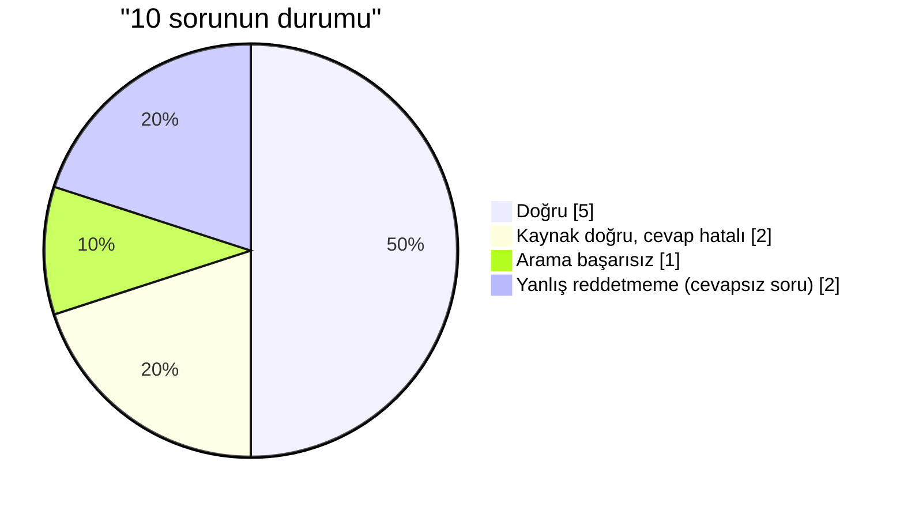

| Ölçüt | Sonuç |
|-------|-------|
| Beklenen kaynak ilk 5'te (cevaplanabilir 7 soru) | **6 / 7** (yalnızca belirsiz Q07 başarısız) |
| Beklenen değer cevapta | 2 / 3 |
| Doğru reddetme (cevapsız) | 1 / 3 |
| Hiç "✔ Doğrulandı" alan cevap | **0 / 10** (model [n] atfını hiç yazmadı) |
| Yanlış değerin "doğrulandı" diye geçmesi | **0** (doğrulama yakaladı) |

### 6.3 Süre dağılımı

| Aşama | Ortalama | Aralık |
|-------|----------|--------|
| Arama + reranker (CPU) | 5,5 sn (ilk soru hariç 4,4) | 2,6–15,5 |
| LLM (≈1900 token girdi, ≈260 token çıktı) | 9,0 sn (ilk soru hariç 8,9) | 4,2–17,8 |
| **Toplam** | **14,5 sn** (ilk soru hariç 13,3) | 7,7–25,4 |
| Sesli okuma (ayrı, isteğe bağlı) | ≈ 8 sn yükleme + 12 sn üretim | CPU |

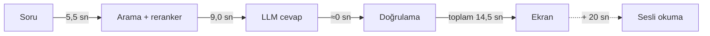

**Yorum:** 5 sn hedefine ulaşmak için hem arama (GPU'da reranker veya daha az aday) hem model (daha hızlı donanım) tarafında iyileşme gerekir. Sesli okuma ekran cevabından sonra başladığı için bu bütçenin dışında düşünülebilir, ama 20 sn bekleme atölyede kabul edilebilir değildir (GPU veya bulut TTS gerekli).

### 6.4 Çıkarımlar

1. **Arama çalışıyor.** Ürün veya model belirtilen 6 sorunun hepsinde doğru doküman ve sayfa ilk 5'te (6/7). Belirsiz soruda (Q07) sorgu analizi filtre üretemedi ve alakasız doküman öne çıktı.
2. **Cevap üretimi 7B'de yetersiz.** Beklenen bir sonuç (notlarda 7–8B için %49–75 doğruluk). Bu modelle yanlış değer riski yüksek.
3. **Doğrulama katmanı değerli.** Q07 ve Q10'daki uydurma alıntılar ekrana "doğrulandı" diye ulaşmadı, Q06'daki yarım kalan JSON çökme yerine uyarıya döndü. Aynı katmanın kendi kusuru (Q05'te model kodunu uydurma sayı sayması) birim testle bulundu ve düzeltildi.
4. **Doğrulama fazla katı da olabilir.** 0/10 cevabın tam "doğrulandı" alması, modelin [n] atfını yazmamasından. Bu bir model uyum sorunu, ancak gerçek sistemde kullanıcıya her cevabın "kısmen" görünmesi kabul edilebilir değil.

---

## 7. Yaşanan problemler

### 7.1 GPU belleği (en önemli olay)

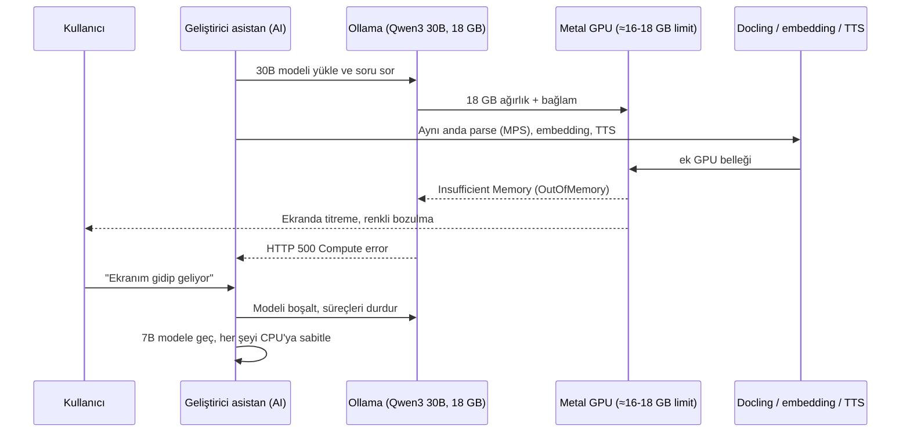

| | |
|---|---|
| **Neden** | 24 GB birleşik belleğin yaklaşık 16–18 GB'ı GPU'ya ayrılabiliyor. 18 GB'lık model buna sığmadı, kısmen CPU'ya taştı, swap'e düştü (1,8 GB) |
| **Belirti** | Arama süresi 3 sn → 20 sn, `Compute error`, kullanıcı ekranında bozulma |
| **Kök neden** | Model boyutu toplam RAM'e göre seçildi, GPU çalışma belleği limiti ve diğer bileşenlerin (parse, embedding, TTS) aynı anda yük bindirmesi hesaba katılmadı |
| **Çözüm** | 4,7 GB'lık 7B model, embedding/reranker/Docling/TTS CPU'da |
| **Ders** | Model boyutunu seçerken **GPU çalışma belleği limiti** hesaba katılmalı (toplam RAM değil). Lokal makinede pilot iş yükü ayrı ayrı denenmeli |

### 7.2 Tüm problemler

| # | Problem | Etki | Çözüm | Durum |
|---|---------|------|-------|-------|
| 1 | Qwen3-30B 24 GB'a sığmadı (§7.1) | Ekran bozulması, hata | 7B model | ✅ |
| 2 | bge-m3 ve reranker MPS'te yanlış sonuç veriyor | **Sessiz hata**, sıralama anlamsız | CPU'ya sabitlendi | ✅ |
| 3 | Chatterbox MPS'te bozuk ses | Kullanılamaz | CPU'ya sabitlendi | ✅ |
| 4 | Chatterbox filigran modülü yüklenmedi | TTS başlamıyor | `setuptools<81` | ✅ |
| 5 | Chatterbox deposundan ~13 GB fazla indirme | Disk | Gerekmeyen dosyalar silindi | ✅ |
| 6 | bge-m3 ağırlıkları ilk indirmede eksik | Model yüklenmiyor | `.bin` ve sparse dosyaları ayrıca indirildi | ✅ |
| 7 | Docling Strickland'ın %94'ünü atladı | Metin kaybı, doküman aranamaz | Sayfa başına kapsam kontrolü + PDF metin katmanı yedeği | ✅ |
| 8 | Uzun paragrafta (1500+ karakter) SPI değeri sulandı | Zayıf arama | Cümle sınırından bölme, kutu aynı | ✅ |
| 9 | JSON şeması ile model "bulunamadı" diyor | Yanlış ret | Alan sırası: `bulunamadi` en sonda | ✅ |
| 10 | Model JSON'u yarıda bırakıyor | Hat çökerdi | Yakalanıp "doğrulanamadı" gösteriliyor | ✅ |
| 11 | Soruda "S-7300A" yazsa da S-7300B ilk sıraya çıkabiliyor | Yanlış makine kılavuzu | Sorgu analizi: model kodundan doküman filtresi | ✅ |
| 12 | Reranker skoru doğru cevapta −5,4 olabiliyor | Sabit eşik yanlış ret verir | Eşik kapalı | 🟡 açık |
| 13 | Belirsiz soruda (ürün yok) arama alakasız doküman getiriyor (Q07) | Uydurma cevap riski | — | 🔴 açık |
| 14 | Model [n] atfı yazmıyor, hiçbir cevap tam doğrulanmıyor | Doğrulama sürekli "kısmen" | Prompt/model | 🔴 açık |
| 15 | OCR satır kaybı (Faz 1'den) | Bilgi aranamaz | PDF metin katmanı yedeği (sınırlı) | 🟡 kısmen |
| 16 | Tablo satırı metninde başlık tekrarı ve çizim kodu | Arama kirlenir | — | 🟡 açık |
| 17 | Mr. Coffee (kitapçık düzeni) ve Bosch (üç dil) sayfa etiketi | Basılı sayfa numarası yanlış olabilir | — | 🟡 açık |
| 18 | **Doğrulama kusuru:** cevapta "S-7300B" gibi model kodu geçince içindeki `7300` "kaynakta olmayan değer" sayılıyordu | Doğru cevap yanlış yere "doğrulanamadı" (Q05) | `CODE_RE`: harf önekli kodların rakamları değer sayılmaz. Birim testle bulundu | ✅ |
| 19 | Parçalama dil sınırını aşabiliyordu (Bosch EN→FR) | Parça yanlış dil etiketi alırdı | Dil değişince parça kapanır. Gerçek veride etkilemedi (önleyici) | ✅ |

---

## 8. Koddaki yapı: bugün

### 8.1 Faz 1 denemesinden pilota

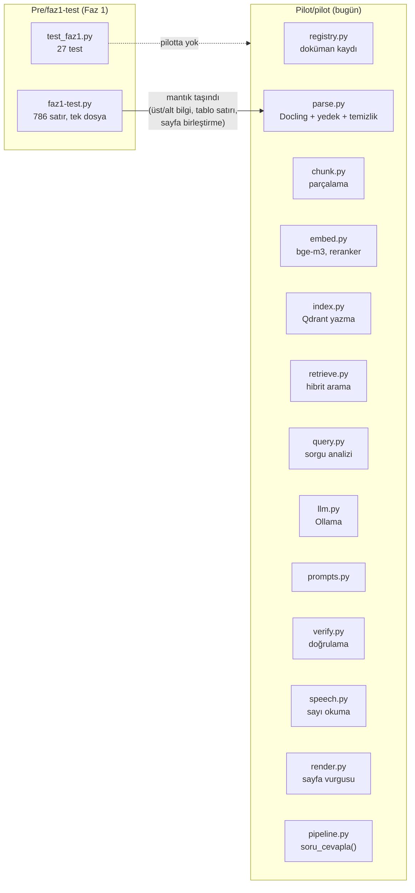

| Dosya | Satır | Görev |
|-------|-------|-------|
| `pilot/parse.py` | 309 | Docling, tablo satırı, üst/alt bilgi, sayfa birleştirme, metin katmanı yedeği, önbellek |
| `pilot/chunk.py` | 133 | Başlık sınırlı parçalama, uzun paragraf bölme, bbox listesi |
| `pilot/verify.py` | 97 | Alıntı, atıf, sayı ve tolerans doğrulaması |
| `pilot/pipeline.py` | 87 | `soru_cevapla()` uçtan uca |
| `pilot/prompts.py` | 70 | Sistem talimatı + JSON şeması |
| `pilot/retrieve.py` | 65 | Hibrit arama, filtre, rerank |
| `pilot/speech.py` | 58 | Sayı/tolerans/aralık/kesir → Türkçe kelimeler |
| `pilot/registry.py`, `query.py`, `index.py`, `embed.py`, `llm.py`, `render.py`, `config.py` | 22–53 | Küçük, tek amaçlı modüller |
| `app.py`, `run_parse.py`, `run_index.py`, `run_eval.py` | 20–70 | Giriş noktaları |
| **Toplam** | ~1300 | |

### 8.2 Veri akışı ve şema

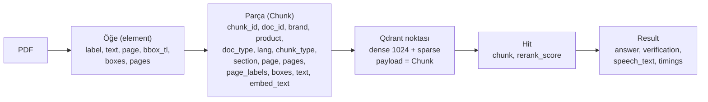

### 8.3 Bugünkü yapının zayıf noktaları

| Zayıflık | Neden sorun |
|----------|-------------|
| **Test kapsamı sınırlı** | 83 birim test var (`verify` 21, `speech`, `query`, parse/chunk, `pipeline`). Eksik: gerçek PDF ile entegrasyon testi, `retrieve`/`index`/`llm`/`app` ve `run_eval.py` yargıcı. Modeller ve arama taklit edildiği için model davranışını ölçmez |
| `pipeline.py` somut sınıflara bağlı | LLM, embedding, vektör DB değişince kod değişir (adaptör yok) |
| `config.py` düz sabitler | Ortam/profil (pilot, sunucu) ayrımı yok |
| Marka filtresi alan adı sabit (`brand`) | Yetki modeline hazır değil |
| `run_eval.py` heuristik yargıç | "Doğru" tanımı alt dizge eşleşmesi, uzman değerlendirmesi yok |
| Faz 1 betiği ile pilot `parse.py` mantık tekrarı | Bakım yükü |
| Kodda sesli çıktı için normalizasyon testleri ve okunuş kuralları sınırlı | Kod/model numaraları ("S-7300A", "E-07") okunuşu belirsiz |

---

## 9. Önerilen yapı değişiklikleri (pilot sonrası)

Hedef: aynı çekirdek akışı koruyarak **bileşenleri değiştirilebilir** ve **ölçülebilir** yapmak.

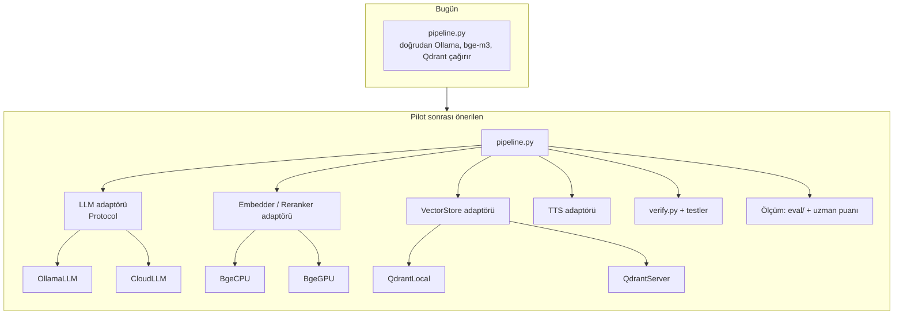

| # | Değişiklik | Neden | Çaba |
|---|------------|-------|------|
| 1 | ✅ **Birim testler yapıldı** (83 test, ilk turda 2 kusur buldu). Kalan: gerçek PDF'li entegrasyon testi, Faz 1 testlerinden uyarlama | Doğrulama katmanı güvenlik ilkesi, regresyon korumalı olmalı | Küçük |
| 2 | **Adaptör arayüzleri** (`Protocol`): LLM, embedder/reranker, vektör DB, TTS | Bulut/lokal geçişi (Q1 cevabına göre) kodu değiştirmeden yapılsın | Orta |
| 3 | **Yapılandırma profilleri** (`pilot`, `server`) ve ortam değişkenleri | Aynı kod laptop ve sunucuda çalışsın | Küçük |
| 4 | **Doğrulama modları:** "katı" (atıf zorunlu) ve "ölçülü" (atıfsız ama alıntı+sayı doğru ise ✔ ama işaretli) | Model [n] yazmasa da doğrulama anlamlı kalsın. Karar iş tarafında | Küçük |
| 5 | **Belirsiz sorular için akış:** ürün/marka yoksa kullanıcıya sor, ya da tüm yetkili dokümanlardan her ürün için ayrı cevap ver | Q07 bulgusu | Orta |
| 6 | **Eşik kalibrasyonu** için 50–100 soruluk set ve ROC benzeri analiz | Q09/Q10: reddetme dengesi | Orta |
| 7 | **Şekil açıklaması hattı:** ingestion'a VLM adımı, açıklamalar ayrı `chunk_type=figure` | Çizim ağırlıklı sayfalar şu an aranamıyor | Büyük |
| 8 | **Denetim izi (audit log)** her soru için kayıt: kaynaklar, doğrulama sonucu, süre. Saklama/silme politikasıyla | Kararlar (§11) ve R8 | Orta |
| 9 | **Faz 1 betiğiyle parse mantığı birleştirme**, tek kaynak | Tekrar azalır | Küçük |
| 10 | **Silme akışı:** `doc_id` bazlı chunk + vektör + sayfa görseli + log alıntıları silme | Sözleşme bitişi kararı | Orta |

---

## 10. Gerçek sistemde önerilen yapı

Girdiler: pilot bulguları, araştırma notları (hibrit senaryo B), alınan kararlar (§11).

### 10.1 Mimari

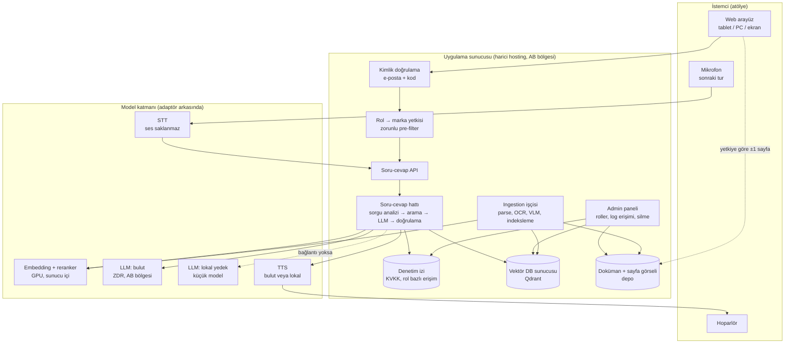

### 10.2 Yetkili soru akışı

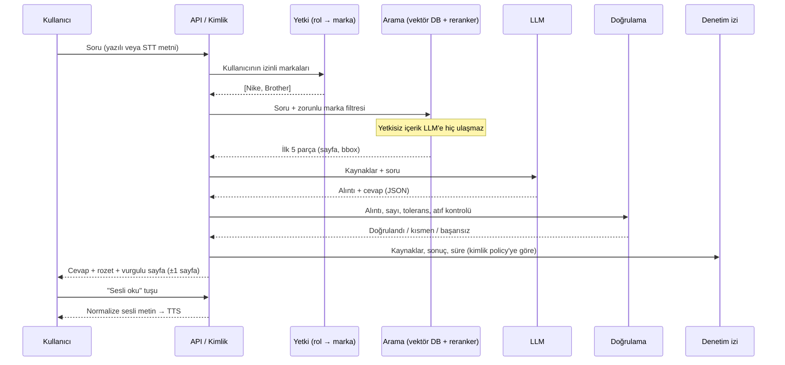

### 10.3 Pilot → gerçek sistem karşılaştırması

| Bileşen | Pilot (bugün) | Gerçek sistem (öneri) | Gerekçe |
|---------|---------------|------------------------|---------|
| **LLM** | qwen2.5:7b, lokal | Orta/üst seviye model: **bulut (ZDR, AB)** birincil, lokal küçük model yedek | 7B yetersiz (5/10). Ağ kesilebiliyor (karar), yedek gerekli |
| **Embedding / reranker** | bge-m3, bge-reranker, CPU | Aynı modeller, **GPU sunucuda** | Aday gecikmesi 5 sn bütçesine sığsın |
| **Vektör DB** | Qdrant gömülü (dosya) | Qdrant sunucu, koleksiyon başına marka veya zorunlu filtre | Çok kullanıcı, silme, yedekleme |
| **PDF işleme** | Docling + PyMuPDF yedeği | Aynı + **VLM şekil açıklaması** + OCR birleştirme | Çizim ve görsel olabilir (karar) |
| **Arayüz** | Streamlit | Özel web arayüzü (tablet uyumlu, büyük dokunma alanı) | Eldivenli kullanım, rol/yetki, ±1 sayfa kısıtı |
| **Kimlik** | Yok | e-posta + kod, rol → marka | Karar: SSO şart değil |
| **Yetki** | Marka filtresi (arayüz) | **Sunucuda zorunlu, aramadan önce**, tüm erişim noktalarında | R8 |
| **TTS** | Chatterbox CPU (12 sn üretim) | GPU'da Chatterbox veya bulut TTS (kalite ve gecikme ölçülecek) | 20 sn bekleme kabul edilemez |
| **STT** | Yok | Bas-konuş + metin onayı + terim listesi, **ses saklanmaz** | Karar: ses kaydı saklanmayacak |
| **Log** | Yok | Denetim izi, aydınlatma metni, rol bazlı erişim | Karar: loglar admin panelden |
| **Silme** | Elle | Doküman bazlı otomatik silme (chunk, vektör, görsel, log alıntıları) | Karar: sözleşme bitince silinir |
| **Doğrulama** | Katı, atıf zorunlu | Aynı ilke, modlu, testli, rozetli | Pilot bulgusu |
| **Dil** | TR soru, EN doküman | Çift yönlü (EN soru da), TR→EN sorgu çevirisi ölçülmüş | Karar: çift yönlü |

### 10.4 Çevrimdışı ve gizlilik davranışı

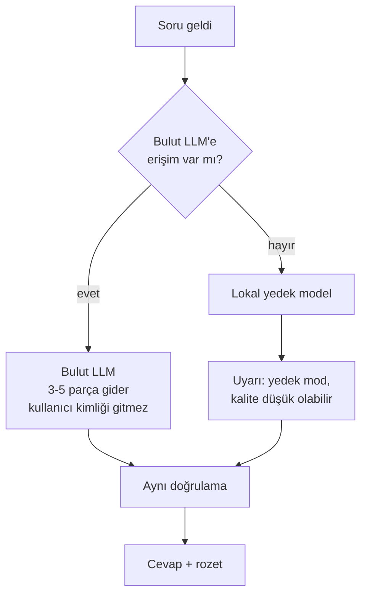

---

## 11. Alınan kararlar ve etkileri

Kaynak: [cevaplar.md](../cevaplar.md). Ayrıntılı tablo: [Pre/notes/sorulacaklar.md](../Pre/notes/sorulacaklar.md).

| Karar | Gerçek sisteme etkisi | Pilotta karşılığı |
|-------|----------------------|--------------------|
| Müşteriden izin istenmeden geliştirilecek | Hibrit senaryo önündeki engel kalktı. Sözleşme yasağı kontrolü hâlâ açık | Public veri, etkisi yok |
| Sözleşme bitince doküman ve türevleri silinir | `doc_id` bazlı silme, tüm türevleri kapsar | Uygulanmadı |
| Aydınlatma metni + izin, log erişimi rollerle | Rol modeli, admin paneli, aydınlatma akışı | Uygulanmadı |
| Yetkiye göre en fazla ±1 sayfa | Görüntüleyici sayfa penceresi | Arayüz seçilen kaynak sayfalarıyla sınırlı, ±1 kuralı yok |
| Marka bazlı yetki | Zorunlu pre-filter | Arayüzde marka filtresi var, yetki yok |
| Ses kaydı saklanmaz, metin tutulabilir | STT'de ses kalıcı depolanmaz | STT yok |
| Fabrika ağı, kesilebilir | Yedek model, çevrimdışı davranış | Her şey lokal olduğu için sorun yok |
| SSO şart değil, e-posta/kod | Basit kimlik | Yok |
| Harici hosting | Şirket içi sunucu varsayımı yok | Yok |
| Çift yönlü dil | TR↔EN | Yalnızca TR soru test edildi |
| Dijital + taranmış PDF, çizim olabilir | OCR + VLM tasarımda | VLM yok |
| Test seti AI hazırlar, uzman kontrol eder | Değerlendirme süreci | 10 soru AI yazdı, uzman kontrolü yok |
| Türkçe terim karşılıkları | Cevap ve sesli metin dili | Prompt'ta "Türkçe karşılığı varsa onu tercih et" |
| Hoparlör, "soru sor" tuşu | Ses arayüzü | Buton var, ses oynatıcı var |
| Sesli soruda marka sorulur, yazılıda filtre görünür | Arayüz tasarımı | Filtre görünür, sesli soru yok |
| Bekleme süresi 5 sn | Başarı kriteri | **14,5 sn, karşılanmadı** |

---

## 12. Güncel risk tablosu

| # | Risk | Pilot kanıtı | Durum |
|---|------|--------------|-------|
| **R4** | Yanlış / uydurulmuş değer | Q01'de uydurma sözcük, Q07 ve Q10'da uydurma alıntı. Doğrulama yakaladı. Zayıf model riski büyütüyor | 🔴 Doğrulama çalışıyor, model yetersiz |
| R1 | Tablo ve çizim ağırlıklı sayfalarda metin araması zayıf | Tablo satırları iyi çalıştı (Brother). Çizimler atlanıyor | 🟡 Çizim açık |
| R2 | Türkçe sesli okumada sayı/birim hatası | Normalizasyon kuralı çalışıyor, kod okunuşları ("S-7300A") test edilmedi | 🟡 |
| R7 | OCR'ın satır kaybı | PDF metin katmanı yedeği kısmen çözdü | 🟡 |
| R8 | Yetki filtresi sızıntısı | Pilotta yetki yok | 🔴 Gerçek sistem için ilk sırada |
| R9 | STT'de model kodu yanlış tanıma | STT yok | ⚪ |
| R10 | Test setinin gerçek veriyi temsil etmemesi | Pilot 10 soru, public veri | 🟡 |
| **Yeni R11** | **Donanım sınırı:** lokal makine yeterli model taşıyamıyor | 30B GPU belleğini aştı | 🔴 Q5 ve bütçe cevabı gerekli |
| **Yeni R12** | **Sessiz hata:** MPS'te embedding ve TTS yanlış sonuç veriyor, hata mesajı yok | Benzerlikler 1,0 çıktı | 🟡 Her ortamda doğrulama testi (smoke test) şart |
| **Yeni R13** | **Doğrulama sürekli "kısmen" göstermesi** kullanıcı güvenini düşürür | 0/10 tam doğrulama | 🟡 |
| **Yeni R14** | **Belirsiz soruda yanlış doküman getirilmesi** | Q07 | 🔴 |

---

## 13. Sonraki adımlar

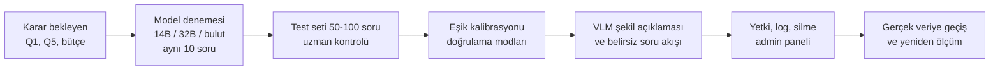

| Öncelik | İş | Bağımlılık |
|---------|----|-----------|
| 1 | **Aynı 10 soruyu daha büyük modelle çalıştırmak** (bulut referansı dahil, public veri olduğu için serbest) | API anahtarı veya GPU erişimi |
| 2 | ✅ Birim testler yapıldı (83). Sıradaki: entegrasyon testi | Yok |
| 3 | Test setini 50–100 soruya çıkarmak, uzman kontrolü | Kalite uzmanı |
| 4 | Belirsiz soru akışı (Q07 bulgusu) | Yok |
| 5 | Sorgu çevirisi (TR→EN) ve hibrit A/B deneyi | Yok |
| 6 | VLM ile şekil açıklaması | GPU veya bulut |
| 7 | Sesli soru (STT) | Karar var, uygulama yok |
| 8 | Yetki, denetim izi, silme, admin paneli | Q1, Q5, hukuk |
| 9 | Dokümantasyon güncelleme: `sentez.md`, `req.md` pilot sonuçları ve kararlarla | Yok |

---

## 14. Sınırlar ve dürüst notlar

- **Örneklem küçük:** 10 soru, tek çalıştırma. Oranlar (5/10) kesin değil, yön gösterir.
- **Değerlendirme heuristik:** "Doğru" otomatik alt dizge eşleşmesi ve doğrulama durumundan türetildi. Uzman puanı yok. Q09'un beklenen sonucu belirsiz (elle kontrol gerekir).
- **Sorular yapay zekâ tarafından yazıldı**, beklenen sayfalar PDF'ten doğrulandı. Gerçek kullanıcı soruları farklı olacaktır.
- **Tek makine, tek model:** Sonuçlar 24 GB Apple M4 Pro ve `qwen2.5:7b` için geçerlidir. Başka donanımda süreler farklıdır.
- **Parse CPU süresi ölçülmedi.** Parse süreleri MPS üzerindeki ilk çalıştırmaya aittir (Bosch 578 sn aykırı değer).
- **Sesli okuma ölçümü tek cümle** ve kullanıcının kulağıyla yapıldı. Kod/model okunuşu, gürültü, ses seviyesi test edilmedi.
- **Dokümanlar telifli olabilir:** `Pre/manuals/public/` içindeki PDF'ler "yeniden dağıtılmayacak" notuyla toplandı (bkz. manual-envanteri.md). Repo public yapılacaksa bu karar yeniden verilmeli.
- **Ders:** GPU belleği aşımı geliştirme makinesinde ekran bozulmasına yol açtı (§7.1). Lokal model denemelerinden önce kaynak sınırı ve eşzamanlı yük doğrulanmalı.

---

## 15. Ek: çalıştırma ve dosya haritası

```bash
cd Pilot
./setup.sh                                  # ortam + model (4,7 GB) + indeks, ~15-25 dk
.venv/bin/streamlit run app.py              # arayüz
.venv/bin/python run_eval.py                # 10 soruluk ölçüm -> eval/sonuc.md
.venv/bin/python -m pytest                  # 83 birim test (model/PDF gerektirmez, <1 sn)
```

```
visual_agent-main/
├── cevaplar.md                  # alınan cevaplar (ham)
├── Pre/                         # araştırma aşaması
│   ├── req.md, sentez.md        # plan, sentez (pilot sonuçları henüz işlenmedi)
│   ├── notes/                   # konu notları, sorulacaklar.md (güncel)
│   ├── manuals/public/          # 7 test PDF'i
│   └── faz1-test/               # Faz 1 kanıt denemesi (27 test)
└── Pilot/                       # bu rapor ve pilot kodu
    ├── PILOT-RAPORU.md          # bu dosya
    ├── KURULUM-LOGU.md          # boyut, süre, sorunlar
    ├── README.md, setup.sh      # kurulum
    ├── pilot/                   # kütüphane
    ├── app.py, run_*.py         # giriş noktaları
    ├── eval/                    # sorular ve sonuç
    ├── tests/                   # 83 birim test
    ├── data/parsed, chunks.jsonl# hazır işlenmiş veri (indeks yeniden üretilir)
    └── tools/                   # doğrulama betikleri, TTS yardımcısı
```

| Boyut | Değer |
|-------|-------|
| Kurulum (TTS hariç) | ~12 GB disk: model 4,7 + embedding/reranker 4,6 + ortam 1,5 |
| TTS (isteğe bağlı) | ~4,2 GB: model 3,1 + ortam 1,1 |
| Repo (venv ve indeks hariç) | ~38 MB |
