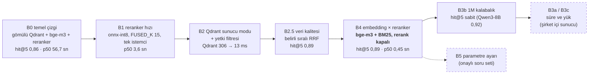

# Arama benchmark'ı: sonuçlar

Arama katmanının ölçümleri (yalnız arama; cevap modeli ayrı). Aşamalar **B0–B5** diye anılır (eski adıyla "Aşama 0–5"); ürün adımları ise **Adım 1–6** ([PRD](../../../docs/PRD.md)). Dosya adlarındaki `asama…` önekleri ve `bench/run_asama*.ps1` betik adları eski adlandırmadan kalmadır.

Ölçüm kodu: [`bench/`](../../bench/). Doğruluk bilinen 36 (B3b'den itibaren 37) soruda; onaylı 155 soruluk set gelene kadar 5–8 puanın altındaki farklar gürültü. Dizüstü süreleri üretimi temsil etmez.

| Klasör | Aşama | Ne ölçüldü | Karar / sonuç |
|---|---|---|---|
| [b0-b1/](b0-b1/README.md) | B0, B1 | Temel çizgi; reranker teşhisi ve modelleri, FUSED_K × max_length | Gizli tekrar hesaplama bulundu; arama p50 56,7 → 3,6 sn |
| [b2/](b2/README.md) | B2 | Qdrant sunucu modu, gRPC, yetki (`access`) filtresi | Sunucu modu: Qdrant p50 306 → 13 ms; yetki filtresi aramanın içinde |
| [b25/](b25/README.md) | B2.5 | Veri kalitesi, belirli sıralı RRF | hit@5 0,86 → 0,89; gömülü ve sunucu modu aynı sıra |
| [b3/](b3/README.md) | B3 | 1M kalabalıkta doğruluk (B3b); süre (B3a) ve yük (B3c) sunucuda | hit@5 1M'e kadar sabit; B3a/B3c bekliyor |
| [b4/](b4/README.md) | B4 | 9 embedding × 3 reranker, maliyet; 2026-11-03 genel kurallar, çeviri, gecikme | **Varsayılan: bge-m3 + BM25, rerank kapalı** (hit@5 0,89, p50 0,45 sn). Dondurulan aday: üçlü füzyon + çevirili BM25 ([özet](b4/ozet_dondurulan_aday_2026-11-03.md)) |
| [adim2/](adim2/plan_cevap_modeli_2026-11-05.md) | Adım 2 | Cevap modeli seçimi: plan (4 ZDR'li aday + yerel qwen2.5:7b taban) | Plan onay bekliyor, koşulmadı |
| [bulunamadi/](bulunamadi/README.md) | — | "Bulunamadı" ve netleştirme, tam hat | Doğru "bulunamadı" %48, hedef ≥ %90 (Adım 2) |
| `genel/` | — | Önekine uymayan genel araç çıktıları (`kayip`, `mod_farki`, `rerank_*`, `openrouter_modeller` …) | Yeni koşularda oluşur |

B5 (parametre ayarı) onaylı soru seti hazır olunca yapılacak.

Yeni sonuçlar `bench.common.write_result` ile adın önekine göre doğru klasöre yazılır (`stage_dir`): `baseline`/`asama1` → b0-b1, `asama2_` → b2, `asama25` → b25, `asama3` → b3, `asama4`/`rerank_duzeltme`/`rerank_teshis2` → b4, `bulunamadi`/`netlestirme` → bulunamadi, diğerleri → genel. Eski sonuçların içeriği değiştirilmedi; yalnız klasöre taşındı. Tek istisna `b3/asama3_hazirlik`: klasör derinliği değiştiği için içindeki göreli bağlantı hedefleri düzeltildi, metin aynı.

İlk pilot ölçümü (Mac, 10 soru) arşivde: [docs/arsiv/pilot-eval/](../../../docs/arsiv/pilot-eval/sonuc_onceki.md).
