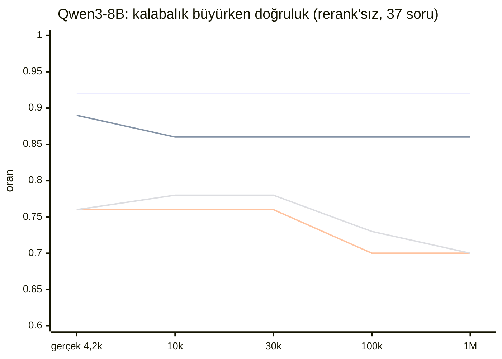

# B3b sonucu: kalabalıkta doğruluk, gerçek parçalardan 1M'e

Tarih: 2026-11-03 · koşu: `bench/run_asama3_yerel.ps1` (korpus → qwen10k → qwen → kademeler → yerel10k → olcum → sentetik) · ham sonuçlar: `asama3b_<koleksiyon>_2026-11-03.{md,json}` (8 koleksiyon)

**Kısaca:** Gerçek 4.232 parçanın arasına 1M'e kadar dikkat dağıtıcı eklendiğinde **hit@5 değişmiyor** (filtreli 0,92, filtresiz 0,86–0,89). **hit@1 100k'dan sonra 0,76 → 0,70** düşüyor; bu 2 soru (G3, N3), 37 soruluk sette gürültü sınırında. Filtresiz aramada ilk 5'e giren dikkat dağıtıcıların ~%90'ı **Türkçe Vikipedi** parçası; korpustaki payı %12. Doküman filtresi bu kalabalığın çoğunu dışarıda tutuyor (1M'de ilk 5'teki 195 sonuçtan 8'i dikkat dağıtıcı, filtresizde 84'ü).

Süreler geliştirme dizüstünde (i5-1335U, GPU yok) alındı: **üretimi temsil etmez, karar için kullanılmaz.** Süre kararı şirket içi sunucudaki B3a'da verilecek.

## Kurulum

| | |
|---|---|
| Korpus | Gerçek 4.232 parça + dikkat dağıtıcılar: big_patent CPC D %40, CPC F %30, Vikipedi en %18, tr %12 ([hazırlık](asama3_hazirlik_2026-10-27.md) §2). Kademeler iç içe: 10k, 30k, 100k, 1M |
| Qwen3-8B (bulut) | 999.952 nokta; MRL 256 kısa vektör HNSW'de, tam 4096 vektör diskte (`short_rescore`), BM25. 1M embed maliyeti ~1,75 USD (günlükten: 10k denemesi 0,016 + kesilen koşu 1,615 + devam 0,117), sınır 3 USD |
| bge-m3 + BM25 (lokal) | 10k'ya kadar (CPU, 0,88 parça/sn, 3,1 saat). Görev tanımındaki 20–30k sınırının altında kaldı; 30k adımı isteğe bağlıydı, koşulmadı |
| Ölçüm | 37 bilinen soru (Q09 artık cevaplı), rerank'sız (B4 varsayılanı), filtreli + filtresiz; ANN recall 300 rastgele sorgu |
| B3a için | `synth_1m`: 1M sentetik nokta (gerçek bge-m3 vektörü + gürültü 0,015, sparse token düşürme 0,3), 1.068 sn'de yüklendi. Ölçümü şirket içi sunucuda |

## Doğruluk

| Koleksiyon | nokta | filtreli hit@1 | hit@5 | hit@20 | MRR | filtresiz hit@1 | hit@5 | hit@20 | MRR | ANN recall@5 / @20 |
|---|---|---|---|---|---|---|---|---|---|---|
| Qwen3-8B, gerçek | 4.232 | 0,76 | 0,92 | 0,97 | 0,82 | 0,76 | 0,89 | 0,97 | 0,82 | 1,00 / 1,00 |
| Qwen3-8B, 10k | 10.000 | 0,76 | 0,92 | 0,97 | 0,82 | 0,78 | 0,86 | 0,97 | 0,83 | 1,00 / 1,00 |
| Qwen3-8B, 30k | 29.952 | 0,76 | 0,92 | 0,97 | 0,82 | 0,78 | 0,86 | 0,95 | 0,82 | 1,00 / 1,00 |
| Qwen3-8B, 100k | 99.952 | 0,70 | 0,92 | 0,97 | 0,79 | 0,73 | 0,86 | 0,95 | 0,78 | 0,98 / 0,96 |
| **Qwen3-8B, 1M** | 999.952 | **0,70** | **0,92** | 0,97 | 0,78 | **0,70** | **0,86** | 0,95 | 0,77 | 0,98 / 0,96 |
| bge-m3 + BM25, gerçek | 4.232 | 0,73 | 0,89 | 0,95 | 0,80 | 0,68 | 0,86 | 0,95 | 0,75 | 1,00 / 1,00 |
| bge-m3 + BM25, 10k | 10.000 | 0,73 | 0,89 | 0,92 | 0,80 | 0,70 | 0,86 | 0,89 | 0,76 | 1,00 / 1,00 |

`scale_bge_m3` (10k'ya kadar kurulan ana koleksiyon) `scale_bge_m3_10000` ile aynı sonucu verdi; tabloda tek satır.

Çizgiler yukarıdan aşağıya: filtreli hit@5, filtresiz hit@5, filtreli hit@1, filtresiz hit@1.

## Hangi sorular değişti

Filtreli aramada sırası değişen yalnız 3 soru var:

| Soru | gerçek | 10k | 30k | 100k | 1M | bge-m3 gerçek / 10k |
|---|---|---|---|---|---|---|
| sekil_sorular:G3 | 1 | 1 | 1 | 2 | 2 | 1 / 1 |
| sekil_sorular:N3 | 1 | 1 | 1 | 3 | 5 | 16 / ilk 20'de yok |
| sekil_sorular:N1 | 6 | 7 | 7 | 6 | 7 | 10 / 10 |

- **N3 (1M, filtreli):** ilk 4 sonuç Türkçe Vikipedi parçası (`dd-wiki-tr-000797` iki kez, `-005369`, `-022672`), doğru Granovsky sayfası 5. sırada. Dikkat dağıtıcılara markalar gerçek dağılımdan atandığı için marka filtresi onları dışarıda tutmuyor (hazırlık §2).
- **G3:** 100k'dan sonra aynı dokümanın başka bir sayfası (s. 55) öne geçiyor; dikkat dağıtıcı etkisi değil, sıralama oynaması.
- **Filtresiz:** sırası değişen 14 soru var. En kötüsü N1: 10k'da 19., 30k'dan itibaren ilk 20'nin dışında, ilk 5'in hepsi patent ve Türkçe Vikipedi.

## Dikkat dağıtıcılar ilk 5'te

Aranan 39 soru × 5 sonuç = 195 (doğruluk 37 soruda; cevabı olmayan 2 soru da aranıyor):

| Koleksiyon | filtreli | filtresiz | filtresizde Türkçe Vikipedi |
|---|---|---|---|
| Qwen3-8B 10k | 4 | 60 | 57 |
| Qwen3-8B 30k | 4 | 60 | 59 |
| Qwen3-8B 100k | 7 | 69 | 63 |
| Qwen3-8B 1M | 8 | 84 | 75 |
| bge-m3 + BM25 10k | 6 | 63 | 58 |

Okuma: kalabalık ilk 5'e giriyor ama doğru sayfayı çoğunlukla ilk 5'ten atamıyor (hit@5 sabit). Türkçe dikkat dağıtıcıların ağırlığı, sorular Türkçe ve kılavuzlar İngilizce olduğu için büyük ihtimalle dil eşleşmesinden. Gerçek veride departmanların Türkçe dokümanları eklendiğinde aynı etki görülebilir; bu yüzden doküman ve yetki filtresi doğruluk için de önemli. Bu bir gözlem; neden olduğu ayrıca test edilmedi.

## Süre (dizüstü, yalnız bilgi)

| Koleksiyon | Qdrant p50 filtreli / filtresiz | koleksiyon diski |
|---|---|---|
| Qwen3-8B gerçek | 23 / 24 ms | 1,1 GB |
| Qwen3-8B 100k | 24 / 31 ms | 2,7 GB |
| Qwen3-8B 1M | 25 / 42 ms | 20,6 GB |
| bge-m3 + BM25 10k | 15 / 23 ms | 0,9 GB |

1M'de Qdrant süreci 5,8 GB RAM kullandı (dizüstünde 32 GB RAM var; sayfa önbelleği buna dahil değil). Sorgu embed süresi bulut ağına bağlı (p50 0,8–1,1 sn) ve bu ölçümün konusu değil.

## Sonuç ve sonraki adım

- **K1 arama ölçütü (hit@5 ≥ %90):** Qwen3-8B filtreli 1M'de 0,92 ile geçiyor; filtresiz 0,86 ile geçmiyor. bge-m3 + BM25 10k'da 0,89 (sınırda). bge-m3 yolu 1M'de ölçülmedi: CPU'da 1M ≈ 185 saat (B4 maliyet tablosu); GPU ya da sunucu gerekir.
- **Embedding kararı (PRD: "bge-m3 ve Qwen3-8B karşılaştırılıyor"):** aynı kademede (10k) Qwen3-8B hit@1 ve hit@5'te 3 puan önde; fark 37 soruda gürültü sınırının altında. Karar onaylı 155 soruluk setle verilmeli.
- **B3a ve B3c** (süre ve yük) şirket içi sunucuda; paket `synth_1m`, `scale_qwen3_8b`, `scale_bge_m3` snapshot'larıyla depo düzenlemesinden sonra bir kez üretilecek.
- **Kesinti notu:** 27 Ekim gecesi koşu 14.400/15.468 toplu işte ağ hatasıyla durdu, 3 Kasım sabahı kaldığı yerden devam etti; veri kaybı yok, son durum 15.625/15.625 toplu iş.
