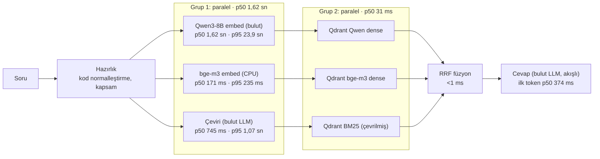
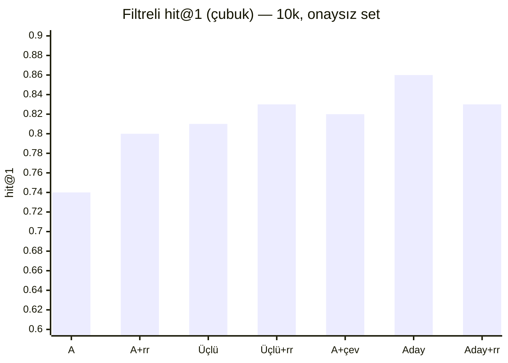

# Özet (2026-11-03): dondurulan arama adayı, bugünkü bulgular

> **Uyarı — aşırı uyum riski.** Bu rapordaki bütün doğruluk sayıları **aynı onaysız soru setinden** geliyor: bilinen 3 set + 155 soruluk aday taslak (`dogrulandi: false`), cevaplı 158–160 soru, 10k kademesi. Gün boyunca yapılan her karar (dil kopyası etiketleri, ilke temizliği, kod kuralı, dil tespiti, çeviri, reranker'sızlık) bu setin sonuçlarına bakılarak verildi; etiketlerin bir kısmı da aynı gün düzeltildi. Sayılar bu yüzden **iyimser** olabilir ve başka sorulara genellenmeyebilir. Karar için: (1) aday setin onaylanması, (2) hiç bakılmamış bir setle (JUKI `gorulmemis_juki` ayrı tutuluyor) ve onaylı setle yeniden ölçüm, (3) 1M kademesinde ölçüm gerekli. Süreler geliştirme dizüstünden (i5-1335U, GPU yok); üretimi temsil etmez.

## 1. Dondurulan aday

**Üçlü füzyon + BM25'e çevrilmiş sorgu, reranker'sız.** Bu setle başka ayar denemesi yapılmayacak.

| Parça | Ayar |
|---|---|
| Dense kol 1 | Qwen3-8B (bulut, ZDR), MRL 256 ile aday + tam vektörle sıralama (`short_rescore`), 30 aday |
| Dense kol 2 | bge-m3 (yerel, CPU), tam vektör, 30 aday |
| Sparse kol | BM25 (fastembed + Qdrant IDF), **sorgu kapsamın diline çevrilmiş** (gemma-3-12b-it, ZDR; hedef diller kapsamdaki parçaların tespit edilen dillerinden), 30 aday |
| Füzyon | RRF (k = 2, pipeline ile aynı), ilk 20; eşitlikte Qwen dense skoru |
| Reranker | yok |
| Ön koşullar (bugün uygulandı) | bölüm adı kuralları, genel kod normalleştirmesi, parça bazında dil tespiti |

Aday **henüz pipeline'a bağlanmadı**: uygulamanın varsayılanı hâlâ bge-m3 + BM25 hibrit (B4 kararı); üçlü füzyon ve çeviri yalnız ölçüm araçlarında (`bench/triple_fusion.py`, `pilot/translate.py`).

## 2. Doğruluk (10k, filtreli, rerank'sız aksi belirtilmedikçe; geçici, onaysız set)

| Yapılandırma | hit@1 | hit@5 | Not |
|---|---|---|---|
| A: Qwen3-8B + BM25 | 0,74 | 0,87 | taban (dil kopyası etiketi ve ilke temizliği sonrası) |
| A + qwen3-reranker-8b | 0,80 | 0,93 | 158 soru |
| C: bge-m3 + BM25 | 0,67 | 0,84 | |
| Üçlü füzyon | 0,81 | 0,94 | |
| Üçlü füzyon + reranker | 0,83 | 0,95 | 158 soru |
| A + çevirili BM25 | 0,82 | 0,97 | |
| **Üçlü füzyon + çevirili BM25 (aday)** | **0,86** | **0,98** | 160 soru; filtresiz 0,84 / 0,94 |
| Aday + reranker | 0,83 | 0,99 | 158 soru; reranker hit@1'i düşürüyor |

Tür bazında (aday, filtreli): değer 0,83/0,97 (90 soru), prosedür 0,90/1,00 (20), kod 1,00/1,00 (20), arıza 0,88/1,00 (8), şekil 0,79/1,00 (14). n küçük; tür farkları 1–2 soru. Ham tablo: [asama4_ceviri_bm25_10k_2026-11-03_2](asama4_ceviri_bm25_10k_2026-11-03_2.md).

## 3. Bugünkü bulgular (sırayla)

| Adım | Bulgu | Rapor |
|---|---|---|
| B3b (1M kalabalık) | hit@5 1M'e kadar sabit; dikkat dağıtıcıların çoğu Türkçe Vikipedi | [b3/asama3b_sonuc](../b3/asama3b_sonuc_2026-11-03.md) |
| Bölüm adları | 606 parçada yanlış/boş başlık düzeltildi (4 genel kural); rerank'sız etki nötr | [bolum_kurallari](bolum_kurallari_2026-11-03.md) |
| Dil kopyaları (etiket) | üç dilli kılavuzlarda birebir çeviriler kabul'e (16 soru, 26 kaynak); "prosedür zayıf" bulgusunun çoğu etiketten | [genel_kurallar](genel_kurallar_2026-11-03.md) |
| İlke temizliği | test sorusuna özgü 5 girdi kaldırıldı; taban değişmedi | [ilke_temizligi](ilke_temizligi_2026-11-03.md) |
| Kod normalleştirme | "e50" = "E050"; A146 artık aramadan önce yanlış "bulunamadı" değil | [kod_dil_ceviri](kod_dil_ceviri_2026-11-03.md) §1 |
| Dil tespiti | lingua, öğe düzeyi; yalnız Mr. Coffee'nin sınırları değişti (iki dilli sayfalar) | [kod_dil_ceviri](kod_dil_ceviri_2026-11-03.md) §2 |
| Çevirili BM25 | en büyük kazanç: A +8 puan hit@1, +10 puan hit@5 (filtreli) | [kod_dil_ceviri](kod_dil_ceviri_2026-11-03.md) §3 |
| Reranker | güçlü aday listesinde hit@1'i düşürüyor; yalnız hit@5 +1 | [kod_dil_ceviri](kod_dil_ceviri_2026-11-03.md) §4 |

## 4. Uçtan uca gecikme (aday, 20 soru, 10k, filtreli)

Ham: [asama4_gecikme_e2e](asama4_gecikme_e2e_2026-11-03.md). Cevap modeli seçilmedi (PRD A1); `mistral-small-24b-instruct-2501` (ZDR) yalnız gösterge. Isınma hariç, Qwen embed'i önbelleksiz.

| Adım | Paralel | p50 | p95 |
|---|---|---|---|
| Qwen3-8B sorgu embed'i (bulut) | grup 1 | 1,62 sn | **23,89 sn** |
| bge-m3 sorgu embed'i (CPU) | grup 1 | 171 ms | 235 ms |
| Çeviri (gemma-3-12b-it) | grup 1 | 745 ms | 1,07 sn |
| Grup 1 duvar saati | – | 1,62 sn | 23,89 sn |
| Qdrant: 3 kol | grup 2 | 16–26 ms | 33–42 ms |
| Grup 2 duvar saati | – | 31 ms | 48 ms |
| Füzyon | – | < 1 ms | < 1 ms |
| Cevap ilk token | – | 374 ms | 19,82 sn |
| Cevap toplam (akış bitişi; JSON şema, ~200 token) | – | 5,40 sn | 26,97 sn |
| **Uçtan uca, ilk token** | – | **1,99 sn** | 28,03 sn |

- **Asıl darboğaz Qwen3-8B sorgu embed'inin kuyruğu:** 20 çağrının 8'i 14–26 sn. Ayrı yoklamada da (20 çağrı) medyan 0,76 sn ama 4 çağrı 10–15 sn. B4'te (27 Ekim) p95 1,6 sn idi; sağlayıcı tarafı. Bu kuyruk varken PRD'nin "arama ≤ 1 sn (p95)" ve "ilk cümle ≤ 3 sn" hedefleri tutmuyor. Önlem önerileri: Qwen çağrısına süre sınırı (ör. 1,5 sn) ve aşınca o sorguda Qwen kolsuz devam (bge-m3 + çevirili BM25; doğruluğu ayrıca ölçülmeli); sağlayıcı seçiminde `sort: latency`; sunucuda yerel embedding seçeneği.
- Çeviri ve bge-m3 embed'i Qwen'e paralel olduğu için medyanda kritik yolda değil; bge-m3 CPU'da 171 ms.
- Qdrant ve füzyon önemsiz (≤ 50 ms).
- Cevap modelinin ilk tokeni çoğunlukla 0,3–1,2 sn; 2 soruda ~20 sn (sağlayıcı kuyruğu).
- Harcama: 0,0033 USD (sınır 0,5 USD); yoklamalarla ~0,005 USD.

## 5. Çeviri seçenekleri (öneri, uygulanmadı)

**(a) Dil aynıysa çeviri atlanır.** Mevcut kod zaten soru dili kapsamın tespit edilen dilleriyle aynıysa çağırmıyor. Bu sette 179 sorunun 175'i Türkçe, belgeler İngilizce: **yalnız 4 sorguda** (İngilizce sorular) atlanır. Kazanç, departmanların Türkçe belge yüklediği gerçek kullanımda büyür (Türkçe soru + Türkçe belge → çağrı yok).

**(b) Daha hızlı model ya da sağlayıcı (ZDR).** 10 Türkçe soruyla yoklandı (bugün, dizüstü):

| Model | p50 | p90 | en uzun | Not |
|---|---|---|---|---|
| gemma-3-12b-it (bugünkü) | 0,50 sn | 0,81 sn | 3,41 sn | çeviriler doğru |
| **gemma-3-12b-it, `provider.sort = latency`** | 0,55 sn | **0,69 sn** | **2,45 sn** | aynı model, kuyruk kısa — öneri 1 |
| gemma-3-4b-it | 0,78 sn | 1,02 sn | 1,10 sn | daha yavaş; "tela" → "haste" (yanlış) |
| llama-3.1-8b-instruct | 1,15 sn | 1,66 sn | 2,01 sn | çeviri yanlış ("storage compartments") |
| mistral-nemo | 3,24 sn | 4,11 sn | 167,6 sn | yavaş |
| mercury-2.5 | 0,87 sn | 1,17 sn | 1,19 sn | 10/10 geçersiz JSON |

Denenen dört alternatifin hiçbiri hem daha hızlı hem doğru değil. Öneriler: **(1)** aynı model, sağlayıcıyı gecikmeye göre seçtirmek + süre sınırı (aşınca BM25 çevirisiz); **(2)** sunucuda yerel çeviri modeli (ör. Marian tr→en, ~300 MB; tahmini CPU 0,1–0,3 sn, ölçülmedi; veri dışarı çıkmaz, ama yalnız eğitildiği dil çiftleri ve gündelik yazımda zayıf).

**(c) Sözlüğün çeviri istemine eklenmesi.** Sorudaki tutulan sözlük terimleri (ör. "masura kovanı → bobbin case") istemde "bu terimleri kullan" diye verilir; departman verisi olarak genel mekanizma. Bu sette 199 sorunun 40'ında sözlük terimi geçiyor. Bugünkü arama metni zaten bu terimlerin İngilizcesini parantez içinde taşıdığı için kazanç büyük olasılıkla küçük; bugünkü çeviri hataları ("kruvaze" → "cross-stitch", "tela" → "haste", "pantolon çizimi" → "pantograph") sözlükte olmayan terimlerden. Sözlüğün büyümesi uzman onayı gerektirir.

## 6. Reranker varsayılanı

Uygulamanın varsayılan yolunda reranker **zaten kapalı** (B4, `f130ac4`): `PILOT_RERANK_PROVIDER=none`; açmak için `local` ya da `openrouter` (bayrak). Kodda değişiklik gerekmedi; testler değişmedi. Yalnız ölçüm aracı `bench/measure.py`'nin sonuç dosyasına yazdığı `rerank` alanı düzeltildi: reranker'ın gerçekten çalışıp çalışmadığını (`--no-rerank` değil **ve** sağlayıcı ayarlı) yazar; eskiden sağlayıcı kapalıyken de `true` yazıyordu.

## 7. Açık riskler ve sonraki adımlar

- **Onaylı set ve görülmemiş set** (yukarıdaki uyarı): aday onaylı setle ve JUKI setiyle yeniden ölçülmeli; hiçbir ayar o setlere bakılarak değiştirilmemeli.
- **1M kademesi ve sunucu paketi** bugünkü değişikliklerden önceki halde (bölüm adı, dil, Mr. Coffee). Sunucu testi tarihi belli olunca güncellenecek.
- **Qwen embed kuyruğu** (§4): süre sınırı ve yedek yol olmadan aday, süre bütçesini karşılamaz.
- **Cevap modeli** (PRD A1) seçilmedi; cevap süresi ve "bulunamadı" davranışı ona bağlı.
- **Kapsam dışı ilke ihlalleri** raporlandı, dokunulmadı: sabit "s7300" aile grubu, `BRAND_ALIASES`, `ASPECTS` ([ilke_temizligi](ilke_temizligi_2026-11-03.md)).

## 8. Bugünkü bulut harcaması

| İş | USD |
|---|---|
| B3b: Qwen3-8B 1M kalan kısım (sabah) | ~0,12 |
| Reranker 10k, 3 yol (A, B, C) | 0,99 |
| Üçlü füzyon + reranker (2 aday listesi) | 0,65 |
| Embed güncellemeleri, eksik sorgu vektörleri | ~0,002 |
| Çeviri (179 soru × 2 kip) | 0,004 |
| Gecikme ölçümü ve yoklamalar | ~0,005 |
| **Toplam** | **~1,77** |
