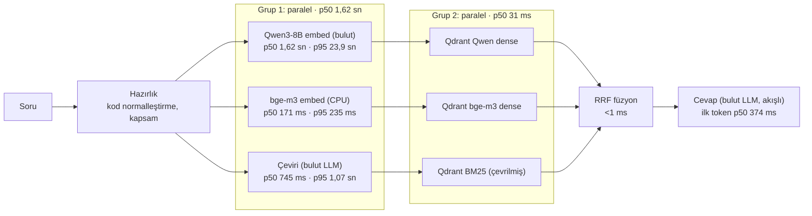
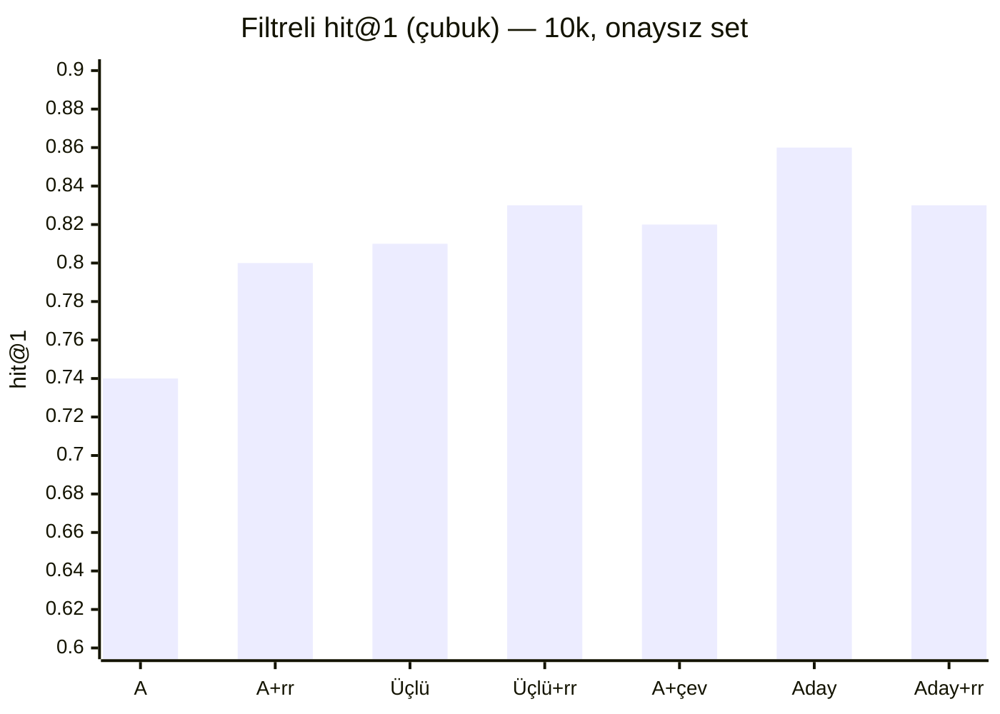

# Özet (2026-11-03): dondurulan arama adayı, bugünkü bulgular

> **Uyarı — aşırı uyum riski.** Bu rapordaki bütün doğruluk sayıları **aynı onaysız soru setinden** geliyor: bilinen 3 set + 155 soruluk aday taslak (`dogrulandi: false`), cevaplı 158–160 soru, 10k kademesi. Gün boyunca yapılan her karar (dil kopyası etiketleri, ilke temizliği, kod kuralı, dil tespiti, çeviri, reranker'sızlık) bu setin sonuçlarına bakılarak verildi; etiketlerin bir kısmı da aynı gün düzeltildi. Sayılar bu yüzden **iyimser** olabilir ve başka sorulara genellenmeyebilir. Karar için: (1) aday setin onaylanması, (2) hiç bakılmamış bir setle (JUKI `gorulmemis_juki` ayrı tutuluyor) ve onaylı setle yeniden ölçüm, (3) 1M kademesinde ölçüm gerekli. Süreler geliştirme dizüstünden (i5-1335U, GPU yok); üretimi temsil etmez.

## 1. Dondurulan aday

**Üçlü füzyon + BM25'e çevrilmiş sorgu, reranker'sız.** Bu setle başka ayar denemesi yapılmayacak.

| Parça | Ayar |
|---|---|
| Dense kol 1 | Qwen3-8B (bulut, ZDR), MRL 256 ile aday + tam vektörle sıralama (`short_rescore`), 30 aday |
| Dense kol 2 | bge-m3 (yerel, CPU), tam vektör, 30 aday |
| Sparse kol | BM25 (fastembed + Qdrant IDF), **sorgu kapsamın diline çevrilmiş** (gemma-3-12b-it, ZDR; hedef diller kapsamdaki parçaların tespit edilen dillerinden), 30 aday |
| Füzyon | RRF (k = 2, pipeline ile aynı), ilk 20; eşitlikte Qwen dense skoru |
| Reranker | yok |
| Ön koşullar (bugün uygulandı) | bölüm adı kuralları, genel kod normalleştirmesi, parça bazında dil tespiti |

Aday **henüz pipeline'a bağlanmadı**: uygulamanın varsayılanı hâlâ bge-m3 + BM25 hibrit (B4 kararı); üçlü füzyon ve çeviri yalnız ölçüm araçlarında (`bench/triple_fusion.py`, `pilot/translate.py`).

## 2. Doğruluk (10k, filtreli, rerank'sız aksi belirtilmedikçe; geçici, onaysız set)

| Yapılandırma | hit@1 | hit@5 | Not |
|---|---|---|---|
| A: Qwen3-8B + BM25 | 0,74 | 0,87 | taban (dil kopyası etiketi ve ilke temizliği sonrası) |
| A + qwen3-reranker-8b | 0,80 | 0,93 | 158 soru |
| C: bge-m3 + BM25 | 0,67 | 0,84 | |
| Üçlü füzyon | 0,81 | 0,94 | |
| Üçlü füzyon + reranker | 0,83 | 0,95 | 158 soru |
| A + çevirili BM25 | 0,82 | 0,97 | |
| **Üçlü füzyon + çevirili BM25 (aday)** | **0,86** | **0,98** | 160 soru; filtresiz 0,84 / 0,94 |
| Aday + reranker | 0,83 | 0,99 | 158 soru; reranker hit@1'i düşürüyor |

Tür bazında (aday, filtreli): değer 0,83/0,97 (90 soru), prosedür 0,90/1,00 (20), kod 1,00/1,00 (20), arıza 0,88/1,00 (8), şekil 0,79/1,00 (14). n küçük; tür farkları 1–2 soru. Ham tablo: [asama4_ceviri_bm25_10k_2026-11-03_2](asama4_ceviri_bm25_10k_2026-11-03_2.md).

## 3. Bugünkü bulgular (sırayla)

| Adım | Bulgu | Rapor |
|---|---|---|
| B3b (1M kalabalık) | hit@5 1M'e kadar sabit; dikkat dağıtıcıların çoğu Türkçe Vikipedi | [b3/asama3b_sonuc](../b3/asama3b_sonuc_2026-11-03.md) |
| Bölüm adları | 606 parçada yanlış/boş başlık düzeltildi (4 genel kural); rerank'sız etki nötr | [bolum_kurallari](bolum_kurallari_2026-11-03.md) |
| Dil kopyaları (etiket) | üç dilli kılavuzlarda birebir çeviriler kabul'e (16 soru, 26 kaynak); "prosedür zayıf" bulgusunun çoğu etiketten | [genel_kurallar](genel_kurallar_2026-11-03.md) |
| İlke temizliği | test sorusuna özgü 5 girdi kaldırıldı; taban değişmedi | [ilke_temizligi](ilke_temizligi_2026-11-03.md) |
| Kod normalleştirme | "e50" = "E050"; A146 artık aramadan önce yanlış "bulunamadı" değil | [kod_dil_ceviri](kod_dil_ceviri_2026-11-03.md) §1 |
| Dil tespiti | lingua, öğe düzeyi; yalnız Mr. Coffee'nin sınırları değişti (iki dilli sayfalar) | [kod_dil_ceviri](kod_dil_ceviri_2026-11-03.md) §2 |
| Çevirili BM25 | en büyük kazanç: A +8 puan hit@1, +10 puan hit@5 (filtreli) | [kod_dil_ceviri](kod_dil_ceviri_2026-11-03.md) §3 |
| Reranker | güçlü aday listesinde hit@1'i düşürüyor; yalnız hit@5 +1 | [kod_dil_ceviri](kod_dil_ceviri_2026-11-03.md) §4 |

## 4. Uçtan uca gecikme (aday, 20 soru, 10k, filtreli)

Ham: [asama4_gecikme_e2e](asama4_gecikme_e2e_2026-11-03.md). Cevap modeli seçilmedi (PRD A1); `mistral-small-24b-instruct-2501` (ZDR) yalnız gösterge. Isınma hariç, Qwen embed'i önbelleksiz.

| Adım | Paralel | p50 | p95 |
|---|---|---|---|
| Qwen3-8B sorgu embed'i (bulut) | grup 1 | 1,62 sn | **23,89 sn** |
| bge-m3 sorgu embed'i (CPU) | grup 1 | 171 ms | 235 ms |
| Çeviri (gemma-3-12b-it) | grup 1 | 745 ms | 1,07 sn |
| Grup 1 duvar saati | – | 1,62 sn | 23,89 sn |
| Qdrant: 3 kol | grup 2 | 16–26 ms | 33–42 ms |
| Grup 2 duvar saati | – | 31 ms | 48 ms |
| Füzyon | – | < 1 ms | < 1 ms |
| Cevap ilk token | – | 374 ms | 19,82 sn |
| Cevap toplam (akış bitişi; JSON şema, ~200 token) | – | 5,40 sn | 26,97 sn |
| **Uçtan uca, ilk token** | – | **1,99 sn** | 28,03 sn |

- **Asıl darboğaz Qwen3-8B sorgu embed'inin kuyruğu:** 20 çağrının 8'i 14–26 sn. Ayrı yoklamada da (20 çağrı) medyan 0,76 sn ama 4 çağrı 10–15 sn. B4'te (27 Ekim) p95 1,6 sn idi; sağlayıcı tarafı. Bu kuyruk varken PRD'nin "arama ≤ 1 sn (p95)" ve "ilk cümle ≤ 3 sn" hedefleri tutmuyor. Önlem önerileri: Qwen çağrısına süre sınırı (ör. 1,5 sn) ve aşınca o sorguda Qwen kolsuz devam (bge-m3 + çevirili BM25; doğruluğu ayrıca ölçülmeli); sağlayıcı seçiminde `sort: latency`; sunucuda yerel embedding seçeneği.
- Çeviri ve bge-m3 embed'i Qwen'e paralel olduğu için medyanda kritik yolda değil; bge-m3 CPU'da 171 ms.
- Qdrant ve füzyon önemsiz (≤ 50 ms).
- Cevap modelinin ilk tokeni çoğunlukla 0,3–1,2 sn; 2 soruda ~20 sn (sağlayıcı kuyruğu).
- Harcama: 0,0033 USD (sınır 0,5 USD); yoklamalarla ~0,005 USD.

## 5. Çeviri seçenekleri (öneri, uygulanmadı)

**(a) Dil aynıysa çeviri atlanır.** Mevcut kod zaten soru dili kapsamın tespit edilen dilleriyle aynıysa çağırmıyor. Bu sette 179 sorunun 175'i Türkçe, belgeler İngilizce: **yalnız 4 sorguda** (İngilizce sorular) atlanır. Kazanç, departmanların Türkçe belge yüklediği gerçek kullanımda büyür (Türkçe soru + Türkçe belge → çağrı yok).

**(b) Daha hızlı model ya da sağlayıcı (ZDR).** 10 Türkçe soruyla yoklandı (bugün, dizüstü):

| Model | p50 | p90 | en uzun | Not |
|---|---|---|---|---|
| gemma-3-12b-it (bugünkü) | 0,50 sn | 0,81 sn | 3,41 sn | çeviriler doğru |
| **gemma-3-12b-it, `provider.sort = latency`** | 0,55 sn | **0,69 sn** | **2,45 sn** | aynı model, kuyruk kısa — öneri 1 |
| gemma-3-4b-it | 0,78 sn | 1,02 sn | 1,10 sn | daha yavaş; "tela" → "haste" (yanlış) |
| llama-3.1-8b-instruct | 1,15 sn | 1,66 sn | 2,01 sn | çeviri yanlış ("storage compartments") |
| mistral-nemo | 3,24 sn | 4,11 sn | 167,6 sn | yavaş |
| mercury-2.5 | 0,87 sn | 1,17 sn | 1,19 sn | 10/10 geçersiz JSON |

Denenen dört alternatifin hiçbiri hem daha hızlı hem doğru değil. Öneriler: **(1)** aynı model, sağlayıcıyı gecikmeye göre seçtirmek + süre sınırı (aşınca BM25 çevirisiz); **(2)** sunucuda yerel çeviri modeli (ör. Marian tr→en, ~300 MB; tahmini CPU 0,1–0,3 sn, ölçülmedi; veri dışarı çıkmaz, ama yalnız eğitildiği dil çiftleri ve gündelik yazımda zayıf).

**(c) Sözlüğün çeviri istemine eklenmesi.** Sorudaki tutulan sözlük terimleri (ör. "masura kovanı → bobbin case") istemde "bu terimleri kullan" diye verilir; departman verisi olarak genel mekanizma. Bu sette 199 sorunun 40'ında sözlük terimi geçiyor. Bugünkü arama metni zaten bu terimlerin İngilizcesini parantez içinde taşıdığı için kazanç büyük olasılıkla küçük; bugünkü çeviri hataları ("kruvaze" → "cross-stitch", "tela" → "haste", "pantolon çizimi" → "pantograph") sözlükte olmayan terimlerden. Sözlüğün büyümesi uzman onayı gerektirir.

## 6. Reranker varsayılanı

Uygulamanın varsayılan yolunda reranker **zaten kapalı** (B4, `f130ac4`): `PILOT_RERANK_PROVIDER=none`; açmak için `local` ya da `openrouter` (bayrak). Kodda değişiklik gerekmedi; testler değişmedi. Yalnız ölçüm aracı `bench/measure.py`'nin sonuç dosyasına yazdığı `rerank` alanı düzeltildi: reranker'ın gerçekten çalışıp çalışmadığını (`--no-rerank` değil **ve** sağlayıcı ayarlı) yazar; eskiden sağlayıcı kapalıyken de `true` yazıyordu.

## 7. Açık riskler ve sonraki adımlar

- **Onaylı set ve görülmemiş set** (yukarıdaki uyarı): aday onaylı setle ve JUKI setiyle yeniden ölçülmeli; hiçbir ayar o setlere bakılarak değiştirilmemeli.
- **1M kademesi ve sunucu paketi** bugünkü değişikliklerden önceki halde (bölüm adı, dil, Mr. Coffee). Sunucu testi tarihi belli olunca güncellenecek.
- **Qwen embed kuyruğu** (§4): süre sınırı ve yedek yol olmadan aday, süre bütçesini karşılamaz.
- **Cevap modeli** (PRD A1) seçilmedi; cevap süresi ve "bulunamadı" davranışı ona bağlı.
- **Kapsam dışı ilke ihlalleri** raporlandı, dokunulmadı: sabit "s7300" aile grubu, `BRAND_ALIASES`, `ASPECTS` ([ilke_temizligi](ilke_temizligi_2026-11-03.md)).

## 8. Bugünkü bulut harcaması

| İş | USD |
|---|---|
| B3b: Qwen3-8B 1M kalan kısım (sabah) | ~0,12 |
| Reranker 10k, 3 yol (A, B, C) | 0,99 |
| Üçlü füzyon + reranker (2 aday listesi) | 0,65 |
| Embed güncellemeleri, eksik sorgu vektörleri | ~0,002 |
| Çeviri (179 soru × 2 kip) | 0,004 |
| Gecikme ölçümü ve yoklamalar | ~0,005 |
| **Toplam** | **~1,77** |

## 9. Ek (2026-11-03 akşam): Qwen kolsuz ikili yol, kuyruk ölçümü planı, süre sınırı tasarımı

Aynı uyarı geçerli: onaysız set, aşırı uyum riski; bu bölümdeki sayılar karar değil. Pipeline'a hiçbir şey bağlanmadı.

### 9.1 İkili yol: bge-m3 + çevirili BM25 (Qwen kolu yok)

10k, rerank'sız, aynı 160 soru, çevrimdışı (bulut çağrısı yok; BM25 kolu bge-m3 koleksiyonundan, aynı korpus). Ham tablo: [asama4_ikili_yol_10k](asama4_ikili_yol_10k_2026-11-03.md).

| hit@1 / hit@5 | Filtreli | Filtresiz |
|---|---|---|
| İkili: bge-m3 + çevirili BM25 | 0,72 / 0,95 | 0,71 / 0,88 |
| **Aday: üçlü + çevirili BM25** | **0,86 / 0,98** | **0,84 / 0,94** |

Tür bazında (filtreli, ikili → aday): değer 0,68/0,94 → 0,83/0,97; prosedür 0,85/0,90 → 0,90/1,00; kod 0,95/1,00 → 1,00/1,00; arıza 0,75/0,88 → 0,88/1,00; şekil **0,50**/1,00 → 0,79/1,00.

**Fark nereden (filtreli, 30 soru; 28'inde aday iyi, 2'sinde ikili):**
- hit@1 kaybı (aday 1., ikili 2.–5.): çoğu ceket/pantolon şartnamesi soruları (Q12, Q16, Q27, G1, G2, A001, A006, A007, A008, A014, A023, A035, A036), Brother (A053, A060, A065), Granovsky (N3, A096, A152), Bosch (A107, A109).
- hit@5 kaybı (5 soru): A018 (ikili 10. / aday 2.), A102 (8. / 1.), A103 (13. / 2.), A110 (7. / 1.), A151 (yok / 2.); üçü üç dilli kılavuzlardan.
- İkili daha iyi: A076 (1. / 2.), A092 (1. / 2.).
- Filtresizde 31 soru, desen aynı; arıza hit@1 0,50 / 0,88.

Okuma: Qwen kolu en çok **ilk sırayı** belirliyor (hit@1 −14 puan); ilk 5 büyük ölçüde korunuyor (−3 puan). Bu, aşağıdaki yedek yolun bedeli.

### 9.2 Kuyruk ölçümü (2 koşu bitti, 3. koşu bekliyor)

`bench/tail_probe.py`: Qwen3-8B sorgu embed'i, çeviri (gemma-3-12b-it), cevap modeli (mistral-small-24b-instruct-2501, akışlı: ilk token ve toplam); her servis 30 çağrı, her girdide `provider.sort = latency` ile ve onsuz art arda; sabit girdiler (30 soru, adayın ilk 5 kaynağıyla kurulmuş cevap istemi), önbellek yok. Görev Zamanlayıcı'dan `bench/run_kuyruk.ps1` (`VisualAgent_kuyruk_t1..t3`, pencere açmadan `conhost.exe --headless`; ilk iki deneme konsol penceresi kapanınca 0xC000013A ile kesildi). Harcama sınırı 0,3 USD (önceki koşular dahil). Özet: `python -m bench.tail_probe --summary`.

| Koşu | Servis | sort | n | hata | p50 | p90 | p95 | en uzun | ilk token p50 / p95 |
|---|---|---|---|---|---|---|---|---|---|
| 18:00 t1 | qwen_embed | yok | 30 | 0 | 0,90 | 2,37 | 3,59 | 4,91 | – |
| 18:00 t1 | qwen_embed | latency | 30 | 0 | 2,03 | 5,71 | 6,17 | 7,07 | – |
| 18:00 t1 | çeviri | yok | 30 | 0 | 0,99 | 2,02 | 2,14 | 2,27 | – |
| 18:00 t1 | çeviri | latency | 30 | 0 | 1,16 | 1,87 | 2,02 | 2,09 | – |
| 18:00 t1 | cevap | yok | 30 | 0 | 4,24 | 6,13 | 6,68 | 8,42 | 0,39 / 0,97 |
| 18:00 t1 | cevap | latency | 30 | 0 | 3,86 | 6,03 | 6,66 | 7,73 | 0,43 / 0,79 |
| 18:08 t2 | qwen_embed | yok | 30 | 0 | 1,16 | 9,53 | 14,44 | 20,81 | – |
| 18:08 t2 | qwen_embed | latency | 30 | 0 | 2,75 | 13,40 | 17,03 | 18,59 | – |
| 18:08 t2 | çeviri | yok | 30 | 0 | 0,83 | 1,71 | 1,81 | 3,32 | – |
| 18:08 t2 | çeviri | latency | 30 | 0 | 0,72 | 1,45 | 1,56 | 1,87 | – |
| 18:08 t2 | cevap | yok | 30 | 0 | 3,01 | 4,58 | 5,06 | 6,12 | 0,38 / 0,64 |
| 18:08 t2 | cevap | latency | 30 | 0 | 2,89 | 4,56 | 4,98 | 5,26 | 0,37 / 0,82 |

Süreler saniye; harcama iki koşu 0,019 USD. t1 ile t2 arası 8 dakika, yani **şimdilik tek zaman dilimi**; t3 farklı bir saatte elle başlatılacak, sonra bu bölüm tamamlanır.

İlk okuma (2 koşu, karar değil):
- **Qwen embed kuyruğu dakikalar içinde gelip gidiyor:** t1'de p95 3,6 sn, 8 dakika sonra t2'de 14,4 sn (en uzun 20,8). Kuyruk yalnız günün saatine bağlı değil; süre sınırı ve yedek yol (9.3) gerekli.
- **`sort=latency` Qwen'de yardımcı olmadı:** iki koşuda da p50 2–2,4 kat kötü, kuyruk daha iyi değil.
- **Çeviri kararlı:** p95 ≤ 2,1 sn; `sort=latency` t2'de biraz iyi, t1'de nötr.
- **Cevap modeli kararlı:** ilk token p95 ≤ 1 sn, toplam p95 ≤ 6,7 sn; `sort=latency` farkı gürültü düzeyinde.

### 9.3 Süre sınırı ve yedek yol tasarımı (uygulanmadı)

Hedef (PRD): arama ≤ 1 sn, ilk kelime ≤ 1,5 sn, ilk cümle ≤ 3 sn (p95). Eşikler aşağıda örnek; kuyruk ölçümünden (9.2) sonra kesinleşir. Bütün bulut çağrıları ZDR'li kalır (yedekler de `require_zdr`).

**Qwen3-8B sorgu embed'i** (bugün: normal çağrı ~0,6–1,8 sn, kuyrukta 14–26 sn)

| Seçenek | Nasıl | Getiri | Bedel / risk |
|---|---|---|---|
| Süre sınırı + kolsuz devam | Embed 1,5 sn'de gelmezse o sorgu ikili yolla (bge-m3 + çevirili BM25) sürer; geç gelen vektör önbelleğe yazılır (aynı soru tekrar gelirse kullanılır) | Arama süresi üstten sınırlı (~1,5 sn + Qdrant) | O sorguda doğruluk ikili yol düzeyine iner (9.1: hit@1 −14, hit@5 −3 puan) |
| Hedging | 1 sn'de cevap yoksa aynı isteği ikinci kez gönder (mümkünse farklı sağlayıcıya: `provider.order` / `sort`), ilk gelen kullanılır, öteki iptal | Kuyruk sağlayıcıya ya da tek isteğe özgüyse büyük kısmı kırpılır; doğruluk kaybı yok | Yavaş isteklerde 2× embed maliyeti (önemsiz: ~0,00001 USD/sorgu); sağlayıcı genel olarak yavaşsa işe yaramaz |
| Devre kesici | Son N çağrının çoğu sınırı aştıysa birkaç dakika Qwen hiç çağrılmaz, ikili yol kullanılır; aralıklı deneme çağrısıyla geri açılır | Her sorguda süre sınırını beklemek gerekmez | Bu sürede bütün sorgular ikili yol doğruluğunda |
| (sunucuda) yerel embedding | Qwen3 yerine sunucuda çalışan model | Ağ kuyruğu yok | Donanım; Qwen3-8B CPU'da pratik değil, doğruluk yeniden ölçülmeli |

Önerilen birleşim: **1 sn'de hedge, 1,5 sn'de kolsuz devam, devre kesici**; önbellekte vektör varsa hiç çağrı yok. Her yedek kullanım günlüğe yazılır (oran izlenir; yüksekse sağlayıcı ya da mimari değişir).

**Çeviri (gemma-3-12b-it)**: süre sınırı ~1,2 sn; aşılırsa BM25 çevirisiz sorguyla (A/üçlü çevirisiz düzeyi). Ayrıca `provider.sort = latency` (yoklamada p90 0,81 → 0,69 sn).

**Cevap modeli**

| Seçenek | Nasıl | Not |
|---|---|---|
| İlk token süre sınırı | İlk token ~1,5 sn'de gelmezse istek iptal, yedeğe geçilir | Bugün ilk token çoğunlukla 0,3–1,2 sn, 2/20 soruda ~20 sn |
| Hedging (ilk token) | 1,2 sn'de ilk token yoksa ikinci istek farklı sağlayıcıya; ilk akan kullanılır | Maliyet yalnız yavaş isteklerde 2× (~0,0003 USD/sorgu) |
| Yedek sağlayıcı / model | Aynı model başka ZDR sağlayıcıda (`provider.order`, `allow_fallbacks`), o da yoksa önceden seçilmiş ZDR'li ikinci model | Cevap modeli seçimi (PRD A1) ile birlikte; ikinci modelin doğruluğu ayrıca ölçülmeli |
| Toplam süre sınırı | Akış ~20 sn'de bitmezse kesilir, kullanıcıya kısmi cevap + "tamamlanamadı" | Doğrulama rozeti kısmi cevapta verilmez |
| Arayüz | Arama bitince kaynaklar hemen gösterilir; cevap akarken "hazırlanıyor" | Algılanan bekleme azalır |

Önerilen birleşim: **1,2 sn'de ilk token hedge'i, 1,5 sn'de yedek sağlayıcı, 20 sn toplam sınır**; eşikler 9.2'deki ilk token dağılımına göre ayarlanır.

## 10. Ek (2026-11-05): ZDR uç nokta kontrolü, ilke dışı kurallar bayrağı, süre sınırı ölçümü

Aynı uyarı geçerli: onaysız set, aşırı uyum riski; sayılar karar değil. Pipeline'a hiçbir şey bağlanmadı (bayrak dışında: varsayılanı kapalı).

### 10.1 ZDR: Safety Retention uç noktaları ZDR sayılmıyor (`323efdb`)

`/endpoints/zdr` listesi "Safety Retention" uç noktalarını da içeriyor (1118 uç noktanın 56'sı, hepsi `google-vertex`); bunlar istemi güvenlik incelemesi için saklayabilir. `require_zdr` artık uç noktanın saklama sınıfına bakıyor (`safety_retention: false`; alan yoksa ZDR sayılmaz) ve modelin Safety Retention sağlayıcıları her istekte `provider.ignore` ile dışlanıyor (`zdr: true` tek başına onları dışlamıyordu). Bugünkü modellerin hepsi geçiyor: Qwen3-8B embed (deepinfra, nebius, siliconflow), gemma-3-12b-it (deepinfra, nextbit), mistral-small 2501 (deepinfra), qwen3-reranker-8b (fireworks); hiçbirinde Safety Retention uç noktası yok. Adım 2 adayı `google/gemma-4-26b-a4b-it`'de `google-vertex` dışlanıyor.

### 10.2 İlke dışı kurallar bayrağı (`40c1684`)

`BRAND_ALIASES`, sabit "s7300" aile grubu ve `ASPECTS`/`DETAIL_HINT` silinmedi; `PILOT_DOC_SPECIFIC_RULES=1` iken kullanılıyor, **varsayılan kapalı**. Ölçüm: hattın karar katmanı (`soru_cevapla`, model çağrılmadan), 199 soru, 10k, iki arama yolu. Ham: [asama4_ilke_bayragi_10k](asama4_ilke_bayragi_10k_2026-11-05.md).

| | Varsayılan (bge-m3 + BM25): kapalı / açık | Aday: kapalı / açık |
|---|---|---|
| hit@1 / hit@5 (160 cevaplı) | 0,66 / 0,85 — aynı | 0,86 / 0,98 — aynı |
| Beklenen netleştirme → netleştirme (18 soru) | **2 / 10** | **4 / 14** |
| Bulunamadı beklenen → kural çıkışı (21) | 4 / 4 | 4 / 4 |

- Bayrak aramayı değiştirmiyor (etkilediği tek arama sorusu Q17, o da netleştirme sorusu olduğu için hit@k'da yok).
- Değişen 8 (varsayılan) / 10 (aday) sorunun **hepsi netleştirme beklenen** sorular (Q07, Q17, Q30, A131–A139): S-7300A ve S-7300B kılavuzlarında aynı bölüm var; aile kuralı olmadan "hangi model?" sorulmuyor, model iki kılavuzdan birini seçip cevap yazıyor. Bu sette kuralın yanlış netleştirmesi yok.
- `ASPECTS`'in etkisi bu sette yok ("konu belirsiz" çıkışı iki durumda da 0).
- Okuma: aile kuralının işlevi gerçek; sorun elle yazılmış olması. Silmek yerine ilke temizliği raporundaki öneri (aile, aynı markanın model adlarının ortak önekinden otomatik) uygulanabilir; karar sizde.

### 10.3 Süre sınırı ve yedek yol, ölçüm aracında (§9.3'ün birleşimi)

`bench/latency_guard.py`, 160 cevaplı soru, aday yapılandırma, 10k, hattın kapsamıyla; aynı çağrılar korumalı ve korumasız değerlendirildi (bırakılan çağrılar arka planda bitirilip süresi kaydedildi). Ayarlar: Qwen 1 sn'de hedge, 1,5 sn'de yedek yol, devre kesici (son 5'in 3'ü → 120 sn); çeviri 1,2 sn (aşınca BM25 çevirisiz); cevap 1,2 sn'de hedge, 20 sn toplam. Gösterge cevap modeli mistral-small 2501. Ham: [asama4_sure_siniri](asama4_sure_siniri_2026-11-05.md). 2026-11-05, 09:19–09:41.

| | Korumasız | **Korumalı** |
|---|---|---|
| hit@1 / hit@5 (160) | 0,82 / 0,96 | **0,77 / 0,94** |
| İlk kelime p50 | 2,76 sn | **1,56 sn** |
| İlk kelime p90 / p95 | 9,85 / 11,44 sn | **2,21 / 2,42 sn** |
| İlk kelime en uzun | 19,53 sn | 5,53 sn |

- **Yedek yola düşme oranı %81:** Qwen ilk istekte zamanında 28 (%18), hedge kazandı 2 (%1), 1,5 sn aşıldı 24 (%15), devre kesici açıkken Qwen beklenmedi 106 (%66). Bu koşuda Qwen embed yavaştı (kendi süresi p50 1,70 sn, p95 10,76 sn; 3 Kasım yoklamasında p50 0,76–0,90 sn); devre kesici bu yüzden çoğunlukla açıktı.
- **Doğruluk bedeli:** −5 puan hit@1, −2 puan hit@5 (yedek yola düşen 130 soruda 0,79/0,95 → 0,73/0,93). Çeviri sınırı da 156 çeviriden 54'ünde aşıldı (çeviri p95 2,68 sn); o sorularda BM25 çevirisiz, kaybın bir kısmı oradan.
- **Süre kazancı:** ilk kelime p95 11,4 → 2,4 sn, p50 2,8 → 1,6 sn. PRD hedefi (ilk kelime ≤ 1,5 sn, p95) yine tutmuyor: korumalı yolda bile grup 1 en fazla 1,5 sn + cevabın ilk tokeni (~0,4–1 sn).
- **Cevap modelinde hız sınırı:** 11 soruda (%7) cevap gelmedi; tek ZDR sağlayıcısı (DeepInfra) 429 döndü, aynı sağlayıcıya giden hedge de. Hedge yalnız farklı sağlayıcıya ya da yedek modele giderse işe yarıyor; Adım 2'de sağlayıcı çeşitliliği bir seçim ölçütü olmalı.
- Korumasız 0,82/0,96, dondurulan 0,86/0,98'den düşük: bu koşuda çeviriler canlı (önbellekteki çevirilerden farklı olabilir) ve BM25 kolu bge-m3 koleksiyonundan. Karşılaştırma yalnız aynı koşu içinde geçerli.
- Okuma: Qwen'in bulut gecikmesi bu dönemde öyle değişken ki aday, korumalı yolda çoğu soruda fiilen ikili yol oluyor. Adayın değeri Qwen sağlayıcısının gecikmesine bağlı; sunucuda yerel embedding seçeneği (§9.3) ağırlık kazanıyor.

Bugünkü bulut harcaması: süre sınırı ölçümü 0,023 USD (ilk deneme dahil ~0,024), bayrak ölçümü 0,0002 USD.

### 10.4 İlke dışı kurallar, kural bazında (2026-11-05, `e23525e`)

`ASPECTS`/`DETAIL_HINT` silindi (etkisizdi). Bayrak artık kural listesi: `PILOT_DOC_SPECIFIC_RULES=brand_aliases,s7300_family` (varsayılan kapalı). Ham: [asama4_ilke_kurallari_10k](asama4_ilke_kurallari_10k_2026-11-05.md).

| Beklenen netleştirme → netleştirme (18) | kapalı | yalnız BRAND_ALIASES | yalnız S-7300 grubu | ikisi |
|---|---|---|---|---|
| Varsayılan (bge-m3 + BM25) | 2 | **10** | 3 | 10 |
| Aday | 4 | **14** | 5 | 14 |

hit@k ve kural çıkışları (yabancı marka, kod yok) dört durumda da aynı; netleştirme beklenmeyen bir soruda netleştirme her durumda 1 (kurallardan bağımsız). **Netleştirme etkisinin neredeyse tamamı `BRAND_ALIASES`'tan:** aile ilişkisi (`family()`) bu tablodan geliyor ve arama sonrası "hangi model?" sorusunu o tetikliyor. S-7300 grubu tek başına yalnız Q17'yi arama öncesi netleştirmeye çeviriyor; Q17'yi `BRAND_ALIASES` da arama sonrası yakalıyor. Dikkat: ölçüm yalnız "netleştirme soruldu mu"ya bakıyor, seçeneklerin doğruluğuna bakmıyor; Q07'de (beklenen kaynak 19. sırada) sorulan büyük olasılıkla "hangi model?", beklenen ise ceket/pantolon. Karar sizde; aile kaynağı açık konu (Adım 2 planı §11).

### 10.5 Süre sınırı: ilk kelime p95'inin aşama dökümü

[asama4_sure_siniri](asama4_sure_siniri_2026-11-05.md) raporuna eklendi (kayıttan). Korumalı yolda 1,5 sn'nin aşıldığı yer: cevap modelinin ilk tokeni 64 soru (%43), Qwen beklemesi 23 (%15), bge-m3 1; 61 soruda (%41) aşılmadı. Grup 1 (embed'ler ‖ çeviri) p50 1,12 sn, p95 1,51 sn; Qdrant 3 kol + füzyon p95 42 ms; cevap ilk token p50 460 ms, p95 1,01 sn. En yavaş %10'da sürenin %57'si grup 1, %42'si cevabın ilk tokeni. Okuma: 1,5 sn hedefi için grup 1'in ~0,5 sn'ye inmesi gerekiyor (çeviri ve Qwen beklemesi); cevap modeli tek başına bütçenin yarısını alıyor.
