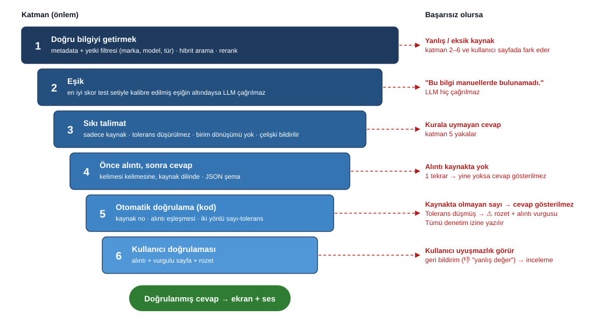

# Visual Agent: Araştırma Sentezi

> **Tarih:** 2026-10-09 · **Güncelleme:** 2026-10-10 (pilot sonuçları ve alınan kararlar işlendi) · **Aşama:** Araştırma (Faz 5: Sentez) + pilot
> **Kapsam:** Manuel tabanlı soru-cevap, kaynak sayfa gösterimi ve sesli yanıt sisteminin araştırma bulguları, önerilen mimari, araç seçimleri, riskler ve bekleyen kararlar.
> **Ayrıntılı notlar:** [Ek A](#ek-a-ayrıntılı-araştırma-notları) · **Bekleyen sorular:** [notes/sorulacaklar.md](notes/sorulacaklar.md) · **Pilot raporu:** [../Pilot/PILOT-RAPORU.md](../Pilot/PILOT-RAPORU.md)

---

## 1. Özet

Proje, atölye ve kalite ekiplerinin marka şartnameleri, makine kılavuzları ve dikim kaynakları hakkında soru sorabildiği bir sistem tasarlamayı amaçlamaktadır. Sistem, ilgili bilgiyi manuellerden bulur, **kaynağa dayalı** bir cevap üretir, bilginin geçtiği **manuel sayfasını vurgulu olarak** gösterir ve cevabı **sesli** okur.

Araştırma aşamasının ana sonuçları:

1. **Mimari netleşti.** Sistem iki hattan oluşur: dokümanların bir kez işlenip indekslendiği *doküman işleme hattı* ve her soruda çalışan *sorgu hattı* (Şekil 1). Çekirdek kısım (doküman ayrıştırma, sayfa ve konum bilgisinin korunması, sayfa üzerinde vurgulama) bir deneme ile doğrulandı: Üç farklı doküman türünde 27/27 test başarılı.
2. **En kritik risk yanlış değerdir.** Uydurulmuş veya yanlış aktarılmış bir değer (ör. dikiş sıklığı, tolerans) yanlış üretime yol açar. Bu risk için **altı katmanlı bir doğruluk güvencesi** tasarlandı (Şekil 2). İlke: Sistem emin değilse cevap vermez, cevap verdiğinde her değer kaynağında gösterilir.
3. **Veri güvenliği için hibrit yapı önerilmektedir.** Dokümanların tamamını işleyen adımlar kurum içinde, yalnızca cevap üretimi (ve sesli okuma) kurumsal sözleşmeli bulut serviste çalışır. Bu yapıda soru başına yalnızca 3–5 metin parçası kurum dışına çıkar (Şekil 3). Kesin karar, müşteri sözleşmelerinin incelenmesine bağlıdır.
4. **Model ve servis seçimi pilotta ölçülerek yapılacaktır.** Genel sıralamalar bu görevi (verilen metne sadakat, Türkçe-İngilizce geçiş, bilinmeyeni "bulunamadı" olarak bildirme) ölçmemektedir. Adaylar aynı test setiyle karşılaştırılacaktır.
5. **Maliyet karar verdirici değildir.** Tahmini kullanımda (günde ~200 soru) bulut LLM ve sesli okuma maliyeti aylık birkaç yüz doları aşmamaktadır. Kararları doğruluk ve gizlilik belirleyecektir.
6. **Pilot çalıştı, mimari doğrulandı, model yetersiz kaldı (2026-10-10).** 7 doküman (611 sayfa) ile tamamen lokal uçtan uca hat kuruldu: arama, kaynaklı cevap, otomatik doğrulama, vurgulu sayfa, sesli okuma. 10 soruda **5 doğru**, ortalama **14,5 sn** (hedef 5 sn). Arama ve kaynak gösterme iyi çalıştı, 7B lokal model cevap üretiminde uydurma yaptı, ama doğrulama katmanı uydurma alıntıları yakaladı. 30B model 24 GB makineye sığmadı. Ayrıntı: [Pilot raporu](../Pilot/PILOT-RAPORU.md), bölüm 10.

**İlerlemek için gereken kararlar** (ayrıntı: Bölüm 9):
- Müşteri sözleşmeleri bulut servislerde işlemeyi yasaklıyor mu? (Q1, 7.1. Müşteriden izin istenmeden geliştirileceği kararlaştırıldı)
- Kurum içinde veya sunucuda GPU kullanılabilir mi? Pilot 7B modelin yetersiz, 30B modelin 24 GB makineye sığmadığını gösterdi (Q5, bütçe)
- Yanlış değer için kabul edilebilir oran nedir? (Hata toleransı)

*Karara bağlananlar:* test setini AI hazırlar, uzman kontrol eder · atölye ağı kesilebilir (yedek gerekli) · giriş e-posta/kod ile · marka bazlı yetki · ses kaydı saklanmaz · sözleşme bitince veri silinir. Tam liste: [notes/sorulacaklar.md](notes/sorulacaklar.md).

---

## 2. Sistemin amacı ve kullanım senaryosu

**Kullanıcılar:** Üretim ustaları, kalite ekibi. Ortam: atölye (gürültü, eldiven, ayakta kullanım).

**Örnek sorular:**
- "Nike ceketlerinde dış dikişlerin SPI değeri nedir?" (marka şartnamesi)
- "S-7300A'da dikiş atlıyor, ne yapmalıyım?" (makine kılavuzu, arıza giderme)
- "E-07 hatası ne anlama geliyor?" (hata kodu)

**Beklenen davranış:**

| Adım | Sistem ne yapar |
|------|-----------------|
| 1 | Sorudaki marka, ürün, makine modeli ve doküman türünü belirler. Kullanıcının yetkili olduğu dokümanlarla sınırlar |
| 2 | İlgili manuel parçalarını bulur (Türkçe soru, İngilizce manuel olabilir) |
| 3 | Kaynaktan **kelimesi kelimesine alıntı** yapar, cevabı Türkçe ve kısa yazar |
| 4 | Cevaptaki her değeri kaynakla otomatik karşılaştırır |
| 5 | Cevabı, orijinal alıntıyı ve **vurgulu kaynak sayfayı** aynı ekranda gösterir |
| 6 | İstenirse cevabın kısa halini sesli okur |
| — | Kaynaklarda bilgi yoksa: "Bu bilgi manuellerde bulunamadı" |

---

## 3. Önerilen mimari


*Şekil 1. Önerilen mimari. Yeşil: kurum içinde çalışan bileşenler. Turuncu: hibrit senaryoda kurumsal sözleşmeli bulut servis (bulut kullanılamazsa kurum içi alternatifleri var, Bölüm 6).*

### 3.1 Doküman işleme hattı (her doküman için bir kez)

| Adım | Ne yapar | Neden önemli |
|------|----------|--------------|
| **Ayrıştırma + OCR** | PDF'ten metin, tablo ve şekilleri **sayfa numarası ve konum (bbox)** bilgisiyle çıkarır. Taranmış sayfaları OCR ile okur | Sayfa ve konum bilgisi, kaynak sayfanın gösterilmesi ve vurgulanması için şarttır |
| **Temizlik + şekil açıklaması** | Üst/alt bilgileri atar, sayfa geçişinde bölünen paragraf ve tabloları birleştirir. Çizimlere görsel dil modeliyle (VLM) metin açıklaması yazar | Dikiş, ölçü ve makine çizimlerindeki bilgi metin aramasıyla da bulunabilir hale gelir |
| **Bölümleme + metadata** | Dokümanı başlık/bölüm sınırlarından parçalara (chunk) böler. Her parçaya marka, ürün, makine modeli, doküman türü, sayfa ve konum bilgisi eklenir | Filtreleme (marka, model, yetki) ve kaynak gösterme bu bilgilere dayanır |
| **Embedding** | Her parçayı anlamını temsil eden bir vektöre çevirir (çok dilli model) | Türkçe soru ile İngilizce manuel arasında anlam eşleşmesi |
| **Vektör veritabanı** | Parçaları, vektörleri ve metadata'yı saklar | Hızlı ve filtreli arama |

### 3.2 Sorgu hattı (her soruda)

| Adım | Ne yapar |
|------|----------|
| **Sorgu analizi + yetki** | Marka, model, doküman türü belirlenir ve kullanıcının izinli markalarıyla kesiştirilir. Yetki filtresi **aramadan önce** ve sunucuda uygulanır |
| **Hibrit arama** | Anlamsal arama ile kelime aramasını birleştirir. Kelime araması kod ve numaralar (ör. "E-07", "ASTM D6193") için gereklidir |
| **Rerank + eşik** | Adayları daha isabetli bir modelle yeniden sıralar. En iyi skor eşiğin altındaysa cevap üretilmez: "Bulunamadı" |
| **LLM** | Önce alıntı, sonra cevap üretir. Çıktı sabit bir şemadadır (cevap, alıntılar, kaynak numaraları, sesli metin, bulunamadı) |
| **Otomatik doğrulama** | Kaynak numaraları, alıntının kaynakta birebir geçtiği ve sayı-tolerans değerleri kod tarafından kontrol edilir |
| **Sesli metin hazırlığı + TTS** | Kısa sesli metindeki sayı, tolerans, kod ve birimler okunacak kelimelere çevrilir ("11 (± 1)" → "on bir, artı eksi bir"), sonra seslendirilir |
| **Ekran** | Cevap + doğrulama rozeti + vurgulu kaynak sayfa + ses oynatıcı |
| **Denetim izi** | Her soru için hangi kaynakların kullanıldığı ve doğrulama sonucu kaydedilir |

### 3.3 Tasarım ilkeleri

| İlke | Açıklama |
|------|----------|
| **Kaynak gösterilmeden cevap yok** | LLM sayfa numarası yazmaz, yalnızca kaynak numarası verir. Sayfa ve konum metadata'dan gelir, bu nedenle uydurulamaz |
| **Doğrulanmadan gösterim ve seslendirme yok** | Cevap, otomatik doğrulamadan geçtikten sonra ekrana ve sese gönderilir |
| **Güvenlik kararları kodda** | Yetki ve filtreleme LLM'e bırakılmaz. Yetkisiz bilgi LLM'e hiç ulaşmaz |
| **Bileşenler değiştirilebilir** | Her bileşen bir adaptör arkasındadır. Bulut ile kurum içi model arasında geçiş, hattın geri kalanını değiştirmez |
| **Arayüz hattan bağımsız** | Soru-cevap hattı tek bir fonksiyon olarak çalışır. Arayüz (pilot veya üretim) bu fonksiyonu çağırır |
| **Hazır orkestrasyon çatısı yok** | Hat her soruda aynı adımları izler. Kritik adımlar projeye özeldir. Modüler Python kodu tercih edilmiştir (bkz. 4) |

---

## 4. Araç ve model seçim önerileri

**Durum sütunu:** ✅ araştırmayla netleşti · 🧪 pilotta ölçülerek kesinleşecek · ⏳ paydaş kararına bağlı

| Bileşen | Önerilen | Alternatif | Gerekçe | Durum |
|---------|----------|------------|---------|-------|
| **PDF ayrıştırma** | Docling | Marker, MinerU | Lokal, açık lisans (MIT), tablo yapısı, sayfa + konum bilgisi. Deneme ile doğrulandı | ✅ (diğer araçlarla karşılaştırma 🧪) |
| **OCR** | Docling içi OCR | Bulut OCR (karşılaştırma için), Surya | Lokal. Denemede bir satır kaybı görüldü, iki OCR'ın birleştirilmesi pilotta denenecek | 🧪 |
| **Şekil / çizim anlama** | Doküman işlemede VLM açıklaması + gerektiğinde cevap anında sayfa görselinin modele verilmesi | Görsel tabanlı arama (ColPali) | Tek arama sistemi, kesin vurgulama, kontrollü maliyet | 🧪 |
| **Bölümleme (chunking)** | Başlık/bölüm bazlı, tablolar bütün, sayfa ve konum listesiyle | Sabit uzunlukta bölme | Manuellerde yapı belirgin, sayfa izlenebilirliği şart | ✅ |
| **Embedding** | bge-m3 (lokal, çok dilli) | multilingual-e5, bulut embedding | Türkçe-İngilizce eşleşme, aynı model hem anlamsal hem kelime vektörü üretir | 🧪 (TR↔EN başarısı) |
| **Vektör veritabanı** | Qdrant (kurum içi) | pgvector | Güçlü metadata filtresi, yerleşik hibrit arama, kolay kurulum | ✅ |
| **Arama** | Hibrit (anlamsal + kelime) | Yalnızca anlamsal | Kodlar, standart ve parça numaraları sık geçiyor | ✅ (kelime tarafının yöntemi 🧪) |
| **Reranker** | bge-reranker-v2-m3 (lokal) | Bulut reranker | Çok dilli, lokal | 🧪 (gecikme) |
| **LLM** | Önceden seçilmemiştir. Pilotta 3 bulut sağlayıcıdan birer orta seviye model + 1 küçük model + 1 açık model aynı test setiyle karşılaştırılır | — | Görev, genel sıralamaların ölçmediği bir beceri gerektiriyor | 🧪 + ⏳ (Q1) |
| **Kurum içi LLM** (bulut kullanılamazsa) | Apache-2.0 lisanslı açık model, ~27–32B, 24 GB GPU | 70B (2 GPU) | 7–8B modeller Türkçe doküman soru-cevapta %49–75 doğrulukta kaldı (2026 çalışması) | 🧪 + ⏳ (GPU) |
| **TTS (sesli okuma)** | Test aşaması: Azure (Türkçe sesler, güçlü telaffuz kontrolü) | Google, ElevenLabs. Kurum içi: Chatterbox Multilingual | Telaffuz kontrolü, kelime zamanlaması, kurum içi çalıştırma seçeneği | 🧪 + ⏳ (Q1) |
| **Sesli metin hazırlığı** | Kural tablosu (sayı, tolerans, kesir, birim, kod) + test listesi | TTS'in kendi normalizasyonu | Türkçe için hazır kapsamlı araç yok, alan dar ve yönetilebilir | ✅ (okunuş alışkanlıkları ⏳) |
| **STT (sesli soru)** | İsteğe bağlı. Bas-konuş + tanınan metni kullanıcı onayı + terim listesi | Hiç olmaması | Mimariyi değiştirmez, sonradan eklenebilir | ⏳ (Q4) |
| **Arayüz** | Pilot: Streamlit + PDF.js tabanlı görüntüleyici (vurgu destekli). Üretim: pilottan sonra karar (özel web arayüzü olası) | NiceGUI | Pilotta en hızlı yol, vurgulama denemede çalıştı | ✅ pilot / ⏳ üretim |
| **Orkestrasyon** | Çatısız, modüler Python + denetim izi | LlamaIndex parçaları, Haystack | Doğrusal hat, projeye özel doğrulama adımları, şeffaflık | ✅ |
| **Değerlendirme** | Kendi ölçüm betiği (değer doğruluğu, kaynak doğruluğu, doğru reddetme) + RAGAS (Türkçe uyarlamalı) + insan değerlendirmesi | DeepEval, TruLens | En kritik metrikler kural tabanlı ölçülebiliyor | ✅ (test seti ⏳) |
| **Yetkilendirme** | Kurumsal giriş (SSO) + rol → marka, aramadan önce zorunlu filtre, varsayılan kapalı | Marka başına ayrı koleksiyon | Sızıntı riski en düşük, esnek | ⏳ (iş kuralı) |

---

### 4.0 Pilotta öğrendiklerimiz (araç seçimi güncellemesi, 2026-10-10)

| Bileşen | Önceki durum | Pilot sonucu | Güncel durum |
|---------|--------------|--------------|--------------|
| PDF ayrıştırma | 🧪 Docling, diğerleriyle karşılaştırma | Docling (OCR kapalı) 0,8–2,7 sn/sayfa, tablo satırı ve bbox çalıştı. Tam sayfa tarama görseli olan Strickland'ın %94'ü kaçırıldı, **PyMuPDF metin katmanı yedeği** eklendi (143/611 sayfa). Marker vb. ile karşılaştırma yapılmadı | ✅ Docling + yedek. Karşılaştırma 🧪 açık |
| OCR | 🧪 Docling içi OCR | Pilotta kapalı: tüm PDF'lerde metin katmanı var. İki OCR birleştirme denenmedi | 🧪 açık (gerçek taranmış veride) |
| Şekil / çizim anlama | 🧪 VLM açıklaması | **Yapılmadı.** Şekiller atlanıyor, çizimler aranamıyor | 🧪 açık, gerçek sistemde zorunlu (çizim olabileceği kararlaştırıldı) |
| Bölümleme | ✅ | Başlık sınırlı, tablo satırı parçaları, uzun paragraf cümle sınırından bölme (SPI değeri uzun paragrafta sulanıyordu). 2921 parça | ✅ doğrulandı |
| Embedding | 🧪 bge-m3 TR↔EN | CPU'da doğru (ilgili 0,65, ilgisiz 0,36–0,42). **Apple GPU'da (MPS) yanlış sonuç** (sessiz hata) | ✅ bge-m3, **CPU veya CUDA GPU**. MPS kullanılmaz |
| Vektör DB | ✅ Qdrant | Gömülü mod, dense + sparse + RRF çalıştı | ✅ |
| Arama | ✅ Hibrit, 🧪 kelime yöntemi | 5 soruda hibrit ve dense ilk 3 aynı: TR sorgu ile sparse kol EN dokümanda katkı vermiyor (A/B ve sorgu çevirisi yapılmadı) | ✅ Hibrit çalışıyor, 🧪 katkısı ölçülmedi |
| Reranker | 🧪 gecikme | CPU'da soru başına 20 aday ≈ 3–7 sn. Skor kalibre değil (doğru cevap −5,4 olabiliyor) | 🧪 GPU'da veya aday azaltarak, eşik kalibrasyonu açık |
| LLM | 🧪 3 bulut + 1 küçük + 1 açık | **Sadece lokal denendi.** 7B: 5/10, uyduruyor ve atıf yazmıyor. 30B (18 GB): GPU belleği aşıldı, kullanılamadı. Bulut denenmedi | 🧪 + ⏳ büyük model için donanım/bulut kararı gerekli |
| Kurum içi LLM | 🧪 ~27–32B, 24 GB GPU | 24 GB birleşik bellekte 30B sığmadı (GPU çalışma belleği ~16–18 GB) | ⏳ Q5 (GPU) ve bütçe |
| TTS | 🧪 Azure test, Chatterbox lokal | Chatterbox Multilingual (CPU) Türkçe kalite iyi (kullanıcı onayı), 4,6 sn ses için 11,6 sn üretim. MPS'te bozuk | ✅ Chatterbox adayı, 🧪 GPU/bulut ile gecikme |
| Sesli metin hazırlığı | ✅ Kural tablosu | Sayı, tolerans, aralık, kesir kuralları çalışıyor ve testli. Kod/model okunuşu belirsiz | ✅ (Q10-a ⏳) |
| STT | ⏳ | Karar: sesli soru isteniyor. Pilotta yok | ⏳ uygulama sonraki tur |
| Arayüz | ✅ pilot Streamlit | Hatasız çalıştı, vurgu doğru yere düşüyor (gözle doğrulandı) | ✅ pilot, ⏳ üretim (özel web) |
| Orkestrasyon | ✅ Çatısız | Modüler Python ~1300 satır, 83 birim test | ✅ |
| Değerlendirme | ✅ Kendi betik | 10 soru, otomatik yargıç. Uzman puanı ve 50–100 soruluk set yok | ✅ betik, ⏳ test seti |
| Yetkilendirme | ⏳ | Kararlar alındı (marka bazlı, e-posta/kod). Uygulanmadı | ⏳ uygulama |

---

## 4.1 Ekran tasarımı (özet)

```
┌───────────────────────────────────────────────────────────────────────────────┐
│ [Marka ▾] [Doküman türü ▾]      Soru: S-7300A'da üst iplik gergin değil...  🎤 Sor │
├────────────────────────────────────┬──────────────────────────────────────────┤
│ CEVAP                 ✔ Doğrulandı │ KAYNAK [1] Brother S-7300A   s.90 (PDF s.101)│
│                                    │ ┌──────────────────────────────────────┐ │
│ Üst iplik gerginliği zayıf veya    │ │ █ Upper thread is not tight        █ │ │
│ alt iplik gerginliği fazla         │ │ █ Is the upper thread tension...   █ │ │
│ olabilir [1] ...                   │ └──────────────────────────────────────┘ │
│ Orijinal alıntı: "Is the upper..." │ ◀ ▶  ➖ ➕   [Dokümanın tamamını aç]      │
│ 🔊 ▶ Oynat  ↺ Tekrar  🐢 Yavaş      │                                          │
└────────────────────────────────────┴──────────────────────────────────────────┘
```

- Cevap ve kaynak sayfa **yan yana**: Değer, kaynağında hemen doğrulanabilir.
- **Doğrulama rozeti:** ✔ doğrulandı · ⚠ kısmen (ör. tolerans eksik) · ✖ bulunamadı.
- **Kritik değerler büyük puntoyla**, orijinal (İngilizce) alıntı her zaman görünür.
- **Basılı ve PDF sayfa numarası birlikte** gösterilir (basılı kılavuzla karşılaştırma için).
- Ses **butonla** başlar (çok kullanıcılı atölye ortamı). Büyük dokunma alanları (eldivenle kullanım).
- Cevap, doğrulama tamamlandıktan sonra gösterilir. Beklerken adım adım durum mesajları.

---

## 5. Doğruluk güvencesi



*Şekil 2. Yanlış değer riskine karşı katmanlı önlemler. Hiçbir katman tek başına yeterli değildir; her katman bir öncekinin kaçırdığını yakalamak üzere tasarlanmıştır.*

**Öne çıkan noktalar:**

- **Eşik test setiyle kalibre edilir.** Şüphede "bulunamadı" tarafı tercih edilir: Yanlış cevap, cevapsızlıktan daha maliyetlidir.
- **Sayı kontrolü iki yönlüdür.** Cevaptaki her değerin kaynakta bulunması yetmez. Kaynaktaki sayı-tolerans ifadesinin cevapta **tam haliyle** bulunması da kontrol edilir. Örnek: Kaynak "11 (± 1)", cevap "11" ise tolerans düşmüştür ve basit kontrol bunu yakalamaz.
- **Dil geçişi riski:** İngilizce "shall not exceed 12" ifadesinin Türkçede "12 olmalı" diye aktarılması anlamı değiştirir. Bu nedenle orijinal alıntı her zaman ekranda gösterilir, çeviri kuralları talimatta tanımlanmıştır.
- **Birim dönüşümü modele bırakılmaz.** Gerekirse kod yapar ve "yaklaşık" olarak işaretler.
- **Sesli okuma da aynı güvenceye tabidir.** Sesli metindeki sayılar doğrulanır, okunuşları kural tablosuyla üretilir. Uzun parça numaraları okunmaz, ekrana yönlendirilir.

### 5.1 Değerlendirme yöntemi

| Unsur | Öneri |
|-------|-------|
| **Test seti** | 50–100 soru. Türler: değer, prosedür, arıza, **cevapsız**, **tuzak** (benzer ama yanlış doküman, ör. S-7300A / S-7300B), Türkçe soru-İngilizce kaynak, görsel, alan dışı, **yetki** |
| **Ana metrikler** | Doğru sayfa ilk 5'te (Recall@5), **değer doğruluğu**, kaynak doğruluğu, sadakat (faithfulness), **doğru reddetme**, gereksiz reddetme, gecikme, maliyet |
| **Taslak hedefler** | Recall@5 ≥ %90 · değer doğruluğu ≥ %98 · doğru reddetme ≥ %90 · tuzak ve yetki testlerinde %100. Kesin hedefler paydaşlarla belirlenecektir |
| **İnsan değerlendirmesi** | Kalite uzmanı, örnek cevapları "bu cevapla üretim yapılır mı?" sorusuyla puanlar |

> "Yanlış değer" ile "cevap yok" ayrı ölçülür. Tek bir "doğruluk yüzdesi" bu iki farklı hatayı gizler.

---

## 6. Veri güvenliği ve dağıtım senaryoları

### 6.1 Hangi veri, hangi kural

| Veri | Hassasiyet | Tabi olduğu kural | Karar mercii |
|------|-----------|-------------------|--------------|
| Müşteri manuelleri ve türevleri (parçalar, vektörler, sayfa görselleri, cevaplar) | Yüksek (ticari sır) | **Müşteri sözleşmesi / NDA** (müşteriye göre değişebilir) | Hukuk birimi, gerekirse müşteri |
| Kullanıcı soruları, kimlikleri, denetim izi, ses kayıtları | Orta (kişisel veri) | **KVKK** | KVKK sorumlusu |

**Tasarım ilkesi:** Bulut servislere kişisel veri gönderilmez (isteklere kullanıcı kimliği eklenmez, ses kurum içinde yazıya çevrilir veya kaydedilmez). Bu, KVKK kapsamındaki yurt dışı aktarım yükümlülüklerinden büyük ölçüde kaçınmayı sağlar (hukuk birimince teyit edilmelidir).

### 6.2 Üç dağıtım senaryosu


*Şekil 3. Bileşenlerin senaryolara göre çalıştığı yer. Önerilen senaryo (B) kesikli çerçeveyle işaretlidir.*

**Temel gözlem:** Bulut kullanımının veri güvenliği etkisi, hangi adımda kullanıldığına göre çok farklıdır. Doküman işleme hattında (OCR, şekil açıklaması, embedding) bulut kullanmak **dokümanın tamamını** dışarı gönderir. Sorgu hattında bulut LLM kullanmak her soruda yalnızca **3–5 parça** gönderir. Kurum içinde çalıştırılması en kolay bileşenler, en çok veri gönderen bileşenlerdir. Hibrit senaryo (B) bu durumdan yararlanır.

- **Şu an (test aşaması):** Açık erişimli (public) test dokümanları kullanıldığı için Senaryo A serbestçe kullanılabilir.
- **Gerçek veriye geçiş:** Senaryo B önerilir. Bulut tarafı için hedeflenen güvenceler: kurumsal sözleşme, veri saklamama (zero data retention), eğitimde kullanmama, bölge seçimi (ör. AB), insan incelemesinin kapatılması.
- **Bulut kesinlikle kullanılamazsa:** Senaryo C. Cevap kalitesi kurum içi modelin pilot sonuçlarına bağlıdır, GPU yatırımı gerekir.
- Kurumun mevcut bir bulut sözleşmesi varsa (Azure, AWS, Google Cloud), modellerin bu platform üzerinden kullanılması hukuki süreci kısaltabilir.

### 6.3 Erişim yetkilendirmesi

- Kullanıcının izinli markaları kurumsal kimlik sisteminden alınır ve **her aramada, sunucu tarafında, aramadan önce** filtre olarak uygulanır. Arayüzdeki marka seçimi yalnızca daraltır.
- Aynı kontrol **tüm erişim noktalarında** uygulanır: PDF/sayfa görüntüleme ve indirme, önceki sorular, önbellek, ses dosyaları, loglar.
- Varsayılan kapalıdır: Markası atanmamış doküman kimseye görünmez.
- Olası iş kuralı: Makine kılavuzları ve genel kaynaklar herkese açık, marka şartnameleri ilgili ekibe özel (paydaşlarca teyit edilecek).

---

## 7. Maliyet ve donanım (yaklaşık)

**Varsayım:** Günde ~200 soru (ayda ~6.000). Fiyatlar 2026-10-09 tarihli resmi fiyat sayfalarından, liste fiyatıdır ve değişebilir.

| Kalem | Aylık yaklaşık | Not |
|-------|----------------|-----|
| Bulut LLM, orta seviye model | ~85–95 $ | Üst seviye ~170 $, küçük modeller ~5–30 $ |
| Bulut TTS | ~36–240 $ | Sesli metnin kısa tutulmasıyla düşer |
| Embedding, vektör DB, reranker | 0 $ (kurum içi) | Donanım ve bakım hariç |

| Senaryo | Donanım |
|---------|---------|
| A / B | Embedding ve reranker için orta seviye bir sunucu (GPU önerilir, şart değil) |
| C | Ek olarak LLM için 24 GB+ bellekli GPU, ayrıca sesli okuma ve şekil açıklaması için GPU kapasitesi |

---

## 8. Riskler

| # | Risk | Etki | Önlem | Durum |
|---|------|------|-------|-------|
| **R4** | **Yanlış veya uydurulmuş değer** | 🔴 Yanlış üretim, müşteri kaybı | Altı katmanlı doğruluk güvencesi (Bölüm 5), iki yönlü sayı-tolerans kontrolü, kaynak sayfanın gösterilmesi | En yüksek öncelik |
| R1 | Tablo ve çizim ağırlıklı sayfalarda metin tabanlı arama zayıf kalabilir | Eksik/yanlış cevap | Şekil açıklaması (VLM), tablo satırı düzeyinde parçalama, gerekirse görsel tabanlı arama | Pilotta ölçülecek |
| R2 | Türkçe sesli okumada teknik terim, sayı ve birimlerin yanlış okunması | Yanlış değer duyulması | Ayrı kısa sesli metin, kural tabanlı normalizasyon, uzun kodların okunmaması | Kural tablosu taslak |
| R3 | Aynı konunun farklı doküman versiyonlarında çelişen bilgi | Yanlış cevap | Versiyon metadata'sı, çelişkinin cevapta bildirilmesi | Gerçek veride versiyon düzeni sorulacak |
| R5 | Cevabın akarak gösterilmesi/seslendirilmesi, doğrulamadan önce değer iletebilir | Yanlış değer | Doğrulamadan sonra gösterim ve seslendirme | Tasarımda çözüldü |
| R6 | Türkçe, ticari lisanslı ve kaliteli kurum içi TTS seçeneği çok az | Bulut kullanılamazsa sesli okuma kalitesi | Chatterbox Multilingual denenecek, Azure kurum içi seçeneği araştırılacak | Pilotta ölçülecek |
| R7 | OCR'ın bir satırı sessizce kaybetmesi (denemede görüldü) | Bilgi aranamaz hale gelir | Bozuk OCR uyarısı, iki OCR kaynağının birleştirilmesi, kullanıcıya her zaman orijinal sayfa görüntüsü | Pilot: PDF metin katmanı yedeği kısmen çözdü, OCR birleştirme açık |
| R8 | Yetki filtresinin bir erişim noktasında unutulması | Gizli bilginin yetkisiz kişiye gösterilmesi | Merkezi zorunlu filtre, tüm erişim noktalarının kontrolü, test setinde yetki testleri | Tasarımda tanımlandı |
| R9 | Sesli soruda model kodunun yanlış tanınması (ör. S-7300A → S-7300B) | Yanlış makinenin kılavuzundan cevap | Tanınan metnin kullanıcı onayı, terim listesi | STT kararına bağlı |
| R10 | Test setinin gerçek dokümanları temsil etmemesi | Pilot sonuçlarının gerçek veriye taşınmaması | Gerçek veriye geçişte test setinin yeniden kurulması ve yeniden ölçüm | Planlandı |
| **R11** | **Donanım sınırı:** 24 GB'lık makine yeterli büyüklükte modeli taşıyamıyor (30B GPU belleğini aştı, ekran bozulması yaşandı) | 7B ile kalite yetersiz, büyük model için donanım yatırımı veya bulut gerekli | GPU sunucu veya bulut LLM, bileşenlerin GPU belleğini paylaşımının hesaplanması | Pilotta görüldü, Q5 ve bütçe cevabı bekleniyor |
| **R12** | **Sessiz hata:** Apple GPU (MPS) üzerinde embedding ve TTS hata vermeden yanlış sonuç üretiyor | Anlamsız sıralama, bozuk ses fark edilmeden kullanılabilir | Her ortamda duman testi (benzerlik ve ses doğrulaması), MPS'in kapatılması | Pilotta görüldü, CPU'ya sabitlendi |
| **R13** | **Model atıf yazmıyor:** hiçbir cevap tam "doğrulandı" almıyor, kullanıcı hep "kısmen" görüyor | Doğrulama rozetinin değeri düşer | Daha güçlü model, doğrulama modları (atıfsız ama alıntı ve sayı doğru), prompt iyileştirme | Pilotta görüldü, açık |
| **R14** | **Belirsiz soruda (ürün/marka belirtilmemiş) yanlış doküman getiriliyor** ve model uydurma alıntı veriyor | Yanlış kaynaktan cevap | Belirsizlikte netleştirme sorusu, ürün başına ayrı cevap | Pilotta görüldü (Q07), açık |

---

## 9. Bekleyen kararlar ve açık sorular

Ayrıntılı liste (kime sorulacağı ve cevap alanlarıyla): [notes/sorulacaklar.md](notes/sorulacaklar.md). **Cevaplananlar** (2026-10-10, [cevaplar.md](../cevaplar.md)) listeden çıkarıldı.

| Öncelik | Soru | Muhatap | Etkilediği karar |
|---------|------|---------|------------------|
| 🔴 | Müşteri sözleşmeleri bulutta işlemeyi yasaklıyor mu? (müşteriden izin istenmeyeceği kararlaştırıldı) | Hukuk | Dağıtım senaryosu (A/B/C), model seçimi |
| 🔴 | Kurum içinde veya sunucuda GPU var mı, bütçe nedir? (pilot: 7B yetersiz, 30B 24 GB'a sığmadı) | BT, yönetim | Senaryo C, model boyutu |
| 🔴 | Yanlış değer için kabul edilebilir oran | Kalite yönetimi | Eşik ayarı, pilot başarı kriteri |
| 🟡 | Bağlantı kesilirse sistem hiç çalışmasın mı, yedek model mi? | BT, kullanıcılar | Yedek model, çevrimdışı davranış |
| 🟡 | Gerçek dokümanların taranmış oranı, görsel türleri, klasör düzeni, versiyonlar | Doküman sahipleri | Doküman işleme hattı, VLM kapsamı |
| 🟡 | Kullanım cihazı ve ortamı (PC, tablet, kiosk) | Kullanıcılar | Arayüz |
| 🟡 | Genel bilgi verilebilir mi, kritik değerde kullanıcı onayı, test setini kontrol edecek uzman | Kalite yönetimi | Prompt kuralı, arayüz onayı, değerlendirme |
| ⚪ | Kodların atölyede okunuşu (301, S-7300A, E-07), sesli cevap uzunluğu | Kullanıcılar | Sesli okuma kuralları |

**Karara bağlananlar:** sözleşme sessizse izinsiz geliştirme · bitişte veri silme · aydınlatma metni ve rol bazlı log erişimi · en fazla ±1 sayfa görünür · marka bazlı yetki · ses kaydı saklanmaz · ağ kesilebilir · e-posta/kod ile giriş · harici hosting · soru TR, manual EN (çift yönlü) · dijital ve taranmış PDF, çizim olabilir · test setini AI hazırlar · sesli soru istenir · Türkçe terim karşılığı · hoparlör · "soru sor" tuşu · sesli soruda marka sorulur · bekleme süresi 5 sn.

---

## 10. Pilot: planlanan ve yapılanlar

**Pilot raporu (ayrıntı, diyagramlar, ölçümler):** [../Pilot/PILOT-RAPORU.md](../Pilot/PILOT-RAPORU.md) · **Kod:** `Pilot/`

**Planlanan kapsam:** Tek marka, 3–5 manuel, uçtan uca prototip: soru → arama → kaynaklı cevap → doğrulama → vurgulu sayfa → sesli okuma.
**Yapılan:** 7 doküman (611 sayfa, 5 kurum), tamamen lokal, yalnızca yazılı soru. Kapsam bilinçli olarak "hafif ve başka bilgisayarda çalıştırılabilir" tutuldu.

### 10.1 Planlanan ölçümler ve ne olduğu

| Konu | Planlanan | Durum | Pilotta ne oldu |
|------|-----------|-------|-----------------|
| **Uçtan uca hat** | Soru → arama → cevap → doğrulama → vurgulu sayfa → ses | ✅ Yapıldı | Streamlit arayüzü, `soru_cevapla()`, 83 birim test |
| **Arama** | Türkçe soru ↔ İngilizce manuel eşleşmesi | ✅ Ölçüldü | Doğru parça ilk 5'te: 6/7 (yalnızca belirsiz soruda başarısız) |
| | Hibrit aramanın katkısı | ⚠ Gözlem | 5 soruda hibrit = dense. Sparse kol TR sorguda katkısız. A/B deneyi yapılmadı |
| | Kelime araması yöntemi, Türkçe kök bulma | ❌ Yapılmadı | BGE-M3 sparse kullanıldı, BM25 ve kök bulucu denenmedi |
| | Sorgu çevirisi (TR→EN) | ❌ Yapılmadı | Q6 açık |
| | Reranker gecikmesi | ✅ Ölçüldü | CPU'da 3–7 sn (20 aday). GPU'da denenmedi |
| **Doküman işleme** | Docling ile diğer ayrıştırıcıların karşılaştırılması | ❌ Yapılmadı | Docling + PyMuPDF yedeği yeterli göründü |
| | OCR birleştirme | ❌ Yapılmadı | PDF'in kendi metin katmanı kullanıldı |
| | Tablo satırı temizliği | ⚠ Açık | Başlık tekrarı ve çizim kodları duruyor |
| | Basılı/PDF sayfa eşleme | ⚠ Kısmen | Basılı etiket okunuyor ("s.90 (PDF s.101)"), kitapçık ve üç dilli düzenlerde güvenilir değil |
| **Görsel anlama** | VLM açıklaması ile görsel arama karşılaştırması | ❌ Yapılmadı | Şekiller atlanıyor |
| **LLM** | Bulut ve kurum içi adayların aynı test setinde karşılaştırılması | ⚠ Kısmen | 1 lokal aday ölçüldü (7B). 30B sığmadı. Bulut yok (karar: önce lokal) |
| | Talimat dili, alıntı birebirlik oranı | ⚠ Kısmen | Türkçe talimat kullanıldı. Alıntı birebirliği doğrulama katmanı tarafından kontrol ediliyor, oran hesaplanmadı |
| **Sesli okuma** | Adayların test cümleleriyle karşılaştırılması | ⚠ Kısmen | 1 aday (Chatterbox), 1 cümle, kullanıcı kulağıyla: kalite iyi. Gürültü ve diğer adaylar yok |
| | Chatterbox Türkçe kalitesi | ✅ Ölçüldü | İyi. CPU'da gerçek zamanın ~2,5 katı |
| **Arayüz** | Vurgunun doğrulanması | ✅ Yapıldı | Sayfa görselinde gözle doğrulandı. Tarayıcıda kullanıcı oturumu yapılmadı |
| | Kullanıcı tepkisi, sesli soru ihtiyacı | ❌ Yapılmadı | Sesli soru isteği cevaplardan biliniyor, pilot dışı |
| **Doğruluk güvencesi** | Altı katmanlı güvence | ⚠ Kısmen | Kod tarafı katmanları (alıntı birebirliği, sayı, tolerans, atıf) uygulandı ve testli. Eşik kalibrasyonu, kullanıcıya rozet ve denetim izi kısmen/yok |
| **Yetkilendirme** | Marka filtresi, yetki testleri | ❌ Yapılmadı | Arayüzde marka filtresi var, yetki yok |

### 10.2 Pilot başarı kriterleri: hedef ve sonuç

| Ölçüt | Taslak hedef | Pilot sonucu | Not |
|-------|--------------|--------------|-----|
| Doğru sayfa ilk 5'te (Recall@5) | ≥ %90 | **6/7 (%86)** | Örneklem çok küçük |
| Değer doğruluğu | ≥ %98 | **2/3** | 7B model, atıf ve uydurma sorunu |
| Doğru reddetme | ≥ %90 | **1/3** | Q09 beklenen sonucu elle kontrol gerek |
| Tuzak (S-7300A/B) | %100 | **1/1** | Tek soru |
| Yetki testleri | %100 | Yapılmadı | |
| Yanlış değerin "doğrulandı" diye geçmesi | 0 | **0** | Doğrulama yakaladı. Kendi kusuru (model kodu) birim testle bulundu ve düzeltildi |
| Yanıt süresi | ≤ 5 sn | **14,5 sn** (ilk soru hariç 13,3) | Arama 5,5 + model 9,0 |
| Genel doğruluk | — | **5/10** | |

### 10.3 Uygulama sırası: durum

| # | Adım | Durum |
|---|------|-------|
| 1 | Doküman işleme hattı (ayrıştırma, bölümleme, metadata, indeksleme) | ✅ Pilotta yapıldı (şekil açıklaması hariç) |
| 2 | Arama (hibrit + filtre + rerank) ve test setiyle ölçüm | ⚠ Çalışıyor, ölçüm 10 soru, A/B ve eşik açık |
| 3 | Cevap üretimi, kaynak gösterme ve otomatik doğrulama | ✅ Yapıldı, model yetersiz |
| 4 | Sayfa görüntüleyici ve vurgulama | ✅ Yapıldı |
| 5 | Sesli metin hazırlığı ve TTS | ✅ Yapıldı (CPU, yavaş) |
| 6 | Arayüzün birleştirilmesi | ✅ Streamlit pilot |
| 7 | Değerlendirme ve iyileştirme turu | ⚠ İlk tur yapıldı (10 soru), geniş test seti bekliyor |
| 8 | Yetkilendirme ve güvenlik | ❌ Sonraki aşama |
| 9 | Gerçek veriye geçiş ve yeniden ölçüm | ❌ Sonraki aşama |

### 10.4 Sonraki adımlar (öncelik sırasıyla)

1. Aynı 10 soruyu daha büyük bir modelle (bulut referansı veya GPU sunucu) çalıştırmak. Karar bekleyen: Q1, Q5, bütçe
2. Test setini 50–100 soruya çıkarmak, uzman kontrolü
3. Belirsiz soru akışı (ürün/marka belirtilmemişse netleştirme veya ürün başına cevap)
4. Eşik kalibrasyonu, doğrulama modları (atıf zorunlu / ölçülü)
5. Sorgu çevirisi ve hibrit A/B deneyi
6. VLM ile şekil açıklaması
7. Sesli soru (STT)
8. Yetkilendirme, denetim izi, silme akışı, admin paneli

---

## Ek A: Ayrıntılı araştırma notları

| Konu | Not dosyası |
|------|-------------|
| RAG temelleri (bölümleme, embedding, vektör DB, hibrit arama, rerank, metadata) | [notes/rag-temelleri.md](notes/rag-temelleri.md) |
| PDF işleme (ayrıştırma araçları, OCR, şekiller, metadata şeması) | [notes/pdf-isleme.md](notes/pdf-isleme.md) |
| Kaynak gösterme ve sayfa vurgulama, görsel tabanlı arama | [notes/kaynak-gosterme.md](notes/kaynak-gosterme.md) |
| Çekirdek deneme raporu (27/27 test) | [../faz1_output/report.md](../faz1_output/report.md) |
| TTS (sesli okuma), metin normalizasyonu | [notes/tts.md](notes/tts.md) |
| Arayüz, orkestrasyon, STT | [notes/arayuz-orkestrasyon.md](notes/arayuz-orkestrasyon.md) |
| LLM seçimi, doğruluk güvencesi, değerlendirme | [notes/llm-degerlendirme.md](notes/llm-degerlendirme.md) |
| Taslak sistem talimatı ve çıktı şeması | [notes/prompt-taslak.md](notes/prompt-taslak.md) |
| Veri güvenliği ve erişim | [notes/guvenlik.md](notes/guvenlik.md) |
| Test doküman envanteri | [notes/manual-envanteri.md](notes/manual-envanteri.md) |
| **Görev özetleri** (her görev için karar tablosu ve önerilen sistem) | [notes/gorev-ozetleri.md](notes/gorev-ozetleri.md) |
| Hazırlık (cevaplar, doküman listesi, test soruları) | [notes/00-hazirlik.md](notes/00-hazirlik.md) |
| Bekleyen sorular | [notes/sorulacaklar.md](notes/sorulacaklar.md) |
| Pilot raporu (kurulum, ölçüm, problemler, öneriler) | [../Pilot/PILOT-RAPORU.md](../Pilot/PILOT-RAPORU.md) |
| Araştırma planı ve günlük | [req.md](req.md) |

## Ek B: Terimler

| Terim | Açıklama |
|-------|----------|
| **RAG** (Retrieval-Augmented Generation) | Cevabı üretmeden önce ilgili bilgiyi dokümanlardan bulup modele veren yöntem |
| **Chunk** (parça) | Dokümanın arama için bölündüğü bölüm |
| **Embedding** | Metnin anlamını temsil eden sayı dizisi (vektör). Anlamca yakın metinlerin vektörleri birbirine yakındır |
| **Hibrit arama** | Anlam araması ile kelime aramasının birlikte kullanılması |
| **Rerank** | İlk aramada bulunan adayların daha isabetli bir modelle yeniden sıralanması |
| **bbox** | Bir metin bloğunun sayfa üzerindeki konumu (dikdörtgen koordinatları). Vurgulama için kullanılır |
| **OCR** | Taranmış sayfa görüntüsündeki yazının metne çevrilmesi |
| **VLM** | Görselleri okuyabilen dil modeli |
| **LLM** | Büyük dil modeli. Bu sistemde bilgi kaynağı değil, verilen kaynakları okuyup cevap yazan bileşen |
| **Halüsinasyon** | Modelin kaynakta olmayan bilgiyi üretmesi |
| **TTS / STT** | Metinden sese / sesten metne çevirme |
| **SPI** | Stitches per inch: inç başına dikiş sayısı |
| **ZDR** (zero data retention) | Bulut sağlayıcının işlenen veriyi saklamaması taahhüdü |
| **SSO** | Kurumsal hesapla tek giriş |
| **Recall@5** | Doğru kaynağın ilk 5 sonuç içinde bulunma oranı |
