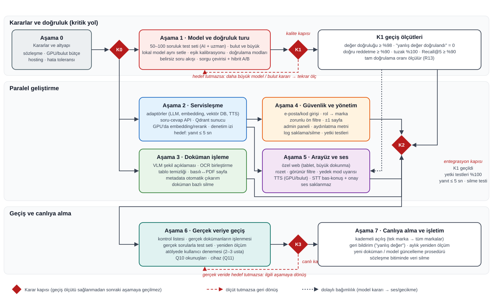
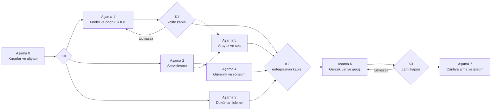

# Uygulama Aşaması Planı

> **Tarih:** 2026-10-13 (pilotun son sonuçlarıyla güncellendi) · **Durum:** Öneri (paydaş onayı bekliyor)
> **Dayanak:** Araştırma notları (Adım 1–7), [ARASTIRMA-SENTEZI.md](ARASTIRMA-SENTEZI.md), pilot sonuçları ([PILOT-RAPORU.md](PILOT-RAPORU.md)), paydaş cevapları ([10-sorulacaklar.md](arastirma/10-sorulacaklar.md), [calisma-notlari/notlar/sorulacaklar.md](calisma-notlari/notlar/sorulacaklar.md))
> **Önceki sürüm:** Bu dosyanın 2026-10-09 tarihli hali (pilot öncesi T1–T9 listesi). Bu sürüm pilot bulgularıyla yeniden yazıldı.

---

## 1. Özet

Araştırma aşaması ve pilot tamamlandı. Pilot, uçtan uca akışın **teknik olarak kurulabildiğini** gösterdi: yazılı ve sesli soru → netleştirme → arama → kaynaklı cevap → doğrulama → vurgulu sayfa → sesli okuma. Üretime geçmeden önce çözülmesi gereken üç ana açık var:

1. **Cevap kalitesi yetersiz.** Arama, cevaplanabilir soruların hepsinde doğru sayfayı buldu (12/12), ama lokal 7B model 18 sorunun yalnız 9'unda doğru sonuç verdi. Hatalar: doğru parçadan yanlış sayı seçme, uydurma adım, Çince/Korece karıştırma. Model atıf yazmadığı için hiçbir cevap tam "doğrulandı" almadı. 30B model mevcut donanıma sığmadı.
2. **Yanıt süresi hedefin çok üstünde.** Mac'te 14,5 sn, GPU'suz Windows dizüstünde soru başına ~3 dk. Hedef 5 sn.
3. **Güvenlik ve yönetim katmanı yok.** Marka bazlı yetki, giriş, denetim izi, silme ve admin paneli kararlaştırıldı, ama uygulanmadı.

Plan bu üç açığı **sırayla değil, kritik yol + paralel geliştirme** şeklinde ele alır:

- **Kritik yol:** Model ve doğruluk. Bu geçmeden gerçek veriye geçilmez.
- **Paralel geliştirme:** Servisleşme, doküman işleme, güvenlik, arayüz ve ses.
- **Karar kapıları:** Her ana geçişte ölçülebilir bir kapı var. Ölçüt sağlanmadan sonraki aşamaya geçilmez.

**Kaba süre:** 1–2 geliştiriciyle yaklaşık **4–5 ay**. Paydaş kararlarının hızına ve model/donanım seçimine bağlıdır (Bölüm 6).

Hedef mimari: [MIMARI.md, Bölüm B](MIMARI.md).

---

## 2. Başlangıç noktası: pilot sonuçları

Ayrıntı: [PILOT-RAPORU.md](PILOT-RAPORU.md).

| Ölçüt | Hedef | Pilot (18 soru, 2026-10-13) | Açık |
|-------|-------|-----------------------------|------|
| Doğru sayfa ilk 5'te (Recall@5) | ≥ %90 | **12/12** | Örneklem küçük |
| Değer doğruluğu | ≥ %98 | 6/9 | Model doğru parçadan yanlış sayı seçiyor (R4). Doğrulama bunu yakalamıyor |
| Doğru reddetme | ≥ %90 | 2/4 | Eşik konamadı (skorlar iç içe) |
| Belirsiz soruda netleştirme | – | 2/2 | Model çalışmadan |
| Yanlış değerin "doğrulandı" diye geçmesi | 0 | **0** | Ama yanlış sayılar "kısmen" rozetiyle geçti |
| Yetki testleri | %100 | Yapılmadı | Uygulama yok (R8) |
| Yanıt süresi | ≤ 5 sn | 14,5 sn (Mac) · ~3 dk (GPU'suz Windows) | GPU veya bulut LLM şart |
| Sesli metinde değer | Ekrandakiyle aynı | ✅ Ayrı kontrol, düşerse ses cevaptan üretiliyor | – |
| Genel doğruluk | — | 9/18 | — |

**Pilotta çalışan ve korunacak olanlar:**
- **Doküman işleme:** Docling + PyMuPDF yedekleri (metin katmanı, tablo), başlık bazlı parçalama, tablo satırı parçaları.
- **Arama:** bge-m3 + Qdrant hibrit arama, bge-reranker.
- **Karar katmanı:** varlıklar, kaynak uyumu, netleştirme akışları.
- **Doğrulama:** iki yönlü sayı-tolerans doğrulaması.
- **Sunum ve ses:** sayfa vurgulama, Türkçe sesli metin kuralları, Chatterbox Türkçe ses, faster-whisper sesli soru.
- **Testler:** 204 birim test.

### 2.1 Pilotta yapılanlar ve plana etkisi

Pilot sırasında bulunan sorunların bir kısmı pilotta düzeltildi. Bunlar uygulama aşamasında **sıfırdan yapılmayacak, servis koduna taşınacak.** Ayrıntı: [PILOT-RAPORU.md §6](PILOT-RAPORU.md).

| Pilotta yapılan | Plandaki karşılığı |
|-----------------|--------------------|
| **Karar katmanı:** dokümansız marka kuralı; model, ürün ve müşteri markası belirsizliğinde seçim düğmeleri; varlık rolleri tablosu (kaynak uyumu); "soru neyi soruyor" kontrolü ve konu seçenekleri; makine + ürün sorusunda kaynak seçimi; model netleştirmesinin kullanıcıya sorulması; "diğer modelde ara" | Aşama 1 belirsizlik akışları ve yeni satır "Soru niyeti" |
| **Terimler ve dil:** 29 terimlik taslak terim sözlüğü (uzman onayı bekliyor), İngilizce eşanlamlılar, cevabın soru dilinde verilmesi, söylenmiş kodların yazılı koda çevrilmesi ("Es yetmiş üç yüz A" → "S-7300A") | Aşama 1 terim sözlüğü, Aşama 5 STT |
| **Doküman işleme:** PyMuPDF tablo yedeği (arıza tablolarında kayan hücreler), içindekiler filtresi, kısmi yeniden indeksleme | Aşama 3 kalite kontrolleri |
| **Doğrulama:** atıf işareti ve yarım atıf ayıklama, ses için ayrı tolerans kontrolü (R15), tekrar döngüsü, yabancı alfabe, adım numaraları, boş cevap | Aşama 1 doğrulama |
| **Prompt:** bölüm başlığı, şema uzunluk sınırları, kısa alıntı kuralı, Latin alfabesi, cevap dili | Aşama 1 prompt |
| **Sesli soru (STT):** bas-konuş, faster-whisper, kayıttan üretilen terim ipucu, onay ekranı, sesli soruda kaynak yoksa sorma, ses saklanmıyor | Aşama 5 STT (hedef mimari aşağıda) |
| **Arayüz ve ortam:** eski cevabın temizlenmesi, yalnız cevabın kaynağının gösterilmesi, adım adım durum, kalıcı ses kaydı, Windows UTF-8, kendiliğinden çevrimdışı mod | Aşama 2, 5 |
| **Ölçüm:** 18 soruluk set, eşik ölçümü, terim deneyi, STT ölçümü, 204 birim test | Aşama 1 test seti |

**Pilotta bulunan, plana eklenen:**
- **Riskler:** R15 (seste tolerans), R16 (atölye terimleri), R17 (model dil kayması).
- **Kör noktalar:** Doğrulamanın ilgililiği ve sayı seçimini denetlememesi. Bunun için cevap-alıntı hizalaması öneriliyor.
- **Ölçüm ve ortam:** Rerank skoruyla eşik konamaması. Gerçek seste kodların kelimeyle yazılması. Kural tabanlı kararların varlığın rolünü bilmemesi (soru niyeti).

---

## 3. Plan akışı



*Şekil 1. Aşamalar ve karar kapıları. Kırmızı baklava: karar kapısı. Kesikli kırmızı ok: ölçüt tutmazsa geri dönüş. Noktalı ok: dolaylı bağımlılık (model kararı ses ve gecikmeyi etkiler). PNG: [sekiller/uygulama-plani.png](sekiller/uygulama-plani.png)*

Düzenlenebilir sürüm (Mermaid):



---

## 4. Aşamalar

### Aşama 0 · Kararlar ve altyapı

**Amaç:** Teknik seçimleri belirleyen kararları almak ve geliştirme altyapısını hazırlamak. Bu kararlar olmadan model ve dağıtım seçimi yapılamaz.

| İş | Ayrıntı | Muhatap |
|----|---------|---------|
| Müşteri sözleşmelerinin bulut kontrolü | Sözleşmeler bulutta işlemeyi **açıkça yasaklıyor mu?** (İzin istenmeyeceği kararlaştırıldı, yasak kontrolü açık) | Hukuk |
| Model erişimi ve bütçe | Bulut LLM hesabı (kurumsal sözleşme, veri saklamama, AB bölgesi) ve/veya GPU sunucu. Aylık bütçe sınırı | Yönetim, BT |
| Hosting | Harici hosting gerekirse: sağlayıcı, bölge, GPU seçeneği. Not: Sunucu (Qdrant dahil) kendi kontrolümüzde olsa da fiziksel olarak hosting firmasında durur; sağlayıcının veri konumu ve sözleşmesi hukukla birlikte netleşmeli | BT, hukuk |
| Hata toleransı | Yanlış değer için kabul edilebilir oran (öneri: "doğrulandı" rozetiyle yanlış değer = 0) | Kalite yönetimi |
| Test seti sorumlusu | AI hazırlar, uzman kontrol eder (karar var). Kontrol edecek uzmanın atanması | Kalite |
| Geliştirme ortamı | Git deposu, CI (otomatik test), ortak geliştirme sunucusu | Ekip |

**Çıktı:** Yazılı karar kaydı (dağıtım senaryosu B veya C, model sınıfı, bütçe, hosting).
**K0 ölçütü:** Senaryo ve model erişimi kesinleşti, test seti uzmanı atandı.
**Kaba süre:** 1–2 hafta (paydaş takvimine bağlı).

### Aşama 1 · Model ve doğruluk turu (kritik yol)

**Amaç:** Cevap kalitesini K1 ölçütlerine çıkarmak. Projenin en kritik riski (R4, yanlış değer) burada çözülür.

| İş | Ayrıntı | Pilot bulgusu / gerekçe |
|----|---------|-------------------------|
| Test setini büyütmek | 50–100 soru, 9 tür: değer, prosedür, arıza, **cevapsız**, **tuzak**, TR soru–EN kaynak, EN soru, görsel, yetki. AI yazar, uzman kontrol eder | Pilot 10 soru, oranlar kesin değil |
| Model karşılaştırması | Aynı set, aynı prompt: en az 1 bulut orta seviye model (referans) + 1 büyük lokal model (27–32B, GPU sunucuda) + mevcut 7B | 7B 5/10. Sağlayıcı önceden seçilmez |
| Doğrulama modları | "Katı" (atıf zorunlu) ve "ölçülü" (atıf yoksa alıntı + sayı doğruysa işaretli onay). Hangi modun kullanılacağı iş kararı | R13: hiçbir cevap tam doğrulanmadı |
| Eşik kalibrasyonu | Cevaplı ve cevapsız soruların rerank skorlarıyla eşik belirlenir. Şüphede "bulunamadı". Rerank skoru tek başına yetmiyor; ek sinyaller (sorgu varlıklarının eşleşmesi, modelin "bulunamadı" kararı) birlikte değerlendirilir | Doğru reddetme 1/3. 18 soruluk ölçümde cevaplı (Q12 −6,87) ve cevapsız (Q18 −5,49) skorlar iç içe (2026-10-13) |
| İngilizce eşanlamlılar | Ürün/model eşanlamlılarına İngilizce karşılıklar (coat, trousers...) | Q16 (İngilizce soru) pantolon şartnamesine gitti |
| Atölye terim sözlüğü | Türkçe atölye terimi → kılavuzdaki İngilizce terim (çağanoz → rotary hook, masura → bobbin, baskı ayağı → presser foot, dizlik → knee lifter, transportör → feed dog). Sorgu genişletme ve sorgu çevirisiyle birlikte. Sözlük kullanıcılarla birlikte büyütülür. LLM sözlüğe aday önerebilir, uzman onaylar; sorgu anında doğrulanmamış LLM çevirisi kullanılmaz | "Çağanoz" sorusu bulunamadı. **R16:** Deneyde bge-m3 5 terimin 1'ini, qwen2.5:7b 0'ını doğru eşledi ("dizlik = bobbin") |
| Belirsizlik akışlarının genişletilmesi | Pilotta model (A / B / ikisi ayrı, "diğer modelde ara"), ürün (ceket / pantolon) ve müşteri markası için var (2026-10-13). Gerçek sistemde varlık listeleri elle değil doküman kaydından ve yetkiden üretilir | R14: "Dış görünür dikişlerde SPI" sorusunda seçim sunulmuyor |
| Soru niyeti ve eksik bilgi | Sorunun **neyi** sorduğunu belirleme: makine ayarı mı, ürün gereksinimi mi ("ceket dikerken iplik gerginliği" kılavuza, "ceket ölçüsü" şartnameye). Gerekli bilgi eksikse (hangi ölçü, hangi beden, hangi dikiş) sorulur. Pilottaki kural tabanlı tablo ve kelime kuralı test setinde yanlış alarm oranıyla ölçülür; yetmezse model tabanlı tespit | Pilot: "Brother A makinesi ceket ölçüsü" önce alakasız "5 mm", sonra rastgele beden satırları getirdi. Kural tabanlı çözümün sınırları: [MIMARI.md §7](MIMARI.md) |
| Belirsiz soru akışı | Ürün/marka/model belirtilmemişse: yazılı soruda tüm yetkili dokümanlar + ürün başına ayrı cevap veya netleştirme, sesli soruda marka sorulur (karar) | R14: Q07'de yanlış doküman |
| Sorgu çevirisi + hibrit A/B | TR soru → EN kelime araması için çeviri. Dense / hibrit / hibrit+çeviri karşılaştırması | Hibrit ile dense aynı sonucu verdi |
| Prompt iyileştirme | Alıntı birebirliği oranı, atıf yazma, Türkçe terim karşılıkları | Uydurma alıntı gözlendi |
| **Sesli metin doğrulaması** | İki yönlü sayı-tolerans kontrolü `sesli_metin`'e de uygulanır. Tutmazsa sesli metin cevaptaki doğrulanmış değerden kodla üretilir ya da ses kapatılır | **R15:** Ekranda "11 (± 1)", seste "on bir dikiş" (Windows denemesi, 2026-10-13) |
| Sayı dışı uydurma kontrolü | Cevaptaki ad/sıfat gibi içerik kelimelerinin alıntıda olup olmadığına hafif bir kontrol (uyarı düzeyinde) | Cevaba kaynakta olmayan "yeşil ceket" eklendi, doğrulama yakalamadı |

**Çıktı:** Seçilmiş model ve mod, kalibre eşik, büyütülmüş test seti, ölçüm raporu.
**K1 ölçütü (kalite kapısı):** Değer doğruluğu ≥ %98 · "yanlış değer doğrulandı" = 0 · doğru reddetme ≥ %90 · tuzak %100 · Recall@5 ≥ %90 · tam doğrulama oranı raporlanır.
**K1 tutmazsa:** Daha büyük model veya bulut kararı Aşama 0'a geri gider, ölçüm tekrarlanır.
**Kaba süre:** 3–4 hafta.

### Aşama 2 · Servisleşme

**Amaç:** Pilot kodunu, aynı çekirdek akışı koruyarak çok kullanıcılı, değiştirilebilir ve hızlı bir servise dönüştürmek.

| İş | Ayrıntı |
|----|---------|
| Adaptörler | LLM, embedding/reranker, vektör DB ve TTS için ortak arayüzler. Bulut ve lokal arasında geçiş kod değiştirmeden yapılır (pilot raporu §9) |
| Yapılandırma profilleri | `pilot` (laptop) ve `server` profilleri, ortam değişkenleri |
| Soru-cevap API | `soru_cevapla()` bir HTTP uç noktasının arkasına alınır (ör. FastAPI). Arayüz bağımsız |
| Qdrant sunucu | Gömülü mod yerine sunucu: çok kullanıcı, yedekleme, silme |
| GPU'da embedding ve rerank | Rerank aday sayısı ayarı (20 → 8–10) ve GPU. Hedef: arama ≤ 1,5 sn |
| Denetim izi | Her soru için kaynaklar, skorlar, doğrulama sonucu, süre. Kimlik saklama politikası Aşama 4'te |
| Çevrimdışı davranış | Bulut LLM'e erişim yoksa lokal yedek model + "yedek mod" uyarısı (ağ kesilebilir kararı) |
| Ortam doğrulama testleri | Her kurulumda embedding benzerliği ve ses için duman testi (R12: GPU'da sessiz hata görüldü) |
| Platformdan bağımsız kurulum | Tüm dosya okuma/yazmalarında `encoding="utf-8"` (Windows'ta pilot indeksi bu yüzden ilk denemede çöktü), `setup.sh`'nin Windows/Docker karşılığı |
| Tam çevrimdışı çalışma | `HF_HUB_OFFLINE=1` sabitlenir: embedding kütüphanesi açılışta Hugging Face'e güncellik sorgusu yapıyor (veri gönderilmiyor, ama ağ kesilince gecikme/hata riski) |

**Çıktı:** Çalışan API, sunucu profili, entegrasyon testleri.
**Kabul ölçütü:** Yanıt süresi ≤ 5 sn (seçilen modelle, %90'lık dilim), pilot testlerinin tamamı geçer.
**Kaba süre:** 3–4 hafta, Aşama 1 ile paralel.

### Aşama 3 · Doküman işleme genişletme

**Amaç:** Gerçek dokümanların (dijital, taranmış, çizimli) eksiksiz işlenmesi. "Çizim ve görsel her zaman olabilir" kararı gereği.

| İş | Ayrıntı |
|----|---------|
| Şekil açıklaması (VLM) | Her çizime doküman işleme sırasında bir kez metin açıklaması yazılır, `figure` parçası olarak indekslenir. Cevap anında gerekirse sayfa görseli modele verilir |
| OCR birleştirme | Taranmış sayfada iki OCR kaynağı (PDF metin katmanı + Docling OCR) karşılaştırılır, bozuk bölümde diğeri kullanılır (R7) |
| Tablo temizliği | Başlık tekrarı ve çizim kodlarının ayıklanması |
| Basılı ↔ PDF sayfa eşleme | Kitapçık ve çok dilli düzenler dahil, güvenilmeyen etiketler gösterilmez |
| Metadata otomatik çıkarımı | Klasör/dosya adı kuralı + kapak bilgisi + LLM çıkarımı, emin olunamayanlar için insan onayı (Q7) |
| Doküman bazlı silme | Bir doküman ve tüm türevleri (parçalar, vektörler, sayfa görselleri, log alıntıları) tek işlemle silinir (karar) |
| Kapsam raporu | Her doküman için: sayfa başına çıkarılan metin, tablo, şekil sayısı, OCR uyarıları |

**Çıktı:** Genişletilmiş doküman işleme servisi ve kapsam raporu.
**Kabul ölçütü:** Test dokümanlarında görsel sorular aranabilir, silme testi geçer, OCR uyarıları raporlanır.
**Kaba süre:** 3–5 hafta, paralel.

### Aşama 4 · Güvenlik ve yönetim

**Amaç:** Alınan güvenlik ve KVKK kararlarını uygulamak (R8).

| İş | Ayrıntı |
|----|---------|
| Giriş | E-posta + kod (karar: SSO şart değil) |
| Rol → marka yetkisi | Kullanıcının izinli markaları, aramadan **önce**, sunucuda, tek merkezi fonksiyonda filtre. Arayüz seçimi sadece daraltır. Varsayılan kapalı |
| Sayfa görüntüleme kısıtı | Yetkiye göre cevap sayfası ± 1 sayfa (karar). Dokümanın tamamı sadece yetkili rollere |
| Tüm erişim noktaları | PDF/sayfa görseli, önceki sorular, önbellek, ses dosyaları, loglar aynı yetki kontrolünden geçer |
| Admin paneli | Kullanıcı ve rol yönetimi, log erişimi (rol bazlı), doküman silme |
| Aydınlatma metni | İlk girişte gösterilir, onay kaydedilir (karar). Metin hukuk tarafından hazırlanır |
| Log saklama | Süre ve anonimleştirme politikası (KVKK sorumlusu). Ses kaydı tutulmaz, metni tutulabilir (karar) |
| Yetki testleri | Test setinde yetki soruları (ör. GL-PD kullanıcısı başka markayı soruyor) + yan kapı testleri |

**Başlangıç noktası:** Arşivdeki taslak `security.py` (e-posta/kod girişi, rol → marka filtresi, ±1 sayfa): [_arsiv/README.md](_arsiv/README.md).
**Kabul ölçütü:** Yetki testleri %100, silme testi geçer, log erişimi rol bazlı.
**Kaba süre:** 2–3 hafta.

### Aşama 5 · Arayüz ve ses

**Amaç:** Atölye koşullarına uygun üretim arayüzü ve sesli kullanım.

| İş | Ayrıntı |
|----|---------|
| Özel web arayüzü | Cevap ve vurgulu sayfa yan yana, doğrulama rozeti, kritik değer büyük punto, orijinal alıntı görünür, tablet uyumlu, eldivenle kullanılabilir büyük dokunma alanları |
| Filtre | Marka/doküman filtresi görünür ve gizlenmez (karar) |
| Durum mesajları | "Aranıyor · Cevap hazırlanıyor · Kaynakla kontrol ediliyor". Cevap doğrulamadan sonra gösterilir (R5) |
| TTS | GPU'da Chatterbox veya bulut TTS (Aşama 1/0 kararına göre). Doğrulanmış metin, kural tabanlı normalizasyon, hoparlör |
| STT | "Soru sor" tuşu (bas-konuş), tanınan metin kullanıcıya gösterilir ve onaylanır, terim listesi. **Ses saklanmaz** (karar) |
| Sesli soruda marka | Marka belirtilmemişse sistem sorar (karar) |
| Kod okunuşları | 301, S-7300A, E-07 okunuşları kullanıcılarla netleştirilip kural tablosuna eklenir (Q10-a) |

#### STT (sesli soru) hedef mimarisi

Pilotta ilk sürümü var (2026-10-13, [MIMARI.md §A4.12](MIMARI.md)). Gerçek sistemdeki hali:

```
 Cihaz (tablet / PC, atölye)              Sunucu (yerel ağ, TLS)                             Arayüz
 ──────────────────────────              ──────────────────────                             ──────
 [🎤 bas-konuş] ── ses (bellekte) ──►  STT servisi                                         Onay ekranı
                                        ├─ çözme + 16 kHz mono (diske yazılmaz)              ├─ tanınan metin (düzenlenebilir)
                                        ├─ Whisper large-v3-turbo (GPU)                      ├─ "sorudan okunan": S-7300A, ceket
                                        │   ya da bulut STT (Q1 izin verirse)                ├─ düşük güven uyarısı
                                        ├─ terim ipucu ◄── doküman kaydı + terim sözlüğü     └─ [Sor] ── soru_cevapla(sesli=True)
                                        │   (model adları, hata kodları, atölye terimleri)        │
                                        └─ metin + güven + süre ──────────────────────────►      ├─ kaynak belirtilmemişse
                                           (ses silinir, denetim izine yalnız metin)             │   "hangi makine/ürün?" (karar)
                                                                                                 └─ cevap → TTS (sesli metin)
```

| Bileşen | Hedef | Gerekçe |
|---|---|---|
| Dinleme | Bas-konuş (sürekli dinleme yok) | Gürültüde yanlış tetikleme ve gizlilik |
| Motor | GPU'da faster-whisper **large-v3-turbo**. Bulut serbestse Azure STT (phrase list) | Pilotta CPU süresi ölçüldü. Karar Q1 ve Q5 ile |
| Terim ipucu | Ingestion'da doküman kaydından **otomatik** çıkarılır: marka, model adları, hata kodları, terim sözlüğü | R9: "S-7300A"nın "S-7300B" yazılması yanlış makinede arama demek |
| Onay | Tanınan metin ve "sorudan okunan" varlıklar gösterilir, kullanıcı düzeltip gönderir. Ses yerine ekranda yazı (A/B ayrımı ses yerine yazıyla daha net) | R9, arayuz-orkestrasyon K5 |
| Sesli soruda kaynak | Makine, ürün veya marka geçmiyorsa arama yapılmadan sorulur | Karar (cevaplar) |
| Gizlilik | Ses yalnız bellekte işlenir, diske ve loga yazılmaz; denetim izinde yalnız metin. Ses saklamak ayrıca izin ister | KVKK, karar |
| Ölçüm | Ustaların gerçek sesiyle, atölye gürültüsünde: kod ve model adı doğruluğu (WER yerine **varlık doğruluğu**), süre | Genel WER kodlardaki hatayı göstermez |

**Kabul ölçütü:** Ses dahil yanıt süresi hedefte, kritik değerler doğru okunur (test cümleleriyle), atölyede kısa kullanılabilirlik denemesi.
**Kaba süre:** 4–6 hafta.

### Aşama 6 · Gerçek veriye geçiş

**Amaç:** Public test dokümanlarından gerçek müşteri dokümanlarına kontrollü geçiş ve yeniden ölçüm (R10).

İşler: Kontrol listesi (Bölüm 8) · gerçek dokümanların işlenmesi ve kapsam raporu · gerçek kullanıcı sorularıyla test seti (uzman kontrollü) · yeniden ölçüm · atölyede 2–3 kullanıcıyla deneme · cihaz ve ortam kararı (Q11).

**K3 ölçütü (canlı kapısı):** K1 ve K2 ölçütleri **gerçek veride** sağlanıyor, kullanıcı denemesinde engelleyici sorun yok.
**K3 tutmazsa:** Sorunun kaynağı olan aşamaya (çoğunlukla 1 veya 3) dönülür.
**Kaba süre:** 3–4 hafta.

### Aşama 7 · Canlıya alma ve işletim

İşler:
- **Kademeli açılış:** önce tek marka ve bir ekip, sonra tüm markalar.
- **Geri bildirim:** "yanlış değer" butonu, her bildirimin denetim iziyle incelenmesi.
- **Düzenli ölçüm:** Aylık yeniden ölçüm (test seti regresyonu).
- **Prosedürler:** Yeni doküman ekleme ve model güncelleme (güncelleme öncesi test seti zorunlu), sözleşme bitiminde veri silme.

---

## 5. Karar kapıları

| Kapı | Ne zaman | Geçiş ölçütü | Karar veren |
|------|----------|--------------|-------------|
| **K0** | Aşama 0 sonu | Dağıtım senaryosu, model erişimi, bütçe, hosting ve test seti uzmanı belli | Yönetim, hukuk, BT |
| **K1** | Aşama 1 sonu | Değer doğruluğu ≥ %98 · yanlış değer "doğrulandı" = 0 · doğru reddetme ≥ %90 · tuzak %100 · Recall@5 ≥ %90 | Kalite + ekip |
| **K2** | Aşama 2–5 sonu | K1 geçildi · yetki testleri %100 · yanıt ≤ 5 sn · silme testi | Ekip + BT |
| **K3** | Aşama 6 sonu | K1 ve K2 ölçütleri gerçek veride · kullanıcı denemesi olumlu | Yönetim + kalite |

> Ölçütler sentezdeki taslak hedeflerdir. Kesin değerler Aşama 0'da hata toleransı kararıyla netleşir.

---

## 6. Öneriler

| # | Öneri | Gerekçe |
|---|-------|---------|
| 1 | **Önce bulut referans ölçümü.** Public test verisiyle (gizlilik engeli yok) aynı test setini bir bulut orta seviye modelle çalıştırmak | 1–2 günde "iyi bir model bu görevde ne kadar başarılı?" sorusunu cevaplar. Lokal modelin hedefe ne kadar uzak olduğunu ve donanım yatırımının gerekip gerekmediğini netleştirir |
| 2 | **Gerçek veri için Senaryo B (hibrit).** Doküman işleme, embedding, vektör DB ve rerank kurum içinde. Yalnızca LLM (ve TTS) kurumsal bulutta | Dışarı çıkan veri soru başına 3–5 parça. Kalite yüksek. Sözleşme yasağı çıkarsa C'ye geçiş adaptörlerle kodu bozmaz |
| 3 | **GPU sunucu (harici hostingte).** En az embedding + rerank + yedek lokal model için | 5 sn hedefi CPU'da tutmuyor. Ağ kesilebileceği için yedek model gerekli |
| 4 | **Doğrulamadan taviz verilmemesi.** Rozet, alıntı ve vurgulu sayfa her cevapta. "Doğrulandı" sadece kod kontrolünden geçen cevapta | R4. Pilotta yanlış değer bir kez bile "doğrulandı" diye geçmedi. Bu özellik korunmalı |
| 5 | **Test setinin erken ve sürekli büyütülmesi.** Her aşamanın kabulü test setiyle | Ölçüm olmadan model, eşik ve prompt seçimi yapılamaz (R10) |
| 6 | **Belirsiz soru akışı Aşama 1'de.** Arayüz işi beklenmez | R14 doğrudan yanlış cevaba yol açıyor |
| 7 | **Güvenlik baştan tasarıma dahil.** Yetki filtresi tek merkezde, tüm erişim noktalarında | Sonradan eklenen yetki, "yan kapı" sızıntısı riskini artırır (R8) |
| 8 | **Her ortamda duman testi.** Kurulumda embedding benzerliği ve ses doğrulaması | Pilotta GPU'da sessiz yanlış sonuç görüldü (R12) |
| 9 | **Kademeli canlıya alma.** Tek marka, tek ekip ile başlamak | Gerçek kullanımda çıkacak soru türleri test setini zenginleştirir |

---

## 7. Gerçek veriye geçiş kontrol listesi

Gerçek müşteri dokümanları sisteme yüklenmeden önce:

- [ ] K1 ve K2 kapıları geçildi (public veride)
- [ ] Dağıtım senaryosu ve sağlayıcı sözleşmesi (veri saklamama, eğitimde kullanmama, AB bölgesi) imzalı
- [ ] Müşteri sözleşmelerinde bulut yasağı yok (veya Senaryo C uygulanıyor)
- [ ] Test ortamındaki bulut ayarları gerçek ortama **kendiliğinden** taşınmıyor; gerçek ortam ayrı yapılandırma profiliyle kuruldu
- [ ] Yetki modeli tanımlı: her kullanıcının markaları, roller, ±1 sayfa kuralı
- [ ] Aydınlatma metni hukuk onaylı ve arayüzde
- [ ] Log saklama süresi ve erişim yetkisi belirlendi
- [ ] Doküman bazlı silme testi gerçek ortamda geçti
- [ ] Gerçek dokümanların klasör/adlandırma düzeni ve metadata kuralları belirlendi (Q7)
- [ ] Gerçek dokümanlar işlendi, kapsam raporu incelendi (taranmış oranı, OCR uyarıları, şekil sayısı)
- [ ] Gerçek kullanıcı sorularıyla test seti kuruldu ve uzman tarafından kontrol edildi
- [ ] Yeniden ölçüm yapıldı, sonuçlar K3 ölçütleriyle karşılaştırıldı
- [ ] Yedekleme ve geri dönüş planı hazır

---

## 8. Riskler ve plandaki karşılıkları

| Risk | Plandaki karşılığı | Aşama |
|------|--------------------|-------|
| **R4** Yanlış / uydurulmuş değer | Model turu, doğrulama modları, K1 kapısı, rozet | 1, 5 |
| **R11** Donanım sınırı | Bulut referans ölçümü, GPU sunucu kararı | 0, 1 |
| **R13** Hep "kısmen" doğrulama | Doğrulama modları, prompt iyileştirme, daha güçlü model | 1 |
| **R14** Belirsiz soruda yanlış doküman | Belirsiz soru akışı | 1 |
| **R15** Sesli metinde tolerans/değer düşmesi | Sesli metin doğrulaması, gerekirse sesli metnin kodla üretilmesi | 1, 5 |
| **R16** Atölye terimlerinin eşleşmemesi, modelin yanlış çevirisi | Uzman onaylı terim sözlüğü, sorgu genişletme, büyük embedding modelinin ölçülmesi | 1 |
| **R17** Model dil kayması (cevaba Çince/Korece karışması) | Doğrulamada yabancı alfabe kontrolü (pilotta var), model seçiminde ölçüt | 1 |
| **R8** Yetki sızıntısı | Merkezi filtre, yan kapı testleri, K2 | 4 |
| R1 Çizim ve tablolar | VLM şekil açıklaması, tablo temizliği | 3 |
| R2 Sesli okumada hata | Kural tablosu, kod okunuşları (Q10-a), test cümleleri | 5 |
| R3 Versiyon çelişkisi | Versiyon metadata'sı, çelişki bildirimi | 3, 1 |
| R7 OCR satır kaybı | OCR birleştirme, kapsam raporu | 3 |
| R9 STT kod tanıma hatası | Tanınan metin onayı, kayıttan üretilen terim ipucu, söylenmiş kod dönüştürücü (pilotta var), ustaların sesiyle kabul ölçümü | 5 |
| R10 Test setinin temsiliyeti | Gerçek sorularla yeniden test seti, K3 | 6 |
| R12 Sessiz donanım hatası | Ortam duman testleri | 2 |

---

## 9. Bekleyen kararlar ve hangi aşamayı engellediği

| Karar | Muhatap | Engellediği |
|-------|---------|-------------|
| Sözleşmelerde bulut yasağı var mı? | Hukuk | K0 → Aşama 1 model seçimi, dağıtım |
| GPU / bulut bütçesi | Yönetim, BT | K0 → Aşama 1, 2 |
| Yanlış değer toleransı | Kalite yönetimi | K1 ölçütü |
| Test seti uzmanı | Kalite | Aşama 1 |
| Bağlantı kesilince yedek mod mu, hiç çalışmama mı? | BT, kullanıcılar | Aşama 2 |
| Gerçek dokümanların düzeni, taranmış oranı, görsel türleri | Doküman sahipleri | Aşama 3, 6 |
| Cihaz ve ortam (Q11) | Kullanıcılar | Aşama 5 |
| Kod okunuşları (Q10-a), sesli cevap uzunluğu | Kullanıcılar | Aşama 5 |
| Genel bilgi verilebilir mi, kritik değerde kullanıcı onayı | Kalite yönetimi | Aşama 1 (prompt), 5 (arayüz) |

Ayrıntılı liste: [calisma-notlari/notlar/sorulacaklar.md](calisma-notlari/notlar/sorulacaklar.md).

---

## 10. Bağlantılar

| Konu | Dosya |
|------|-------|
| Araştırma sentezi (mimari, araç seçimi, riskler) | [ARASTIRMA-SENTEZI.md](ARASTIRMA-SENTEZI.md) |
| Pilotun ve hedefin mimarisi | [MIMARI.md](MIMARI.md) |
| Pilot raporu (ölçümler, sorunlar ve çözümleri, öneriler) | [PILOT-RAPORU.md](PILOT-RAPORU.md) |
| Adım raporları 1–7 | [README.md](arastirma/README.md) |
| Açık sorular ve riskler | [13-acik-sorular-ve-riskler.md](arastirma/13-acik-sorular-ve-riskler.md) · [calisma-notlari/notlar/sorulacaklar.md](calisma-notlari/notlar/sorulacaklar.md) |
