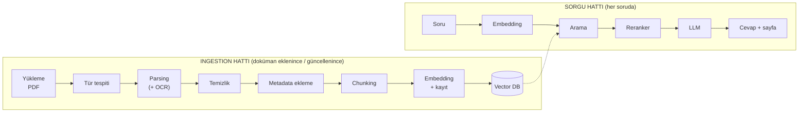
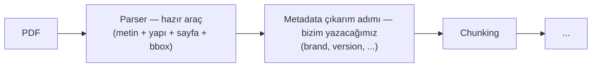
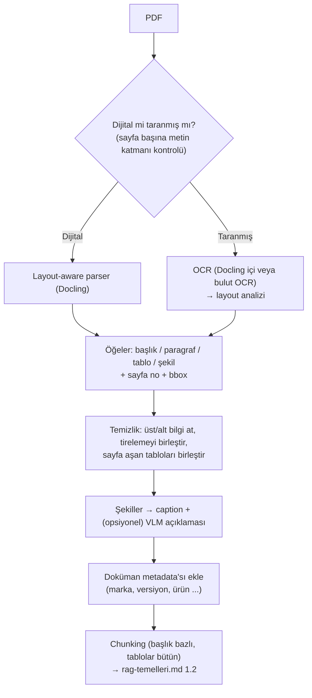

# Manual / PDF İşleme (Ingestion) — Adım 2

> **Kaynak not:** `pdf-isleme.md` (başlangıç 2026-10-08) · **İlgili plan:** req.md Adım 2 · **Bağlantılı notlar:** [01-manual-envanteri.md](01-manual-envanteri.md), [03-kaynak-gosterme.md](03-kaynak-gosterme.md), [06-veri-guvenligi-ve-erisim.md](06-veri-guvenligi-ve-erisim.md), rag-temelleri.md (bu sette yok)
> **Beslediği çıktılar:** Araştırma notu (PDF işleme) · Mimari taslağı (ingestion hattı) · Araç seçimi (parser, OCR, VLM) · Manual format değerlendirmesi · Açık sorular & riskler · Görev planı (2.3 araç denemesi)

---

## 1. Özet

- RAG hattının ilk adımı PDF'ten metin çıkarmak (**parsing**). Buradaki hata sonraki hiçbir adımda düzeltilemez; LLM bozuk metne dayanarak yanlış değer söyler ("garbage in, garbage out"). RAG kalite sorunlarının büyük kısmı parsing'den çıkar.
- PDF bir **baskı** formatıdır: "şu karakteri, şu fontla, şu koordinata çiz" bilgisini tutar; paragraf/başlık/tablo bilgisi yoktur. Parser kelime, satır, paragraf, okuma sırası, başlık/gövde/altbilgi ve tablo yapısını **tahmin etmek** zorundadır.
- **Öneri:** Ana parser **Docling** (layout-aware, MIT, lokal, tablo modeli, OCR, bbox) + parsing sonrası **kural tabanlı temizlik** + şekiller için **caption + VLM açıklaması** + sayfa görselleştirme için PyMuPDF (AGPL kontrolü) + önce lokal OCR, bulutla karşılaştırma.
- **Asıl güvence:** OCR ve sayı hataları hiçbir zaman sıfıra inmez; cevapla birlikte **orijinal sayfa görüntüsü** gösterilmeli.
- Her metin parçası için **sayfa numarası** ve **bbox** (sayfa üzerindeki konum) çıkarılmalı; yoksa sayfa gösterip vurgulanamaz.

## 2. Kavramlar

### 2.1 Ingestion (veri alımı / doküman yükleme hattı)

Bir PDF'in ham dosyadan **aranabilir chunk'lara** dönüşene kadar geçirdiği adımların tamamı (rag-temelleri.md 1.1'deki "indeksleme hattı").



*Tür tespiti → Metadata ekleme: Adım 2 (bu not). Chunking → Embedding: Adım 1.*

| | **Ingestion** | **Sorgu (retrieval + generation)** |
|---|---|---|
| Ne zaman | Doküman eklenince, güncellenince, silinince | Her soruda |
| Kullanıcı bekler mi | Hayır, arka planda (*offline*) | Evet, saniyeler içinde (*online*) |
| Hız önemi | Düşük; bir manuel dakikalar sürebilir | Yüksek |
| Kalite önemi | **Çok yüksek**; kaybolan bilgi sorguda geri gelmez | Yüksek |
| Pahalı adımlar | OCR, VLM ile şekil açıklaması, embedding | Reranker, LLM |

→ Pahalı/yavaş ama kaliteli yöntemler (OCR, VLM) **ingestion'a** konur: bir kez yapılır, her soruda kullanılır.

**Ingestion ne zaman tekrar çalışır?**

| Durum | Yapılan |
|-------|---------|
| Yeni manuel | Tüm hat çalışır, chunk'lar eklenir |
| Manuelin yeni versiyonu | Yeni versiyon işlenir; eskisi `is_latest = false` yapılır veya silinir (`doc_id` ile) |
| Aynı dosya tekrar yüklendi | `file_hash` aynıysa atlanır |
| Embedding modeli / chunking stratejisi değişti | **Tüm dokümanlar baştan işlenir** (re-ingestion / re-indexing) |

**İyi bir ingestion hattı:** tekrarlanabilir (kopya chunk oluşmaz), kayıt tutar (hangi doküman ne zaman işlendi, hangi sayfa OCR'a düştü, hangi sayfada hata oldu), **hatayı sessiz geçmez** (metin çıkmayan sayfa, boş tablo, düşük OCR güveni raporlanır).

### 2.2 PDF türleri

| Tür | Nasıl oluşur | Metin var mı? | Nasıl anlaşılır | Test setinde |
|-----|--------------|---------------|-----------------|--------------|
| **Dijital** (born-digital) | Word/InDesign'dan "PDF olarak kaydet" | ✅ | Metin seçilip kopyalanabiliyor | GL-PD-14-04A |
| **Taranmış** | Kağıt doküman tarayıcıdan | ❌ Her sayfa fotoğraf | Metin seçilemiyor, yakınlaştırınca piksel | GL-PD-07-14A |
| **Taranmış + OCR katmanlı** | Taramaya görünmez OCR metni eklenmiş | 🟡 Hatalı olabilir | Seçilebiliyor ama kopyalanınca bozuk karakter | Strickland |
| **Görsel ağırlıklı** | Sunum, broşür, katalog | 🟡 Az; bilgi çizimlerde | Kısa etiketlerden ibaret | (Stitch Guide — sete eklenmedi) |

**Önemli:** Taranmış PDF'te basit metin çıkarma **hata vermez, sessizce boş metin döner.** Doküman sistemde "yüklenmiş" görünür ama hiçbir şey aranamaz; sistem "bulunamadı" der veya başka dokümandan cevap verir. **Çözüm:** Sayfa başına çıkan metin uzunluğu kontrol edilir; metin yok/çok azsa sayfa otomatik OCR'a gönderilir.

## 3. Tipik zorluklar

| Zorluk | Ne oluyor | Sonucu | Örnek |
|--------|-----------|--------|-------|
| **Tablolar** | Basit parser tabloyu düz metne döker, hücre-sütun ilişkisi kaybolur | "Yan dikiş → 301 → 11 SPI" ilişkisi kopar, LLM yanlış satırın değerini okur | Şartname dikiş operasyon tablosu |
| **Çok kolonlu sayfa** | Okuma sırası karışır | Anlamsız cümleler, yanlış chunk | Broşür/dergi, Strickland |
| **Üst / alt bilgi** | "GL-PD-14-04A, Page 12" her sayfada | Chunk kirlenir, aramada gürültü | Tüm şartnameler |
| **Sayfayı aşan tablo** | Başlık satırı sadece ilk sayfada | İkinci sayfadaki satırların sütunu bilinmez | Uzun dikiş tabloları |
| **Şekiller / çizimler** | Parser resmi atlar veya "[resim]" yazar | Çizimdeki bilgi kaybolur | Dikiş çizimleri |
| **Özel karakterler** | "±", "½", "°" yanlış çıkabilir | "11 (± 1)" → "11 ( 1)" → **değer değişir** | SPI toleransları |
| **Satır sonu tirelemesi** | "stitch-" / "ing" bölünür | Kelime araması bulamaz | Uzun metinler |
| **OCR hataları** | "1"↔"l", "0"↔"O", "5"↔"S" | **Sayısal değer bozulur** | Taranmış pantolon şartnamesi |

**Tablo düzleşmesi örneği:**

```
Orijinal tablo:                     Düz metne dökülmüş hali:
┌─────────────┬────────┬──────┐     "Operation Stitch SPI Side seam Sleeve seam
│ Operation   │ Stitch │ SPI  │      Hem 301 401 504 11 ± 1 8-10 6-8"
├─────────────┼────────┼──────┤
│ Side seam   │ 301    │ 11±1 │     → "Side seam"in değeri 11 ± 1 mi, 8-10 mu?
│ Sleeve seam │ 401    │ 8-10 │
│ Hem         │ 504    │ 6-8  │
└─────────────┴────────┴──────┘
```

LLM yanlış satırın değerini emin bir dille söyleyebilir; hata cevaptan anlaşılmaz. **Çözüm:** layout-aware parser, tabloyu bölmeden tek chunk, tabloyu Markdown olarak veya her satırı başlıklarıyla ("Side seam: stitch 301, SPI 11 ± 1") saklamak.

**OCR sayı hatası neden özellikle tehlikeli?** (SPI = inç başına dikiş; birim dönüşümü gerektirmez)
- "11 (± 1)" → "11 (+ 1)": doğru aralık 10–12 iken 11–12 olur; alt sınır kaybolur, doğru ürün hatalı sayılabilir (ya da tersi).
- "11 (± 1)" → "ll (± l)": artık sayı değil harf; "11" araması chunk'ı bulamaz, LLM değeri **tahmin etmeye** çalışabilir.
- **Hata sessizdir:** bozuk değer makul görünür; "cevaptaki sayı kaynakta var mı?" kontrolü (S11) de geçer, çünkü **kaynak metnin kendisi bozuk.**
- → Taranmış dokümanlarda kullanıcıya her zaman **orijinal sayfa görüntüsü** (OCR metni değil) gösterilmeli; düşük OCR güvenli sayılarda uyarı verilmeli.

## 4. Seçenekler: Parsing yaklaşımları

| Seviye | Nasıl çalışır | Artı | Eksi | Örnek araçlar |
|--------|---------------|------|------|---------------|
| **1. Düz metin çıkarma** | Karakterleri sırayla okur | Çok hızlı, kolay kurulum | Tablo/kolon/başlık yapısını bilmez; taranmışta boş döner | `pypdf`, PyMuPDF (temel) |
| **2. Layout-aware** | Sayfayı görüntü gibi analiz eden model başlık/paragraf/tablo/şekil bölgelerini bulur, her bölgeyi uygun yöntemle okur | Tablo yapısı, okuma sırası, başlık hiyerarşisi korunur; bbox verir | Daha yavaş, GB'larca model indirir | **Docling**, Marker, MinerU, Unstructured |
| **3. VLM tabanlı** | Sayfa resmi multimodal LLM'e verilip "Markdown'a çevir" denir | Karmaşık tablo ve çizimde en iyi; taranmışı da okur | Pahalı, yavaş, **uydurma riski**; bulutsa veri dışarı gider | LlamaParse, GPT/Claude/Gemini vision, Mistral OCR |

**Çıktı formatı:** Markdown veya JSON (her öğe için tür + metin + sayfa + bbox). Bizim için **JSON tarzı yapılandırılmış çıktı** daha önemli (sayfa ve bbox taşır).

### 4.1 Hangi yaklaşım hangi sorunu çözüyor?

✅ çözer · 🟡 kısmen · ❌ çözmez

| Sorun | 1. Düz metin | 2. Layout-aware | 3. VLM | Kalan açık / ek çözüm |
|-------|:---:|:---:|:---:|------|
| Tablolar | ❌ | ✅ (birleşik hücrede hata yapabilir) | ✅ En iyi | VLM değer **uydurabilir**; tablo çıktısı elle kontrol; tablo tek chunk |
| Çok kolonlu sayfa | ❌ | ✅ | ✅ | Çok karışık sayfalarda okuma sırası kontrol |
| Üst / alt bilgi | ❌ | 🟡 Bazı araçlar etiketler | 🟡 | **Kural:** her sayfada aynı yerde tekrar eden satırları at |
| Sayfayı aşan tablo | ❌ | 🟡 MinerU birleştirir, Docling birleştirmez | ❌ | **Birleştirme:** sütun sayısı aynıysa birleştir, başlık satırını ikinci parçaya da ekle |
| Şekiller | ❌ | 🟡 Bulur/kırpar, içini okumaz | ✅ Açıklayabilir | VLM ile şekil açıklaması veya görsel retrieval (Adım 3.4); açıklama yanlış olabilir |
| Özel karakterler | 🟡 | 🟡 | 🟡 | Örnek sayfalarda doğrulama; taranmışta OCR riskine dönüşür |
| Tireleme | ❌ | 🟡 | ✅ | **Kural:** satır "-" ile bitip sonraki küçük harfle başlıyorsa birleştir |
| OCR hataları | ❌ | 🟡 OCR motoru kadar | 🟡 Okuyamadığını tahmin edebilir | **Tamamen çözen yok.** OCR güven skorunu metadata'da tutmak, düşük güvenli sayıda uyarı, iki OCR'ı karşılaştırmak, kritik tablolar için insan kontrolü |

**Sonuç:**
1. Seviye 2 (layout-aware) **temel olarak yeterli.**
2. Parsing sonrası **temizlik adımı şart** (üst/alt bilgi, tireleme, sayfa aşan tablo) — basit kurallarla.
3. **Şekiller için ayrı çözüm** gerekir (VLM açıklaması veya görsel retrieval); hiçbir parser çizimi tek başına metne çevirmez.
4. OCR/sayı hataları sıfıra inmez → asıl güvence **orijinal sayfanın gösterilmesi** (rag-temelleri.md S11, Katman 6).

### 4.2 Neden her şey VLM ile yapılmıyor?

| Sebep | Açıklama |
|-------|----------|
| **Halüsinasyon** (en önemlisi) | Okuyamadığı sayıyı tahmin edip yazabilir; normal parser gibi "okuyamadım" demez |
| **Maliyet** | Sayfa başına ücret; binlerce sayfada ve her güncellemede tekrar |
| **Hız** | Sayfa başına saniyeler; layout-aware çok daha hızlı |
| **Gizlilik** | Güçlü VLM'lerin çoğu bulutta (req.md Q1); lokal için güçlü GPU |
| **bbox** | Metnin koordinatını genelde vermez veya zayıf verir → vurgulama yapılamaz (kritik eksik) |
| **Tekrarlanabilirlik** | Aynı sayfaya farklı çıktı üretebilir; test ve hata ayıklama zorlaşır |

**Pratikte hibrit:** Varsayılan layout-aware parser (Docling); VLM **sadece zor sayfalarda** (çizim, karmaşık tablo). VLM'in sayıları mümkünse OCR çıktısıyla karşılaştırılır.

## 5. Araç karşılaştırması

### 5.1 PDF parsing araçları

| Araç | Tür | Tablo | OCR | bbox | Lisans | Not |
|------|-----|-------|-----|------|--------|-----|
| **pypdf** | Düz metin | ❌ | ❌ | ❌ | BSD | Sadece hızlı kontrol |
| **pdfplumber** | Düz metin + tablo kuralları | 🟡 Çizgili tablolarda iyi | ❌ | ✅ Karakter seviyesi | MIT | Çizgili, basit tablolar |
| **PyMuPDF** (+ `pymupdf4llm`) | Düz metin → Markdown | 🟡 | 🟡 Tesseract ile | ✅ Çok detaylı | ⚠️ **AGPL** veya ücretli ticari | Çok hızlı; sayfayı PNG'ye çevirme ve vurgulama için de (Adım 3). Lisans ticari kullanımda sorun olabilir |
| **Docling** (IBM) | Layout-aware | ✅ TableFormer | ✅ EasyOCR / Tesseract / RapidOCR | ✅ | **MIT** | Lokal, CPU'da da çalışır. Sayfa aşan tabloyu birleştirmez |
| **Marker** | Layout-aware (+ isteğe bağlı LLM) | ✅ | ✅ Surya | ✅ | Kod Apache 2.0, **model ağırlıkları ayrı lisans** | Doğruluk kritikse LLM desteği açılabilir |
| **MinerU** | Layout-aware | ✅ Sayfa aşan tabloyu birleştirir | ✅ | ✅ | Apache 2.0 tabanlı özel lisans | Formül ve Çince/Japonca'da güçlü; büyük model indirir |
| **Unstructured** | Layout-aware | ✅ | ✅ | ✅ | Apache 2.0 (açık sürüm) | Çok format (PDF, Word, HTML) |
| **LlamaParse** | VLM, bulut | ✅ Birleşik/iç içe hücreler dahil | ✅ | 🟡 | Ücretli | Veri buluta gider |
| **Azure Document Intelligence / AWS Textract / Google Document AI** | Bulut OCR + layout | ✅ | ✅ Çok güçlü | ✅ | Ücretli | Taranmışta endüstri standardı; veri buluta gider |

> Lisans bilgileri değişebilir; kesin seçimden önce resmi sayfalardan doğrulanmalı. Test aşamasında public veri olduğu için bulut servisleri denenebilir; gerçek veride gizlilik kararı (Q1) belirleyici.
>
> **Kaynaklarda ortak görüş:** Bir parser'ın temiz raporlarda iyi çıkması bizim dokümanlarda iyi çıkacağı anlamına gelmez; **karar kendi en zor sayfalarımızda yapılan denemeyle verilir.**

### 5.2 OCR

OCR: görüntüdeki yazıyı metne çevirir. Çıktı: metin + kelime bbox'ı + **güven skoru** (ör. 0.97, 0.62).
Adımlar: ön işleme (eğiklik, kontrast, gürültü) → metin bölgesi tespiti → tanıma → çıktı.

- **Güven skoru** metadata'da (`ocr_confidence`) tutulursa düşük güvenli sayıya dayanan cevapta kullanıcı uyarılabilir.
- **Kaliteyi etkileyenler:** çözünürlük (≥ 300 DPI önerilir; pantolon şartnamesi ~300 DPI ✅), eğik tarama, leke/gölge, küçük font, tablo çizgileri, el yazısı.

| Araç | Tür | Not |
|------|-----|-----|
| **Tesseract** | Açık kaynak, klasik | Yaygın, ücretsiz; tablolarda zayıf |
| **EasyOCR / RapidOCR / PaddleOCR** | Açık kaynak, derin öğrenme | Genelde Tesseract'tan iyi; Docling içinden kullanılabilir |
| **Surya** | Açık kaynak, derin öğrenme | Marker'ın OCR motoru, layout tespiti de yapar |
| **VLM tabanlı OCR** (Mistral OCR, GPT/Claude/Gemini vision) | Bulut / büyük model | Tablolarda çok iyi; okuyamadığını uydurabilir |
| **Azure DI / AWS Textract / Google Document AI** | Bulut | Taranmış tablolarda en güçlülerden |

Taranmış pantolon şartnamesi, gerçek manuellerde taranmış doküman olup olmadığına dair bir **vekil**; adımın önemi gerçek veride taranmış manuel oranına (req.md Q3) bağlı.

### 5.3 Şekiller ve çizimler

| Yaklaşım | Nasıl | Artı | Eksi |
|----------|-------|------|------|
| **Başlık / etiket** | "Fig. 3: Stitch type 301" ve çevre metin chunk'a eklenir | Basit, ucuz | Çizimin kendisindeki bilgi kaybolur |
| **Görsel açıklama (captioning)** | Ingestion'da her şekil VLM'e verilir ("Bu çizimi ayrıntılı açıkla"), açıklama metin olarak indekslenir | Normal metin RAG'i ile çalışır | VLM yanlış açıklayabilir; ek maliyet |
| **Görsel tabanlı retrieval** (ColPali vb.) | Sayfa resim olarak embedding'e çevrilir | Çizim ve tablo bilgisini doğrudan yakalar | Yeni altyapı (Adım 3.4) |

Ayrıca: **cevapta sayfa görüntüsünü göstermek** — kullanıcı çizimi kendi gözüyle görür.

### 5.4 Bounding box

- **Veren araçlar:** PyMuPDF (karakter/kelime/satır/blok, en detaylı), pdfplumber (karakter), Docling / Marker / MinerU / Unstructured (öğe: paragraf, tablo, şekil), OCR motorları (kelime).
- **Dikkat:** Farklı koordinat sistemleri (orijin sol-üst/sol-alt; point/piksel). Parser ile render aracı arasında **koordinat dönüşümü** doğrulanmalı. En kolay test: bir chunk'ın bbox'ını sayfa resmine çizip gözle kontrol.

## 6. Metadata şeması

Taslak şema: rag-temelleri.md 1.7.

- **Parsing'den otomatik gelenler:** `pages`, `bboxes`, `section_path` (başlık hiyerarşisi), `chunk_type` (text/table/figure), `table_caption`, `ocr_confidence`, `source_type` (dijital/taranmış).
- **Parsing'den doğrudan gelmeyenler:** `brand`, `version`, `is_latest`, `effective_date`, `product_category`, `allowed_groups` (req.md Q7). Parser "daktilocu" gibidir: yazanı ve yapıyı çıkarır, anlamlandırmaz / form doldurmaz. Ör. kapakta "GL-PD-14-04A, Revision A, 10 June 2015" üç ayrı paragraf olarak çıkar; `version = "A"`, `effective_date = "2015-06-10"` diye etiketlenmez.

| Grup | Alanlar | Neden parser vermez |
|------|---------|---------------------|
| Sayfada yazıyor ama etiketsiz | `version`, `effective_date`, bazen `brand` | Yazıyı çıkarır, anlamlandırmaz |
| Sayfada hiç yazmıyor olabilir | `brand` (logo resim olabilir), `product_category` | Bilgi logoda, klasörde veya bağlamda |
| Dokümanın içinde olamaz | `is_latest`, `allowed_groups` | `is_latest` başka dokümanlarla karşılaştırma ister; `allowed_groups` kurum içi karar |

→ Bu alanlar **otomatik** doldurulacak, ama parser'dan değil, hatta eklenecek ayrı bir **metadata çıkarım adımından** (bizim yazacağımız parça):



**Çıkarım yöntemleri** (birlikte kullanılır; hedef: otomatik çıkarım + sadece emin olunamayanlarda insan onayı):

| Yöntem | Nasıl | Alanlar | Örnek |
|--------|-------|---------|-------|
| 1. Klasör / yükleme yeri | Yüklendiği klasör/portal alanı | `brand`, `product_category`, `allowed_groups` | `manuals/Nike/Apparel/...` |
| 2. Dosya adlandırma kuralı | Dosya adı kalıbı ayrıştırılır | `brand`, `doc_type`, `version` | `Nike_StitchingManual_v3_2025-03.pdf` |
| 3. PDF gömülü bilgileri | Başlık, yazar, oluşturma tarihi | `doc_title`, tarih (ipucu) | Çoğu zaman boş/yanlış, tek başına güvenilmez |
| 4. Kapaktan kural tabanlı (regex) | İlk 1–2 sayfada kalıp aranır | `version`, `effective_date`, doküman no. | "GL-PD-14-04A", "Revision B", "Effective: 01 March 2025" |
| 5. LLM ile yapılandırılmış çıkarım | İlk sayfalar LLM'e: "marka, versiyon, yürürlük tarihi, ürün grubu? JSON ver, emin değilsen boş bırak" | Hepsi | Kural yazılamayan, formatı markaya göre değişen dokümanlar |
| 6. Hesaplanan alanlar | Diğer alanlardan türetilir | `is_latest`, `allowed_groups` | En yüksek versiyon → `is_latest = true`; `brand = Nike` → `allowed_groups = ["nike-team", "qa"]` (eşleme tablosu) |

- **İnsan ne zaman devreye girer:** LLM alanı boş bıraktıysa veya kaynaklar çelişiyorsa (klasör "Nike", kapak "Adidas"); yükleme ekranında **önceden doldurulmuş form**, kullanıcı kontrol edip onaylar.
- **Risk:** `brand` yanlışsa doküman ilgili soruya hiç gelmez veya başka markanın sorusuna gelir → `brand` ve `is_latest` çıkarım doğruluğu ayrıca kontrol edilmeli.
- **Test setinde:** Doküman numaraları kapakta ("GL-PD-14-04A", Rev. A); yöntem 4 ve 5 denenip elle bilinen değerlerle karşılaştırılacak.
- **`allowed_groups`:** Arama otomatik olarak kullanıcının gruplarına açık chunk'larda yapılır (metadata filtresi). Gerekebilir çünkü bazı müşteriler manuellerinin sadece kendi proje ekibince görülmesini sözleşmeyle isteyebilir (aksi gizlilik ihlali). Gerekliliği req.md **Adım 7.3**'e bağlı; elle değil `brand` → grup eşlemesiyle (yöntem 6) doldurulur; test setinde boş bırakılacak.

## 7. Önerilen ingestion hattı (taslak)



## 8. Öneri

| Konu | Öneri | Alternatif | Gerekçe |
|------|-------|------------|---------|
| Ana parser | **Docling** | Marker, MinerU | MIT, lokal, tablo modeli, OCR entegrasyonu, bbox |
| Sayfa görselleştirme + vurgulama | PyMuPDF | pdf2image + Pillow | Hızlı, detaylı. **AGPL ticari kullanımda kontrol edilmeli** |
| OCR | Docling içi (EasyOCR/RapidOCR) ile başla | Azure DI (karşılaştırma), Surya | Önce lokal, sonra bulutla kalite farkını ölç |
| Şekiller | Caption + VLM açıklaması (deneme) | ColPali (Adım 3.4) | Strickland ve Brother çizimlerinde test |
| Kalite kontrolü | Sayıların doğruluğu özel kontrol | — | Yanlış sayı = yanlış dikim |

**VLM ve veri güvenliği planı:** Test aşamasında bulut VLM denenir ("üst sınır" referansı); aynı denemede lokal VLM de çalıştırılıp karşılaştırılır; fark küçükse gerçek veride lokal. Nihai karar req.md Q1 ve Adım 7 ile (ayrıntı: [06-veri-guvenligi-ve-erisim.md](06-veri-guvenligi-ve-erisim.md)).

| VLM seçeneği | Veri dışarı çıkar mı? | Artı | Eksi |
|--------------|----------------------|------|------|
| Bulut VLM, standart API | ✅ Evet | En yüksek kalite, kurulum yok | Gizlilik riski; sağlayıcının saklama politikasına bağlı |
| Bulut VLM, kurumsal anlaşma (kendi Azure/AWS hesabı, ZDR, eğitimde kullanmama) | 🟡 Fiziksel olarak evet, sözleşmeyle korunur | Yüksek kalite, hukuki güvence | Müşteri NDA'sı izin veriyor mu? Hukuk/BT onayı |
| Lokal açık VLM (Qwen-VL ailesi, Gemma, InternVL, Docling'in küçük görsel modelleri) | ❌ Hayır | Veri kurum içinde | GPU gerekir (req.md 0.5); kalite düşük olabilir |

Şekil açıklaması ingestion'da **bir kez**, arka planda yapıldığı için yavaş bir lokal model de kabul edilebilir.

**Veri kurum dışına çıkabilecek tüm noktalar:**

| Bileşen | Ne gönderilir | Lokal alternatif |
|---------|---------------|------------------|
| Bulut OCR (Azure DI, Textract) | Taranmış sayfa görüntüleri | Docling içi OCR, Surya, Tesseract |
| Bulut VLM | Sayfa ve çizim görüntüleri | Lokal açık VLM |
| Bulut embedding API | Tüm chunk metinleri | `bge-m3` (lokal) |
| Bulut LLM | Soru + getirilen chunk'lar | Lokal açık LLM (Adım 4.1) |
| Bulut çeviri (query translation) | Kullanıcının sorusu | Lokal LLM veya NLLB / OPUS-MT |
| Bulut TTS | Cevap metni | Lokal TTS (Adım 5) |

## 9. Görev: 2.3 Araç denemesi (deney planı)

1. Her dokümandan **en zor 2–3 sayfa** seçilir (dikiş tablosu, taranmış tablo, çizimli sayfa).
2. Adaylar: **Docling**, **PyMuPDF4LLM**, **Marker** (+ karşılaştırma için bir bulut servis: Azure DI veya LlamaParse).
3. Her çıktı elle kontrol edilir:

| Ölçüt | Soru |
|-------|------|
| Metin doğruluğu | Kelimeler ve **sayılar** doğru mu? ("11 (± 1)", "52-56") |
| Tablo yapısı | Satır-sütun ilişkisi korunmuş mu? |
| Okuma sırası | Paragraflar doğru sırada mı? |
| Başlık hiyerarşisi | "3. → 3.2" yapısı çıkmış mı? (chunking için gerekli) |
| Sayfa + bbox | Her öğe için sayfa no ve koordinat var mı? |
| Hız | Sayfa başına süre |
| Gürültü | Üst/alt bilgi ayıklanmış mı? |

**Doğrulanacaklar:**
- [ ] Docling ceket şartnamesindeki dikiş tablosunu doğru çıkarıyor mu?
- [ ] Taranmış pantolon şartnamesinde OCR sayıları ("10-14", "52-56") doğru okuyor mu?
- [ ] Lokal OCR ile bulut OCR arasında anlamlı fark var mı?
- [ ] Strickland ve Brother çizimleri için VLM açıklaması işe yarıyor mu?

## 10. Açık sorular ve riskler

- **Sessiz hatalar:** Taranmış sayfada boş metin, bozuk sayı, düşen tolerans fark edilmeyebilir → sayfa bazlı metin kontrolü, `ocr_confidence`, orijinal sayfa gösterimi.
- **OCR/sayı hataları sıfıra inmez** → kritik tablolar için insan kontrolü, iki OCR karşılaştırması.
- **VLM uydurma riski** (tablo değeri, şekil açıklaması).
- **Lisanslar:** PyMuPDF AGPL; Marker model ağırlıkları ayrı lisans; MinerU özel lisans → resmi kaynaktan doğrulanmalı.
- **Docling sayfa aşan tabloyu birleştirmiyor** → kendi birleştirme kuralımız gerekiyor.
- **Metadata çıkarım hatası** (`brand`, `is_latest`) filtrelemeyi bozar.
- **Koordinat sistemi uyumsuzluğu** (parser ↔ render).
- Gerçek veride taranmış doküman oranı (Q3), bulut kullanımı (Q1), GPU (req.md 0.5 / Q5), `allowed_groups` gerekliliği (Adım 7.3 / Q7) açık.

## Kaynaklar

- [Best Open-Source PDF-to-Markdown Tools in 2026: Marker vs Docling vs MinerU vs PyMuPDF4LLM](https://themenonlab.blog/blog/best-open-source-pdf-to-markdown-tools-2026)
- [From PDFs to Markdown: Evaluating Document Parsers for Air-Gapped RAG](https://dev.to/ashokan/from-pdfs-to-markdown-evaluating-document-parsers-for-air-gapped-rag-systems-58eh)
- [Document Parsing for Production RAG: Architecture, Tradeoffs](https://medium.com/@manikandan_t/document-parsing-for-production-rag-architecture-tradeoffs-and-when-to-use-what-7a89ab0af7b7)
- [Best PDF Parsers for RAG (Nutrient)](https://www.nutrient.io/blog/best-pdf-parsers-for-rag/) · [Docling alternatives](https://www.nutrient.io/blog/docling-alternatives.md)
- [Docling vs MinerU](https://www.file2markdown.ai/blog/docling-vs-mineru) · [Marker vs MinerU](https://www.file2markdown.ai/blog/marker-vs-mineru)
- [PDF Parser Benchmark (GitHub)](https://github.com/applied-artificial-intelligence/pdf-parser-benchmark)
- [PyMuPDF (GitHub, lisans bilgisi)](https://github.com/pymupdf/PyMuPDF)
- [LlamaIndex: Best Table Parsing AI](https://www.llamaindex.ai/insights/best-table-parsing-ai)
