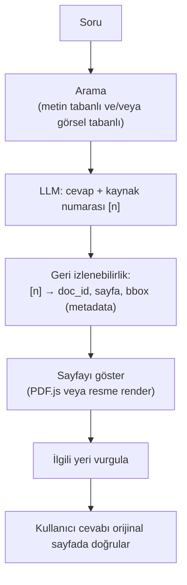
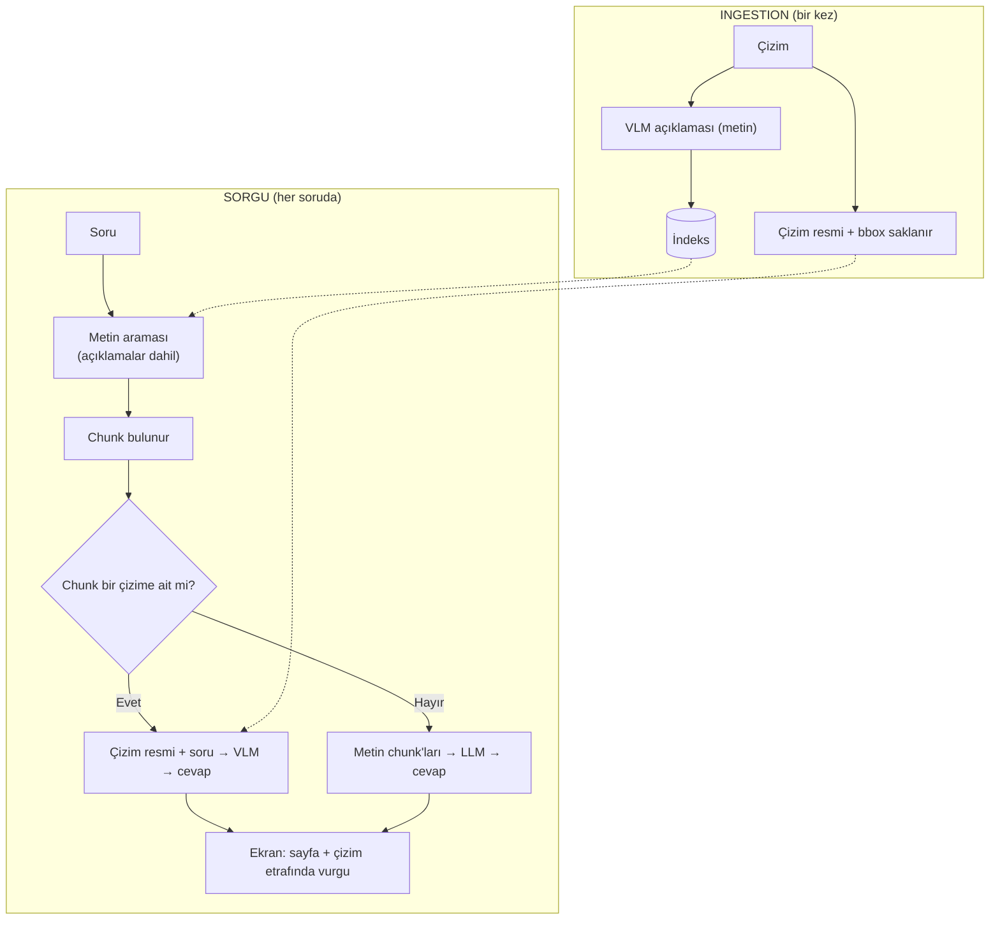

# Kaynak Gösterme, Sayfa Görüntüleme ve Görsel Retrieval — Adım 3

> **Kaynak not:** `kaynak-gosterme.md` (başlangıç 2026-10-08) · **İlgili plan:** req.md Adım 3 · **Bağlantılı notlar:** [02-pdf-isleme.md](02-pdf-isleme.md), [04-llm-secimi-ve-degerlendirme.md](04-llm-secimi-ve-degerlendirme.md), [05-arayuz-ve-orkestrasyon.md](05-arayuz-ve-orkestrasyon.md), rag-temelleri.md (bu sette yok)
> **Beslediği çıktılar:** Araştırma notu (citation, sayfa görüntüleme, vurgulama, multimodal) · Mimari taslağı (sorgu → kaynak → vurgu akışı, A+B görsel akışı) · Araç seçimi (UI/PDF görüntüleyici, render aracı, VLM/ColPali) · Açık sorular & riskler · Görev planı (Faz 1 kontrol noktası)

---

## 1. Özet

- Sistem sadece metin cevap değil, cevabın **kaynağını** da gösterecek: kaynak bağlama (citation) → sayfa görüntüleme → ilgili yeri vurgulama. Bu üçü halüsinasyona karşı önlemlerdendir.
- **Citation yöntemi:** Chunk'lar promptta numaralandırılır; LLM sadece **[n]** yazar; sayfa ve bbox **metadata'dan** gelir (LLM sayfa numarasını yanlış yazamaz).
- **Sayfa görüntüleme önerisi:** Prototipte **`streamlit-pdf-viewer`** (PDF.js, bbox vurgusu, vurguya otomatik kaydırma). Yedek: sunucuda 150 DPI render + önceki/sonraki butonları. Karar noktası: gizlilik (Q9).
- **Vurgulama:** Başlangıçta chunk bbox'ı (açık renk), geliştirmede LLM alıntısının metin aramasıyla bulunup cümle seviyesinde koyu vurgu; çizimli talimatlarda ilgili çizime çerçeve.
- **Görsel anlama bir ihtiyaç, opsiyon değil.** Önerilen başlangıç **A + B**: ingestion'da VLM ile görsel açıklaması (bulmak için) + cevap anında görselin VLM'e verilmesi (anlamak için). ColPali gerekirse ikinci arama kanalı.

## 2. Kavramlar

| Terim | Türkçesi | Anlamı |
|-------|----------|--------|
| *Citation* | Atıf | Cevabın yanına kaynağı yazmak: "[1] GL-PD-14-04A, s. 12" |
| *Grounding* | Dayandırma | Cevabın **sadece** verilen kaynaklara dayanması |
| *Attribution* | İz sürme | Bir cümlenin kaynaktaki **hangi parçaya** karşılık geldiğini bulmak (vurgulama için gerekli) |
| *Traceability* | İzlenebilirlik | Cevaptan kaynağa (doküman, sayfa, paragraf) geri gidebilmek |
| *Rendering* | Çizdirme | PDF talimatlarını uygulayıp sayfayı PNG/JPG'ye çevirmek |
| *Highlight / bbox* | Vurgulama | Gösterilen sayfada cevabın dayandığı metnin yerini yarı saydam kutuyla işaretlemek; kutu parser'ın bbox'ından gelir |
| *Multimodal retrieval* | Görsel tabanlı arama | Aramayı metin yerine sayfa resimleri üzerinde yapmak (ör. ColPali, 2024) |

**İzlenebilirlik neden lazım?**

| Sebep | Açıklama | Projede örnek |
|-------|----------|---------------|
| Güven | Kullanıcı kaynağı görmek ister | Usta "11 SPI" bilgisini manuelde görmek ister |
| Doğrulama / hata yakalama | Yanlış bilgi kaynakla karşılaştırınca fark edilir | Cevap "12 SPI", kaynak "11 (± 1)" → hata yakalanır |
| Sorumluluk / denetim | Kararın dayanağı belgelenir | Müşteri şikayetinde "hangi şartnamenin hangi maddesi?" |
| Güncellik | Bilginin hangi versiyondan geldiği görünür | "Rev. A mı, Rev. B mi?" |
| Projenin kendisi | Sayfayı göstermek için önce hangi sayfa olduğu bilinmeli | İzlenebilirlik olmadan sayfa gösterme/vurgulama yapılamaz |

**Rendering neden lazım?** Web arayüzleri resmi kolayca gösterir; kullanıcı sayfayı **manuelde göründüğü haliyle** görür (tablo düzeni, çizimler, logolar); vurgu kutusu resmin üstüne çizilir; taranmış sayfada resim **orijinal taramanın kendisidir** — OCR metni hatalı olsa bile gerçek değer görünür.

**Vurgulama neden lazım?** Bir şartname sayfasında onlarca değer olabilir (dış dikiş 11 ± 1, overedge 10 ± 2, ilik 54 ± 2...). Sadece sayfa gösterilirse kullanıcı doğru satırı kendisi arar ve **yanlış satırı okuyabilir.** Vurgu olmazsa doğrulama zahmetli olur, kullanıcılar zamanla kaynağa bakmayı bırakır.

## 3. Mimari: Kavramların akışı



Hedef ekran (ASCII taslak):

```
┌─────────────────────────────────────────────────────────────────────┐
│  Soru: "Ceketin dış dikişlerinde SPI kaç olmalı?"                   │
├──────────────────────────────┬──────────────────────────────────────┤
│  CEVAP                       │  KAYNAK SAYFA                        │
│                              │  ┌────────────────────────────────┐  │
│  Dış görünür dikişler inç    │  │ 3.5 Stitching                  │  │
│  başına 11 (± 1) dikiş       │  │ ████████████████████████████   │  │
│  olmalıdır. [1]              │  │ █ All outside visible stitch █ │  │ ← vurgu
│                              │  │ █ shall be 11 (± 1) SPI...   █ │  │
│  [1] GL-PD-14-04A, s. 12     │  │ ████████████████████████████   │  │
│                              │  │ Overedge shall be ...          │  │
│  🔊 Sesli oku                │  └────────────────────────────────┘  │
└──────────────────────────────┴──────────────────────────────────────┘
```

## 4. Kaynak bağlama (citation / grounding)

### 4.1 Yöntem

1. **Chunk'lara kimlik ver:** Promptta her chunk numaralandırılır:
   ```
   [1] (GL-PD-14-04A, s.12) All outside visible stitching shall be 11 (± 1) stitches per inch...
   [2] (GL-PD-14-04A, s.12) Overedge or pre-hemming shall be 10 (± 2) stitches per inch...
   [3] (GL-PD-07-14A, s.9)  The seams for all outside visible stitching shall be 10-14 SPI...
   Kural: Her bilgiden sonra kaynağını [numara] olarak yaz. Kaynaklarda yoksa "bulunamadı" de.
   ```
2. **LLM numarayla cevap verir:** "Dış görünür dikişler inç başına 11 (± 1) dikiş olmalıdır [1]."
3. **Kod numarayı metadata'ya çevirir:** `[1]` → `doc_id = gl-pd-14-04a`, `pages = [12]`, `bboxes = [...]` → sayfa görüntülenir, kutu çizilir.

**Neden sayfa numarası değil chunk numarası?** LLM sayfa numarasını uydurabilir/yanlış yazabilir (s.12 yerine s.21). Chunk numarası sınırlı bir kümedir (1–5); cevaptaki numaranın verilen chunk'lardan biri olup olmadığı kolayca kontrol edilir. Sayfa ve bbox metadata'dan kesin gelir; alıntı ve sayı kontrolü de o chunk'a karşı yapılabilir.

### 4.2 Sayfa sınırında kesilen cümleler

Kimlik sayfaya değil **chunk'a** verilir; kesilme chunking yöntemine bağlıdır.

| Chunking | Sayfa sonunda |
|----------|---------------|
| Sayfa bazlı | ❌ Cümle kesilir ("...shall be" s.12 + "11 (± 1)..." s.13 iki ayrı chunk) |
| **Başlık/bölüm bazlı** (seçilen, rag-temelleri.md 1.2) | ✅ Kesilmez; parser metni okuma sırasıyla, sayfalardan bağımsız akış olarak verir |

**Ingestion'da yapılanlar:**
1. **Temizlik:** sayfa sonu üst/alt bilgi atılır (yoksa cümle ortasına "GL-PD-14-04A Page 12" girer).
2. **Paragraf birleştirme:** sayfanın son öğesi nokta ile bitmiyor ve sonraki sayfanın ilk öğesi küçük harfle başlıyorsa birleştir; satır sonu tirelemesi de burada.
3. **Uzun bölüm bölünürken** kelime ortasından değil cümle sonundan bölünür, biraz overlap bırakılır.
4. **Sayfayı aşan tablolar** ayrıca birleştirilir.

Birleşen chunk iki sayfayı da bilir:

```json
{ "pages": [12, 13],
  "bboxes": [ {"page": 12, "box": [72, 700, 523, 760]},
              {"page": 13, "box": [72, 60, 523, 95]} ] }
```

Ekranda: s.12'nin altı vurgulanır + "devamı s.13" ile s.13'ün üst kısmı (veya iki sayfa alt alta). **Risk:** birleştirme kuralları her dokümanda kusursuz çalışmayabilir (ör. sayfa sonunda tablo, sonraki sayfada yeni başlık) → Faz 1'de sayfa geçişleri özellikle kontrol edilecek.

### 4.3 Kaynak doğrulama

| Kontrol | Nasıl |
|---------|-------|
| Numara geçerli mi? | Cevaptaki [n] verilen chunk'lardan biri mi? |
| Alıntı chunk'ta var mı? | LLM'den kısa alıntı istenirse (S11 Katman 4), alıntının chunk'ta geçtiği metin karşılaştırmasıyla kontrol |
| Sayılar chunk'ta var mı? | "11", "± 1" gibi değerler atıf yapılan chunk'ta geçiyor mu? |

Başarısızsa cevap reddedilir veya uyarıyla gösterilir.

### 4.4 Detay seviyesi

| Seviye | Örnek | Bizim için |
|--------|-------|------------|
| Doküman | "Kaynak: GL-PD-14-04A" | Yetersiz |
| Sayfa | "GL-PD-14-04A, s. 12" | Minimum |
| **Chunk / paragraf** | Sayfa + vurgulanan paragraf | **Hedef** |
| Cümle / kelime | Sadece "11 (± 1)" vurgulanır | İdeal ama zor |

## 5. Sayfa görüntüleme: Seçenekler

| Yaklaşım | Nasıl | Artı | Eksi |
|----------|-------|------|------|
| **A. Sunucuda resme çevirmek** | Python'da sayfa PNG/JPG'ye render edilir, resim olarak gönderilir | Basit, her arayüzde (Streamlit, Gradio); vurgu doğrudan resme çizilir; kullanıcıya **sadece ilgili sayfa** gider | Yakınlaştırınca bulanık; metin seçilemez; tek sayfa |
| **B. Tarayıcıda PDF (PDF.js)** | PDF tarayıcıya gönderilir, PDF.js ilgili sayfayı açar | Net görüntü, yakınlaştırma, metin seçme, gezinme | Özel bileşen/arayüz gerekir; vurgu katmanı ayrıca; **dokümanın tamamı kullanıcıya gider** |

**Render araçları (A):**

| Araç | Not |
|------|-----|
| **PyMuPDF** (`page.get_pixmap(dpi=150)`) | Çok hızlı, ek kurulum yok. ⚠️ AGPL |
| **pdf2image** (Poppler) | Yaygın, MIT; Poppler ayrıca kurulmalı |
| **pypdfium2** (Google PDFium) | Hızlı, serbest lisans (Apache/BSD); PyMuPDF'e iyi alternatif |

**DPI:** 72–100 küçük önizleme · **150 ekranda okumak için genelde yeterli** · 200–300 küçük yazılı tablolar, yakınlaştırma.
**Performans:** Sayfalar ingestion'da **önceden render** edilip saklanabilir; bedeli disk (sayfa başına ~100–500 KB).

### 5.1 A ve B'nin sorunları ve çözümleri

**A (resim):**

| Sorun | Çözüm |
|-------|-------|
| Sadece tek sayfa görünür | Önceki/sonraki sayfa butonları veya kaydırıcı |
| Yakınlaştırınca bulanık | 200–300 DPI render + tıklayınca büyük görüntü |
| Metin seçilemez, sayfada arama yok | A ile çözülmez; "Dokümanın tamamını aç" bağlantısı (`dosya.pdf#page=12`) |
| Her geçişte sunucudan resim | Önceden render + önbellek |

**B (PDF.js):**

| Sorun | Çözüm |
|-------|-------|
| "Maliyetli/zor" algısı | **Para maliyeti yok** (PDF.js açık kaynak, Mozilla). Maliyet geliştirme eforu, ama **`streamlit-pdf-viewer`** Streamlit içinde PDF.js ile gösteriyor, bbox annotation destekliyor, vurguya otomatik kaydırıyor → prototipte bile mümkün |
| Büyük PDF yavaş | PDF.js parça parça yükler; çok büyükse sayfa aralığı gönderilir |
| Vurgu koordinatları | PDF.js PDF koordinatlarıyla çalışır; parser bbox'ı genelde doğrudan kullanılır (DPI ölçeklemesi yok); orijin kontrol edilmeli |
| **Dokümanın tamamı kullanıcıya gider** | Gizli manuellerde ve marka yetkisinde (Adım 7.3) sorun → yetki kontrolü, sadece ilgili sayfa aralığını içeren PDF parçası, indirmeyi kapatmak (tam güvenlik değil) |
| Mobil/tablet performansı | Fabrika tabletlerinde test |

### 5.2 Hangi ihtiyaç hangi yöntemi gerektirir?

| Soru | Evet ise |
|------|----------|
| Kullanıcı dokümanda gezinmek, öncesini/sonrasını okumak istiyor mu? | B |
| Yakınlaştırma (küçük tablo, teknik çizim) gerekecek mi? | B (A'da yüksek DPI ile kısmen) |
| Metin seçme/kopyalama veya sayfa içi arama? | B |
| Bir cevapta farklı sayfalarda birden fazla vurgu? | B |
| Dokümanın tamamının kullanıcıya gitmesi sorun mu? | **A** |
| Ekran çok basit mi olmalı (atölye, dokunmatik, eldiven)? | **A** |

**Bizim durum:** Öncesini/sonrasını okuma ve teknik çizimde yakınlaştırma ihtiyacı **B'yi işaret ediyor**; tek ciddi engel **gizlilik.**

## 6. Vurgulama

**Temel yöntem (A için):**

```
1. Chunk metadata'sından bbox:   [72, 210, 523, 268]  (PDF point)
2. Sayfa 150 DPI'da render edilir
3. Ölçekleme: piksel = point × (150 / 72) ≈ point × 2.08 → [150, 437, 1090, 558]
4. Yarı saydam sarı dikdörtgen çizilir (Pillow, OpenCV veya PyMuPDF)
```

**Kutu yanlış yere düşerse olası sebepler:**
- **DPI ölçeklemesi yapılmamış** (en olası): kutu sol üstte küçük kalır.
- **Orijin farkı:** PDF'te (0,0) sol-alt, resimde sol-üst → kutu dikeyde ayna konumuna düşer.
- **Sayfa numarası kayması:** 0'dan / 1'den sayma farkı → kutu komşu sayfaya çizilir.
- Döndürülmüş sayfa veya PDF kırpma alanı farkı.

| Seçenek | Ne vurgulanır | Nasıl | Zorluk |
|---------|---------------|-------|--------|
| **Chunk bbox** | Paragraf/tablo alanı | Metadata `bboxes` doğrudan | ✅ Kolay — **başlangıç** |
| Cümle / ifade | Destekleyen cümle veya "11 (± 1)" | LLM alıntısı sayfada metin aramasıyla (PyMuPDF `page.search_for("11 (± 1)")`) | 🟡 Alıntı birebir değilse bulunamaz; OCR'lı sayfada zor |
| Tablo hücresi | İlgili satır/hücre | Parser hücre bbox'ı | 🟡 Parser hücre koordinatı vermeli |
| Çizim | Şeklin tamamı | Şeklin bbox'ı | ✅ Kolay |

**Pratik yaklaşım (katmanlı):** chunk alanı **açık renk**, destekleyen cümle **koyu renk**; cümle bulunamazsa sadece chunk (her zaman çalışan yedek). **Çizimli talimatlarda** (ör. "Şekil 5'teki gerginlik somununu (A) çevirin") üç katman: talimat bloğu açık renk + ilgili cümle koyu renk + atıf yapılan çizim çerçeveyle. Chunk vurgusu bağlamı korur, cümle vurgusu kesin yeri gösterir; birbirini tamamlar.

| Özel durum | Çözüm |
|------------|-------|
| Chunk iki sayfaya yayılıyor | İlk sayfa + "devamı s.13" bağlantısı, veya iki sayfa alt alta |
| Birden fazla kaynak [1][2][3] | Sekme/küçük resim listesi, tıklanan gösterilir |
| Taranmış sayfa | bbox'lar OCR'dan; resim orijinal tarama olduğu için kullanıcı **gerçek değeri** görür. Ör. OCR "11"i "ll" okursa kullanıcı vurgulu yerde "11" görür, uyuşmazlığı fark eder; sayfa gösterilmeseydi hata sessiz kalırdı |

## 7. Görsel tabanlı (multimodal) retrieval: ColPali vb.

```
Metin tabanlı:  Sayfa → Parser/OCR → Metin → Chunk → Embedding → Arama   (bilgi kaybı: tablo, çizim, OCR)
Görsel tabanlı: Sayfa → Resim → Görsel embedding → Arama                 (metin çıkarma YOK)
```

**ColPali nasıl çalışır:** Sayfa resmi küçük parçalara (patch; ör. 32×32 ızgara, ~1000 parça) bölünür → VLM her parça için vektör üretir (sayfa = ~1000 vektör) → soru kelime kelime vektörlere çevrilir → her kelime sayfadaki en uygun parçayla eşleştirilip puanlar toplanır (*late interaction*: tek vektörlü bi-encoder ile cross-encoder arasında; BGE-M3 multi-vector ile aynı fikir) → en yüksek puanlı sayfalar getirilir.
**Model aileleri:** ColPali (PaliGemma tabanlı), ColQwen2 / ColQwen2.5 (Qwen-VL tabanlı) ve türevleri. Benchmark: **ViDoRe**.

| Artı | Eksi |
|------|------|
| Tablo, çizim, düzen bilgisini doğrudan yakalar | **Depolama:** sayfa başına ~1000 vektör (metin RAG'e göre yüzlerce kat) |
| OCR hatası / parsing kaybı yok | GPU gerekir (ingestion ve sorgu) |
| Çizim ağırlıklı dokümanlarda metin RAG'den belirgin iyi | **Sayfa bulur, cevap vermez:** çıktısı vektör/benzerlik puanı, metin üretmez → cevap için VLM gerekir (ya da sayfa OCR + LLM) |
| Patch eşleşme haritası kaba bölge gösterebilir | Harita kesin vurgu değil, daha çok hata ayıklama aracı |
| | Kelime/kod araması ("E-07") zayıf olabilir |
| | Sayfa seviyesinde çalışır, bbox/chunk konumu vermez |

### 7.1 Karar: Görsel anlama bir ihtiyaç

Gerçek spec ve manuellerde dikim/dikiş çizimleri, ölçü çizimleri ve makine parça görselleri var; anlaşılmazsa bilginin önemli kısmı kaybolur. Açık soru "gerekli mi?" değil, **"hangi yöntemle, hangi maliyetle?"**


**İki ayrı iş:** (1) **Bulmak** — cevap hangi sayfa/çizimde? (2) **Anlamak** — çizimde ne anlatılıyor? ColPali sadece 1'i yapar; 2 için her durumda VLM gerekir.

| Seçenek | Nasıl | Bulmak | Anlamak | Maliyet | Vurgu (bbox) |
|---------|-------|--------|---------|---------|--------------|
| **A. Ingestion'da görsel açıklama** | Her çizim bir kez VLM'e verilir, ayrıntılı açıklama yazılır ("504 tipi 3 iplikli overlok dikişini üstten ve alttan gösteriyor..."), normal chunk gibi indekslenir | ✅ Açıklama üzerinden metin araması | 🟡 Açıklama kalitesi kadar | **Ucuz:** görsel başına bir kez | ✅ |
| **B. Cevap anında görseli VLM'e vermek** | Bulunan chunk çizime aitse/atıf yapıyorsa sayfa/çizim resmi de cevap üreten VLM'e verilir | (A veya C ile) | ✅ En iyi | Orta: sadece görselli sorularda | ✅ |
| **C. ColPali ile görsel arama** | Sayfalar resim olarak indekslenir | ✅ Görsel ağırlıklı sayfalarda en iyi | ❌ B gerekir | Pahalı: ~1000 vektör/sayfa, GPU | ❌ Sayfa seviyesi |

### 7.2 Önerilen: A + B



| Avantaj | Açıklama |
|---------|----------|
| Tek arama sistemi | Ayrı ColPali altyapısı (depolama, GPU, ikinci indeks) gerekmez |
| Bulma işini A çözer | Açıklama metni "overlok dikiş görünümü" sorusunda doğru çizimi bulur |
| Anlama işini B çözer | Açıklama eksik kalsa da model çizimi kendisi görür |
| Kesin vurgulama | Çizimin bbox'ı bilinir |
| Maliyet kontrollü | VLM ingestion'da bir kez; cevap anında sadece görselli sorularda |

**ColPali ne zaman yine gerekir?** Açıklamalar arama için yetersiz kalırsa (kullanıcı çizimi kelimelerle tarif edemiyorsa, onlarca benzer dikiş tipi ayırt edilemiyorsa) → metin aramasının **yanına** ikinci kanal.
**Gizlilik:** A ve B'deki VLM'in lokal/bulut olması Q1'e bağlı; lokal açık VLM'ler (Qwen-VL ailesi vb.) kullanılabilir.

**Karar nasıl kesinleşecek (ölçüm):**
1. Gerçek dokümanlardaki **görsel türlerini** öğrenmek (req.md Q3): dikiş tipi çizimleri, ölçülü teknik çizimler, fotoğraflar, makine parça çizimleri.
2. Test setine **görsel sorular** eklemek (cevabı sadece çizimde); mümkünse gerçek görsel türlerine benzeyen örnekler.
3. Pilotta **A+B** ile **C+B**'yi aynı görsel sorularda karşılaştırmak: doğru sayfa (Recall@5), cevap doğruluğu, maliyet, gecikme.

## 8. Öneri (özet)

| Konu | Öneri | Yedek / alternatif |
|------|-------|--------------------|
| Citation | Numaralı chunk → [n] → metadata; numara/alıntı/sayı kontrolü | — |
| Detay seviyesi | Chunk/paragraf (hedef), cümle (ideal) | — |
| Sayfa görüntüleme (prototip) | **B: `streamlit-pdf-viewer`** (PDF.js + bbox + otomatik kaydırma) | A: PyMuPDF/pypdfium2, 150 DPI + önceki/sonraki + "dokümanı aç" (`#page=N`) |
| Vurgulama | Chunk bbox (açık) + cümle (koyu, `search_for`) + çizim çerçevesi | Sadece chunk bbox |
| Görsel anlama | **A + B** | C (ColPali) ikinci kanal olarak; pilotta A+B vs C+B |

Nihai arayüz seçimi Adım 6'da ([05-arayuz-ve-orkestrasyon.md](05-arayuz-ve-orkestrasyon.md)).

## 9. Görev: Faz 1 kontrol noktası (deneme planı)

Plandaki ölçüt: *"Bir manualden bir chunk'ı sayfa no + bbox ile çıkarıp, o sayfayı highlight'lı gösterebiliyor muyuz?"* (pdf-isleme 2.3 araç denemesiyle birlikte yapılacak.)

1. Ceket şartnamesinin (dijital) dikiş sayfasını **Docling** ile parse et → öğeler + sayfa + bbox.
2. Dikiş paragrafını içeren öğeyi seç.
3. Vurguyu iki yolla göster: (a) `streamlit-pdf-viewer` ile bbox annotation + otomatik kaydırma; (b) 150 DPI PNG + ölçeklenmiş sarı kutu.
4. Aynısını taranmış pantolon şartnamesinde (OCR) ve bir Brother sayfasında tekrarla.
5. **Başarı ölçütü:** Kutu gözle doğru paragrafın üstüne düşüyor mu?
6. **Sayfa geçişi kontrolü:** Sayfa sonunda başlayıp sonrakinde biten paragraf tek chunk olmuş mu, araya üst/alt bilgi girmiş mi, iki sayfada da doğru vurgulanıyor mu?

## 10. Açık sorular ve riskler

- **Q9 (gizlilik):** Kullanıcıya dokümanın tamamının gitmesi kabul edilebilir mi? Değilse A'ya veya sayfa aralığı gönderilen B'ye dönülür.
- **Q3:** Gerçek dokümanlardaki görsel türleri ve taranmış oranı bilinmiyor → görsel anlama yönteminin kesinleşmesi buna bağlı.
- **Q1:** VLM lokal mi bulut mu?
- LLM yanlış [n] verebilir → doğrulama şart.
- Paragraf/tablo birleştirme kuralları yanlış birleştirme yapabilir.
- Koordinat dönüşümü hataları (DPI, orijin, sayfa indeksi, rotasyon/kırpma).
- Cümle vurgusu, alıntı birebir değilse veya OCR'lı sayfada çalışmayabilir.
- VLM açıklamaları eksik/yanlış olabilir; ColPali depolama ve GPU maliyeti.
- `streamlit-pdf-viewer`'ın fabrika tabletlerinde performansı test edilmedi.

## Kaynaklar

- [ColPali: Efficient Document Retrieval with Vision Language Models (makale)](https://arxiv.org/pdf/2407.01449v1) · [ICLR 2025](https://mlanthology.org/iclr/2025/faysse2025iclr-colpali)
- [The rise of vision-driven document retrieval for RAG (Vespa)](https://blog.vespa.ai/the-rise-of-vision-driven-document-retrieval-for-rag/)
- [What exactly is ColPali? (Decoding ML)](https://decodingml.substack.com/p/the-king-of-multi-modal-rag-colpali)
- [Searching complex documents with ColPali (Elastic)](https://www.elastic.co/jp/search-labs/blog/elastiacsearch-colpali-document-search)
- [Reproducibility of Visual Document Retrieval with Late Interaction](https://arxiv.org/pdf/2505.07730)
- [Hybrid-vector Retrieval for Visually Rich Documents](https://awesomepapers.io/similarity-search/papers/kim2025hybrid)
- [ColPali vs OCR (Mixpeek)](https://mixpeek.com/comparisons/colpali-vs-ocr) · [Visual document retrieval guide](https://mixpeek.com/guides/visual-document-retrieval)
- [ColPali (Emergent Mind özet)](https://www.emergentmind.com/topics/colpali)
