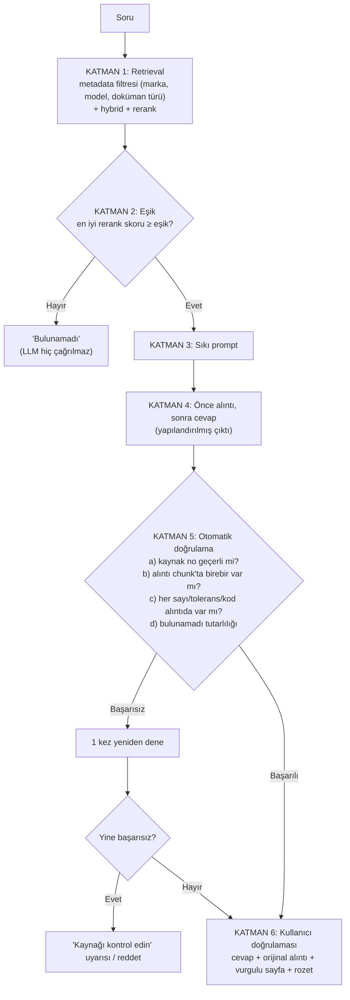

# LLM Seçimi, Halüsinasyon Azaltma ve Değerlendirme — Adım 4

> **Kaynak not:** `llm-degerlendirme.md` (başlangıç 2026-10-09) · **İlgili plan:** req.md Adım 4 · **Bağlantılı:** prompt-taslak.md, sorulacaklar.md, rag-temelleri.md (S11), tts.md (bu sette yok); [03-kaynak-gosterme.md](03-kaynak-gosterme.md), [05-arayuz-ve-orkestrasyon.md](05-arayuz-ve-orkestrasyon.md), [06-veri-guvenligi-ve-erisim.md](06-veri-guvenligi-ve-erisim.md)
> **Beslediği çıktılar:** Araştırma notu (LLM) · Araç/model seçimi (LLM, değerlendirme araçları) · Mimari taslağı (halüsinasyon katmanları) · Açık sorular & riskler · Görev planı (pilot model karşılaştırması, test seti)

---

## 1. Özet

- LLM'in rolü **bilgi kaynağı değil, okuyucu ve yazar**: getirilen 3–5 chunk'ı okur, cevabı bulur ve **kelimesi kelimesine alıntılar**, Türkçe, kısa ve **[n] kaynak numarasıyla** yazar; kaynakta yoksa **"bulunamadı"** der. Model kendi bilgisinden cevap üretmemeli.
- **Seçim kriterleri:** kaynağa sadakat, bilmediğini söyleme, TR yazma + EN okuma, şemaya uyma; sonra gecikme, maliyet, gizlilik, görsel okuma. Bağlam penceresi kriter değil (istekler ~3–5K token).
- **Maliyet karar verdirici değil:** ~5–170 $/ay (6.000 soru/ay). Kararı **doğruluk (kendi test setimizde)** ve **gizlilik (Q1)** verecek.
- **7–8B açık modeller** bir Türkçe doküman QA çalışmasında %49–75 doğruluk → bizim için yetersiz. Lokal hedef ~27–32B, 24 GB GPU (ölçülmeli).
- **Öneri:** Pilotta 3 sağlayıcıdan orta seviye birer model + 1 küçük model + 1 lokal aday, aynı test seti/prompt/chunk'larla. **Yapılandırılmış çıktı (JSON)**, **6 katmanlı halüsinasyon önlemi**, **iki yönlü sayı-tolerans kontrolü**, 50–100 soruluk 8 türlü test seti.

## 2. Kavramlar

| Terim | Anlamı | Sistem |
|-------|--------|------------|
| *Token* | En küçük metin birimi (~¾ İngilizce kelime). **Türkçe eklemeli olduğu için daha çok token tutar** | Fiyat ve hız token'a göre |
| *Context window* | Tek seferde okunabilen token (ör. 128K, 1M) | İstekler ~3–5K → sorun değil |
| *Input / output tokens* | Gönderilen / üretilen. **Çıktı genelde 4–6 kat pahalı** | Cevaplar kısa → maliyet düşük |
| *Reasoning / thinking tokens* | Cevaptan önce "içinden düşünme"; çıktı olarak faturalanır | Doğruluğu artırabilir, gecikme/maliyeti artırır; ayarlanabilir |
| *Prompt caching* | Sabit kısım önbellekten, ~%90 ucuz | Sistem promptu her soruda aynı → otomatik tasarruf |
| *Bulut API (kapalı model)* | Sağlayıcı sunucusunda; token başına ödeme | OpenAI, Anthropic, Google |
| *Açık ağırlıklı (open-weight)* | Ağırlıklar indirilir, kendi sunucumuzda çalışır; veri dışarı çıkmaz | Lisansa dikkat |
| *Parametre* (7B, 27B, 70B) | Model büyüklüğü | Büyük = genelde daha iyi, daha çok bellek |
| *Quantization* (4-bit, Q4) | Sıkıştırma; bellek ~4 kat düşer, kalite biraz düşer | Lokalde standart |
| *VRAM* | GPU belleği | Modelin sığıp sığmayacağı |
| *Ollama, llama.cpp, vLLM* | Lokal çalıştırıcılar | Ollama en kolay, vLLM çok kullanıcılı sunucu |
| *System prompt* | Sabit görev tanımı ve kurallar | "Sadece verilen kaynaklardan cevap ver..." |
| *Temperature* | Rastgelelik | Düşük tutulur (bazı yeni modellerde kaldırıldı, yerini "effort/düşünme derinliği" aldı) |
| *Structured output* | Cevabın JSON şemasında zorunlu kılınması | `{cevap, alıntılar, kaynaklar, sesli_metin, bulunamadı}`; tüm büyük sağlayıcılar ve çoğu lokal çalıştırıcı destekliyor |

**Bulut/lokal kararı:** Q1 (bulut kabul mü) ve Q5 (GPU var mı) — sorulacaklar.md A1, A2.

### 2.1 RAG'de halüsinasyon türleri

| Tür | Örnek | Yakalayan katman |
|-----|-------|------------------|
| Kaynakta olmayanı eklemek | "11 SPI, ayrıca 3 mm dikiş payı bırakın" (dikiş payı kaynakta yok) | Alıntı zorunluluğu, sayı kontrolü |
| Değeri yanlış kopyalamak | "11 (± 1)" → "11 (± 2)" veya "12" | **Sayı kontrolü** |
| Toleransı / birimi düşürmek | "11 (± 1) SPI" → "11 SPI" | Sayı kontrolü (iki yönlü) |
| Yanlış kaynağı birleştirmek | Ceketin 11 ± 1'ini pantolon sorusuna vermek | Metadata filtresi, kaynak gösterme, kullanıcı sayfada görür |
| Yanlış modele ait cevap | S-7300A sorusuna S-7300B'den cevap | `product_model` filtresi, doküman adı ekranda |
| Kendi genel bilgisini kullanmak | "Genelde 10–12 SPI kullanılır" | Sistem kuralı + eşik + alıntı zorunluluğu |
| Bilmediğini söylememek | Cevap yokken uydurmak | Eşik (LLM hiç çağrılmaz), "bulunamadı" kuralı |
| **Çeviri hatası** | "shall not exceed 12" → "12 olmalı" (üst sınır ↔ kesin değer) | Orijinal İngilizce alıntı ekranda, kullanıcı sayfada görür |

Sistemde **dil geçişi** var (EN manuel → TR cevap); "shall", "minimum", "not to exceed", "approximately" anlamları kaymamalı → **orijinal cümle (alıntı) her zaman ekranda.**

### 2.2 Değerlendirme terimleri

| Terim | Anlamı |
|-------|--------|
| Test seti / altın set | Cevabı ve sayfası önceden bilinen sorular (req.md 0.4) |
| Retrieval metrikleri | Recall@k, MRR (rag-temelleri.md 1.5) |
| Faithfulness | Cevaptaki her iddia kaynakta var mı? |
| Answer relevance | Cevap soruyu gerçekten cevaplıyor mu? |
| Abstention | Cevabı olmayan soruda "bulunamadı" — bizim için **doğru davranış** |
| LLM-as-judge | Cevabı başka LLM'e puanlatmak; hızlı ama hata yapabilir, insanla kalibre edilmeli |

Değerlendirme şart: model seçimini **bizim verimizde** yapmak, bir değişikliğin iyileştirip bozduğunu görmek, pilotun başarılı sayılıp sayılmayacağına karar vermek (req.md 6.3).

## 3. Seçenekler: Modeller

### 3.1 Seçim kriterleri

| # | Kriter | Neden | Nasıl ölçülür |
|---|--------|-------|---------------|
| 1 | **Kaynağa sadakat** | R4 | Faithfulness + değer doğruluğu |
| 2 | **Bilmediğini söyleme** | S11 Katman 2–3 | Abstention oranı |
| 3 | **TR yazma + EN okuma** | Q2: EN manuel, TR cevap | Çapraz dil soruları |
| 4 | **Talimat ve şemaya uyma** | Yapılandırılmış çıktı, [n], alıntı | Şemaya uymayan / alıntısız cevap oranı |
| 5 | Gecikme | Süre sorusu (arayüz notu) | Soru başına saniye |
| 6 | Maliyet | Bütçe | Aylık tahmin |
| 7 | Gizlilik / çalışma yeri | Q1 | Bulut / lokal / sözleşme |
| 8 | Görsel okuma (VLM) | Çizimli sayfalarda B seçeneği | Görsel test soruları |

**Neden genel sıralamalar yetmez:** Benchmark'lar modelin ne kadar çok şey bildiğini, kodlama ve akıl yürütmesini ölçer; bizim görev "verilen metne sadakat, bilmediğinde susma". Bilgili bir model kaynak yetersizken kendi bilgisini ekleme eğiliminde bile olabilir.

### 3.2 Bulut modeller (resmi fiyat sayfaları, 2026-10-09, 1M token başına USD)

| Sağlayıcı | Model | Girdi | Çıktı | Not |
|-----------|-------|------:|------:|-----|
| Anthropic | Claude Opus 5.5 | 4,00 | 20,00 | Üst seviye, 1M bağlam |
| | Claude Sonnet 5.5 | 2,00 | 10,00 | Orta |
| | Claude Haiku 5.5 | 0,10 | 0,50 | Küçük, hızlı |
| OpenAI | gpt-5.6-sol | 4,00 | 20,00 | Üst |
| | gpt-5.6-terra | 2,00 | 12,00 | Orta |
| | gpt-5.6-luna | 0,20 | 1,20 | Küçük, hızlı |
| Google | gemini-3.1-pro-preview | 2,00 | 12,00 | Önizleme aşamasında |
| | gemini-3.8-flash | 0,75 | 3,75 | 1 Ocak 2027'de fiyat iki katına çıkacak (resmi sayfa) |
| | gemini-3.1-flash-lite | 0,25 | 1,50 | Küçük |

- **Ortak:** Hepsi Türkçe, görsel okuma (VLM), yapılandırılmış çıktı ve önbellek destekliyor. Aynı modeller **Azure, AWS, Google Cloud** üzerinden kurumsal sözleşmeyle de kullanılabiliyor (OpenAI → Azure; Claude → AWS Bedrock / Google Vertex / Microsoft Foundry). Şirketin mevcut bulut sözleşmesi varsa (Q1-a) önemli.
- **Veri kullanımı (doğrulanmalı):** Ücretli API'lerde veri varsayılan olarak eğitimde kullanılmıyor (Google: ücretsiz katmanda "ürün geliştirmek için kullanılır", ücretlide "kullanılmaz"). Kötüye kullanım denetimi için ~30 gün saklanabiliyor. **ZDR** çoğu sağlayıcıda ayrı başvuru/sözleşme ile; bazı üst modellerde yok (ör. Anthropic'in Fable modeli 30 gün saklama gerektiriyor). **Ücretsiz katmanlar / tüketici uygulamaları (ChatGPT, Gemini uygulaması) müşteri verisi için kullanılmamalı.**

### 3.3 Açık ağırlıklı (lokal) modeller

| Aile | Lisans | Türkçe | Not |
|------|--------|--------|-----|
| **Qwen** (Alibaba) | Çoğu boyut Apache-2.0 (en büyük amiral özel lisanslı, doğrulanmalı) | ✅ | Türkçe doküman QA çalışmasında 7B'de en iyi doğruluk/hız dengesi |
| **Gemma** (Google) | Apache-2.0 mı "Gemma License" mı — kaynaklar çelişiyor, model kartından doğrulanmalı | ✅ | Küçük boyutlar, cihaz üstü |
| **Mistral** | Small/Large'da Apache-2.0 (doğrulanmalı) | 🟡 | Aynı çalışmada Türkçede zayıf |
| **Llama** (Meta) | Meta topluluk lisansı (kullanım politikası, isim şartı, bölgesel koşullar) | ✅ | Lisans karmaşık |
| **Türkçe uyarlanmış** (Trendyol-LLM, Cosmos Turkish-Llama, Kocdigital vb.) | Modele göre | ✅✅ | "Türkçe uyarlama her zaman daha iyi değil" |
| DeepSeek, Kimi, GLM, MiMo (büyük) | Çeşitli (çoğu serbest) | ? | Sıralamaların tepesinde ama yüzlerce milyar parametre, lokalde pahalı |

**Türkçe doküman QA kanıtı** ([arXiv 2609.28007](https://arxiv.org/html/2609.28007), 2026, doğrulanmalı): 5 açık model (7–8B), retrieval'lı Türkçe QA, 6 GB VRAM'li dizüstü GPU, 4-bit.

| Model | Doğruluk | Hız (sn/soru) | "Bilmiyorum" (20 cevapsız sorudan) |
|-------|---------:|--------------:|-------------------------:|
| Trendyol-LLM-8B | %75 | 23,9 ("düşünme modu", ~14 kat yavaş) | 18 |
| Qwen2.5-7B | %65 | 1,7 | 19 |
| Cosmos | %54 | — | 18 |
| Mistral | %51 | — | 13 |
| Kocdigital | %49 | — | 9 |

- Yazarlar: **Türkçeye özel uyarlama doküman tabanlı başarıyı garanti etmiyor**; model, retrieval ve donanım ayrı ölçülmeli.
- **Anlamı:** 7–8B modeller 100 sorunun 25–50'sini yanlış cevaplıyor; "yanlış değer = yanlış dikim" için yetersiz. Ama çalışma eski nesil (Qwen2.5) ve tek doküman üzerinde → uyarı işareti, kesin hüküm değil; yeni nesil **ölçülmeli.**
- **Genel Türkçe benchmark'lar:** TurkishMMLU, TR-MMLU, **CETVEL** (EACL 2026). CETVEL de Türkçeye özel modellerin genel çok dilli modelleri genelde geçemediğini buldu; ama bunlar genel bilgi/dil ölçüyor, "metne sadakat"i değil.

### 3.4 Lokal donanım

| Model boyutu | VRAM (yaklaşık) | Örnek donanım | Bizim için |
|--------------|-----------------|---------------|------------|
| 7–8B | ~5–8 GB | Dizüstü / giriş GPU | Doğruluk muhtemelen yetersiz |
| 14B | ~10–12 GB | 12–16 GB GPU | Ara seçenek |
| **27–32B** | **~18–24 GB** | **24 GB GPU (tek kart)** | **Lokal için makul hedef**, ölçülmeli |
| 70B | ~40–48 GB | 2× 24 GB veya 48 GB | Daha iyi, pahalı |
| 100B+ / MoE | 80 GB+ | Sunucu GPU | Pilot için fazla |

- GPU yoksa (Q5) lokal LLM pratikte zor: CPU'da 7B bile soru başına onlarca saniye.
- Aynı GPU'yu paylaşacaklar: embedding (bge-m3), reranker, ingestion VLM, belki TTS (Chatterbox) ve STT (Whisper) → GPU bütçesi **toplamda** düşünülmeli.

### 3.5 Kabaca bulut maliyeti

Varsayım: günde 200, ayda ~6.000 soru; soru başına ~4.000 girdi (sistem talimatı + 5 chunk + soru), ~600 çıktı token'ı; düşünme token'ları hariç.

| Seviye | Örnek | ~Aylık |
|--------|-------|-------:|
| Üst | Claude Opus 5.5 / gpt-5.6-sol | ~170 $ |
| Orta | Claude Sonnet 5.5 / gpt-5.6-terra / gemini-3.1-pro | ~85–95 $ |
| Hızlı / ucuz | gemini-3.8-flash | ~30 $ |
| Küçük | Claude Haiku 5.5 / gpt-5.6-luna / gemini-3.1-flash-lite | ~5–10 $ |

Düşünme token'ları ve sayfa resmi gönderimi maliyeti birkaç kat artırabilir; yine yönetilebilir. Önbellek girdi maliyetini daha da düşürür.

### 3.6 Model seçim yöntemi

1. **Test aşaması (public veri, bulut serbest):** Her sağlayıcıdan bir orta seviye (3 aday) + bir küçük model, aynı test seti, aynı prompt ve chunk'lar → bulut için "üst sınır" ve "yeterli olan en ucuz".
2. **Lokal aday (Q1 = bulut yok ihtimali):** Apache-2.0 açık model (ör. Qwen ailesinden 27–32B) aynı test setinde; fark küçükse gerçek veride lokal.
3. **Karar ölçütü:** önce değer doğruluğu ve doğru reddetme, sonra faithfulness, sonra gecikme ve maliyet.
4. Ölçüm **pilotta** (araştırma aşamasında deneme yok, req.md 6.1). Sağlayıcı önceden seçilmiyor.

**Q1 = "bulut yasak" çıkarsa:** (1) ~27–32B Apache-2.0 model + ~24 GB GPU (daha iyisi 70B, 2 GPU) — donanım yatırımı (Q5, bütçe); (2) pilotta bulutla aynı test setinde karşılaştır; (3) fark büyükse diğer katmanlar sıkılaştırılır (daha yüksek eşik, sıkı sayı kontrolü, kullanıcı onayı) — sistem daha çekingen davranır; (4) ara çözüm: **kurumsal bulut** (kendi Azure/AWS hesabı, veri saklamama) — hukuk bunu "bulut" sayıyor mu? (Q1-a).

## 4. Prompt tasarımı ilkeleri

Taslak sistem promptu ve şema: `prompt-taslak.md` (bu sette yok).

| İlke | Neden |
|------|-------|
| Rol ve sınır: "Sadece verilen kaynaklardan cevap ver, genel bilgini kullanma" | — |
| **Önce alıntı, sonra cevap** | Model önce kanıtı bulur; kod alıntıyı kontrol edebilir (Katman 4) |
| **Sayısal değerler sadece alıntıdan** | Değer kopyalama hatasını azaltır |
| Her iddia için [n] | Sayfa/bbox metadata'dan gelir |
| "Bulunamadı" şemada ayrı alan | Modelin "bir şey söylemek zorunda" hissetmesini engeller |
| **Çelişkiyi bildir, seçme** | Ceket 11 ± 1, pantolon 10–14 ikisi de gelirse ikisini de kaynaklarıyla yaz (R3) |
| Soru belirsizse sor | "Hangi ürün için? Ceket mi pantolon mu?" |
| **Çeviri kuralları:** shall / minimum / maximum / not to exceed / approximately anlamını koru; birim dönüştürme | Dönüşüm (inç → cm) gerekirse **kod** yapar, "yaklaşık" işaretler |
| Toleransı asla düşürme | Düşen tolerans hatasını baştan azaltmak |
| Yapılandırılmış çıktı (JSON) | Kodun alıntı/sayı/kaynak kontrolü için |
| Sesli metin ayrı alan (tts.md 2.5) | Kısa, rakamlı, kaynak numarasız |
| Kullanıcı sorusu ve doküman içeriği **veri**dir, talimat değil | Prompt injection'a karşı ucuz önlem |

**JSON alanları ve gittikleri yer:** `cevap` → ekran · `alintilar` → doğrulama + sayfada cümle vurgusu · `sesli_metin` → normalizasyon + TTS · `bulunamadi` → "bulunamadı" ekranı · `netlestirme_sorusu` → kullanıcıya soru · `celiski_var` → uyarı rozeti.
**Fayda:** Asıl sebep **otomatik doğrulama** (serbest metinden alıntı/cevap ayıklamak kırılgan). Şema zorunlu kılınınca model şemaya uymayan cevap veremez. Denetim izinde alanlar ayrı kaydedildiği için "alıntı doğru, cevaba yanlış aktarılmış" ile "alıntı yok → retrieval yanlış chunk getirmiş" ayrımı yapılabilir.

## 5. Mimari: Halüsinasyon azaltma katmanları (S11'in ayrıntılı hali)



- **Katman 2 – Eşik kalibrasyonu:** Test setinde cevabı olan ve olmayan sorular için en iyi rerank skoru kaydedilir; eşik "cevaplıların çoğu geçsin, cevapsızların çoğu takılsın" noktasına konur.
- **Katman 4 – Alıntı:** Kaynak dilinde (genelde EN), kelimesi kelimesine; cevap TR olabilir, alıntı çevrilmez. Kontrol birebir (boşluk/satır sonu normalize); OCR'lı metinde küçük farklara *fuzzy match* toleransı, **sayılarda tolerans yok.** Alıntı aynı zamanda ekranda cümle vurgusu için kullanılır (`search_for(alıntı)`).
- **Katman 5c – Sayı kontrolü:**
  1. Cevaptan ve alıntılardan sayısal ifadeler **bütün ifade olarak** çıkarılır (regex): "11 (± 1)", "10-14", "3/16", "½", "E-07", "S-7300A", "146391-001", "301", "LSc-2", "3/16 to 1/4".
  2. Normalize: "½" → 1/2, "10–14" → 10-14, "± 1" → ±1, "1.5" = "1,5", boşluklar.
  3. **Yön 1 (cevap → kaynak):** cevaptaki her ifade atıf yapılan chunk'ta/alıntıda var mı? (uydurma "12"yi yakalar)
  4. **Yön 2 (kaynak → cevap):** alıntıdaki her sayı-tolerans ifadesi cevapta **tam haliyle** var mı? (düşen toleransı yakalar)
  - Tek yönlü kontrol "inç başına 11 dikiş [1]" cevabını **geçirir** (11 kaynakta var), tolerans kaybı kaçar; rakam rakam karşılaştırma hiçbir şey yakalamaz ("± 1"deki 1 de kaynakta var).
  - Birim dönüşümü ("1/4 inç ≈ 6,35 mm") kaynakta yoktur → dönüşümü kod yapar, "dönüştürülmüş, yaklaşık" etiketi.
  - Sesli metindeki sayılar da aynı kontrolden geçer.
- **Katman 5d – Bulunamadı tutarlılığı:** "bulunamadı" ise cevap alanı boş; cevap varsa en az bir geçerli alıntı ve kaynak. "Bulunamadı" ama rerank skoru çok yüksekse kayda alınır, pilotta incelenir.

**Doğrulama başarısızsa:**

| Durum | Davranış |
|-------|----------|
| Alıntı chunk'ta yok | 1 kez yeniden dene; yine yoksa cevabı gösterme, "Kaynağı kontrol edin" + kaynak sayfası |
| Cevapta kaynakta olmayan sayı | **Cevap gösterilmez**; sadece kaynak sayfası ve alıntı ("Bu bilgi için kaynağa bakın") |
| Tolerans düşmüş | Cevap ⚠ rozetle + alıntı vurgulu (veya "toleransı da yaz" ile yeniden deneme) |
| Geçersiz kaynak no | Yeniden dene, olmazsa reddet |

Tüm başarısızlıklar **denetim izine** yazılır; pilotta hata türü sıklıkları analiz edilir.

**Ek önlemler (pilottan sonra, gerekirse):** ikinci (küçük) model ile doğrulama (*verifier*; ek çağrı/gecikme); çapraz dil anlam kontrolü (kural listesiyle başla); sağlayıcının yerleşik atıf özellikleri (ör. Anthropic Citations — sağlayıcı bağımlılığı; bizim [n] yöntemi bağımsız, önce o).

## 6. Değerlendirme yöntemi

### 6.1 Test seti (req.md 0.4, sorulacaklar.md A3)

```json
{
  "id": "T07",
  "soru": "Ceketin dış görünür dikişlerinde SPI kaç olmalı?",
  "tur": "deger",
  "beklenen_doc": "gl-pd-14-04a",
  "beklenen_sayfa": [22, 23],
  "beklenen_degerler": ["11 (± 1)"],
  "beklenen_davranis": "cevapla",
  "not": "Pantolon (10-14) ile karışmamalı"
}
```
`tur`: deger | prosedur | ariza | cevapsiz | tuzak | capraz_dil | gorsel (+ alan dışı) · `beklenen_davranis`: cevapla | bulunamadi | netlestir

| Tür | Örnek | Ölçtüğü |
|-----|-------|---------|
| Değer | "Ceket dış dikiş SPI?" | Değer doğruluğu (en kritik) |
| Prosedür | "Üst iplik gerginliği nasıl ayarlanır?" | Adımların eksiksizliği |
| Arıza | "S-7300A'da dikiş atlıyor" | Arıza tablosu, doğru model |
| **Cevapsız** | "Nike ceketlerde düğme sayısı?" (sette Nike yok) | Doğru reddetme |
| **Tuzak** | "S-7300A'da ..." (cevap sadece B'de) | Yanlış modele ait cevap vermemek |
| Çapraz dil | TR soru, EN kaynak | Diller arası retrieval + çeviri |
| Görsel | Cevabı sadece çizimde | Görsel anlama |
| Alan dışı | "Kahve makinesi kireç nasıl temizlenir?" dikim bağlamında | Doküman türü karışması |
| (Yetki — veri güvenliği notundan) | Nike yetkili kullanıcı Adidas soruyor | Yetki filtresi |

**Neden cevapsız ve tuzak sorular:** Sadece cevaplı sorularla her şeye cevap veren ama uyduran sistem iyi görünürdü; eşik kalibre edilemezdi; aşırı çekingenlik de ölçülemezdi. Tuzak sorular metadata filtresinin ve "çelişkiyi bildir" kuralının işe yarayıp yaramadığını gösteren tek yer.
**Boyut:** Pilot için **50–100 soru** (10–20 ile başla); özellikle cevapsız ve tuzak sorulardan yeterli örnek. Gerçek veriye geçişte yeniden kurulacak.

### 6.2 Metrikler (taslak hedefler, pilot başarı kriteri 6.3 için)

| Seviye | Metrik | Ne | Hedef |
|--------|--------|----|-------|
| Retrieval | **Recall@5** | Doğru sayfa ilk 5'te mi? | ≥ %90 |
| Retrieval | MRR | Doğru sayfa kaçıncı? | İzlenir |
| Cevap | **Değer doğruluğu** | Beklenen değerler (tolerans dahil) tam mı? | **≥ %98**; yanlış değer = kritik hata |
| Cevap | **Kaynak doğruluğu** | Gösterilen sayfa beklenen mi? | ≥ %95 |
| Cevap | Faithfulness | İddialar kaynakta var mı? | ≥ %95 |
| Cevap | Answer relevance | Soruya cevap veriyor mu? | İzlenir |
| Davranış | **Doğru reddetme** | Cevapsızlarda "bulunamadı" | ≥ %90 |
| Davranış | Gereksiz reddetme | Cevaplılarda "bulunamadı" | ≤ %10 |
| Davranış | Tuzak başarısı | Yanlış model/markadan cevap vermeme | %100 |
| Operasyon | Gecikme | Soru → doğrulanmış cevap | Kullanıcıya sorulacak |
| Operasyon | Maliyet | Soru başına | İzlenir |

"Yanlış cevap" ≠ "cevap yok": **yanlış değer** en ağır hata, **gereksiz "bulunamadı"** hafif hata. Tek bir "doğruluk %" yetmez.

### 6.3 Araçlar

| Araç | Ne | Bizim için |
|------|----|------------|
| **Custom script** | Test setini `soru_cevapla()` ile çalıştırır, kural tabanlı metrikleri hesaplar | **Temel**; kritik metrikler kural tabanlı, LLM hakem gerekmez |
| **RAGAS** | Faithfulness, answer relevancy, context precision (LLM hakem) | Faithfulness için; **Türkçe prompt uyarlama özelliği** kullanılmalı |
| **DeepEval** | pytest benzeri çatı, 50+ metrik, CI | Otomatik regresyon testi gerekirse |
| **TruLens** | Üretimde izleme (RAG Triad) | Pilot sonrası canlı izleme |

**LLM hakem uyarıları:** Hakem cevap üreten modelden **farklı** olmalı; Türkçe cevaplarda İngilizce odaklı hakem güvenilirliği düşebilir → küçük insan etiketli setle karşılaştır (ör. 30 cevabı kalite ekibi puanlar). Bir 2026 kaynağı (doğrulanmalı): yüksek faithfulness kaynağın **doğru kaynak** olduğunu göstermez → kaynak doğruluğu ayrı ölçülür.
**İnsan değerlendirmesi:** Kalite ekibinden biri rastgele 30–50 cevabı **"bu cevapla dikim yapar mıydım?"** sorusuyla puanlar; kullanıcı geri bildirim butonu (👍 / 👎 + "yanlış değer" seçeneği).

## 7. Öneri

| Konu | Öneri | Alternatif | Gerekçe |
|------|-------|-----------|---------|
| **LLM (test aşaması)** | 3 sağlayıcıdan orta seviye birer model + bir küçük model, pilotta karşılaştırma | Tek sağlayıcıyla başlamak | Tarafsız, kendi verimizde ölçülmüş seçim |
| **LLM (Q1 = bulut yok)** | Apache-2.0 açık model, ~27–32B, 24 GB GPU | 70B (2 GPU) · Türkçe uyarlanmış model | 7–8B yetersiz kanıtı; Q5'e bağlı |
| **Çıktı biçimi** | Yapılandırılmış çıktı (JSON şeması) | Serbest metin + ayrıştırma | Otomatik doğrulama için şart |
| **Halüsinasyon** | 6 katman, kalibre eşik, iki yönlü sayı kontrolü | + ikinci model doğrulayıcı | R4 |
| **Değerlendirme** | Custom script + RAGAS (TR uyarlamalı) + insan değerlendirmesi | DeepEval (CI), TruLens (izleme) | Kritik metrikler kural tabanlı |
| **Test seti** | 50–100 soru, 8 tür, cevapsız ve tuzak dahil | — | Pilot başarı kriteri için şart |

## 8. Açık sorular ve riskler

- **Q1** (bulut kabul mü), **Q1-a** (kurumsal bulut "bulut" sayılır mı / mevcut sözleşme), **Q5** (GPU), **bütçe**.
- Test setini **kim hazırlayacak** (req.md 0.4).
- **Kabul edilebilir yanlış değer oranı** ve **"genel bilgi kullanılabilir mi"** kararı (sorulacaklar.md A5).
- Kabul edilebilir **gecikme** kullanıcıya sorulacak.
- Lokal 7–8B doğruluk riski; lisans belirsizlikleri (Gemma, Qwen amiral, Mistral, Llama).
- Çeviri kaynaklı anlam kayması (shall / not to exceed).
- LLM hakemin Türkçe güvenilirliği; faithfulness'ın yanlış kaynağı gizleyebilmesi.
- Fiyat değişimi (gemini-3.8-flash 1 Ocak 2027'de iki katı); ZDR'nin bazı modellerde olmaması.

## Kaynaklar

**Resmi fiyat / model sayfaları**
- [Anthropic: modeller ve fiyatlar](https://platform.claude.com/docs/en/about-claude/models/overview) · [Anthropic fiyatlandırma](https://www.anthropic.com/pricing)
- [OpenAI API fiyatlandırma](https://developers.openai.com/api/docs/pricing)
- [Google Gemini API fiyatlandırma](https://ai.google.dev/gemini-api/docs/pricing)

**Türkçe ve açık modeller**
- [Evaluating Open-Weight LLMs for Turkish Domain Documents Under Retrieval and Hardware Constraints (arXiv 2609.28007, 2026)](https://arxiv.org/html/2609.28007)
- [CETVEL: Turkish LLM benchmark (EACL 2026)](https://aclanthology.org/2026.eacl-long.46) · [arXiv 2508.16431](https://arxiv.org/pdf/2508.16431)
- [TurkishMMLU (arXiv 2407.12402)](https://arxiv.org/pdf/2407.12402) · [TR-MMLU](https://loan.bilgi.edu.tr/items/cbb9b062-8df6-4073-85e4-81d51227442e/full)

**Değerlendirme**
- [RAGAS: metrikleri hedef dile uyarlama](https://docs.ragas.io/en/stable/howtos/customizations/metrics/metrics_language_adaptation/)
- [MEMERAG: çok dilli RAG değerlendirme meta-benchmark'ı (ACL 2025)](https://aclanthology.org/2025.acl-long.1101)

**İkincil kaynaklar (doğrulanmalı)**
- [Best Open Source LLMs (October 2026, Thunder Compute)](https://www.thundercompute.com/blog/best-open-source-llms) · [BenchLM açık model sıralaması](https://benchlm.ai/best/open-source) · [Open-weight modeller ve lisanslar (layer3labs)](https://www.layer3labs.io/open-weights/best-open-weights-ai-models) · [Qwen vs Llama vs Mistral (promptquorum)](https://www.promptquorum.com/local-llms/qwen-vs-llama-vs-mistral)
- [OpenAI fiyat tablosu özeti (morphllm)](https://www.morphllm.com/openai-api-pricing) · [Gemini fiyatları 2026 (cloudzero)](https://www.cloudzero.com/blog/gemini-pricing/)
- [RAGAS vs TruLens vs DeepEval (Analytics Vidhya, 2026)](https://www.analyticsvidhya.com/blog/2026/07/rag-evaluation-frameworks/) · [LLM evaluation frameworks compared (Atlan)](https://atlan.com/know/llm-evaluation-frameworks-compared/) · [Best RAG evaluation tools 2026 (futureagi)](https://futureagi.com/blog/best-rag-evaluation-tools-2026/)
