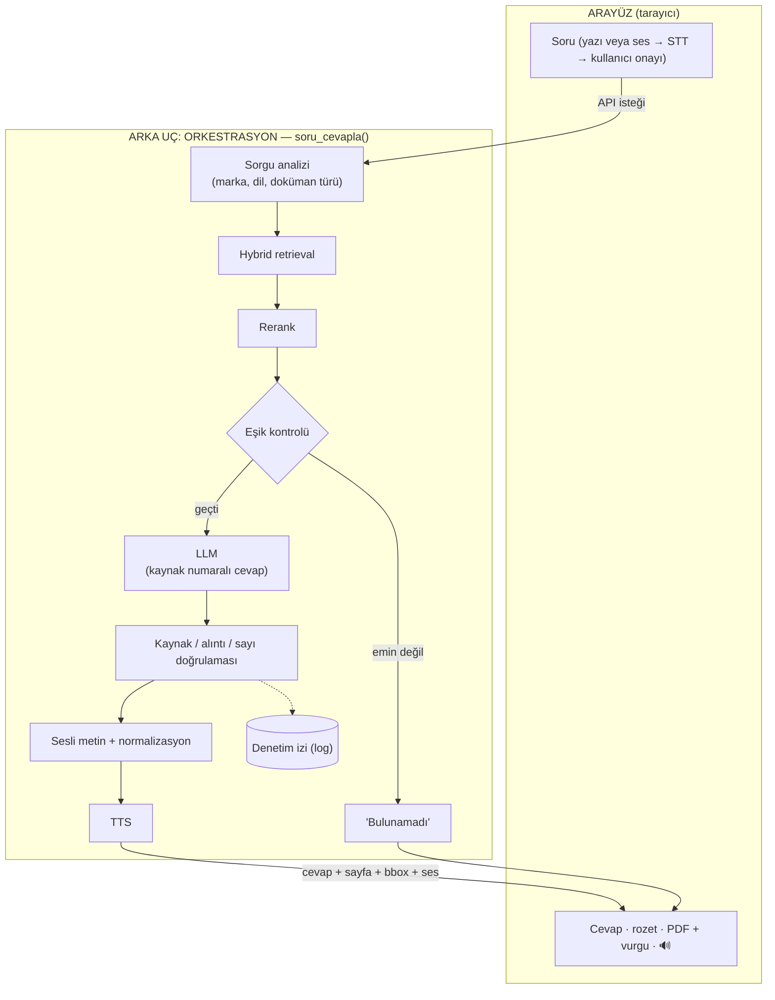

# Arayüz, Orkestrasyon ve Sesli Soru (STT) — Adım 6

> **Kaynak not:** `arayuz-orkestrasyon.md` (başlangıç 2026-10-09) · **İlgili plan:** req.md Adım 6 · **Bağlantılı:** [03-kaynak-gosterme.md](03-kaynak-gosterme.md), [04-llm-secimi-ve-degerlendirme.md](04-llm-secimi-ve-degerlendirme.md), [06-veri-guvenligi-ve-erisim.md](06-veri-guvenligi-ve-erisim.md); rag-temelleri.md, tts.md, Faz 1 denemesi (`faz1-test.py`, `faz1_output/report.md`) bu sette yok
> **Beslediği çıktılar:** Araştırma notu (UI, orkestrasyon, STT) · **Mimari taslağı** (uçtan uca akış, modül yapısı, ekran düzeni) · Araç seçimi (UI, orkestrasyon, STT) · Açık sorular & riskler · Görev planı (pilot arayüzü)

---

## 1. Özet

- **Pilot arayüzü: Streamlit + `streamlit-pdf-viewer`** (Faz 1'de PDF + bbox vurgusu çalıştı; en hızlı yol). **Üretim:** muhtemelen özel web (React + FastAPI); karar pilottan sonra.
- **Temel ilke — "mutfağı salondan ayırmak":** RAG hattı arayüzden bağımsız bir Python paketi, tek giriş noktası `soru_cevapla()`. Arayüz değişse de hat değişmez.
- **Orkestrasyon: çatısız, modüler düz Python** (ingestion / retrieval / generation / verification / speech / pipeline) + her soru için **denetim izi**. Hat doğrusal ve deterministik; ajan gerekmiyor.
- **Ekran:** cevap solda, vurgulu kaynak sayfası sağda (aynı anda görünür), doğrulama rozeti, kritik değer büyük punto, cevap **doğrulandıktan sonra** gösterilir.
- **STT:** Gerekliliği kullanıcıya bağlı (Q4); mimariyi değiştirmez, sonradan eklenebilir. Gerekirse bas-konuş + tanınan metni ekranda onaylama + terim ipucu listesi.
- **Elenenler:** Gradio (bbox vurgusu belgelenmemiş), Chainlit (sohbet kalıbı), Open WebUI (sayfa görüntüleme yok + marka koruma lisans maddesi).

## 2. Kavramlar

- **Arayüz (frontend):** Kullanıcının gördüğü kısım (soru kutusu, cevap, PDF görüntüleyici, ses oynatıcı); tarayıcıda çalışır. **Arka uç (backend):** arama, LLM, doğrulama, TTS; sunucuda. İkisi **API** üzerinden konuşur. (Benzetme: salon / mutfak / garson.) Faz 1'de ikisi tek Python dosyasında iç içeydi; deneme için doğru, ama ileride arayüz değişecek (prototip → üretim, PC → tablet).
- **Python arayüz çatıları** (Streamlit, Gradio, NiceGUI, Chainlit): sadece Python ile web arayüzü, hazır bileşenler. **Özel web** (React/Next.js/Vue + FastAPI): her piksel kontrol edilir.
- Ekranımız sıradan sohbet ekranı değil: PDF sayfası + vurgu + gezinme; ses oynatıcı + okunan cümlenin vurgulanması (tts.md 2.3); atölye koşulları (eldiven; ses hedefleniyor ama manuel kullanım da düşünülmeli).
- **Orkestrasyon:** Adımları doğru sırayla, doğru verilerle çalıştıran, bir adım başarısız olunca ne yapılacağına karar veren ve her adımı kaydeden kod. **Çatı** (LangChain, LlamaIndex, Haystack) hazır kalıplar sunar; **soyutlama** ayrıntıyı gizler — ama gizlenen ayrıntı (prompt'un tam metni, hangi chunk'ın neden geldiği, metadata'nın taşınması) en çok kontrol etmek istediğimiz yer olabilir. Soru aslında "ne kadar kontrol istiyoruz?".
- **STT terimleri:** *WER* (kelime hata oranı; kod ve sayılarda tek hata bile önemli), *bas-konuş* (push-to-talk), *uyandırma kelimesi* (wake word), *sözlük ipucu* (phrase list / prompt: "overlok, lockstitch, S-7300A, SPI").

### 2.1 Streamlit "rerun" modeli

Herhangi bir butona basılınca Python dosyası **baştan sona yeniden çalışır.** Basit uygulamada kolaylık; ama ses çalarken butona basılınca sesin kesilmesi, cevabın yeniden üretilmesi gibi sorunlar çıkabilir.

**Somut risk:** Usta soruyu sorar (retrieval + LLM + doğrulama + TTS: ~5–10 sn, LLM ücreti) → [2] kaynak sekmesine tıklar → session state yoksa soru **yeniden** cevaplanır: 10 sn bekleme, ikinci LLM ücreti ve en kötüsü LLM'in **farklı** bir cevap yazması (güven kaybı, R4). Session state varsa cevap anında ve değişmeden gelir.

**Pilot kuralları (Streamlit'in standart yöntemi):**
1. **Ağır iş sadece "Sor" butonunda:** `soru_cevapla()` yalnızca yeni soruda çağrılır; sonuç (cevap, kaynaklar, bbox'lar, ses) *session state*'e yazılır.
2. **Ekran her zaman session state'ten çizilir;** diğer tıklamalar hiçbir şeyi yeniden hesaplamaz.
3. **Bağımsız parçalar *fragment* olur** (ör. kaynak görüntüleyici paneli; ses oynatıcı yerinde kalır).

- Tarayıcı içinde kalan etkileşimler rerun tetiklemez: ses oynatıcının oynat/durdur/sar düğmeleri; PDF.js içinde kaydırma/yakınlaştırma (büyük ihtimalle; pilotta kontrol edilecek).
- Rerun tetikleyenler: "Sor", kaynak sekmesi değiştirme, Streamlit butonları (ör. "Yavaş oku" Streamlit butonu olursa).
- **Karmaşık etkileşimler** (ses çalarken anlık cümle vurgusu, mikrofon dinlerken ekran güncellemesi, birbirini etkileyen paneller) Streamlit'te kodu karıştırır → pilotta basit tutulur (ses butonla, cümle vurgusu yok veya sonradan).

| Seçenek | Nasıl | Ne zaman |
|---------|-------|----------|
| **Streamlit + 3 kural** | Yeniden çizer, sonuçları session state'ten alır | **Pilot (önerilen)** |
| **NiceGUI** (olay tabanlı) | Butona basınca sadece o fonksiyon çalışır; hâlâ sadece Python | Streamlit'te etkileşim çok karışırsa |
| **Özel web** (React + FastAPI) | Ekranı tarayıcı yönetir; arka uca sadece soru sorulurken gidilir | Üretim: senkron vurgu, tablet, yetkilendirme |

## 3. Mimari

### 3.1 Uçtan uca sorgu akışı (orkestrasyon)



### 3.2 Modül yapısı (önerilen)

```
visual_agent/
  ingestion/      parse (Docling) → temizlik → chunk → metadata → indeks
  retrieval/      sorgu analizi, hybrid arama (Qdrant), rerank, eşik
  generation/     prompt, LLM çağrısı, [n] ayrıştırma
  verification/   kaynak no / alıntı / sayı kontrolü        (S11 Katman 5)
  speech/         sesli metin, normalizasyon, TTS            (tts.md)
  pipeline.py     soru_cevapla(): adımları sırayla çağırır + her adımı loglar
  app_streamlit.py   pilot arayüzü (sadece pipeline'ı çağırır)
```

Tek giriş noktası:

```python
cevap = soru_cevapla(soru="...", kullanici=..., dil="tr")
# cevap: metin, kaynaklar [(doc_id, sayfa, basili_sayfa, bbox'lar)],
#        doğrulama sonucu, sesli metin, ses dosyası
```

- Streamlit bu fonksiyonu doğrudan çağırır; özel web'e geçilirse aynı fonksiyon bir **FastAPI uç noktasının** (`POST /soru`) arkasına konur, JSON döner. **RAG hattında tek satır değişmez.**
- **Değişmeyenler:** ingestion, retrieval, rerank, eşik, LLM, doğrulama, sesli metin, TTS. **Değişen:** sadece arayüz (`app_streamlit.py` → React) + araya FastAPI uç noktası.
- **Ek faydalar:** arayüzsüz otomatik test (test seti script ile `soru_cevapla()` üzerinden — değerlendirme bunu gerektiriyor); birden fazla arayüz (PC, tablet, başka sistem); hatanın ekranda mı hatta mı olduğunu ayırma.

## 4. Seçenekler: Arayüz

### 4.1 Ekran ihtiyaçları (seçim kriterleri)

| # | İhtiyaç | Kaynak | Önem |
|---|---------|--------|------|
| K-a | PDF sayfası + **bbox vurgusu** + gezinme + yakınlaştırma | kaynak gösterme notu, Q9 | 🔴 Zorunlu |
| K-b | Birden fazla kaynak arasında geçiş ([1], [2], [3]) | kaynak gösterme notu | 🔴 Zorunlu |
| K-c | Ses: oynat / durdur / tekrar / yavaş oku, okunan cümleyi vurgulama | tts.md 2.3 | 🟡 Önemli |
| K-d | Durum gösterimi: "aranıyor", "doğrulanıyor", "bulunamadı", uyarı | S11, tts.md R5 | 🔴 Zorunlu |
| K-e | Mikrofon + tanınan metni onaylama | STT | 🟡 Duruma bağlı |
| K-f | Tablet / dokunmatik, büyük butonlar, uzaktan okunabilir yazı | Atölye | 🟡 Önemli |
| K-g | Kullanıcı girişi, marka bazlı yetki | Adım 7.3 | 🟡 Üretimde zorunlu |
| K-h | Geliştirme hızı, Python bilgisiyle yapılabilmesi | Pilot | 🔴 Pilot için kritik |

### 4.2 Karşılaştırma

| Seçenek | Ne | PDF + bbox (K-a) | Ses / senkron vurgu (K-c) | Yerleşim | Öğrenme / hız | Not |
|---------|----|------------------|---------------------------|----------|---------------|-----|
| **Streamlit** | Python veri uygulaması | ✅ `streamlit-pdf-viewer` (PDF.js, bbox, vurguya kaydırma); **Faz 1'de çalıştı** | 🟡 `st.audio` var; otomatik/sıralı çalma ve senkron vurgu için **özel JS bileşeni** | 🟡 Kolon/sekme yeterli, piksel kontrolü sınırlı | ✅ En kolay | Rerun modeli karmaşık etkileşimde zorlaşır; `st.audio_input` ile mikrofon (sürüm doğrulanmalı) |
| **Gradio** | Python model demosu (Hugging Face) | 🟡 `gradio_pdf` PDF.js ile gösteriyor, **bbox vurgusu belgelenmemiş** | 🟡 Ses bileşeni güçlü (mikrofon, akış); senkron vurgu için özel kod | 🟡 Demo odaklı | ✅ Kolay | Ürün ekranı için sınırlı |
| **NiceGUI** | Python uygulama arayüzü (FastAPI + Vue) | 🟡 Hazır bileşen yok, PDF.js gömülebilir (efor orta) | ✅ Olay tabanlı, JS çağırmak kolay | ✅ İyi | 🟡 Orta | Daha "uygulama gibi"; ekosistem küçük (doğrulanmalı) |
| **Chainlit** | Python sohbet arayüzü | ❌ Yan panelde eleman gösterilebilir, vurgu yok | 🟡 Ses var | ❌ Sohbet kalıbı | ✅ Kolay | "Cevap + sayfa" ekranına uymuyor |
| **Open WebUI** | Hazır ChatGPT benzeri arayüz | ❌ Sayfa görüntüleme + bbox yok | 🟡 TTS/STT entegrasyonu | ❌ Değiştirmek zor | ✅ Kurulum kolay | **Lisans:** v0.6.6'dan (Nisan 2025) beri marka koruma maddesi — 50'den fazla kullanıcıda ad/logo kaldırılamaz, kurumsal lisans gerekir. **Elendi** |
| **Özel web** (React/Next.js + FastAPI) | JS arayüz + Python API | ✅ PDF.js veya hazır bileşenler (`react-pdf`, `react-pdf-highlighter`, doğrulanmalı) | ✅ Kelime zamanlamasıyla vurgu, sıralı çalma | ✅ Tam | ❌ En yavaş, JS/React gerekir | Üretim, tablet, yetkilendirme için en uygun |

**Open WebUI / Chainlit neden uygun değil:** Sorun gizlenen kısım değil (o orkestrasyon çatılarının sorunu), **ekran kalıbının sabit olması**: sohbet kalıbına bağlılar, sayfa + bbox vurgusu yok; cevap ile kaynak yan yana, doğrulama rozeti, "bulunamadı" ekranı tasarlanamıyor. (Büyük buton/kontrast her arayüzde ayrıca tasarlanmalı; eleme sebebi değil.)

| Soru | Cevap |
|------|-------|
| Pilot için? | **Streamlit.** Faz 1'de PDF + bbox çalışıyor; günler sürer. "Olsa iyi olur" özellikler basit tutulur |
| Üretim için? | Muhtemelen **özel web (React + FastAPI):** senkron vurgu, tablet, yetkilendirme, SSO en temiz burada. Streamlit yeterliyse üretime taşınabilir; **karar pilottan sonra** |

## 5. Tek ekran düzeni (wireframe)

> req.md'de `wireframe.png` deniyordu; şimdilik ASCII. Pilot arayüzü yapılınca ekran görüntüsüyle değiştirilebilir.

**Geniş ekran (PC / yatay tablet):**

```
┌───────────────────────────────────────────────────────────────────────────────┐
│ [Marka: Tümü ▾] [Doküman: Tümü ▾]                                    👤 Ayşe │
│ ┌─────────────────────────────────────────────────────────┐ ┌────┐ ┌──────┐  │
│ │ S-7300A'da üst iplik gergin değil, ne yapmalıyım?       │ │ 🎤 │ │ Sor  │  │
│ └─────────────────────────────────────────────────────────┘ └────┘ └──────┘  │
├────────────────────────────────────┬──────────────────────────────────────────┤
│ CEVAP                ✔ Kaynakla    │ KAYNAK  [1] Brother S-7300A ▸ [2] ...    │
│                        doğrulandı  │ s.90 (PDF s.101)        ◀ ▶  ➖ ➕  ⤢     │
│                                    │ ┌──────────────────────────────────────┐ │
│ Üst iplik gerginliği zayıf veya    │ │  Troubleshooting                     │ │
│ alt iplik gerginliği fazla olabilir│ │ ┌──────────────────────────────────┐ │ │
│ [1]. Önce üst iplik gerginliğini   │ │ │█ Upper thread is not tight     █│ │ │ ← sarı vurgu
│ artırın, gerekirse alt ipliği      │ │ │█ Is the upper thread tension...█│ │ │
│ ayarlayın (kılavuz s.65, s.67) [1].│ │ └──────────────────────────────────┘ │ │
│                                    │ │  (tablonun geri kalanı: açık mavi)   │ │
│ ┌────────────────────────────────┐ │ │                                      │ │
│ │ 🔊 ▶ Oynat  ⏸  ↺ Tekrar  🐢 Yavaş│ │ │                                      │ │
│ └────────────────────────────────┘ │ └──────────────────────────────────────┘ │
│                                    │ [Dokümanın tamamını aç]                  │
├────────────────────────────────────┴──────────────────────────────────────────┤
│ Önceki sorular: • Ceket dış dikiş SPI?  • E-07 hatası?                        │
└───────────────────────────────────────────────────────────────────────────────┘
```

**Dar ekran (dikey tablet / telefon):**

```
┌──────────────────────────────┐
│ [Soru................] 🎤 Sor│
├──────────────────────────────┤
│ CEVAP           ✔ Doğrulandı │
│ Dış dikişler: inç başına     │
│ ╔══════════════════════════╗ │
│ ║   11 (± 1) dikiş  [1]    ║ │ ← kritik değer büyük punto
│ ╚══════════════════════════╝ │
│ 🔊 ▶  ↺  🐢                  │
├──────────────────────────────┤
│ KAYNAK [1] GL-PD-14-04A s.22 │
│ ┌──────────────────────────┐ │
│ │  ...vurgulu sayfa...     │ │
│ └──────────────────────────┘ │
└──────────────────────────────┘
```

| Tasarım kararı | Gerekçe |
|----------------|---------|
| Cevap solda, kaynak sağda, aynı anda | Usta değeri okur, gözünü kaydırıp kaynakta doğrular; kaynağı sekmeye gizlemek doğrulamayı azaltır |
| Kritik değer büyük punto | Atölyede uzaktan bakılır. Değer cevaptan **kodla** çıkarılır, sayı kontrolünden geçmiş değer gösterilir |
| Doğrulama rozeti ✔ / ⚠ / ✖ | Katman 5 sonucunu göstermek; ⚠'de cevap gri + "Kaynağı kontrol edin" |
| Basılı + PDF sayfa no: "s.90 (PDF s.101)" | Faz 1'de çözüldü; usta basılı kılavuzda 90'a bakar |
| Kaynak sekmeleri [1] [2]; cevaptaki [1]'e tıklayınca açılır | Çok kaynaklı cevaplar |
| Ses butonla başlar (ayarla otomatik) | Çok kullanıcılı atölyede rahatsızlık; tarayıcılar otomatik çalmayı genelde engeller |
| "Bulunamadı" ekranı ayrı | "Bu bilgi manuellerde bulunamadı. İlgili birimle teyit edin." + yakın sonuçlar **"cevap değildir"** etiketiyle |
| Mikrofon → metin kutuya, kullanıcı onaylar | STT hatası yanlış makinede aramaya yol açmasın |
| Büyük dokunma alanları (≥ 48 px), yüksek kontrast | Tablet, eldiven, atölye ışığı |

**Etkileşim sırası:**
1. Kullanıcı soruyu yazar/söyler (söylerse metin kutuya gelir, onaylar)
2. "Kaynaklar aranıyor..." (retrieval + rerank)
3. "Cevap hazırlanıyor..." (LLM)
4. "Kaynakla kontrol ediliyor..." (doğrulama)
5. Cevap + rozet + vurgulu kaynak sayfası birlikte açılır
6. 🔊 aktif (veya ayara göre otomatik okuma)

**Neden akan (kelime kelime) metin yok?** Doğrulanmamış değer ekranda görünür (tts.md R5 ile aynı çatışma); usta yanlış değeri görebilir ve sonradan düzeltilse de aklında kalabilir. **Pilot:** cevap doğrulandıktan sonra bir kerede; bekleme sırasında durum mesajları. Bilgilendirici bekleme cümlesi kullanılabilir (ör. "Ceket şartnamesinde dış dikiş bilgisini arıyorum") ama içerik **sorudan/filtreden** gelmeli, LLM cevabından değil, ve **değer içermemeli.** Bekleme uzun bulunursa: metin akarak ama **gri ve "doğrulanıyor" etiketiyle**, doğrulama bitince normal renk.

## 6. Seçenekler: Orkestrasyon çatıları

**Hattın özellikleri (kriterler):** (1) doğrusal ve deterministik — ajan gerekmiyor, öngörülebilirlik R4 için önemli; (2) özel adımlar çok (bbox/sayfa metadata'sının sonuna kadar taşınması, basılı sayfa no, eşik, alıntı/sayı doğrulaması, sesli metin) — hiçbiri çatılarda hazır yok; (3) şeffaflık — hangi chunk geldi, skoru, LLM'e ne gitti, doğrulama neden başarısız (hata ayıklama + denetim izi).

| Seçenek | Ne | Öğrenme | Esneklik | Citation desteği | Not |
|---------|----|---------|----------|------------------|-----|
| **LangChain (v1) / LangGraph** | En geniş ekosistem; v1 (Ekim 2025) ile **ajan odaklı** (`create_agent`, LangGraph motoru); eski "chain" yapıları `langchain-classic` paketine taşındı | ❌ Yüksek; sık değişen API | ✅ ama soyutlamalarla boğuşma | 🟡 Kalıplar var; bbox/doğrulama yine bizde | Doğrusal hattımız için ajan yapısı fazla |
| **LlamaIndex** | Doküman ve retrieval odaklı | 🟡 Orta | 🟡 İyi | ✅ En iyisi: metadata (sayfa, dosya) chunk'lara taşınıyor, sayfa numaralı atıf örneği resmi dokümanda, `CitationQueryEngine` | Ingestion parçaları işe yarar |
| **Haystack 2.x** (deepset) | Pipeline odaklı; tipli bileşenler, YAML | 🟡 Orta | ✅ Yapı açık | 🟡 Genel destek (doğrulanmalı) | Felsefe olarak bize en yakın çatı |
| **Çatısız (düz Python)** | Her adım fonksiyon; `qdrant-client`, `FlagEmbedding` (bge-m3, reranker), LLM SDK, TTS SDK | ✅ En düşük | ✅ Tam kontrol | Kendimiz yazarız (zaten tasarlandı: numaralı chunk → [n] → metadata) | Bir kaynak: "tek doküman kümesi + tek LLM sağlayıcısı için SDK + vektör DB istemcisi yeterli" (doğrulanmalı) |

**Değerlendirme:** "3 satırda RAG" bize sadece kolay kısmı verir; zor kısımlar her durumda bizde. Çatının maliyeti gerçek: ek öğrenme, gizlenen prompt/metadata akışı, sürüm değişikliklerinde kırılma.

**Öneri: çatısız, modüler düz Python.** Bir çatının tek parçası işe yarıyorsa (ör. LlamaIndex okuyucusu) seçici kullanılabilir; omurga bizde kalır.
**Loglama (denetim izi):** Her soru için tek kayıt — soru, filtreler, gelen chunk'lar ve skorları, LLM'e giden prompt, cevap, doğrulama sonucu, gösterilen sayfa. Basit JSON log ile başla; ileride LLM izleme araçları (Langfuse vb., doğrulanmalı). Loglar müşteri verisi içerir → Adım 7.
**Ne zaman çatıya geçilir?** Sistem çok adımlı ajan davranışına evrilirse (ör. "önce makine kılavuzuna bak, bulamazsan şartnameye bak, karşılaştır, gerekirse kullanıcıya sor") → LangGraph veya Haystack yeniden değerlendirilir.

## 7. Seçenekler: STT (sesli soru)

| Lehine | Aleyhine |
|--------|----------|
| Eller meşgul (kumaş, makine), eldiven, kirli el | **Atölye gürültüsü** doğruluğu düşürür |
| Klavye kullanmayanlar için kolay | **Kod ve model adları** ("S-7300A", "E-07", "LSc-2") en çok yanlış tanınan ve yanlış olmaması gerekenler |
| TTS ile "eller serbest" deneyim | TR cümle + EN terim karışımı ("lockstitch", "overlok") |
| | Ses kaydı **kişisel veri** (KVKK); bulut STT'ye ses gider |

**Risk örneği:** "S yetmiş üç yüz A'da E sıfır yedi hatası" → STT "S-7300B'de E-07 hatası" yazarsa sistem S-7300B kılavuzunda arar, benzer model olduğu için bir cevap da bulur — **yanlış makineye ait** (E-07'nin anlamı, ayar değerleri, parça numaraları farklı olabilir). Sonraki tüm doğrulamalar geçer, çünkü cevap S-7300B kılavuzuna göre doğrudur (R4'ün STT versiyonu).

**Gerekirse nasıl:**

| Karar | Öneri | Gerekçe |
|-------|-------|---------|
| Dinleme | **Bas-konuş** | Sürekli dinleme gürültüde yanlış tetiklenir, gizlilik sorunu |
| Tanınan metin | **Kutuya yazılır, kullanıcı görür ve onaylar/düzeltir** (görsel onay) | Yanlış model kodu yanlış manuelde aramaya yol açmasın |
| Terim ipucu | Marka, model, hata kodu, teknik terim listesi (Azure *phrase list*, Whisper *prompt*); ingestion'da metadata'dan otomatik çıkarılabilir | Kod tanıma doğruluğu |
| Mikrofon | Gürültü önleyici kulaklık-mikrofon / yakın mikrofon | Tablet mikrofonu atölyede yetersiz kalabilir (Q10) |
| Son kontrol | Kaynak ekranında doküman adı ("Brother S-7300B") görünür | — |

**Sesli onay** ("S-7300B dediniz, doğru mu?"): eller tamamen meşgulken faydalı olabilir; ama ek gecikme, "evet" yine STT'den geçer, "A"/"B" seste de karışabilir. Pilotta görsel onayla başla, kullanıcı isterse sesli onay ekle.

| Motor | Türkçe | Lokal | Not |
|-------|--------|-------|-----|
| **Whisper large-v3** (OpenAI, açık, MIT) | ✅ | ✅ | En doğru Whisper; **GPU gerekir**, CPU'da gerçek zamandan yavaş |
| **Whisper large-v3-turbo** | ✅ | ✅ | ~2 kat hızlı; çok dilli ortalamada ~1,5 puan WER farkı (Türkçe için ayrı rakam yok). Bir ölçümde CPU tek iş parçacığıyla gerçek zamandan ~4 kat yavaş (doğrulanmalı) → pratikte GPU |
| **faster-whisper** | ✅ | ✅ | Aynı modelleri CTranslate2/int8 ile hızlı çalıştırır; CPU'da kısa sorular (3–5 sn) için kabul edilebilir olabilir, **ölçülmeli** |
| **Azure Speech STT** | ✅ | Bulut (container seçeneği var) | Phrase list, gerekirse Custom Speech; TTS de Azure olursa tek sağlayıcı |
| **Google / OpenAI STT** (gpt-4o-transcribe vb.) | ✅ | Bulut | Kalite yüksek; gizlilik Q1'e bağlı |

Bulut yasak ve GPU yoksa sesli soru zorlaşır (CPU'da faster-whisper ölçülmeli); GPU varsa Whisper lokalde rahat çalışır.

## 8. Öneri

| Konu | Öneri | Alternatif | Gerekçe |
|------|-------|-----------|---------|
| **Arayüz (pilot)** | Streamlit + `streamlit-pdf-viewer` (+ 3 rerun kuralı) | NiceGUI | Faz 1'de çalışıyor, en hızlı |
| **Arayüz (üretim)** | Özel web (React + FastAPI), pilottan sonra karar | Streamlit'te kalmak | Senkron vurgu, tablet, yetki, SSO |
| **Ekran düzeni** | Cevap + kaynak yan yana, rozet, büyük kritik değer, doğrulandıktan sonra göster | Akan metin + "doğrulanıyor" etiketi | R4: doğrulanmamış değer görünmesin |
| **Orkestrasyon** | Çatısız, modüler Python + denetim izi | LlamaIndex (ingestion parçaları), Haystack | Doğrusal hat, özel adımlar, şeffaflık |
| **STT** | İsteğe bağlı mikrofon: bas-konuş + onay + terim listesi (Q4'e göre) | Hiç olmaması | Kod tanıma hatası R4'e yol açabilir |
| **STT motoru** | Bulut serbestse Azure STT, değilse faster-whisper (Whisper large-v3-turbo) | Whisper large-v3 (GPU) | Q1 ve Q5'e bağlı |

## 9. Görev: Pilot arayüzü için yapılacaklar (kaynaktan türetilen)

- `soru_cevapla()` tek giriş noktasını ve modül yapısını kur; Streamlit'i yalnızca bu fonksiyonu çağıracak şekilde yaz.
- 3 rerun kuralını uygula (Sor'da ağır iş, session state'ten çizim, fragment).
- PDF.js kaydırma/yakınlaştırmanın rerun tetikleyip tetiklemediğini kontrol et.
- Durum mesajları, rozet, "bulunamadı" ekranı, basılı + PDF sayfa no.
- JSON denetim izi.
- (Opsiyonel) mikrofon butonu ile STT denemesi; kullanıcı tepkisine göre karar.
- Wireframe'i pilot ekran görüntüsüyle güncelle.

## 10. Açık sorular ve riskler

- **Q4:** STT gerekli mi? · **Q5:** GPU · **Q9:** dokümanın tamamı gösterilebilir mi? · **Q10:** kulaklık/hoparlör · **Q11 (yeni):** hangi cihaz (PC, tablet, kiosk), ekran nerede duracak?
- Kabul edilebilir bekleme süresi (kullanıcıya sorulacak).
- Streamlit rerun modelinin karmaşık etkileşimlerde (senkron vurgu, mikrofon) zorlaşması.
- STT'nin model/hata kodlarını yanlış tanıması → yanlış makine kılavuzu (doğrulamalar yakalamaz).
- Ses kaydı ve loglar kişisel/müşteri verisi (KVKK, Adım 7).
- Doğrulanmamış bilgilerin: `st.audio_input` sürümü, NiceGUI ekosistemi, React PDF bileşenleri, Haystack citation desteği, Langfuse, Whisper turbo CPU ölçümü.

## Kaynaklar

**Resmi dokümanlar**
- [Streamlit: fragments (kısmi yeniden çalıştırma)](https://docs.streamlit.io/develop/concepts/architecture/fragments) · [st.audio](https://docs.streamlit.io/develop/api-reference/media/st.audio)
- [Gradio: PDF custom component rehberi](https://www.gradio.app/guides/pdf-component-example) · [gradio-pdf (PyPI)](https://pypi.org/project/gradio-pdf)
- [Open WebUI lisansı (marka koruma maddesi)](https://docs.openwebui.com/license/)
- [LangGraph v1 geçiş rehberi (create_agent)](https://docs.langchain.com/oss/python/migrate/langgraph-v1)
- [LlamaIndex: PDF sayfa numaralı atıf örneği](https://developers.llamaindex.ai/python/examples/citation/pdf_page_reference/) · [Document/metadata kullanımı](https://developers.llamaindex.ai/python/framework/module_guides/loading/documents_and_nodes/usage_documents/)
- [Azure Custom Speech ile doğruluk artırma](https://azure.microsoft.com/en-us/blog/improve-speechtotext-accuracy-with-azure-custom-speech/) · [Azure AI Speech LLM 2607 duyurusu (phrase list iyileştirmeleri)](https://devblogs.microsoft.com/foundry/announcing-azure-ai-speech-llm-2607/)

**İkincil kaynaklar (doğrulanmalı)**
- [Open WebUI lisansının işletmeler için anlamı (wz-it)](https://wz-it.com/en/blog/open-webui-license-branding-business/) · [Is it really FOSS? Open WebUI](https://isitreallyfoss.com/projects/open-webui)
- [Streamlit vs NiceGUI (bitdoze)](https://www.bitdoze.com/md/streamlit-vs-nicegui.md) · [Streamlit vs Gradio vs Chainlit (markaicode)](https://markaicode.com/vs/streamlit-vs-gradio-vs-chainlit/)
- Streamlit ses/otomatik çalma tartışmaları: [autoplay](https://discuss.streamlit.io/t/how-to-get-autoplay-audio-in-streamlit-ui/65450), [streaming audio](https://discuss.streamlit.io/t/streaming-audio-response-from-streamlit-app/65910), [sıralı çalma](https://discuss.streamlit.io/t/autoplay-multiple-audios-in-a-streamlit-app-one-after-another/67165)
- [LangChain vs LlamaIndex vs Haystack 2026 (toolhalla)](https://toolhalla.ai/blog/langchain-vs-llamaindex-vs-haystack-2026) · [Best RAG framework 2026 (techsy)](https://techsy.io/en/blog/best-rag-framework-2026) · [index.dev karşılaştırması](https://www.index.dev/skill-vs-skill/ai-langchain-vs-llamaindex-vs-haystack)
- [LangChain 1.0 vs LangGraph 1.0 (clickittech)](https://www.clickittech.com/ai/langchain-1-0-vs-langgraph-1-0/)
- [Whisper large-v3 vs turbo karar rehberi (vexascribe)](https://vexascribe.com/whisper-large-v3-vs-turbo) · [Türkçe STT CPU/GPU ölçümü (alphaneural, rakip satıcı)](https://app.alphaneural.io/models/mihuai/turkish-stt)
- [Chainlit bakım durumu (beamforai, üçüncü taraf takipçi)](https://www.beamforai.com/tools/157/status)
