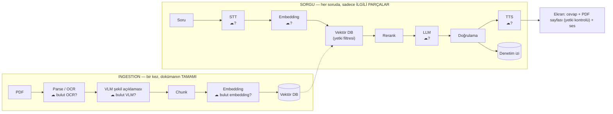
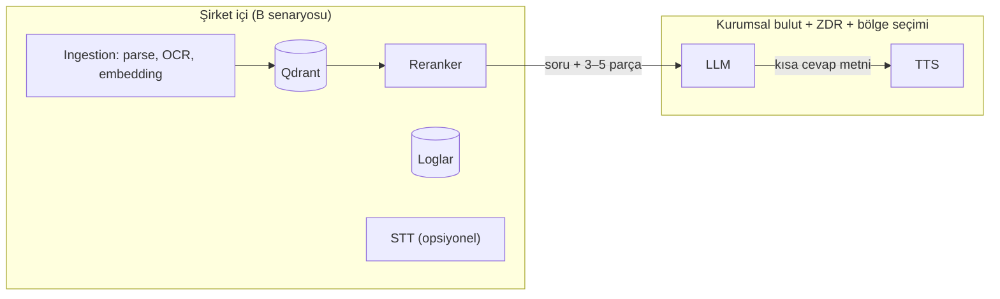
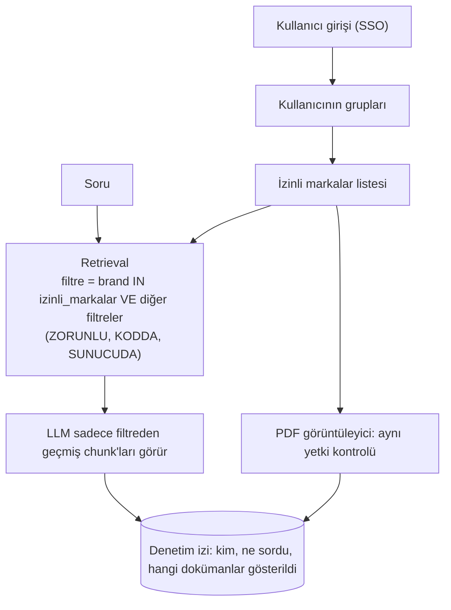

# Veri Güvenliği ve Erişim — Adım 7

> **Kaynak not:** `veri-guvenligi.md` (başlangıç 2026-10-09) · **İlgili plan:** req.md Adım 7 · **Bağlantılı:** sorulacaklar.md (A1, A2), rag-temelleri.md 1.7, tts.md, prompt-taslak.md (bu sette yok); [02-pdf-isleme.md](02-pdf-isleme.md), [03-kaynak-gosterme.md](03-kaynak-gosterme.md), [04-llm-secimi-ve-degerlendirme.md](04-llm-secimi-ve-degerlendirme.md), [05-arayuz-ve-orkestrasyon.md](05-arayuz-ve-orkestrasyon.md)
> **Durum:** Kararların çoğu sorulacaklar.md'deki cevaplara (Q1, 7.1, 7.3, Q5, internet) bağlı. Bu not, cevaplar gelince hızlı karar verebilmek için seçenekleri ve sonuçlarını hazırlıyor.
> **Beslediği çıktılar:** Araştırma notu (güvenlik) · Mimari taslağı (veri akışı, A/B/C dağıtım senaryoları, yetki akışı) · Araç seçimi (bulut sağlayıcı / lokal bileşenler) · **Açık sorular & riskler** (ana kaynak) · Görev planı (gerçek veriye geçiş kontrol listesi)

---

## 1. Özet

- İki ayrı hukuk: **manueller ve türevleri → NDA / ticari sır** (müşteri sözleşmesi, müşteriye göre değişir); **kullanıcı hesapları, loglar, ses → KVKK** (kanun, herkes için aynı).
- **Risk adıma göre değişir:** Ingestion'da bulut (OCR, VLM, embedding) → dokümanın **tamamı** dışarı; sorguda bulut LLM → soru başına **3–5 parça.** En çok veri gönderen bileşenler lokal yapması en kolay olanlar; en az gönderen (büyük LLM) lokal yapması en zor olan.
- **Öneri:** Gerçek veri için **B. Hibrit** senaryo (ingestion + embedding + vektör DB + reranker lokal; LLM ve TTS kurumsal bulut + ZDR + bölge seçimi). Test aşamasında tamamen bulut (A) serbest, ama mimari adaptörlerle B ve C'ye geçilebilir kurulur.
- **Ana ilke:** Güvenlik kararları LLM'in dışında, **kodda** verilir. Yetki filtresi **retrieval'dan önce, sunucuda, merkezi fonksiyonda, her istekte;** varsayılan kapalı; tüm "yan kapılar" aynı kontrolden geçer.
- **Tasarım ilkesi:** Buluta kişisel veri gönderilmez.

## 2. Kavramlar

### 2.1 Sistemdeki veriler

| Veri | Örnek | Hassasiyet | Hukuki temel |
|------|-------|------------|--------------|
| Müşteri manuelleri | Nike tedarikçi şartnamesi, ölçü tabloları | 🔴 Ticari sır, genelde NDA | Sözleşme (NDA), ticari sır |
| Manuelden türeyenler | Chunk metinleri, **embedding vektörleri**, sayfa resimleri, VLM açıklamaları | 🔴 Manuelle aynı; vektörlerden içerik kısmen geri çıkarılabilir (doğrulanmalı) | Aynı |
| Cevaplar | "Dış dikiş 11 (± 1) SPI [1]" + alıntı | 🔴 Manuelden alıntı içerir | Aynı |
| Kullanıcı soruları ve log | "Nike ceket SPI?" + kim, ne zaman | 🟡 Kişisel veri; hangi markada çalışıldığını da gösterir | **KVKK** + sözleşme |
| Ses kayıtları (STT varsa) | Sesli soru | 🟡 Kişisel veri | KVKK |
| Kullanıcı hesapları | Ad, rol, yetkili markalar | 🟡 Kişisel veri | KVKK |

### 2.2 NDA ve KVKK

| | NDA / ticari sır | KVKK |
|---|---|---|
| Korur | Müşterinin işini (şartname, ölçü, üretim bilgisi) | Gerçek kişileri (ad, ses, davranış kaydı) |
| Kapsam | Manueller ve türevleri | Hesaplar, loglar, ses |
| Kural kaynağı | Müşteri sözleşmesi (müşteriye göre farklı) | Kanun |
| Bulut sorusu | "Sözleşme üçüncü tarafa / yurt dışına göndermeye izin veriyor mu?" | "Yurt dışı aktarım güvenceleri var mı?" |

Manueller (içinde kişi adı yoksa) KVKK değil NDA konusu; loglar ve hesaplar KVKK konusu.

### 2.3 Roller ve yurt dışı aktarım

| Terim | Anlamı | Kim |
|-------|--------|-----|
| Veri sorumlusu | İşlemenin amaç ve yöntemine karar veren | (kaynakta doldurulmamış) |
| Veri işleyen | Sorumlu adına işleyen | Bulut sağlayıcı (OpenAI, Anthropic, Microsoft, Google, AWS) |
| Alt işleyen | İşleyenin kullandığı başka şirket | Ör. veri merkezi |
| DPA | Veri işleme sözleşmesi | Sağlayıcıların kurumsal sözleşme ekleri |
| Yurt dışına aktarım | Verinin Türkiye dışındaki sunucuya gitmesi | Bulut API'leri genelde yurt dışında |

**KVKK 2024 değişikliği (7499 sayılı Kanun):** (1) yeterlilik kararı varsa ona göre; (2) yoksa **uygun güvenceler** — en yaygını **standart sözleşme** (imzadan sonra **5 iş günü içinde Kurum'a bildirim**); (3) o da yoksa sınırlı istisnai haller. **Açık rıza artık kalıcı dayanak değil** (geçiş süresi 1 Eylül 2024'te bitti). Bildirim yapılmazsa idari para cezası. (Hukukla teyit edilmeli.)
→ Buluta kişisel veri gidecekse standart sözleşme süreci gerekebilir; sadece chunk/cevap metni gidiyorsa KVKK yükü azalır ama NDA sorusu geçerli. **Tasarım:** kullanıcı adı/kimlik isteklere eklenmez, ses lokal yazıya çevrilir veya hiç kaydedilmez.

### 2.4 Saklama, eğitimde kullanma, ZDR, veri yerleşimi

| Soru | Terim | Tipik durum (ücretli API, doğrulanmalı) |
|------|-------|----------------------------------------|
| Veriyle model eğitilir mi? | Training use | Ücretli API'de varsayılan **hayır**; ücretsiz katman / tüketici uygulamasında evet olabilir |
| Ne kadar saklanır? | Data retention | Hiç ile ~30 gün (kötüye kullanım denetimi) arası |
| Hiç saklanmaması mümkün mü? | ZDR | Çoğunda başvuru / kurumsal sözleşme ile, **sadece bazı uç nokta ve modellerde** |

- **Kötüye kullanım denetimi:** İstekler otomatik taranır, bazen saklanır; bazı sağlayıcılarda saklama ve **insan incelemesi** başvuruyla kapatılabilir.
- **"Eğitimde kullanmıyoruz" ≠ ZDR:** İlki saklamamak demek değil (~30 gün saklanıp sınırlı durumda insanca incelenebilir). ZDR'de istek işlendikten sonra saklanmaz (yasal istisnalar hariç), başvuruyla verilir ve her özelliği kapsamaz.
- **Veri yerleşimi:** Bazı sözleşmeler "AB dışına çıkamaz" / "Türkiye'de kalmalı" diyebilir. Azure, AWS, Google Cloud bölge seçimi sunuyor (ör. Azure **EU Data Zone**: işlem AB'de, saklanan veri seçilen coğrafyada). Doğrudan sağlayıcı API'lerinde bölge seçeneği daha sınırlı olabilir. **Türkiye'de kalma şartı** varsa büyük bulut LLM'leri pratikte zor → on-prem.

### 2.5 Kimlik doğrulama ve yetkilendirme

| Terim | Soru | Sistemde |
|-------|------|----------|
| Authentication | "Sen kimsin?" | Şirket hesabıyla tek giriş (SSO) |
| Authorization | "Neyi görebilirsin?" | Kullanıcı A sadece Nike manuelleri |
| RBAC | Yetkiler rollere bağlı | "Nike hattı ekibi" → Nike |
| Least privilege | Sadece gereken | Varsayılan hiçbir marka, rolle açılır |

### 2.6 LLM'e özgü riskler (OWASP Top 10 for LLM, 2025)

| Risk | Ne | Nasıl olabilir | Önlem |
|------|----|----------------|-------|
| **Prompt injection** (LLM01) | Metne gizli talimatın modeli yönlendirmesi | Doküman içinde "önceki kuralları unut" (dolaylı); müşteri manuelinde olası değil, dış kaynaklı dokümanda mümkün | Kaynakları "veri" olarak işaretlemek (prompt-taslak kural 10), **yetki kararını LLM'e bırakmamak**, çıktı doğrulaması |
| **Hassas bilgi ifşası** (LLM02) | Yetkisiz kişiye gizli bilgi | Adidas yetkisi olmayana Adidas chunk'ı | **Yetki filtresi retrieval'dan önce** |
| **Vektör/embedding zayıflıkları** (LLM08, 2025'te yeni) | Vektör DB'nin yetkisiz erişime açık olması, filtrenin unutulması | Tüm markalar tek koleksiyonda, filtre unutulursa sızıntı | Yetki farkındalıklı retrieval, test |
| **Sistem talimatı sızıntısı** (LLM07) | Sistem talimatının ortaya çıkarılması | Talimatımızda gizli bir şey yok | Talimata **sır koymamak** (API anahtarı, yetki kuralı) |

**"Kullanıcı Nike yetkilisi ise Adidas bilgisi verme" talimatı neden yetmez?** (1) Bilgi zaten LLM'e ulaşmış olur (bulutta zaten dışarı gönderilmiş); (2) model kurala her zaman uymaz — güvenlikte "çoğu zaman" yetmez; (3) dolambaçlı soru ("diğer markalarla karşılaştır") veya prompt injection ile atlatılabilir; (4) sistem talimatı gizli değildir (LLM07). **Doğrusu:** yetkisiz bilgi LLM'e hiç ulaşmaz.

## 3. Mimari: Veri akışı ve bulut riskinin yeri

## 4. Gizlilik gereksinimleri

### 4.1 Müşteri sözleşmelerinde (NDA) bakılacak 8 madde

| # | Madde | Neden |
|---|-------|-------|
| 1 | Üçüncü taraflarla paylaşım yasağı; bulut sağlayıcı "üçüncü taraf" sayılıyor mu? | Q1'in doğrudan cevabı |
| 2 | Alt yüklenici / hizmet sağlayıcı için müşterinin **yazılı izni** gerekiyor mu? | İzin alınabilirse bulut mümkün |
| 3 | Coğrafi kısıt ("Türkiye dışına çıkamaz", "AB içinde") | Veri yerleşimi |
| 4 | Saklama ve imha: sözleşme bitince dokümanlar ve **kopyaları** silinmeli mi? | Türevler (chunk, vektör, sayfa resmi, log) de silinmeli → silme süreci |
| 5 | Güvenlik standartları (şifreleme, erişim kaydı, ISO 27001 vb.) | Teknik önlem listesi |
| 6 | İhlal bildirimi yükümlülüğü | Olay müdahale süreci |
| 7 | Amaç sınırlaması ("sadece üretim için") | YZ sisteminde işlemek amaca uyuyor mu? |
| 8 | YZ / otomatik işleme maddesi (yeni sözleşmelerde görülmeye başladı, doğrulanmalı) | Doğrudan cevap |

Sözleşme bulutu açıkça izin vermiyorsa **müşteriden yazılı izin** (kurumsal bulut, AB bölgesi, veri saklamama, eğitimde kullanmama güvenceleriyle) bir seçenek — iş kararı (A1).

### 4.2 KVKK açısından yapılacaklar

| Konu | Gereken |
|------|---------|
| Çalışan bilgilendirme | Sorular ve kimlik loglanıyorsa **aydınlatma metni** |
| Log saklama süresi | Ör. 1 yıl, sonra anonimleştirme/silme |
| Ses kaydı | Kaydetmemek (yazıya çevirip hemen silmek) en basit |
| Yurt dışı aktarım | Kişisel veri buluta gidecekse standart sözleşme + bildirim; **tasarımla kaçınılabilir** (kimlik isteklere eklenmez) |
| Erişim | Logları sadece sistem yöneticisi, kalite sorumlusu gibi kişiler görür |

**Kime ne sorulur:** Hukuk/sözleşme sorumlusuna — "Müşteri sözleşmeleri dokümanların bulut hizmete (üçüncü taraf, yurt dışı) gönderilmesine izin veriyor mu?" (8 madde). KVKK sorumlusuna — "Soruları ve kimlikleri ne kadar saklayabiliriz? Aydınlatma metni gerekir mi? Ses kaydı işleyebilir miyiz? Buluta kişisel veri giderse aktarım süreci gerekir mi?" İkisi aynı birim olabilir; önemli olan iki sorunun ayrı sorulması.

## 5. Seçenekler: Bulut mu, on-prem mi?

### 5.1 Bileşen bileşen

| Bileşen | Ne zaman | Buluta ne gider | Hassasiyet | Lokal alternatif | Lokal donanım |
|---------|----------|-----------------|------------|------------------|---------------|
| OCR | Ingestion | Taranmış sayfa resimlerinin tamamı | 🔴 Tüm doküman | Docling içi OCR, Surya, Tesseract | CPU yeterli, GPU hızlandırır |
| VLM | Ingestion | Tüm çizimler | 🔴 | Lokal açık VLM (Qwen-VL vb.) | GPU (kullanıcı beklemez) |
| Embedding | Ingestion + sorgu | Tüm chunk metinleri + sorular | 🔴 | `bge-m3` (lokal) | CPU'da çalışır, GPU hızlandırır |
| Vektör DB | Sürekli | Tüm chunk + vektörler (bulut DB ise) | 🔴 | Qdrant (Docker) | CPU, disk |
| Reranker | Sorgu | Soru + aday chunk'lar | 🟡 | `bge-reranker-v2-m3` | GPU önerilir |
| LLM | Sorgu | Soru + 3–5 chunk (+ sayfa resmi) | 🟡 Parçalar | Açık model ~27–32B | **24 GB GPU** |
| TTS | Sorgu | Kısa sesli cevap metni | 🟡 | Chatterbox Multilingual | GPU önerilir |
| STT | Sorgu | Kullanıcının sesi | 🟡 + kişisel veri | Whisper / faster-whisper | GPU önerilir |
| Uygulama sunucusu, loglar | Sürekli | Her şey | 🔴 | Şirket içi sunucu | — |

### 5.2 Üç dağıtım senaryosu

| | **A. Tamamen bulut** | **B. Hibrit (önerilen ara çözüm)** | **C. Tamamen lokal** |
|---|---|---|---|
| Lokal | Sadece arayüz | Ingestion (parse, OCR, embedding), vektör DB, reranker, loglar, (STT) | Her şey |
| Bulut | OCR, VLM, embedding, LLM, TTS, STT | **LLM** (+ TTS, + gerekirse ingestion VLM), **kurumsal sözleşmeyle** | Hiçbiri |
| Dışarı giden | Dokümanların tamamı + sorular | Soru başına 3–5 parça + kısa cevap metni | Hiçbir şey |
| Kalite | En yüksek | Yüksek (cevap üretimi bulut modeliyle) | Lokal LLM'e bağlı (pilotta ölçülecek) |
| Donanım | Yok | Orta (embedding + reranker için küçük/orta GPU veya güçlü CPU) | Yüksek (LLM için 24 GB+ GPU, ayrıca VLM, TTS, STT) |
| Hukuki yük | En yüksek | Orta (tek sağlayıcı sözleşmesi, ZDR) | En düşük |
| Ne zaman | Sözleşmeler açıkça izin veriyor | Kurumsal güvencelerle izin veya müşteri izni | Bulut kesin yasak veya veri Türkiye'de kalmalı |

**Hibritin ek faydaları:** Dışarı sadece kullanıcıların sorduğu konular çıkar (sorulmayan bölümler hiç gönderilmez); indeks içeride olduğu için sağlayıcı değiştirmek veya C'ye geçmek dokümanların yeniden işlenmesini gerektirmez.

**Test aşaması:** Public dokümanlarla A serbest; ama her bileşen bir **adaptör** arkasında (`llm = BulutLLM(...)` / `llm = LokalLLM(...)`), embedding ve vektör DB **baştan lokal** (`bge-m3` + Qdrant).

### 5.3 Sağlayıcı veri politikaları (doğrulanmalı)

| Sağlayıcı | Eğitimde kullanım (ücretli) | Varsayılan saklama | ZDR | Bölge seçimi |
|-----------|-----------------------------|--------------------|-----|--------------|
| **Anthropic (Claude API)** | Hayır (açık izin olmadan) | İçerik varsayılan saklanmıyor; **istisna:** "Covered Models" (Fable / Mythos) 30 gün | Var (Messages API, onaylı); Covered Models dışında | İşlem bölgesi (`inference_geo`, doğrulanmalı); AWS Bedrock / Google Cloud / Microsoft Foundry üzerinden de |
| **OpenAI (doğrudan API)** | Hayır | ~30 gün (kötüye kullanım) | Var, satış ekibi üzerinden başvuru; bazı uç noktalar uygun değil | Bazı bölgesel seçenekler (doğrulanmalı) |
| **Azure OpenAI / Microsoft Foundry** | Hayır | ~30 gün | "Değiştirilmiş denetim" (insan incelemesi yok) ve ZDR başvuruyla, kurumsal sözleşme (EA / MCA) | ✅ Güçlü: **EU Data Zone** |
| **Google Gemini API** | Ücretlide hayır, **ücretsizde evet** | Kötüye kullanım için sınırlı süre loglama | Var (koşullu) | Vertex AI üzerinden |

- "ZDR açık" her özelliği kapsamaz: dosya yükleme, batch, sohbet geçmişi gibi **durum tutan** özelliklerin kendi saklama kuralları olabilir. Kullanımımız basit (tek istek → tek cevap), ZDR kapsamında kalmak kolay; kullanılan API özellikleri sözleşmeyle karşılaştırılmalı.
- **Mevcut bulut sözleşmesi varsa** (Q1-a) aynı platform üzerinden model kullanmak (Azure'da OpenAI, AWS'de Claude) hukuki süreci kısaltır.
- **Hangisi yeterli?** Sözleşmeye bağlı: "üçüncü tarafla paylaşma" yasağı varsa ikisi de yetmeyebilir → müşteri izni veya C. "Güvenlik önlemi al" deniyorsa asgari "eğitimde kullanmama + kurumsal sözleşme", güçlüsü **ZDR + AB bölgesi + kötüye kullanım incelemesinin kapatılması** (hibritte hedeflenen). **Karar:** hukuk birimi ve gerekirse müşteri; BT ve proje ekibi seçenekleri hazırlar.

## 6. Marka bazlı yetkilendirme

| Model | Kural | Ne zaman |
|-------|-------|----------|
| Herkes her şeyi görür | Sadece giriş | Tüm sözleşmeler iç paylaşıma izin veriyor, az kullanıcı |
| Marka bazlı | Rol → izinli markalar | Sözleşme "sadece ilgili ekip" diyorsa |
| Marka + doküman türü | Ör. makine kılavuzları açık, şartnameler ekibe özel | Karma ihtiyaç (muhtemel) |
| Doküman bazlı | Her dokümanın erişim listesi | Çok hassas tekil dokümanlar |

**Tahmini en olası ihtiyaç:** Makine kılavuzları ve genel terzilik kaynakları herkese açık, marka şartnameleri marka ekibine özel (paydaşlardan teyit).

**Uygulama kuralları:**

| # | Kural | Neden |
|---|-------|-------|
| 1 | Yetki filtresi retrieval'dan **önce** (pre-filter) | Post-filter'da yetkisiz chunk LLM bağlamına girmiş olabilir |
| 2 | Filtre sunucuda, her istekte; arayüz seçimi sadece **daraltır** | "Marka: Tümü" seçen yine sadece izinli markalarında arar |
| 3 | Yetki kararı LLM'e bırakılmaz | Prompt kuralı güvenlik değildir |
| 4 | **Her erişim noktası** aynı kontrolden geçer | Sızıntı en çok unutulan yan kapılardan olur |
| 5 | Varsayılan kapalı | Markası atanmamış doküman kimseye (ya da sadece yöneticiye) görünmez; "herkese açık" bilinçli verilir |
| 6 | Yetki değişiklikleri hemen geçerli | Yetkiler vektör DB'ye kopyalanmaz; her sorguda güncel gruplardan hesaplanır |
| 7 | Önbellek kullanıcılar arasında paylaşılmaz | Başkasının cevabı farklı yetkili kullanıcıya gitmesin |
| 8 | Yetkisiz marka soruları test setine | "Nike yetkili kullanıcı Adidas soruyor → bulunamadı / yetki yok" (yeni test türü: **yetki testi**) |

**Yan kapılar:**

| Yan kapı | Nasıl sızar | Önlem |
|----------|-------------|-------|
| PDF görüntüleyici / "dokümanın tamamını aç" | Kullanıcı `/pdf/nike-spec.pdf` adresini `/pdf/adidas-spec.pdf` yapar | Her PDF/sayfa isteğinde aynı yetki kontrolü |
| Önceki sorular / geçmiş | Başkalarının soru ve cevapları görünür | Geçmiş kişiye özel veya yetki filtreli |
| Önbellek | Başkasının cevabı verilir | Paylaşılmaz veya yetki kümesine göre ayrılır |
| Sesli cevap dosyaları | Herkese açık klasörde | Aynı yetki kontrolü, geçici dosyalar silinir |
| Loglar | Tüm markaların alıntıları görünür | Log erişimi kısıtlı |
| Sayfa resimleri, VLM açıklamaları | Doğrudan erişilebilir klasörde | Statik dosya olarak açık bırakılmaz |
| Marka seçme kutusu | "Adidas" seçince filtre genişler mi? | Sunucu her zaman izinli markalarla kesiştirir |

Yetki kontrolü bir ekran özelliği değil, **veriye dokunan her uç noktanın** özelliği.

**Qdrant'ta iki yol:**

| Yol | Nasıl | Artı | Eksi |
|-----|-------|------|------|
| Tek koleksiyon + payload filtresi | Her chunk'ta `brand`, `access` | Basit, esnek; Qdrant filtrelemede güçlü | Filtreyi unutan tek satır = sızıntı → merkezi fonksiyon + test |
| Marka başına koleksiyon | Kullanıcı sadece izinli koleksiyonlarda arar | Yapısal ayrım; sözleşme bitince koleksiyonu silmek kolay | Çok markalı arama ve ortak dokümanlar için birden fazla koleksiyonda arayıp birleştirmek |

**Öneri:** Pilotta (tek marka) fark yok. Üretimde tek koleksiyon + merkezi zorunlu filtre + yetki testleri; sözleşmeler sıkı ayrım isterse marka başına koleksiyon.
**Silme:** Her chunk, vektör, sayfa resmi, VLM açıklaması `doc_id` ile bağlı; "dokümanı ve türevlerini sil" tek işlemle. Loglardaki alıntılar için ayrı kural gerekir.

## 7. Diğer temel önlemler

| Önlem | Neden |
|-------|-------|
| API anahtarları koda yazılmaz (ortam değişkeni / sır yöneticisi) | Sızarsa başkası bizim adımıza istek yapar |
| Kurumsal hesap, ücretsiz/bireysel değil | Ücretsiz katmanda veri eğitimde kullanılabilir |
| Şifreleme: aktarımda (HTTPS) ve diskte (manuel, vektör DB, log) | Standart |
| LLM cevabı ekranda düz metin (HTML işlenmez) | Cevaba karışan kodun tarayıcıda çalışmasını engellemek |
| Erişim kaydı (denetim izi) | Kim neyi gördü; R4 şikâyetinde geriye dönük inceleme |
| Test ve gerçek veri ayrımı | Test ortamının bulut ayarları gerçek veriye kendiliğinden taşınmamalı; geçiş **kontrol listesiyle** (Faz 6) |

## 8. Öneri

| Konu | Öneri | Alternatif | Karar neye bağlı |
|------|-------|-----------|------------------|
| Mimari | Adaptörlü, A/B/C arası geçilebilir; embedding + vektör DB + reranker baştan lokal | — | — |
| Gerçek veri senaryosu | **B. Hibrit** (LLM ve TTS kurumsal bulut + ZDR + bölge seçimi) | C. Tamamen lokal | Q1, NDA maddeleri, müşteri izni, Q5, internet |
| Bulut sağlayıcı | Şirketin mevcut bulut platformu üzerinden (varsa) | Doğrudan sağlayıcı API'si | Q1-a, pilot sonuçları |
| Kişisel veri | Buluta gönderilmez (kimlik yok, ses lokal veya kaydedilmez) | Standart sözleşme süreci | KVKK sorumlusu |
| Yetkilendirme | SSO + rol → marka, pre-filter, merkezi zorunlu filtre, varsayılan kapalı | Marka başına koleksiyon | 7.3 cevabı, NDA ayrım maddesi |
| Denetim izi | Her soru loglanır, erişim kısıtlı, saklama süresi belirlenir | — | KVKK sorumlusu |

## 9. Açık sorular ve riskler

**Açık sorular** (sorulacaklar.md): Q1 (bulut kabul mü), Q1-a (mevcut bulut sözleşmesi / kurumsal bulut), 7.1 (NDA maddeleri), 7.3 (marka bazlı yetki), KVKK, Q5 (GPU), internet erişimi, giriş (SSO). **Yeni:** müşteriden izin alınabilir mi, log saklama süresi, silme yükümlülüğü. Veri sorumlusunun kim olduğu kaynakta tanımlanmamış.

**Riskler:**
- Ingestion'da bulut kullanımı → dokümanların tamamı dışarı.
- Yetki filtresinin unutulması (tek koleksiyonda) → markalar arası sızıntı (LLM08).
- Yan kapılardan sızıntı (PDF URL, önbellek, geçmiş, ses dosyaları, loglar, statik sayfa resimleri).
- Yetki kararını prompt'a bırakmak; prompt injection.
- ZDR'nin kısmi kapsamı (durum tutan özellikler, bazı modellerde yok).
- Türkiye'de kalma şartı çıkarsa bulut LLM pratikte imkânsız → C ve 24 GB+ GPU.
- KVKK yurt dışı aktarım bildirim yükümlülüğü (idari para cezası).
- Vektörlerden içerik geri çıkarılabilirliği (doğrulanmalı).

## Kaynaklar

**Resmi (sağlayıcılar)**
- [Anthropic: API ve veri saklama (ZDR, Covered Models)](https://platform.claude.com/docs/en/manage-claude/api-and-data-retention)
- [Microsoft: Azure OpenAI / Foundry veri gizliliği (Data Zone, kötüye kullanım denetimi)](https://learn.microsoft.com/en-us/azure/foundry/responsible-ai/openai/data-privacy)
- [Google: Gemini API sıfır veri saklama](https://ai.google.dev/gemini-api/docs/zdr?hl=en) · [Gemini API fiyatlandırma (ücretsiz/ücretli katman veri kullanımı)](https://ai.google.dev/gemini-api/docs/pricing)
- [Qdrant: Multitenancy ve özel sharding](https://qdrant.tech/documentation/production-operations/multitenant-search/) · [Qdrant multitenancy makalesi](https://qdrant.tech/articles/multitenancy/)

**KVKK (ikincil, hukukla teyit edilmeli)**
- [Yurt dışına kişisel veri aktarımı rehberi neleri düzenliyor? (Erdem & Erdem)](https://www.erdem-erdem.av.tr/bilgi-bankasi/yurt-disina-kisisel-veri-aktarimi-rehberi-neleri-duzenliyor)
- [KVKK standart sözleşme bildirim modülü duyurusu (Alomaliye)](https://www.alomaliye.com/2024/10/30/kvkk-standart-sozlesme-bildirim-modulu/)
- [Standart sözleşme bildirim yükümlülüğü ve yaptırımları (Cottgroup)](https://www.cottgroup.com/en/legislation/item/standart-sozlesme-bildirim-yukumlulugu-ve-yaptirimlari)
- [Veri merkezi / bulut hizmet sözleşmeleri ve veri lokalizasyonu (Hukukçular Evi)](https://hukukcularevi.com/danismanlik/veri-merkezi-bulut-hizmet-sozlesmeleri-veri-lokalizasyonu/)

**LLM güvenliği (ikincil, doğrulanmalı)**
- [OWASP Top 10 for LLM Applications 2025 özeti (Confident AI)](https://www.confident-ai.com/blog/owasp-top-10-2025-for-llm-applications-risks-and-mitigation-techniques) · [Outpost24 özeti](https://outpost24.com/blog/owasp-top-10-llm-risks-explained/)
- [Vector store access control for RAG (tianpan.co, 2026)](https://tianpan.co/blog/2026/04/17/vector-store-access-control-rag-rls)
- [LlamaIndex: Qdrant ile hybrid RAG, multitenancy](https://developers.llamaindex.ai/python/examples/vector_stores/qdrant_hybrid_rag_multitenant_sharding)

**Sağlayıcı politikaları (ikincil, doğrulanmalı)**
- [OpenAI ZDR kapsamı ve uygun olmayan uç noktalar (ecorpit)](https://ecorpit.com/openai-zero-data-retention-limits-endpoints-india-residency-2026/) · [ZDR ne gerektirir (spotdev)](https://www.spotdev.co.uk/blog/openai-zero-data-retention)
- [Azure OpenAI veri saklama politikası (anarlog)](https://anarlog.so/blog/azure-open-ai-data-retention-policy/)
