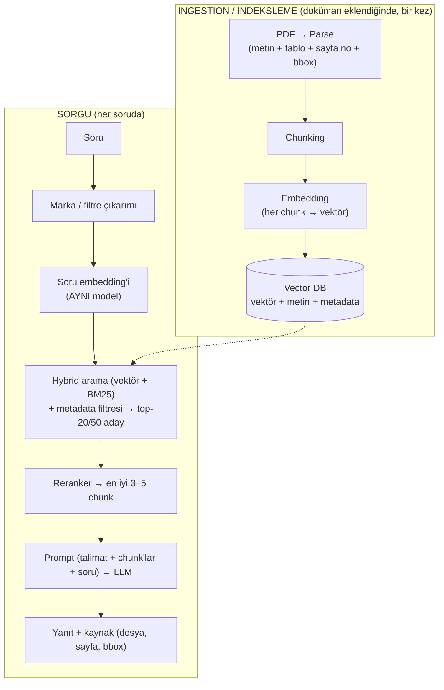
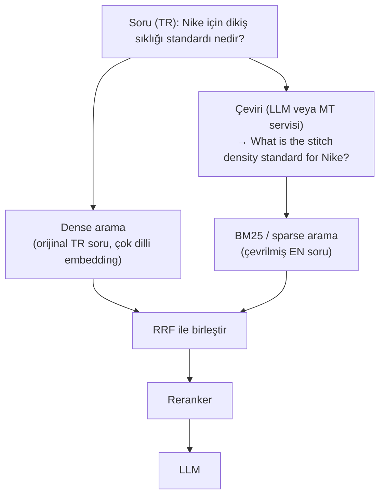
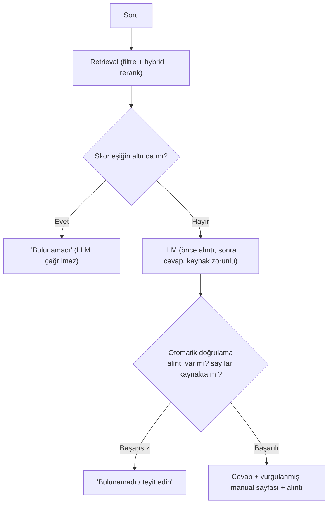

# RAG Temelleri: Chunking, Embedding, Vector DB, Hybrid Search, Reranking, Metadata — Adım 1

> **Kaynak not:** `rag-temelleri.md` (başlangıç 2026-10-08) · **İlgili plan:** [plan](15-plan.md) Adım 1 · **Bağlantılı:** [02-pdf-isleme.md](02-pdf-isleme.md), [03-kaynak-gosterme.md](03-kaynak-gosterme.md), [04-llm-secimi-ve-degerlendirme.md](04-llm-secimi-ve-degerlendirme.md), [06-veri-guvenligi-ve-erisim.md](06-veri-guvenligi-ve-erisim.md), [12-uctan-uca-mimari.md](12-uctan-uca-mimari.md)
> **Beslediği çıktılar:** Araştırma notu (RAG temelleri) · **Araç seçimi (embedding, vector DB, reranker, arama)** · Mimari taslağı (indeksleme + sorgu hattı) · Açık sorular & riskler · Görev planı (retrieval deneyi A–D)

---

## 1. Özet

- **RAG (Retrieval-Augmented Generation):** LLM cevap vermeden önce ilgili bilgiyi dışarıdan getirip prompta eklemek. Var olma sebepleri: **özel veri** (müşteri manuelleri internette yok), **güncellik** (dosyayı değiştirmek yeterli), **izlenebilirlik** (cevabın dosya/sayfası gösterilebilir — projenin temeli). Halüsinasyonu **azaltır ama sıfırlamaz.** Alternatif fine-tuning pahalı, güncellemesi zor ve kaynak gösteremez.
- **Temel kural:** LLM veri tabanının tamamını değil, sadece kendisine verilen birkaç chunk'ı görür → **sistem kalitesini en çok retrieval kalitesi belirler.**
- **Pilot önerisi:** başlık/bölüm bazlı chunking (tablolar bütün, sayfa + bbox metadata) · **`bge-m3`** (lokal, çok dilli, dense + sparse) · **Qdrant** · hybrid (dense + sparse, RRF) · **`bge-reranker-v2-m3`** · arayüzde marka seçimi + sorudan çıkarım · aday 30 → LLM'e 3–5 chunk.
- Sparse tarafında **BM25 (TR/EN stemming)** ile **BGE-M3 sparse** deneyle karşılaştırılacak (A–D deneyi, pilota ertelendi).
- Halüsinasyona karşı **8 katmanlı** savunma (S11) projenin en yüksek öncelikli riski için tasarlandı.

## 2. Mimari: İki hat



**R-A-G:** *Retrieval* — soru aynı embedding modeliyle vektöre çevrilir, vector DB en yakın k chunk'ı bulur (genelde *cosine similarity*) · *Augmented* — chunk'lar ve soru prompta konur · *Generation* — LLM sadece bu chunk'lara bakarak cevap üretir.

| Bileşen | Görevi |
|---------|--------|
| Parser | PDF'ten metin, tablo, sayfa no ve koordinatları çıkarır (Adım 2) |
| Chunker | Metni anlamlı parçalara böler |
| Embedding modeli | Metni anlamını temsil eden vektöre çevirir |
| Vector DB | Vektörleri saklar, en yakınları hızlı bulur (ANN indeksleri, ör. HNSW) |
| Retriever | Arama stratejisi (hybrid, filtre, top-k) |
| Reranker | Adayları soruya göre hassas yeniden sıralar |
| LLM | Chunk'lara dayanarak cevap ve kaynak üretir |

Klasik DB'de `LIKE '%dikiş%'` sadece birebir eşleşme yapar ("stitch density" araması "dikiş sıklığı"nı bulamaz). Ama kelime araması kodlarda ("ISO 4915") vektörden başarılıdır → **hybrid search.** PostgreSQL'e `pgvector` eklenerek klasik DB de vector DB olarak kullanılabilir.

## 3. Chunking

| Strateji | Nasıl | Artı | Eksi |
|----------|-------|------|------|
| Sabit boyut | Her N token'da böl (+ overlap) | Basit, hızlı | Cümle/tablo ortasından bölebilir |
| Recursive | Önce paragraf, sığmazsa cümle, sonra kelime | Daha doğal sınırlar | Doküman yapısını bilmez |
| Sayfa bazlı | Her sayfa bir chunk | Sayfa izlenebilirliği mükemmel | Sayfa çok konulu olabilir, konu sayfayı aşabilir |
| **Başlık/bölüm bazlı (structure-aware)** | Başlık sınırlarından böl, uzunsa alt böl | Anlam bütünlüğü yüksek, manuellere uygun | Başlıkları doğru tanıyan parser gerekir |
| Semantic | Cümle embedding'lerinde anlamın değiştiği yerden böl | Konu geçişlerini yakalar | Yavaş, tutarsız olabilir |

- **Boyut dengesi:** Çok küçük → bağlam kaybolur ("bu değer 8–10 olmalı", hangi değer?). Çok büyük → anlam sulanır, isabet düşer, maliyet artar, LLM dikkatini kaybeder, sayfa belirsizleşir. **Tipik: 200–800 token, %10–20 overlap.**
- **Sayfa izlenebilirliği:** Her chunk'ta `pages: [12, 13]` ve sayfa başına bbox; ekranda s.12 açılır, vurgu s.13'te devam eder ("devamı s.13").
- **Tablolar bölünmez**, tablo başlığı/başlık satırı chunk'a eklenir.
- Chunk başına **başlık yolu** eklemek isabeti artırır: `[Nike > Dikiş Standartları > 3.2 Stitch Density]`.

## 4. Embedding

**Tanım:** Metnin anlamını sabit uzunlukta bir vektöre çevirmek (`bge-m3` → 1024 boyut). Anlam benzerliği "iki nokta ne kadar yakın?" sorusuna dönüşür. Model, ilişkili çiftleri (soru↔cevap, cümle↔çevirisi) yaklaştırıp ilişkisizleri uzaklaştırarak eğitilir. **Cosine similarity:** ~1.0 aynı anlam, ~0.5 ilişkili, ~0 ilgisiz.

**Kurallar:** Soru ve chunk'lar **aynı modelle** vektörleştirilir (her modelin "haritası" farklı). **Model değişirse tüm dokümanlar yeniden indekslenir.**

| Güçlü | Zayıf → kapatan |
|-------|-----------------|
| Eş anlamlılar | Kodlar ve sayılar ("ISO 4915" ≈ "ISO 4916") → BM25 |
| Diller arası eşleşme | Olumsuzluk ("8'den az" ≈ "8'den fazla") → reranker |
| Farklı kelimelerle aynı soru | Çok uzun metinde anlam sulanır → doğru chunk boyutu |

### 4.1 Diller arası (cross-lingual) arama

Sadece **çok dilli** modeller yapabilir: ortak kelime parçaları (sayılar, birimler, kodlar), 100+ dilde ön eğitim ve asıl etken **çeviri çiftleriyle eğitim** ("Dikiş sıklığı 8-10 olmalıdır" ↔ "Stitch density shall be 8-10" aynı noktaya çekilir). Sadece İngilizce model Türkçe cümleyi anlamsız noktaya koyar → **çok dillilik şart.**

Senaryo (çeviri yapmadan): TR soru → çok dilli embedding → EN chunk (s.12) → LLM'e EN chunk + TR soru + "sorunun dilinde cevap ver" → TR cevap + kaynak. Bulmayı embedding, çevirip cevaplamayı LLM yapar; ekranda **orijinal dildeki** sayfa gösterilir; TTS sorunun dilindeki cevabı okur. **Hedef: manuelleri çevirmeden orijinal haliyle indekslemek** (çeviri maliyeti, gecikmesi ve hatası yok; gösterilen sayfa orijinal doküman).

| Konu | Risk | Çözüm |
|------|------|-------|
| Benzerlik skoru | Diller arası eşleşmede biraz düşük | Eşiği buna göre ayarla; reranker da çok dilli olsun |
| **BM25** | **Diller arası çalışmaz** | Query translation |
| Teknik terimler | LLM sektör terimini yanlış çevirebilir | Terim sözlüğü (glossary) prompta |
| Alıntı | Cevap TR, kaynak EN | Sorun değil; alıntı orijinal dilde gösterilir |

### 4.2 Query translation (sorgu çevirisi)

Arama öncesi **sadece soru** doküman diline çevrilir (dokümanlar orijinal kalır). Dense arama zaten diller arası çalışır; ama BM25'te TR soru ile EN chunk tek ortak kelime paylaşmaz (puan 0) → hybrid'in kelime tarafı devre dışı kalır; özellikle kod içeren sorularda acıtır ("ISO 4915" eşleşir ama "dikiş tipi" ↔ "stitch type" kaybolur).



- **Çeviriyi kim yapar:** (1) LLM ("İngilizceye çevir"; terim sözlüğüne daha iyi uyar) veya (2) MT servisi (Google Translate API, DeepL, Azure Translator, lokal NLLB / OPUS-MT; genelde daha hızlı/ucuz).
- Hedef dil `lang` metadata'sından; karışıksa soru iki dilde aranabilir. Kodlar, numaralar, birimler çeviride **korunur**.
- **Maliyet/risk:** ek gecikme ~100–500 ms; terim yanlış çevrilirse BM25 yanlış kelimeyi arar (glossary); bulut çeviride soru dışarı gider (lokal LLM ile de yapılabilir).
- **Alternatif:** BGE-M3 sparse gibi çok dilli learned sparse yöntemler açığı kısmen kapatabilir; gerekliliği A–D deneyinde "TR soru + EN manual" sorularıyla ölçülecek ([plan](15-plan.md) Q6).

### 4.3 Model seçenekleri

| Model | Tür | Not |
|-------|-----|-----|
| **`BAAI/bge-m3`** | Açık, lokal | Çok dilli, uzun metin (8K), aynı model dense + sparse üretir (hybrid avantajı). Güçlü aday |
| `intfloat/multilingual-e5-large` | Açık, lokal | Yaygın, dengeli, Türkçe iyi |
| `Qwen3-Embedding` ailesi | Açık, lokal | Çok dilli benchmark'larda üst sıralarda, farklı boyutlar |
| `jina-embeddings-v3` | Açık ağırlık / API | Çok dilli; ticari lisans koşullarına bakılmalı |
| OpenAI `text-embedding-3-large` | Bulut | Kolay, kaliteli; veri dışarı gider |
| Cohere `embed-multilingual` / `embed-v4` | Bulut | Çok dilli odaklı; veri dışarı gider |

**Seçim ölçütleri:** Türkçe kalitesi, maksimum girdi uzunluğu, vektör boyutu, lisans, lokal çalıştırılabilirlik (gizlilik), donanım. [MTEB leaderboard](https://huggingface.co/spaces/mteb/leaderboard)'a bakılır, asıl karar **kendi test setimizle** (Adım 0.4).

## 5. Vector DB karşılaştırma

| DB | Tür | Metadata filtre | Hybrid (BM25) | Artı | Eksi |
|----|-----|-----------------|---------------|------|------|
| **Chroma** | Gömülü / hafif sunucu | ✅ | Sınırlı | Kurulumu en kolay, prototip için ideal | Büyük ölçek ve üretimde zayıf |
| **Qdrant** | Sunucu (Docker) / bulut | ✅ Güçlü | ✅ (sparse vektör) | Hızlı, filtreleme çok iyi, hybrid, iyi dokümante | Ayrı servis çalıştırmak gerekir |
| **pgvector** | PostgreSQL eklentisi | ✅ (SQL) | Postgres full-text ile | Tek DB'de ilişkisel veri + vektör, yetkilendirme kolay | Çok büyük ölçekte tuning |
| Weaviate / Milvus | Sunucu | ✅ | ✅ | Ölçeklenebilir, zengin özellik | Ölçeğimiz için ağır olabilir |

**Ölçeğimiz:** birkaç marka × onlarca manual × yüzlerce sayfa → on binlerce chunk; hepsi kaldırır. Seçimi **filtreleme, hybrid desteği, kurulum kolaylığı** belirler. (FAISS görev tanımında aday olarak geçiyor; kaynak notta karşılaştırılmamış.)

## 6. Hybrid search

| Arama | Güçlü | Zayıf |
|-------|-------|-------|
| Vektör (dense) | Anlam, eş anlamlılar, diller arası | Kodlar, sayılar |
| Kelime (BM25 / sparse) | Birebir terimler, ürün kodları, standart numaraları | Eş anlamlı ve başka dildeki karşılıklar |

Manuellerde standart numaraları (ISO, ASTM), birimler ve kodlar çok geçtiği için önemli.

### 6.1 Sparse ve dense vektör

| | Dense (yoğun) | Sparse (seyrek) |
|---|---|---|
| Uzunluk | ~384–4096 (`bge-m3` → 1024) | Kelime dağarcığı kadar (on binler – yüz binler) |
| Doluluk | Her boyut dolu | Neredeyse hepsi 0; sadece geçen kelimeler |
| Boyutun anlamı | Tek başına anlamsız | Her boyut bir kelime |
| Yakaladığı | Anlam benzerliği | Kelime eşleşmesi |
| Örnek | `bge-m3` dense, `multilingual-e5`, OpenAI embedding | BM25, TF-IDF, SPLADE, BGE-M3 sparse |

```
Metin: "Stitch density shall be 8-10 SPI"
Dense  (1024 boyut, hepsi dolu): [0.021, -0.143, 0.388, 0.007, -0.250, 0.119, ..., -0.052]
Sparse (~250.000 boyut):         { "stitch": 0.31, "density": 0.27, "spi": 0.44, "8": 0.12, "10": 0.12 }
```

Sparse saklanırken sadece `{kelime: ağırlık}` tutulur. **Sparse retrieval** = kelime tabanlı arama (klasik: BM25, TF-IDF formülle; öğrenilmiş: SPLADE, BGE-M3 sparse sinir ağıyla). **Dense retrieval** = anlam tabanlı arama. **Hybrid = dense + sparse.**

**BGE-M3'teki "M3":** Multi-Linguality (100+ dil) · Multi-Granularity (8192 token'a kadar) · Multi-Functionality — tek modelden üç çıktı: (1) dense vektör (1024), (2) sparse vektör (*lexical weights*), (3) multi-vector (ColBERT tarzı, her token için vektör; daha hassas ama pahalı). "BGE-M3 sparse" = modelin ürettiği seyrek vektör; chunk bir kez modelden geçince dense + sparse birlikte elde edilir, BM25 için ayrı sistem gerekmez.

### 6.2 Sparse tarafı seçenekleri

| Yöntem | Nasıl | Artı | Eksi | Bizim için |
|--------|-------|------|------|------------|
| TF-IDF | Sıklık × nadirlik | En basit | Uzun dokümanı kayırır, doygunluk yok | BM25 gelişmiş hali; ayrıca denemeye gerek yok |
| **BM25** | TF-IDF + sıklık doygunluğu + uzunluk normalizasyonu | Eğitimsiz, hızlı, açıklanabilir, sağlam baseline | Eş anlamlı / diller arası yok; **Türkçe için stemming şart** | ✅ Güçlü aday (baseline) |
| BM25F | Başlıkta geçen kelimeye daha fazla puan | Başlıkları belirgin manuellerde faydalı | Ayar gerektirir | ➕ Ek olarak denenebilir |
| SPLADE | Transformer kelime ağırlıklarını öğrenir, terim genişletir | Eş anlamlı sorununu kısmen çözer | Çoğu İngilizce odaklı, GPU | 🟡 Türkçe zayıf, öncelikli değil |
| **BGE-M3 sparse** | Aynı model kelime ağırlığı da üretir | Çok dilli, **ek model yok**, Qdrant destekliyor | Kodlarda BM25 kadar keskin olmayabilir; tokenizer'a bağlı | ✅ Güçlü aday |
| BM42 (Qdrant) | BM25 IDF + transformer attention | Kısa metinler için önerildi | **Değerlendirmesi tartışmalı;** Qdrant'ın tekrar testlerinde iyi ayarlı BM25 daha yüksek recall verdi | ❌ Önerilmez |

**Türkçe:** Eklemeli dil — "dikiş", "dikişin", "dikişlerde" BM25 için ayrı kelimeler. Türkçe IR çalışmalarına göre kök bulma başarıyı belirgin artırır (bir çalışmada **%20'ye kadar**); morfolojik analiz (**Zemberek**) en iyi; **ilk 5 harf (prefix-5)** şaşırtıcı derecede iyi ve ucuz. Her chunk kendi diline göre işlenir: `lang: tr` → Türkçe kök bulucu, `lang: en` → İngilizce stemmer.
**Kodlar:** "ISO 4915", "SPI-10", "M12x1.5" tokenizer'da parçalanabilir → bütün halde veya ayrı bir "keyword" alanında indekslemek birebir eşleşmeyi garantiler.

### 6.3 Birleştirme (fusion)

| Yöntem | Nasıl | Ne zaman |
|--------|-------|----------|
| **RRF** (Reciprocal Rank Fusion) | Sıralamalara bakar: `1 / (k + sıra)`, genelde k=60; iki listede de üstte olan kazanır | **Başlangıç;** ayar gerektirmez |
| Ağırlıklı (convex) | `α × dense + (1-α) × sparse` | ~50+ etiketli test sorusu olunca α ayarlanarak RRF'i geçebilir |

### 6.4 Retrieval metrikleri

Test setinde her sorunun doğru chunk/sayfası önceden bilinmeli (Adım 0.4); metrikler sadece bulma adımını ölçer.
- **Recall@k:** Doğru chunk ilk k sonuçta mı? (Recall@5 = 0.80 → soruların %80'inde ilk 5'te.) LLM'e ilk 3–5 verildiği için doğru chunk orada değilse model onu hiç görmez.
- **MRR:** `1/sıra` ortalaması (1. → 1.0, 2. → 0.5, 5. → 0.2, yok → 0). Doğru chunk'ı en üste koyan sistemi ödüllendirir; ekranda **ilk** kaynak gösterileceği için önemli.

| Soru | Doğru chunk sırası | Recall@5 | 1/sıra |
|------|-------------------|----------|--------|
| S1 | 1 | 1 | 1.00 |
| S2 | 3 | 1 | 0.33 |
| S3 | 7 | 0 | 0.14 |
| S4 | bulunamadı | 0 | 0 |
| **Sonuç** | | **2/4 = 0.50** | **1.47/4 ≈ 0.37** |

Diğer: Precision@k (birden fazla doğru chunk varsa), Hit Rate@k (tek doğru chunk'ta Recall@k ile eşit), nDCG@k (çoklu ve kısmen ilgili sonuçlar; akademik). **Pilot hedef örneği:** Recall@5 ≥ 0.90, MRR ≥ 0.70 (kesin hedefler ilk ölçümden sonra).

## 7. Reranking

- **Sorun:** Vektör araması hızlı ama kaba; "en yakın" ≠ "en doğru".
- **İki aşama:** hızlı ön eleme (bi-encoder + BM25) → top-20/50 → reranker (cross-encoder) soru ve chunk'ı **birlikte** okuyup puanlar → en iyi **3–5** LLM'e.
- **Neden hepsi verilmiyor:** gereksiz chunk dikkati dağıtır (*lost in the middle*), maliyet/gecikme artar, yanlış kaynağa atıf riski yükselir.
- **Seçenekler:** `BAAI/bge-reranker-v2-m3` (açık, çok dilli), Jina Reranker, Cohere Rerank (bulut). **Maliyet:** soru başına ~100–500 ms (donanıma bağlı).

| | Bi-encoder (`bge-m3`) | Cross-encoder (`bge-reranker-v2-m3`) |
|---|---|---|
| Nasıl | Soru ve chunk ayrı vektörlenip karşılaştırılır | Soru + chunk tek metin; doğrudan alaka puanı |
| Hız | Çok hızlı (chunk vektörleri önceden hesaplı) | Yavaş (her çift için ayrı çalışır) |
| İsabet | Kaba | Hassas: olumsuzluk, sayılar, "gerçekten cevaplıyor mu?" |
| Kullanım | Binlerce chunk'tan ~30 aday | ~30 adaydan en iyi 3–5 |

**Örnek** — "Nike'ta dikiş sıklığı en az kaç olmalı?":

| Chunk | Bi-encoder sırası | Reranker puanı | Yeni sıra |
|-------|------------------:|---------------:|----------:|
| "Stitch density should not be below 8 SPI" | 4 | 0.94 | 1 |
| "Stitch density is measured in SPI" (tanım) | 1 | 0.41 | 3 |
| "Thread density for embroidery: 12 SPI" (alakasız) | 2 | 0.22 | 4 |
| "Stitch density for Nike apparel: 8–10 SPI" | 3 | 0.88 | 2 |

## 8. Metadata ve filtreleme

Vector DB'de her chunk: **vektör(ler)** + **metin** + **metadata** (`{brand: "Nike", page: 12, lang: "en", ...}`). Metadata filtreleme, klasik `WHERE`'in vector DB karşılığı: vektör araması "bu chunk kime ait?" bilmez; Nike ve Adidas dikiş bölümleri neredeyse aynı cümlelerle yazılmış olabilir.

| Fayda | Örnek |
|-------|-------|
| Doğruluk | Nike sorusuna Adidas standardı gelmez |
| Güncellik | Eski versiyondaki geçersiz değer gelmez |
| Güvenlik | Yetkisiz markanın dokümanı hiç görünmez (Adım 7.3) |
| Hız | Daha küçük küme üzerinde arama |

| Zamanlama | Nasıl | Değerlendirme |
|-----------|-------|---------------|
| **Pre-filter** | Önce `brand = Nike` seçilir, arama onların içinde | ✅ Sonuç sayısı garanti, yanlış marka gelmez. **Önerilen**; Qdrant verimli yapar |
| Post-filter | Önce top-30, sonra Nike olmayanlar atılır | ❌ Top-30'un çoğu Adidas ise 2–3 chunk kalır, doğru chunk kaybolabilir |

**Filtre değerlerinin kaynağı:** (1) arayüz seçimi (en güvenilir), (2) sorudan (bilinen marka listesi eşleştirme veya LLM çıkarımı), (3) sistemden (kullanıcı yetkisi, `is_latest = true`). Soruda marka yoksa tüm (yetkili) markalarda aranıp cevapta marka belirtilir veya "Hangi marka için?" diye sorulur.

**Metadata'nın dört görevi:** filtreleme (`brand`, `version`, `lang`) · kaynak gösterme/görüntüleme (`doc_name`, `pages`, `bboxes`) · LLM'e bağlam (`section_path`, `doc_title`) · yönetim (`doc_id`, `file_hash`, `ingested_at`).

### 8.1 Alan listesi

**Doküman düzeyi:**

| Alan | Örnek | Görev | Neden |
|------|-------|-------|-------|
| `doc_id` | `nike-stitch-2025-v3` | Yönetim | Tekil kimlik; güncellemede eski chunk'ları silmek |
| `brand` / `customer` | `Nike` | Filtre | Marka filtresi (en kritik) |
| `doc_name` | `Nike_Stitching_Manual.pdf` | Kaynak | Ekranda/cevapta |
| `doc_title` | `Nike Apparel Stitching Standards` | Kaynak, bağlam | Daha okunur |
| `doc_type` | `stitching_manual`, `quality_manual`, `packaging_guide`, `test_method` | Filtre | Türe göre arama |
| `version` | `2025-v3` | Filtre, kaynak | Hangi versiyon |
| `is_latest` | `true` | Filtre | Sadece güncel versiyon |
| `effective_date` | `2025-03-01` | Filtre, kaynak | Yürürlük tarihi |
| `lang` | `en`, `tr` | Filtre, işleme | Stemmer seçimi, query translation hedefi |
| `product_category` | `apparel`, `footwear`, `accessories` | Filtre | Aynı markada farklı standartlar |
| `season` / `collection` | `FW25` | Filtre | Sezona özel kurallar |
| `confidentiality` | `confidential`, `internal` | Erişim | Gizlilik seviyesi |
| `allowed_groups` | `["nike-team", "qa"]` | Erişim | Yetki filtresi |
| `source_type` | `digital`, `scanned` | Kalite | OCR'lı içerik daha az güvenilir olabilir |
| `file_hash` | `sha256:…` | Yönetim | Tekrar yükleme / değişiklik tespiti |
| `ingested_at` | `2026-10-08T14:20` | Yönetim | İndeksleme zamanı |

**Konum:**

| Alan | Örnek | Görev | Neden |
|------|-------|-------|-------|
| `pages` | `[12, 13]` | Kaynak | Gösterilecek sayfa(lar) |
| `page_labels` | `["3-4", "3-5"]` | Kaynak | Basılı sayfa no PDF sayfasından farklı olabilir; kullanıcıya basılı gösterilir |
| `bboxes` | `[{page: 12, box: [...]}, ...]` | Görüntüleme | Vurgulama |
| `section_path` | `["3. Dikiş", "3.2 Stitch Density"]` | Bağlam, filtre | Başlık hiyerarşisi; chunk başına eklenir |
| `chunk_index` | `47` | Yönetim | Komşu chunk'ları getirmek |
| `prev_chunk_id` / `next_chunk_id` | `…46` / `…48` | Bağlam | Cevap sınırda kesiliyorsa komşuyu da vermek |

**İçerik:**

| Alan | Örnek | Görev | Neden |
|------|-------|-------|-------|
| `chunk_type` | `text`, `table`, `figure`, `list` | Filtre, işleme | Tablolar farklı gösterilebilir |
| `table_caption` / `figure_caption` | `Table 3: Stitch types by seam` | Bağlam | Aramada çok işe yarar |
| `keywords` / `codes` | `["ISO 4915", "SPI", "301"]` | Arama | Kodlarda birebir eşleşme garantisi |
| `token_count` | `412` | İşleme | Prompta sığdırma |
| `ocr_confidence` | `0.87` | Kalite | Düşük güvenli OCR'da uyarı |

**Tam örnek:**

```json
{
  "doc_id": "nike-stitch-2025-v3", "brand": "Nike",
  "doc_name": "Nike_Stitching_Manual.pdf", "doc_title": "Nike Apparel Stitching Standards",
  "doc_type": "stitching_manual", "version": "2025-v3", "is_latest": true,
  "effective_date": "2025-03-01", "lang": "en", "product_category": "apparel",
  "confidentiality": "confidential", "allowed_groups": ["nike-team", "qa"], "source_type": "digital",
  "pages": [12, 13], "page_labels": ["3-4", "3-5"],
  "bboxes": [
    {"page": 12, "box": [72, 210, 523, 268]},
    {"page": 12, "box": [72, 275, 523, 410]},
    {"page": 13, "box": [72, 60, 523, 140]}
  ],
  "section_path": ["3. Stitching Requirements", "3.2 Stitch Density"], "chunk_index": 47,
  "chunk_type": "text", "codes": ["SPI", "ISO 4915"], "token_count": 412
}
```

Örnek filtre: `brand = "Nike" AND is_latest = true AND "nike-team" IN allowed_groups AND product_category = "apparel"`.

**Pilot zorunlu çekirdek:** `doc_id`, `brand`, `doc_name`, `version`, `is_latest`, `lang`, `pages`, `bboxes`, `section_path`, `chunk_type`. Sonradan alan eklemek yeniden indeksleme gerektirebilir → marka ve ürün kategorisi gibi filtreler baştan netleşmeli. Kesin şema Adım 2.5'te ([02-pdf-isleme.md](02-pdf-isleme.md) §6). Bazı alanların (marka, versiyon, kategori, yürürlük tarihi) PDF'ten otomatik çıkarılamayabileceği açık soruydu → 02'de otomatik çıkarım + insan onayı olarak ele alındı.

### 8.2 Birden fazla doküman türü (ürün standardı + makine kılavuzu)

Doğru kurulursa karışmaz: (1) katmanlı metadata, (2) sorgu yönlendirme, (3) belirsizse sormak veya iki kaynağı birlikte kullanmak.

| Alan | Ürün standardı / şartname | Makine kılavuzu |
|------|---------------------------|-----------------|
| `doc_type` | `product_standard` | `machine_manual` |
| Kime ait | `brand` = "Nike" (müşteri) | `manufacturer` = "Brother" (üretici) |
| Neyle ilgili | `product_category` = "ceket", "pantolon" | `product_model` = "S-7300A" |
| Ortak | `doc_id`, `version`, `is_latest`, `lang`, `pages`, `bboxes`, `section_path`, `chunk_type` | aynı |

⚠️ "Brother" makine üreticisi, "Nike" müşteri markası; **aynı `brand` alanına yazılmamalı.**

| Sorgu yönlendirme | Nasıl | Artı | Eksi |
|-------------------|-------|------|------|
| Arayüzde seçim | "Ürün standartları" / "Makine" sekmesi | En güvenilir | Ek adım |
| Kural tabanlı | Model kodu, hata kodu, "makine, iğne, bobin, ayar, arıza" → makine; marka adı → standart | Hızlı, açıklanabilir | Her durumu yakalamaz |
| LLM ile sınıflandırma | `{tür: "machine_manual", model: "S-7300A"}` | Esnek | Ek gecikme, nadiren yanlış |

| Soru | Anlaşılan | Filtre |
|------|-----------|--------|
| "Nike ceketinde dış dikiş SPI kaç olmalı?" | Standart, Nike, ceket | `doc_type = product_standard AND brand = Nike AND product_category = ceket` |
| "S-7300A'da E-07 hatası ne demek?" | Makine, S-7300A | `doc_type = machine_manual AND product_model = S-7300A` |
| "Dikiş atlıyor, ne yapmalıyım?" | Makine (arıza), model belirsiz | `doc_type = machine_manual` → cevapta model belirtilir veya "Hangi makine?" |

- **İki kaynaklı sorular** ("Nike ceketi için dikiş sıklığını makinede nasıl ayarlarım?"): standarttan hedef değer (11 ± 1 SPI) + kılavuzdan nasıl yapılır ("11 SPI ≈ 2.3 mm dikiş uzunluğu"); iki kaynak ayrı gösterilir — en değerli senaryolardan biri olabilir. Belirsiz tek kaynaklı soruda: "Ürün standardındaki değeri mi, makine ayarını mı soruyorsunuz?"
- **Koleksiyon:** tek koleksiyon + `doc_type` filtresi (önerilen başlangıç); türler çok farklılaşırsa (farklı chunking, erişim kuralları) ayrı koleksiyonlar.

### 8.3 Bounding box

PDF sayfasındaki metin parçasını çevreleyen dikdörtgen: `[x0, y0, x1, y1]` (sol-üst, sağ-alt). Örn. A4 sayfa 595 × 842 pt'de chunk bbox'ı `[72, 210, 523, 268]`.

| Konu | Açıklama |
|------|----------|
| Birim | PDF point (1 pt = 1/72 inç); A4 ≈ 595 × 842 pt |
| Orijin | PDF standardında (0,0) **sol-alt**; bazı kütüphaneler (PyMuPDF) sol-üste çevirir |
| Ölçekleme | `piksel = pt × (DPI / 72)` |
| Detay | Kelime / satır / blok; vurgu için satır veya blok yeterli |
| Bir chunk = çok kutu | Sayfa bilgili **kutu listesi** (tek büyük kutu aradaki alakasız şekli de kapsar) |
| Taranmış PDF | bbox'ı OCR üretir (kelime başına) |

Kaynak: parser (Adım 2.6); örn. PyMuPDF `page.get_text("dict")`, Docling, Unstructured öğe başına bbox.

## 9. Halüsinasyona karşı katmanlar (S11)

Hiçbir yöntem riski %100 sıfırlamaz; hedef: (1) sistem emin değilse cevap vermesin, (2) cevap verdiğinde kullanıcı her bilgiyi kaynağında görebilsin. **Projede en yüksek öncelikli risk.**

| Katman | İçerik |
|--------|--------|
| 1. Retrieval | Hybrid, marka/versiyon filtresi, reranker (uydurmanın en büyük sebebi doğru chunk'ın gelmemesi) |
| 2. Eşik | Reranker skoru eşiğin altındaysa LLM hiç çağrılmaz: *"Bu bilgi manuellerde bulunamadı. Lütfen ilgili birimle teyit edin."* |
| 3. Sıkı prompt | Sadece kaynaklar; her bilgiye kaynak; yoksa "bulunamadı"; çelişkiyi belirt; düşük temperature |
| 4. Önce alıntı | Kelimesi kelimesine alıntı, sonra cevap; sayılar sadece alıntıdan |
| 5. Otomatik doğrulama | Alıntı chunk'ta var mı; cevaptaki sayı/birim kaynakta var mı; opsiyonel ikinci model (faithfulness) — **kodla doğrulanabilir** kontroller |
| 6. Arayüz | Sayfa her zaman gösterilir ve vurgulanır; kritik değerler alıntı olarak; asıl kaynak sayfadır, LLM cevabı yol gösteren özet; diller arası senaryoda alıntı orijinal dilde |
| 7. Ölçme / izleme | Cevapsız sorular test setinde; faithfulness (RAGAS vb.); "yanlış/eksik" butonu; audit log |
| 8. Doğru versiyon | Sadece güncel versiyon aranır |



Ayrıntılı hali: [04-llm-secimi-ve-degerlendirme.md](04-llm-secimi-ve-degerlendirme.md) §5 (6 katmanlı uygulama) ve [09-prompt-taslagi.md](09-prompt-taslagi.md).

## 10. Öneri

| Bileşen | Öneri (pilot) | Alternatif | Gerekçe |
|---------|---------------|------------|---------|
| Chunking | Başlık/bölüm bazlı + sayfa/bbox metadata, tablolar bütün | Recursive (300–600 token) | Manuellerde yapı belirgin, sayfa izlenebilirliği şart |
| Embedding | `bge-m3` (lokal) | `multilingual-e5-large`, bulut API (izin varsa) | Çok dilli, lokal, sparse de üretiyor |
| Vector DB | **Qdrant** | Chroma (hızlı deneme), pgvector | Güçlü filtre + yerleşik hybrid + Docker |
| Arama | Hybrid dense + sparse, RRF; sparse için BM25 (TR/EN stemming) vs BGE-M3 sparse deneyle | Sadece vektör | Standart numaraları ve kodlar çok |
| Reranker | `bge-reranker-v2-m3` | Cohere Rerank | Çok dilli, lokal |
| Filtre | Arayüzde marka seçimi + sorudan otomatik çıkarım | Sadece LLM çıkarımı | Yanlış marka riski en düşük |
| top-k | Aday 30 → LLM'e 3–5 | — | Kalite / gecikme dengesi |

## 11. Görev: Retrieval deneyi (pilota ertelendi)

Gerçek manuellerin parse/chunk edilmesi (Adım 2) ve test setinin (Adım 0.4) hazır olması gerektiği için araştırma aşamasında yapılamaz; [plan](15-plan.md) Faz 6'da takip ediliyor.

| # | Yapılandırma |
|---|--------------|
| A | Sadece dense (`bge-m3`) |
| B | Dense + BM25 (TR/EN stemming) |
| C | Dense + BGE-M3 sparse |
| D | Dense + BM25 + BGE-M3 sparse |
| + | Her birinin reranker'lı versiyonu (ilk ~30 aday yeniden sıralanır) |

**Ölçüt:** Recall@5, MRR; ayrı raporlanır: kod/numara içeren sorular, TR soru + EN manual, cevabı olmayan sorular.

- [ ] `bge-m3` TR soru ↔ EN manual eşleşmesinde yeterli mi?
- [ ] Hybrid, sadece vektöre göre ne kadar fark yaratıyor?
- [ ] Sparse: BM25 mi, BGE-M3 sparse mı, ikisi mi?
- [ ] Türkçe kök bulucu: Zemberek / Snowball / prefix-5?
- [ ] Reranker gecikmesi kabul edilebilir mi?

## 12. Açık sorular ve riskler

- **Q6:** Diller arası aramada BM25 için soru doküman diline çevrilmeli mi (*query translation*)? Açık; A–D deneyiyle cevaplanacak ([plan](15-plan.md) §11).
- Q8: Hangi doküman türleri kapsanacak (`doc_type`, yönlendirme).
- Marka bilgisi sorudan mı arayüzden mi; soruda marka yoksa davranış ([10-sorulacaklar.md](10-sorulacaklar.md) "Marka").
- Embedding modeli değişirse tüm dokümanların yeniden indekslenmesi; metadata alanı sonradan eklenirse yeniden indeksleme.
- Diller arası benzerlik skorunun düşük çıkması (eşik ayarı), BM25'in diller arası çalışmaması, terim çeviri hataları.
- Embedding'in kod/sayı ve olumsuzluk zayıflığı.
- `brand` / `manufacturer` alanlarının karışması; doküman türleri arası karışma.
- Post-filter kullanılırsa doğru chunk kaybı.

## Kaynaklar

- [MTEB Leaderboard](https://huggingface.co/spaces/mteb/leaderboard): embedding model karşılaştırması
- [BGE-M3 model kartı](https://huggingface.co/BAAI/bge-m3)
- [Qdrant: Hybrid search dokümantasyonu](https://qdrant.tech/documentation/concepts/hybrid-queries/)
- [Lost in the Middle (makale)](https://arxiv.org/abs/2307.03172)
- [Comparing SPLADE Sparse Vectors with BM25 (Zilliz)](https://zilliz.com/learn/comparing-splade-sparse-vectors-with-bm25)
- [Hybrid Search for RAG: BM25, SPLADE, and Vector Search Combined](https://blog.premai.io/hybrid-search-for-rag-bm25-splade-and-vector-search-combined): RRF k=60 ile başlama önerisi
- [Milco: Learned Sparse Retrieval Across Languages](https://arxiv.org/pdf/2510.00671)
- [Qdrant BM42 makalesi](https://qdrant.tech/articles/bm42/) · [bm42_eval deposu](https://github.com/qdrant/bm42_eval)
- [Haystack: BM42 hybrid retrieval cookbook](https://haystack.deepset.ai/cookbook/hybrid_retrieval_bm42/)
- [Turkish Text Retrieval Experiments Using Lemur Toolkit](https://arxiv.org/pdf/1405.1740)
- [First large-scale IR experiments on Turkish texts (Bilkent)](https://repository.bilkent.edu.tr/items/4ed9cb10-6abb-4530-8b35-cbec3bd72cc3/full)
