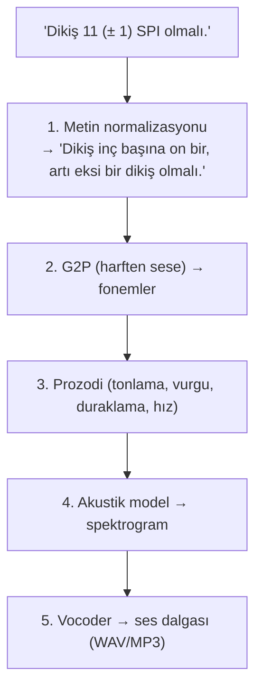
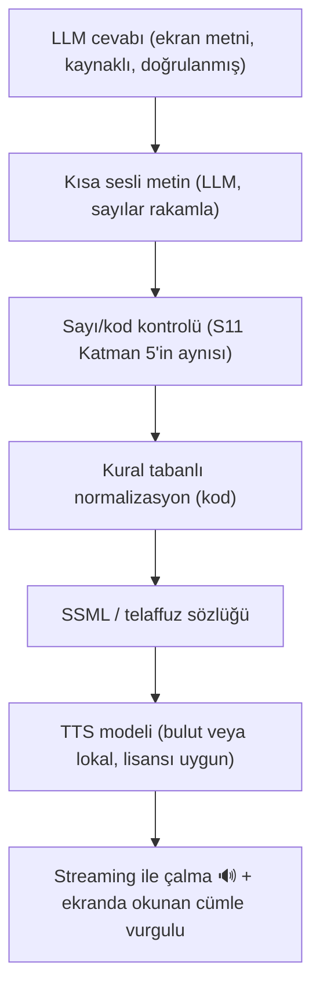

# TTS: Metinden Sese — Adım 5

> **Kaynak not:** `tts.md` (başlangıç 2026-10-09) · **İlgili plan:** [plan](15-plan.md) Adım 5 · **Bağlantılı:** [07-rag-temelleri.md](07-rag-temelleri.md) (S11), [02-pdf-isleme.md](02-pdf-isleme.md), [03-kaynak-gosterme.md](03-kaynak-gosterme.md), [01-manual-envanteri.md](01-manual-envanteri.md), [05-arayuz-ve-orkestrasyon.md](05-arayuz-ve-orkestrasyon.md), [09-prompt-taslagi.md](09-prompt-taslagi.md)
> **Ses örnekleri (5.2 denemesi yapılınca):** `Pre/notes/tts-samples/`
> **Beslediği çıktılar:** Araştırma notu (TTS) · **Araç seçimi (TTS)** · Mimari (sesli metin hattı) · Açık sorular & riskler · Görev planı (pilot TTS denemesi)

---

## 1. Özet

- Ses **kolaylık** kanalı, **doğruluk** kanalı değil: ekran metni ve vurgulu sayfadan sonra **en zayıf halka.** Doğru yazılmış "11 (± 1)" yanlış okunursa S11 katmanlarının hiçbiri işe yaramaz ([plan](15-plan.md) R2, R4) → **normalizasyon, S11'in TTS tarafındaki devamı.**
- **Test aşaması önerisi: Azure AI Speech** (Türkçe neural + HD + multilingual sesler; en güçlü SSML, kelime zamanlaması, container ile lokale geçiş yolu).
- **Bulut yasaksa: Chatterbox Multilingual** (MIT ağırlık, Türkçe, lokal, GPU) — Türkçe + ticari lisans + kalite üçlüsünü sağlayan tek güçlü açık aday; Türkçe kalitesi bilinmiyor (yeni risk **R6**).
- **Streaming:** önce tam cevap + doğrulama, sonra doğrulanmış metin streaming TTS ile (A). Cümle cümle doğrulamasız okuma R4 ile uyumsuz.
- **Sesli metin:** LLM ayrı, kısa (1–3 cümle) metin yazar (sayılar **rakamla**) → sayı kontrolü → **kendi kural tablomuzla** normalizasyon → SSML/sözlük → TTS. Türkçe hazır normalizasyon kütüphanesi bulunamadı.
- Maliyet (~2,4M karakter/ay → ~36–240 $/ay) **karar verdirici değil**; kararı gizlilik (Q1), Türkçe kalite ve normalizasyon kontrolü verecek.

## 2. Kavramlar

TTS (*Text-to-Speech*, ses sentezi): metni insan sesine benzer sese çevirmek; tersi STT. İyi bir "spiker" metni **anlar** ("%50" → "yüzde elli"), doğru **telaffuz** eder ("overlok" TR, "lockstitch" EN), doğru **tonlama** yapar. Projede en çok sorun ilk adımda (metni anlamak) çıkar.



| Terim | Anlamı |
|-------|--------|
| Text normalization | Sayı, kısaltma, sembol ve birimleri okunacak kelimelere çevirmek |
| G2P | Yazılışı telaffuza çevirmek; Türkçe büyük ölçüde yazıldığı gibi okunur, İngilizce terimlerde zor ("gauge" → "geyç") |
| Phoneme | En küçük ses birimi |
| Prosody | Yükselip alçalma, vurgu, duraklama, hız |
| Vocoder | Spektrogramı ses dalgasına çeviren son adım |
| Voice | Belirli konuşmacı sesi ("Emel (kadın, TR)", "Ahmet (erkek, TR)") |
| TTFA | *Time to first audio* — ilk sesin gelme süresi |
| RTF | *Real-time factor* — 10 sn sesi 2 sn'de üretmek = 0,2; < 1 ise konuşulandan hızlı (lokalde önemli) |
| Streaming | İlk parça hazır olur olmaz çalmak (TTS streaming: ilk ses 0,1–0,5 sn; LLM → TTS cümle cümle) |
| SSML | Metne TTS talimat etiketleri (`say-as`, `sub`, `phoneme`, `break`, `prosody`, `lang`) |
| Lexicon | Bir kelimenin okunuşunu bir kez tanımlayıp her yerde kullanmak ("overlok", "lockstitch", "Juki") |
| Code-switching | Aynı cümlede dil karışımı ("Overlok makinesinde lockstitch 301 yerine 504 kullanın, SPI 10-14 olsun") |
| Voice cloning | Birkaç saniyelik kayıttan ses taklidi (*zero-shot*: 5–10 sn örnekle, yeniden eğitimsiz) |

**Yeni nesil modeller** (2024 sonrası; ElevenLabs, Chatterbox, XTTS vb.) adımları tek sinir ağında yapıp "audio token" üretir: daha doğal ama (1) "bu sayıyı şöyle oku" müdahalesi zorlaşır (SSML desteği genelde yok/sınırlı; metnin kendisi değiştirilerek yönlendirilir), (2) **TTS halüsinasyonu:** kelime atlama, tekrar, uydurma (klasik sistemlerde neredeyse hiç olmaz).

```xml
<speak>
  Dikiş sıklığı <say-as interpret-as="cardinal">11</say-as> olmalı.
  <break time="300ms"/>
  Hata kodu <say-as interpret-as="characters">E07</say-as>.
  <sub alias="inç başına dikiş">SPI</sub>
</speak>
```
Her servis her etiketi her dilde desteklemez (`say-as` türlerinin Türkçede çalışması servise göre değişir, **denenmeli**).

### 2.1 Normalizasyon neden kritik? (test setinden örnekler)

| Metin | Doğru okunuş (TR) | Olası yanlış okunuş | Sonuç |
|-------|-------------------|---------------------|-------|
| `11 (± 1) stitches per inch` | "inç başına on bir, artı eksi bir dikiş" | "on bir parantez artı eksi bir"; "±" okunmaz → "on bir bir" | Tolerans anlaşılmaz veya "111" duyulur |
| `10-14 SPI` | "inç başına on ile on dört dikiş" | "on eksi on dört S P I"; "on on dört" ("1014"); "es pi ay" | **Negatif sayı** veya tek değer gibi duyulur |
| `3/16 to 1/4-inch gauge` | "on altıda üç ile dörtte bir inç" | "üç bölü on altı", "üç on altıncı", "Mart on altı" (tarih!) | Ölçü yanlış anlaşılır |
| `½ inch` | "yarım inç" | Okunmaz veya "bir iki inç" | Değer kaybolur |
| `stitch type 301 or 401` | "üç yüz bir ya da dört yüz bir tipi dikiş" | "üç sıfır bir" de olabilir | Kabul edilebilir ama tutarlı olmalı |
| `LSc-2` | "L S c iki" | "Lsc eksi iki" | Kod anlaşılmaz |
| `E-07` | "E sıfır yedi" | "E eksi yedi", "E yedi" | Yanlış hata kodu aranır |
| `S-7300A` | "S yetmiş üç yüz A" veya "S yedi bin üç yüz A" | "S eksi yedi bin üç yüz A" | Kafa karışıklığı |
| `146391-001` | Rakam rakam, gruplu | "yüz kırk altı bin üç yüz doksan bir eksi bir" | **Yanlış parça sipariş edilir** |

**Türkçeye özel:** sayı + ek ("11'e" → "on bire") ekin sayının okunuşuna göre seçilmesi; tire belirsizliği (aralık / kod / parça no / eksi); dil karışımı ("SPI"); ondalık ayırıcı (TR "1,5", EN "1.5" → "bir nokta beş" veya "bin beş yüz" okunabilir).

**Çok dillilik seçenekleri:** çok dilli sesler (Azure Multilingual, ElevenLabs, OpenAI, Chatterbox; cümle içi geçiş **denenmeli**), SSML `<lang xml:lang="en-US">`, telaffuz sözlüğü, terimi Türkçeleştirmek ("stitches per inch" → "inç başına dikiş").

## 3. Projede TTS'in yeri

| Kanal | Ne verir | Güvenilirlik |
|-------|----------|--------------|
| Ekrandaki cevap metni | Kaynaklı, doğrulanmış cevap | Yüksek (S11) |
| Vurgulu manuel sayfası | Orijinal kaynak | En yüksek |
| **Sesli okuma** | Cevabın sesi | Normalizasyon ve TTS kalitesine bağlı; **en zayıf halka** |

**Tasarım ilkesi:** Ses, ekrandaki doğrulanmış metinden **türetilir**; kritik değerler seste de geçer ama son kontrol ekranda/sayfada; riskli olanlar (uzun parça no.) okunmaz → "Parça numarası ekranda."



## 4. Seçenekler

### 4.1 Bulut servisleri

| Servis | Türkçe ses | Fiyat (1M karakter, liste) | Streaming | Normalizasyon / SSML | Not |
|--------|-----------|----------------------------|-----------|----------------------|-----|
| **Azure AI Speech** | `tr-TR-EmelNeural` (K), `tr-TR-AhmetNeural` (E) standart neural · `tr-TR-Elif` (K), `tr-TR-Aydın` (E) yeni **MAI-Voice-2** HD / HD Flash · Multilingual sesler Türkçe destekli | Standart neural ~15–16 $ (doğrulanmalı) · HD daha pahalı · **Ücretsiz ayda 0,5M karakter** (resmi) · taahhüt paketlerinde indirim | ✅ | ✅ **En güçlü SSML** (say-as, phoneme, lexicon, lang); **word boundary** olayları → ekranda senkron vurgu | **Lokal seçenek:** Neural TTS container (bağlantılı) ve bağlantısız container (Microsoft onayı). Türkçe sesin container'da olup olmadığı **doğrulanmalı** |
| **Google Cloud TTS** | `tr-TR` **Chirp 3 HD** + eski nesil (Standard / WaveNet / Neural2) | Chirp 3 HD **30 $** (ilk 1M ücretsiz) · eski nesiller daha ucuz (doğrulanmalı) | ✅ | Eski nesilde SSML güçlü; Chirp 3 HD'de **sınırlı** (doğrulanmalı) | Faturalamaya boşluk ve SSML etiketleri dahil |
| **ElevenLabs** | Flash v2.5, Multilingual v2, v3, v4, v4 Turbo (hepsi Türkçe) | Flash/Turbo **50 $** · Multilingual v2 / v3 **100 $** (doğrulanmalı) | ✅ REST + WebSocket | ⚠️ **Flash v2.5'te sayı normalizasyonu varsayılan KAPALI**; belge "normalizasyonu LLM'de yapın" diyor. SSML yok | En doğal ses iddiası. Flash v2.5 ~75 ms (üretici), bağımsız ölçümde ~200 ms |
| **OpenAI** | ✅ ("İngilizce için optimize" deniyor) | `tts-1` **15 $** · `tts-1-hd` **30 $** · `gpt-4o-mini-tts` token bazlı (metin 0,60 $/1M token, ses 12 $/1M token) | ✅ chunked | SSML yok; `gpt-4o-mini-tts`'e talimat verilebilir ("sayıları yavaş ve net oku") | Kullanıcıya **"bu ses yapay zekâ"** bildirimi kullanım koşulu |
| **Amazon Polly** | **Burcu** (neural, 2024) · Filiz (standart, eski) | Neural ~16 $, standart ~4 $ (**doğrulanmalı**) | ✅ | ✅ Güçlü SSML + lexicon; Türkçe fonem tablosu yayınlanmış | Tek neural Türkçe ses |

**Gizlilik (Q1):** Bulut TTS'e cevap metni gider (manuelden alıntı, değerler, parça no.). Bulut LLM varsa aynı metin zaten LLM sağlayıcısına gidiyor; TTS **ikinci sağlayıcı** = ikinci sözleşme ve saklama politikası. **Aynı sağlayıcıda kalmak** (ör. LLM + TTS Azure) sözleşme sayısını azaltır; kısa sesli metin giden veriyi de azaltır.

### 4.2 Açık kaynak / lokal modeller

| Model | Türkçe | Lisans (kod / **ağırlık**) | Ticari | Donanım | Not |
|-------|--------|----------------------------|--------|---------|-----|
| **Chatterbox Multilingual** (Resemble AI, 2025) | ✅ (23 dilden biri) | MIT / **MIT** | ✅ | GPU önerilir (500M parametre); CPU'da yavaş olabilir (doğrulanmalı) | Lokal + ticari + Türkçe üçünü sağlayan en güçlü aday. Ses klonlama var. Her çıktıya görünmez **PerTh watermark**. Türkçe kalitesi **bilinmiyor** |
| **Piper** | ⚠️ Sadece `tr_TR-dfki` kaldı (fahrettin ve fettah sesleri sahiplerinin isteğiyle kaldırıldı) | Motor GPL-3.0 (eski MIT repo Ekim 2025'te arşivlendi) / dfki: **CC BY-NC-SA** | ❌ (Türkçe ses) | CPU'da çok hızlı, Raspberry Pi'de bile | Ticari Türkçe için kendi sesimizi eğitmek gerekir (lisanslı kayıt + efor); daha "robotik" |
| **Coqui XTTS-v2** | ✅ | MPL-2.0 / **CPML (ticari değil)** | ❌ | GPU | Coqui 2023 sonu / 2024 başı kapandı; ticari lisans alınacak kimse yok. Sadece test |
| **Kokoro-82M** | ❌ (8 dil) | Apache-2.0 | ✅ | CPU yeterli | Hızlı ve iyi; sadece İngilizce için düşünülebilir |
| **F5-TTS** | Resmi yok (topluluk fine-tune'ları) | MIT / **CC-BY-NC** | ❌ | GPU | NC kısıtı tüm fine-tune'lara geçer |
| **Meta MMS-TTS** | ✅ | **CC-BY-NC** | ❌ | CPU/GPU, küçük | Test için |
| Qwen3-TTS, CosyVoice 3, Fish/OpenAudio S1, Voxtral | ❌ Türkçe yok | Apache-2.0 / NC karışık | — | GPU | Takip: dil listeleri genişliyor |
| FreyaTTS (2026, akademik) | ✅ Türkçe öncelikli | Bilinmiyor | ? | ? | Ağırlık ve lisans takip edilecek |

**Tespit:** 2026 itibarıyla "Türkçe + ticari lisans + yüksek kalite" sağlayan açık model çok az (görünen: Chatterbox Multilingual). Açık TTS sıralamalarının (Artificial Analysis Speech Arena vb.) üstündekilerin çoğu NC veya Türkçesiz → lokal karar büyük ölçüde Chatterbox'ın Türkçe kalitesine bağlı (**R6**).

| Model sınıfı | CPU (GPU yok) | GPU |
|--------------|---------------|-----|
| Piper, Kokoro (<100M) | ✅ Gerçek zamandan hızlı | Gereksiz |
| Chatterbox, XTTS, F5 (~500M) | 🟡 Yavaş, uzun cevapta bekletir (doğrulanmalı) | ✅ Önerilir (~4–8 GB VRAM yeterli olabilir, doğrulanmalı) |

### 4.3 Lisans: üç katman

| Katman | Örnek | Neden önemli |
|--------|-------|--------------|
| Kod | Coqui TTS: MPL-2.0 · Piper motoru: GPL-3.0 | Çalıştırma/dağıtma koşulu |
| **Model ağırlıkları** | XTTS-v2: CPML · F5-TTS: CC-BY-NC | **Asıl kısıt;** kod MIT olsa bile ağırlık NC ise ticari kullanılamaz |
| Eğitim verisi / ses | Piper `tr_TR-dfki`: CC BY-NC-SA | Ağırlık veriden türer; kısıt fine-tune'lara da geçer |

- Şirket içi üretim süreci, satılmasa da çoğu NC lisansta **ticari kullanım** sayılır (CPML: "doğrudan veya dolaylı gelir") → NC modeller **test için kullanılabilir, üretimde kullanılamaz.** "Türkçe fine-tune'un lisansı MIT yazıyor" diye güvenmemek gerekir.
- Piper motoru **GPL-3.0**: ürüne gömülüp dağıtılırsa kaynak açma yükümlülüğü doğabilir; sadece kendi sunucumuzda çalıştırmak genelde sorun değil (**hukuk onayı**).
- Bulut servislerin de koşulları var: ses çıktısının kullanım hakları, eğitimde kullanım, saklama süresi, "yapay ses" bildirimi (OpenAI) → kurumsal sözleşmede kontrol (Adım 7.2).

| Durum | Modeller |
|-------|----------|
| ✅ Ticari, Türkçe var | Tüm bulut servisler (kendi koşullarıyla) · Chatterbox Multilingual (MIT) |
| ⚠️ Ticari, Türkçe yok | Kokoro, Qwen3-TTS, CosyVoice |
| ❌ Sadece test / araştırma | XTTS-v2 (CPML), F5-TTS (CC-BY-NC), MMS-TTS (CC-BY-NC), Piper `tr_TR-dfki` (CC BY-NC-SA), OpenAudio S1 (CC-BY-NC-SA) |

**Ses klonlama:** Muhtemelen gerek yok (hazır net bir ses yeterli). Kurumsal ses istenirse: ses sahibinin yazılı izni (KVKK'da ses biyometrik veri sayılabilir, **hukuk onayı**); klonlama kötüye kullanıma açık olduğu için birçok açık model NC lisanslı.

## 5. Gecikme ve streaming

```
Retrieval + rerank     ~0,5–2 sn
LLM ilk token          ~0,5–2 sn
LLM tam cevap          ~2–10 sn   (cevap uzunluğuna bağlı)
Doğrulama (S11, K5)    ~0,1 sn
TTS ilk ses            ~0,1–0,5 sn (bulut) / lokal modele bağlı
```

Üretici rakamları (ağ hariç): ElevenLabs Flash v2.5 ~75 ms, v4 Turbo ~100 ms, v3 Conversational ~280 ms; bağımsız ölçümde Flash v2.5 medyan ~200 ms (ağ dahil). Azure, Google, OpenAI, Polly streaming destekli → **bulut TTS darboğaz değil; darboğaz LLM ve doğrulama.**

**Streaming ↔ doğrulama çatışması:** S11 Katman 5 "cevap gitmeden önce kontrol" diyor; cümle cümle seslendirmede doğrulanmamış değer duyulabilir.

| Seçenek | Nasıl | İlk ses | Güvenlik |
|---------|-------|---------|----------|
| **A. Önce tam cevap + doğrulama, sonra streaming TTS** | LLM biter → alıntı/sayı kontrolü → doğrulanmış metin cümle cümle TTS'e | LLM süresi + ~0,5 sn | ✅ Duyulan her şey doğrulanmış |
| B. Cümle cümle doğrulama + seslendirme | Her cümlenin sayıları kaynakta varsa okunur | Çok hızlı | 🟡 Bütün cevaba bakan kontroller (çelişki, eksik) sonradan; okunan geri alınamaz |
| C. Doğrulamasız cümle cümle | Klasik sesli asistan | En hızlı | ❌ R4 ile uyumsuz |

**Öneri A:** Usta bilgi soruyor; 2–4 sn beklemek kabul edilebilir, yanlış değer duymak edilemez. Beklerken ekranda durum mesajları; **sabit mesajlar önceden seslendirilip** saklanır (gecikme sıfır). Beklerken okunabilecek cümle **sabit ve değer içermeyen** olmalı, sistemden gelmeli ("Ceket şartnamesinde buldum, kontrol ediyorum."); LLM'in ilk cümlesi değil (ilk cümle çoğu zaman cevabın kendisidir). Gecikme pilotta sorun olursa B.

**Arayüze notlar (Adım 6):** durdur / tekrar / yavaş oku / ses aç-kapat; okunan cümlenin ekranda senkron vurgusu (Azure word boundary); kulaklık mı hoparlör mü (kullanıcılara sorulmalı); varsayılan butonla okuma, ayarla otomatik.

## 6. Maliyet

Varsayım: günde 200 soru × ~400 karakter = 80.000 karakter/gün ≈ **2,4M karakter/ay.**

| Servis | ~Aylık (liste, ücretsiz kota hariç) |
|--------|-----------------------------------:|
| Azure standart neural (~15 $/1M) | ~36 $ |
| OpenAI tts-1 (15 $/1M) | ~36 $ |
| Google Chirp 3 HD (30 $/1M) | ~72 $ |
| ElevenLabs Flash (50 $/1M) | ~120 $ |
| ElevenLabs Multilingual v2 (100 $/1M) | ~240 $ |
| Lokal (Chatterbox / Piper) | Karakter ücreti yok; GPU ve bakım |

## 7. Sesli okuma metni ve normalizasyon

**Ekran metni ≠ sesli metin:** madde işaretleri, [1] numaraları, parantezler, tablolar, uzun alıntılar seste kötü duyulur; 6 maddelik liste dinlenemez; İngilizce alıntının tamamı gereksiz.
**Sesli metin:** kısa (1–3 cümle, ~15–30 sn), kaynak numarası yok (gerekirse "Kaynak ekranda gösteriliyor."), liste yerine sıralı cümle ("Üç adım var. Birincisi..."; uzunsa "Diğerleri ekranda"), riskli değerler ekrana yönlendirilir.

| Kim üretir | Artı | Eksi |
|------------|------|------|
| a. LLM ayrı kısa metin yazar | Bağlamı anlar, özetler | Değeri değiştirebilir (11 → 12) |
| b. Kod ekran metninden kuralla türetir | Değer değişmez | Özetleyemez, doğal değil |
| **c. a + b + kontrol (önerilen)** | LLM rakamla yazar → sayı kontrolü → kod kelimeye çevirir | Biraz karmaşık |

**Neden rakam?** Rakamlar basit metin karşılaştırmasıyla kontrol edilir; LLM "on bir artı eksi bir" yazarsa Türkçede aynı sayının çok biçimi ("on bir", "onbir", "on bire", "on birlik") kontrolü kırılganlaştırır ve kelimeyle yazılmış değer değişikliği ("on iki artı eksi bir") gözden kaçmaya açıktır; kural tabanlı kod her seferinde aynı sonucu verir. **LLM ne söyleneceğini seçer, kod nasıl okunacağını belirler, aradaki rakamlar kontrol edilir.**

**Normalizasyon kuralları (ilk taslak):**

| Tür | Örnek | TR okunuş | Kural |
|-----|-------|-----------|-------|
| Tolerans | `11 (± 1)` | "on bir, artı eksi bir" | `X (± Y)` kalıbı |
| Aralık | `10-14`, `10–14` | "on ile on dört" / "ondan on dörde kadar" | Sayı-tire-sayı, kod bağlamı değilse |
| Kesir | `3/16`, `1/4` | "on altıda üç", "dörtte bir" | Payda + "-da/-de" + pay |
| Özel kesir | `½`, `¼`, `¾` | "yarım", "çeyrek", "üç çeyrek" | Sözlük |
| Ondalık | `1.5 mm` / `1,5 mm` | "bir buçuk" / "bir virgül beş milimetre" | Kaynak dil ayırıcısı |
| Birim | `mm`, `cm`, `in`, `"`, `SPI`, `°C` | milimetre, santimetre, inç, inç, inç başına dikiş, santigrat derece | Birim sözlüğü |
| Hata kodu | `E-07` | "E sıfır yedi" | Harfler tek tek, baştaki sıfır okunur |
| Model kodu | `S-7300A` | "S yetmiş üç yüz A" (?) | Atölyede nasıl söylendiği sorulacak |
| Dikiş tipi/sınıfı | `301`, `401`, `504`, `LSc-2` | "üç yüz bir"? "üç sıfır bir"? · "L S c iki" | Sektör alışkanlığı sorulacak |
| Parça no | `146391-001` | Okunmaz → "Parça numarası ekranda" (veya 3'lü gruplar) | 6+ haneli kodlar |
| Kısaltma | `SPI`, `ASTM`, `No.` | "inç başına dikiş", "A S T M", "numara" | Kısaltma sözlüğü |
| Madde işareti | `- ...`, `1. ...` | "Birincisi... İkincisi..." | Liste → sıralı cümle |
| Kaynak no | `[1]` | (okunmaz) | Silinir |
| Ek | `11'e`, `E-07'de` | "on bire", "E sıfır yedide" | En kolayı: LLM'e "sayı ve kodlardan sonra ek kullanma" ("E-07 hatasında") |

**Araçlar:** `num2words` Türkçe destekli (doğrulanmalı; kesir/ek sınırlı olabilir). Kapsamlı, bakımlı Türkçe TTS normalizasyon kütüphanesi **bulunamadı**; NVIDIA NeMo text processing Türkçe için hazır görünmüyor (doğrulanmalı) → kural tablosu **kendimiz** (alan dar, yönetilebilir). Bulut normalizasyonu yedek; bir platformda Türkçe sayıların İngilizce kurallarla okunduğu ("3+1" → "three plus one") hata raporu var. Kural tablosu bir **test listesiyle** (girdi → beklenen okunuş) yazılır; round-trip (TTS → Whisper → sayı karşılaştırma) pilotta otomatik test olabilir.

## 8. Öneri

| Konu | Öneri | Alternatif | Gerekçe |
|------|-------|-----------|---------|
| TTS (test) | **Azure** (TR neural + HD + multilingual) | Google Chirp 3 HD, ElevenLabs | En güçlü SSML/telaffuz, kelime zamanlaması, container yolu; public veriyle bulut sorun değil |
| TTS (Q1 = bulut yasak) | **Chatterbox Multilingual** (lokal, GPU) | Azure container (Türkçe ses varsa, onaylı) · kendi Piper sesimiz (CPU, lisanslı kayıt) | Türkçe + ticari lisanslı tek güçlü açık model; Türkçe kalitesi doğrulanmalı |
| Streaming | Tam cevap + doğrulama → streaming TTS | Cümle düzeyinde doğrulama | R4 |
| Sesli metin | LLM kısa metin (rakamla) + sayı kontrolü + kural normalizasyonu | Sadece kuralla türetme | Kısalık + değer güvenliği |
| Normalizasyon | Kendi kural tablosu + test listesi | TTS'in kendi normalizasyonu (yedek) | Türkçe hazır kütüphane yok |
| Arayüz | Butonla okuma, tekrar/yavaş, okunan cümle vurgulu | Otomatik okuma (ayarla) | Atölye, çok kullanıcı |
| Ses klonlama | Gerek yok | Kurumsal ses (rıza + hukuk) | Hazır ses yeterli |

## 9. Görev: 5.2 Kalite karşılaştırması (pilota devredildi)

**Kapsam kararı (2026-10-09):** Araştırma görevi ([11-arastirma-gorevi-tanimi.md](11-arastirma-gorevi-tanimi.md)) deneme değil araştırma notu istiyor (Faz 1 denemesi ise [plan](15-plan.md)'da açıkça tanımlı bir kontrol noktasıydı); sistematik karşılaştırma (kodla ses üretme, round-trip STT, puanlama) **pilota ([plan](15-plan.md) Faz 6.1) devredildi.** Araştırmada yapılan: test planı ve cümleler.

| # | Dil | Cümle | Test ettiği |
|---|-----|-------|-------------|
| T1 | TR | "Dikiş atlıyorsa önce iğnenin doğru takıldığını ve ipliğin doğru yoldan geçtiğini kontrol edin." | Doğallık |
| T2 | TR + EN, sayı | "Dış görünür dikişlerde inç başına 11 (± 1) dikiş olmalı. Stitch type 301 ya da 401 kullanılır, overlok kenarlarda SPI 10-14 arası." | **Normalizasyon + dil geçişi (en kritik)** |
| T3 | EN teknik | "Overedge or pre-hemming shall be 10 (± 2) stitches per inch, with a 3/16 to 1/4-inch gauge." | İngilizce teknik, kesir |
| T4 | Kod listesi | "E-07 hatası, S-7300A modeli, LSc-2 dikiş sınıfı, ½ inç, parça no. 146391-001." | Kod ve sembol |

- Her cümle **ham** (TTS'in kendi normalizasyonu) ve **normalize edilmiş** halde.
- **Ölçütler:** kritik değer doğruluğu (tek yanlış = o aday ham metinle kullanılamaz) · round-trip (Whisper ile yazıya çevirip sayıları karşılaştırma; regresyon testi) · 1–5 doğallık (MOS; mümkünse ustalarla) · atölye gürültüsünde ve gerçek hoparlörde dinleme · TTFA ve toplam süre.
- **Adaylar:** Azure (Emel/Ahmet + Elif/Aydın HD + bir Multilingual), Google Chirp 3 HD, ElevenLabs Flash v2.5 ve Multilingual v2, OpenAI gpt-4o-mini-tts, Amazon Polly Burcu, Chatterbox Multilingual (lokal); kalite referansı olarak XTTS-v2 ve Piper dfki (üretimde kullanılamaz).
- **İsteğe bağlı hızlı dinleme (kodsuz, ücretsiz, ölçüm değil izlenim):** T2 ve T4 ham haliyle — Azure [Voice Gallery / Speech Studio](https://speech.microsoft.com/portal/voicegallery) (ücretsiz katman), ElevenLabs web (ücretsiz hesap), Chatterbox Hugging Face Space demosu, Google Chirp 3 HD ürün sayfası demo kutusu.
- Karar test metinlerine değil, **gerçek cevaplardaki ifade türlerine** göre verilmeli (gerçek şartnamelerdeki kod/birim/tolerans biçimleri çıkarılmalı).

## 10. Açık sorular ve riskler

- **Q1** (bulut mu lokal mi), **Q5** (GPU), **Q10-a/b/c** (kod okunuşları, İngilizce terim mi Türkçe mi, kulaklık/hoparlör), otomatik mi butonla mı okuma ve sesli cevap uzunluğu.
- **R2** ([plan](15-plan.md)): Türkçe TTS'de teknik terim/birim okunuşu bozuk olabilir → yanlış değer duyulması (R4 ile bağlantılı).
- **R6:** Chatterbox'ın Türkçe kalitesi bilinmiyor; lokal karar buna bağlı.
- Azure container'da Türkçe ses var mı (doğrulanmalı); fiyatların resmi sayfadan doğrulanması.
- TTS halüsinasyonu (atlama/tekrar/uydurma); normalizasyon hataları (tolerans, aralık, kesir, ondalık, kod) → yanlış değer duyulması (R4'ün sesli versiyonu).
- **R5** ([plan](15-plan.md)): LLM → TTS cümle cümle seslendirme, S11 Katman 5 ("cevap gitmeden doğrulama") ile çatışıyor; doğrulanmamış değer duyulabilir → öneri A ile çözülüyor.
- NC lisans tuzakları (fine-tune'lara geçiş), Piper GPL-3.0.
- İkinci bulut sağlayıcısı = ek sözleşme; ses klonlamada KVKK.

## Kaynaklar

**Resmi dokümanlar**
- [Azure Speech dil ve ses desteği (tr-TR sesleri)](https://learn.microsoft.com/en-us/azure/ai-services/speech-service/language-support?tabs=tts)
- [Azure Speech fiyatlandırma](https://azure.microsoft.com/en-us/pricing/details/cognitive-services/speech-services/) (fiyatlar sayfada dinamik yükleniyor, hesaplayıcıdan kontrol edilmeli)
- [Azure Speech container'ları](https://learn.microsoft.com/en-us/azure/ai-services/speech-service/speech-container-overview) · [Neural TTS container](https://learn.microsoft.com/en-us/azure/ai-services/speech-service/speech-container-ntts)
- [Google Cloud TTS fiyatlandırma](https://cloud.google.com/text-to-speech/pricing) · [Chirp 3 HD sesleri](https://docs.cloud.google.com/text-to-speech/docs/chirp3-hd) · [Google SSML](https://docs.cloud.google.com/text-to-speech/docs/ssml)
- [ElevenLabs modeller](https://elevenlabs.io/docs/overview/models)
- [OpenAI Text-to-speech rehberi](https://developers.openai.com/api/docs/guides/text-to-speech) · [OpenAI fiyatlandırma](https://developers.openai.com/api/docs/pricing)
- [Amazon Polly: Burcu duyurusu](https://aws.amazon.com/about-aws/whats-new/2024/02/amazon-polly-neural-turkish-voice-burcu) · [Polly sesleri](https://docs.aws.amazon.com/polly/latest/dg/available-voices.html) · [Polly Türkçe fonem tablosu](https://docs.aws.amazon.com/polly/latest/dg/ph-table-turkish.html)

**Açık modeller**
- [Chatterbox (Resemble AI)](https://resemble.ai/chatterbox) · [NVIDIA model kartı (Chatterbox Multilingual)](https://build.nvidia.com/resembleai/chatterbox-multilingual-tts/modelcard)
- [Piper Türkçe sesleri](https://huggingface.co/rhasspy/piper-voices/tree/main/tr/tr_TR) · [tr_TR-dfki MODEL_CARD](https://huggingface.co/rhasspy/piper-voices/blob/6fb8245d6d27fef8988272e0c8e9f5018da1bbbf/tr/tr_TR/dfki/medium/MODEL_CARD)
- [Fish Speech / OpenAudio S1 model kartı](https://huggingface.co/fishaudio/s1-mini/blob/main/README.md)
- [FreyaTTS: Turkish-first speech synthesis (arXiv, 2026)](https://arxiv.org/pdf/2607.09530)

**İkincil kaynaklar (doğrulanmalı)**
- [Open Source Turkish TTS: A Developer's Guide (ablt.dev)](https://www.ablt.dev/blog/turkish-tts/) · [free-turkish-tts-models (GitHub)](https://github.com/Rumeysakeskin/free-turkish-tts-models)
- [Best Open Source Self-Hosted TTS Models in 2026 (Pinggy)](https://pinggy.io/blog/best_open_source_self_hosted_text_to_speech_models/) · [Best Open-Source TTS 2026 (findskill.ai)](https://findskill.ai/blog/best-open-source-tts-2026/)
- [XTTS-v2 review (promptquorum)](https://www.promptquorum.com/power-local-llm/xtts-v2-review) · [Coqui TTS review](https://www.promptquorum.com/power-local-llm/coqui-tts-review) · [Piper TTS review: GPL-3.0 geçişi](https://www.promptquorum.com/power-local-llm/piper-tts-review)
- [F5-TTS lisans notları (soniqo)](https://soniqo.audio/guides/f5-tts) · [Kokoro dil listesi (soniqo)](https://soniqo.audio/guides/kokoro)
- [Azure TTS fiyat özeti (texttolab)](https://texttolab.com/blog/azure-text-to-speech-pricing) · [Twilio: Polly neural ses fiyatı](https://twilio.com/en-us/changelog/new-text-to-speech-voices-for-say-update-03-2025)
- [Vapi Flash v2.5 bağımsız gecikme ölçümü](https://humannessindex.vapi.ai/models/elevenlabs-flash-v2-5) · [Türkçe TTS'de sayıların İngilizce okunması hata raporu (Vapi)](https://vapi.ai/community/m/1447889126128091186)
- [Wikimedia: TTS metin normalizasyonu prototipi (NeMo)](https://phabricator.wikimedia.org/T426756) · [Mintlemon Turkish NLP normalizer](https://mintlemon-turkish-nlp.readthedocs.io/en/latest/_module/normalizer.html)
- Streaming pratikleri: [Smallest AI](https://docs.smallest.ai/atoms/developer-guide/build/agents/patterns/streaming), [KugelAudio](https://docs.kugelaudio.com/streaming-best-practices), [Fish Audio realtime streaming](https://docs.fish.audio/features/realtime-streaming)
