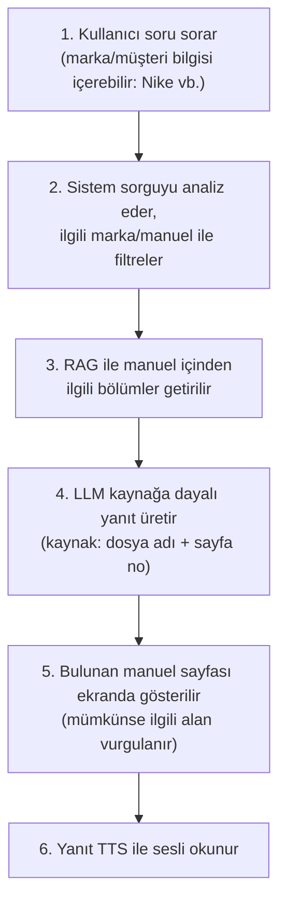

# Araştırma Görevi Tanımı: Manual Tabanlı RAG + Sesli Yanıt Visual Board — Temel Konu Araştırması

> **Kaynak not:** Danışmanın görev tanımı (diğer notlarda `tasks.md` olarak anılıyor; araştırma planı ayrı bir dosya: [15-plan.md](15-plan.md), eski adıyla req.md). Kaynak zaten düz bir görev metni; burada yapılandırıldı, içerik değiştirilmedi.
> **Bağlantılı:** tüm notlar ([README.md](README.md)) · [12-uctan-uca-mimari.md](12-uctan-uca-mimari.md) · [UYGULAMA-PLANI.md](../UYGULAMA-PLANI.md)
> **Beslediği çıktılar:** Tüm çıktıların tanımı (kapsam ve beklenen çıktılar listesi)

## 1. Amaç

Kullanıcının bir **visual board** üzerinden soru sorduğu (örn. "Nike için dikiş standartları nelerdir?"), modelin RAG ile indekslenmiş manuellerden ilgili bilgiyi bulduğu, bilginin geçtiği manuel sayfasını ekranda gösterdiği ve yanıtı TTS modeliyle sesli okuduğu bir sistemin kurulması.

Bu görev, projeye başlamadan önce öğrenilmesi gereken temel konuların araştırılmasını kapsar (**araştırma aşaması**). Uygulama aşaması, araştırma çıktılarına göre **ayrı task'lara** bölünecek.

## 2. Hedef akış

## 3. Araştırılacak temel konular (ve karşılayan notlar)

| # | Konu | Alt başlıklar | Karşılayan not(lar) |
|---|------|---------------|---------------------|
| 1 | RAG temelleri | Mimari ve bileşenler (ingestion, chunking, embedding, vector DB, retrieval, generation); chunking stratejileri (sabit boyut, semantic, sayfa/başlık bazlı) ve sayfa bazlı izlenebilirlik; embedding seçenekleri (çok dilli, TR/EN); vector DB seçenekleri (Chroma, Qdrant, FAISS, pgvector vb.) ve karşılaştırma; hybrid search (BM25 + vektör), reranking, metadata filtreleme | [07](07-rag-temelleri.md) |
| 2 | Manual / PDF işleme | Format envanteri (dijital PDF, taranmış PDF, tablo/şekil ağırlıklı); layout-aware parsing (tablolar, şekiller, çok kolon); OCR ihtiyacı ve seçenekleri; chunk metadata'sı: marka, doküman adı, versiyon, sayfa no, (varsa) bounding box | [01](01-manual-envanteri.md), [02](02-pdf-isleme.md), [07](07-rag-temelleri.md) §8 |
| 3 | Kaynak gösterme ve sayfa görüntüleme | Cevaptan kaynağa izlenebilirlik (citation / source grounding); PDF sayfasını görsele çevirip gösterme; metnin sayfada vurgulanması (highlight / bbox); multimodal / görsel tabanlı retrieval (ColPali benzeri) ve gerekliliği | [03](03-kaynak-gosterme.md) |
| 4 | LLM seçimi ve yanıt kalitesi | Bulut API vs. lokal/açık kaynak, Türkçe performansı; prompt tasarımı (yalnızca kaynağa dayalı yanıt, "bilgi bulunamadı"); hallucination azaltma; RAG değerlendirme (test seti, retrieval ve yanıt doğruluğu; örn. RAGAS) | [04](04-llm-secimi-ve-degerlendirme.md), [09](09-prompt-taslagi.md), [07](07-rag-temelleri.md) §9 |
| 5 | TTS | Bulut ve açık kaynak seçenekler, TR/EN kalite karşılaştırması; gecikme, streaming, maliyet, lisans; uzun/teknik yanıtların sesli okunmaya uygun hale getirilmesi (kısaltma, sayı ve birim okunuşu) | [08](08-tts.md) |
| 6 | Visual board / arayüz ve orkestrasyon | Arayüz seçenekleri (Streamlit, Gradio, Open WebUI, özel web arayüzü vb.); soru girişi + sayfa görüntüleyici + ses oynatıcının tek ekranda birleşmesi; orkestrasyon çatıları (LangChain, LlamaIndex vb.); STT ihtiyacının değerlendirilmesi | [05](05-arayuz-ve-orkestrasyon.md) |
| 7 | Veri güvenliği ve erişim | Müşteri (marka) manuellerinin gizlilik gereksinimleri; bulut API vs. şirket içi (on-prem); marka bazlı erişim yetkilendirme | [06](06-veri-guvenligi-ve-erisim.md) |

## 4. Beklenen çıktılar (ve karşılayan notlar)

| Çıktı | Karşılayan not(lar) |
|-------|---------------------|
| Her konu başlığı için kısa araştırma notu (özet, seçenekler, artı/eksi) | 01–09; özet düzeyinde [16](../ARASTIRMA-SENTEZI.md) |
| Önerilen mimari taslağı (akış diyagramı) | [12](12-uctan-uca-mimari.md) (ayrıca 05, 07 içindeki diyagramlar) |
| Araç/model seçim önerileri (embedding, vector DB, LLM, TTS, arayüz) | [README.md](README.md) özet tablosu; [12](12-uctan-uca-mimari.md) §3 |
| Kullanılacak manuellerin envanteri ve format değerlendirmesi | [01](01-manual-envanteri.md), [02](02-pdf-isleme.md) |
| Açık sorular ve riskler listesi | [13](13-acik-sorular-ve-riskler.md), [10](10-sorulacaklar.md) |
| Uygulama aşaması için önerilen task/aşama planı | [14](../UYGULAMA-PLANI.md), [15-plan.md](15-plan.md) Faz 6 |

## 5. Notlar (görev tanımından)

- **Önceliklendirme önerisi:** 1, 2, 3 → 5, 6 → 4 → 7 (planda Faz 1–4 olarak uygulandı: [15-plan.md](15-plan.md) §3).
- Araştırmanın sonunda **küçük bir pilot** (tek marka, birkaç manuel) ile uçtan uca prototip denemesi önerilebilir.
