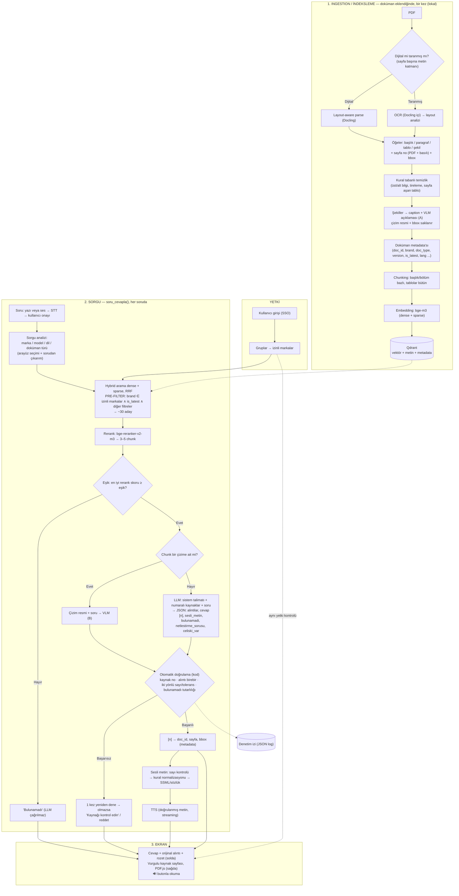
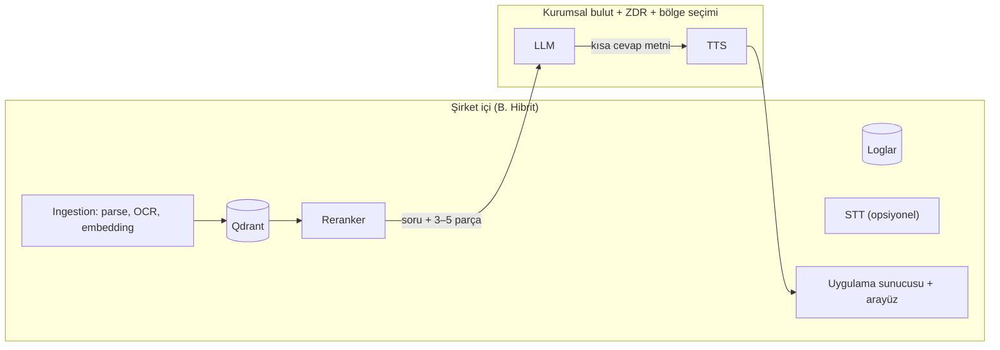

# Uçtan Uca Mimari Taslağı

> **Kaynak:** Bu not yeni bilgi içermez; yalnızca 01–11, 15 ve 16 numaralı notlardaki diyagram, öneri ve kararların birleştirilmiş halidir. Her bileşenin kaynağı tabloda belirtildi.
> **Ana kaynaklar:** [05](05-arayuz-ve-orkestrasyon.md) §3 (orkestrasyon, modül yapısı) · [07](07-rag-temelleri.md) §2, §9, §10 (iki hat, S11, araç önerileri) · [02](02-pdf-isleme.md) §7 (ingestion) · [03](03-kaynak-gosterme.md) §3, §7.2 (kaynak/vurgu, A+B görsel) · [04](04-llm-secimi-ve-degerlendirme.md) §5 (halüsinasyon katmanları) · [06](06-veri-guvenligi-ve-erisim.md) §3, §5.2, §6 (veri akışı, hibrit, yetki) · [08](08-tts.md) §3, §5 (sesli metin, streaming) · [09](09-prompt-taslagi.md) (LLM girdi/çıktı sözleşmesi) · [11](11-arastirma-gorevi-tanimi.md) §2 (hedef akış) · [15](15-plan.md) §2 (plan hedef akışı) · [16](../ARASTIRMA-SENTEZI.md) §3 (sentez mimarisi ve tasarım ilkeleri)
> **Beslediği çıktılar:** **Önerilen mimari taslağı (akış diyagramı)** · Araç/model seçim önerileri (özet tablo)

---

## 1. Özet

- Görev tanımındaki 6 adımlı hedef akış ([11](11-arastirma-gorevi-tanimi.md) §2) iki hatla karşılanıyor: **ingestion/indeksleme** (doküman eklendiğinde bir kez) ve **sorgu** (her soruda).
- Sorgu hattı **doğrusal ve deterministik**; çatısız, modüler Python; tek giriş noktası `soru_cevapla()`; arayüz bu fonksiyonu çağırır (pilot: Streamlit; üretim: FastAPI `POST /soru` + React) ([05](05-arayuz-ve-orkestrasyon.md)).
- Güvenlik kararları **kodda**: yetki filtresi retrieval'dan önce (pre-filter), sunucuda; LLM'e sayfa/bbox verilmez, sadece [n] ([06](06-veri-guvenligi-ve-erisim.md), [09](09-prompt-taslagi.md)).
- Cevap ekranda ve seste **doğrulamadan sonra** gösterilir/okunur (S11 Katman 5; TTS streaming seçeneği A) ([04](04-llm-secimi-ve-degerlendirme.md), [08](08-tts.md)).
- Önerilen dağıtım (gerçek veri): **B. Hibrit** — ingestion, embedding, vektör DB, reranker, loglar lokal; LLM ve TTS kurumsal bulut + ZDR + bölge seçimi; her bileşen adaptör arkasında ([06](06-veri-guvenligi-ve-erisim.md) §5.2).

## 2. Uçtan uca akış

**Okuma notları:**
- Eşik ve doğrulama başarısızlık davranışları ayrıntılı olarak [04](04-llm-secimi-ve-degerlendirme.md) §5'te (cevapta kaynakta olmayan sayı → cevap gösterilmez, sadece kaynak sayfası ve alıntı; düşen tolerans → ⚠ rozet).
- Görsel yol (A+B) [03](03-kaynak-gosterme.md) §7.2'den; ColPali yalnızca açıklamalar yetersiz kalırsa ikinci arama kanalı.
- Sorgu çevirisi (query translation) ve BM25 sparse tarafı deneye bağlı ([07](07-rag-temelleri.md) §4.2, §11) olduğu için diyagramda sabit adım olarak gösterilmedi.
- STT opsiyonel (Q4) ve mimariyi değiştirmiyor.

## 3. Bileşenler ve araç önerileri

| Katman | Bileşen | Öneri (pilot) | Alternatif | Kaynak not |
|--------|---------|---------------|-----------|------------|
| Ingestion | Parser | Docling | Marker, MinerU (karşılaştırma: Marker, PyMuPDF4LLM) | [02](02-pdf-isleme.md) |
| Ingestion | OCR | Docling içi (EasyOCR/RapidOCR) | Azure DI, Surya | [02](02-pdf-isleme.md) |
| Ingestion | Şekiller | Caption + VLM açıklaması (A) | ColPali (C) ikinci kanal | [02](02-pdf-isleme.md), [03](03-kaynak-gosterme.md) |
| Ingestion | Chunking | Başlık/bölüm bazlı, tablolar bütün, sayfa + bbox metadata | Recursive (300–600 token) | [07](07-rag-temelleri.md) |
| İndeks | Embedding | `bge-m3` (lokal) | `multilingual-e5-large`, bulut API | [07](07-rag-temelleri.md) |
| İndeks | Vektör DB | Qdrant (Docker), tek koleksiyon + merkezi zorunlu filtre | Chroma (hızlı deneme), pgvector; marka başına koleksiyon | [07](07-rag-temelleri.md), [06](06-veri-guvenligi-ve-erisim.md) |
| Sorgu | Arama | Hybrid dense + sparse, RRF | Sadece vektör | [07](07-rag-temelleri.md) |
| Sorgu | Reranker | `bge-reranker-v2-m3` | Cohere Rerank | [07](07-rag-temelleri.md) |
| Sorgu | Filtre | Arayüzde marka seçimi + sorudan çıkarım, pre-filter | Sadece LLM çıkarımı | [07](07-rag-temelleri.md), [06](06-veri-guvenligi-ve-erisim.md) |
| Üretim | LLM | Pilotta 3 sağlayıcıdan orta seviye + 1 küçük + 1 lokal aday; Q1 = bulut yok ise ~27–32B Apache-2.0, 24 GB GPU | 70B (2 GPU) | [04](04-llm-secimi-ve-degerlendirme.md) |
| Üretim | Prompt / çıktı | 10 kurallı sistem talimatı + JSON şeması | İngilizce talimat (pilotta denenecek) | [09](09-prompt-taslagi.md) |
| Doğrulama | Halüsinasyon | 6 katman, kalibre eşik, iki yönlü sayı kontrolü | + ikinci model doğrulayıcı | [04](04-llm-secimi-ve-degerlendirme.md), [07](07-rag-temelleri.md) |
| Ses | TTS | Test: Azure; Q1 = bulut yasak: Chatterbox Multilingual | Azure container, kendi Piper sesi | [08](08-tts.md) |
| Ses | Sesli metin | LLM kısa metin (rakamla) + sayı kontrolü + kendi kural tablosu | Sadece kuralla türetme | [08](08-tts.md) |
| Giriş | STT (opsiyonel) | Bulut serbestse Azure STT, değilse faster-whisper (large-v3-turbo) | Whisper large-v3 | [05](05-arayuz-ve-orkestrasyon.md) |
| Arayüz | UI | Pilot: Streamlit + `streamlit-pdf-viewer` (3 rerun kuralı); üretim: React + FastAPI | NiceGUI | [05](05-arayuz-ve-orkestrasyon.md), [03](03-kaynak-gosterme.md) |
| Arayüz | Sayfa render/vurgu | PDF.js (streamlit-pdf-viewer); yedek PyMuPDF 150 DPI (AGPL kontrolü) | pypdfium2, pdf2image | [03](03-kaynak-gosterme.md), [02](02-pdf-isleme.md) |
| Orkestrasyon | Hat | Çatısız modüler Python + JSON denetim izi | LlamaIndex parçaları, Haystack | [05](05-arayuz-ve-orkestrasyon.md) |
| Değerlendirme | Ölçüm | Custom script + RAGAS (TR uyarlamalı) + insan değerlendirmesi | DeepEval, TruLens | [04](04-llm-secimi-ve-degerlendirme.md) |

**Modül yapısı** ([05](05-arayuz-ve-orkestrasyon.md) §3.2): `ingestion/` · `retrieval/` · `generation/` · `verification/` · `speech/` · `pipeline.py` (`soru_cevapla()`) · `app_streamlit.py`.

## 4. Dağıtım (veri nerede çalışır)

| Senaryo | Lokal | Bulut | Ne zaman |
|---------|-------|-------|----------|
| A. Tamamen bulut | Sadece arayüz | OCR, VLM, embedding, LLM, TTS, STT | Test aşaması (public veri); sözleşmeler açıkça izin veriyorsa |
| **B. Hibrit (önerilen)** | Ingestion, vektör DB, reranker, loglar, (STT) | LLM (+ TTS, + gerekirse ingestion VLM), kurumsal sözleşmeyle | Kurumsal güvencelerle izin veya müşteri izni |
| C. Tamamen lokal | Her şey (LLM için 24 GB+ GPU, ayrıca VLM, TTS, STT) | — | Bulut kesin yasak veya veri Türkiye'de kalmalı |

Embedding ve vektör DB test aşamasında da **baştan lokal** (`bge-m3` + Qdrant); bu sayede A → B → C geçişi yeniden indeksleme gerektirmez ([06](06-veri-guvenligi-ve-erisim.md)).

## 5. Gecikme bütçesi (kaynaklardaki tahminler)

| Adım | Süre | Kaynak |
|------|------|--------|
| Retrieval + rerank | ~0,5–2 sn | [08](08-tts.md) §5 |
| LLM ilk token / tam cevap | ~0,5–2 sn / ~2–10 sn | [08](08-tts.md) §5 |
| Doğrulama (S11 K5) | ~0,1 sn | [08](08-tts.md) §5 |
| TTS ilk ses | ~0,1–0,5 sn (bulut) | [08](08-tts.md) §5 |
| Toplam (retrieval + LLM + doğrulama + TTS) | ~5–10 sn | [05](05-arayuz-ve-orkestrasyon.md) §2.1 |

Kabul edilebilir bekleme süresi kullanıcılara sorulacak ("Süre", [10](10-sorulacaklar.md) A4).

## 6. Mimarideki boşluklar (kaynaklarda karar verilmemiş)

- **Q1 / Q1-a / 7.1** cevaplanmadan dağıtım senaryosu (A/B/C), LLM, TTS, VLM, STT sağlayıcısı kesinleşmez.
- **Sparse yöntemi** (BM25 TR/EN stemming vs BGE-M3 sparse), **query translation** (Q6) ve reranker gecikmesi pilot deneyine bağlı ([07](07-rag-temelleri.md) §11).
- **Görsel anlama** A+B mi C+B mi pilotta ölçülecek ([03](03-kaynak-gosterme.md)).
- **Yetki modeli** (herkes / marka / marka + doküman türü / doküman bazlı) 7.3 ve NDA cevabına bağlı; SSO varlığı bilinmiyor.
- **Üretim arayüzü** (React + FastAPI) pilottan sonra kararlaştırılacak; cihaz (Q11) bilinmiyor.
- Sorgu yönlendirme (birden fazla doküman türü, `doc_type`) Q8'e bağlı ([07](07-rag-temelleri.md) §8.2).
- Kaynaktaki sentez şekli (Şekil 1, `sentez-sekiller/sekil1-mimari.svg`) bu sette yok; bu diyagram notlardan yeniden kurulmuştur ve sentezin §3.1–3.3 tablolarıyla ([16](../ARASTIRMA-SENTEZI.md)) uyumludur.
