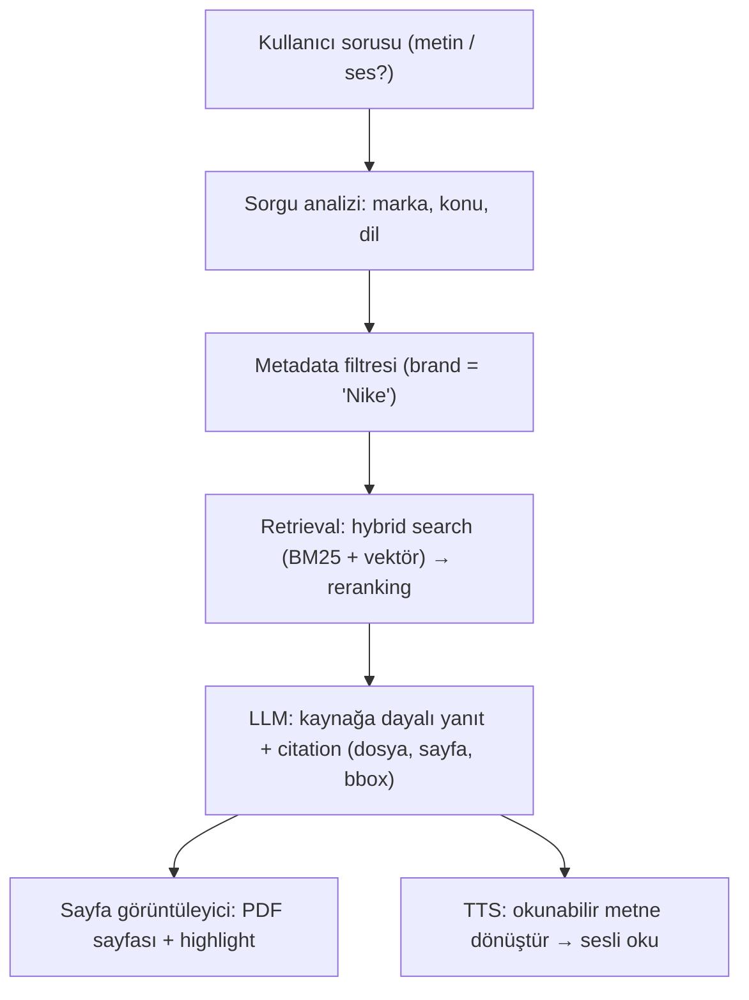

# Plan: Araştırma Planı, Fazlar, Riskler ve Karar Günlüğü

> **Kaynak not:** Diğer notlarda `req.md` olarak anılan dosya ("Visual Agent: Pre Req", son güncelleme 2026-10-09). Bu sette adı **plan** olarak değiştirildi; diğer notlardaki "req.md" atıfları bu nota bağlandı.
> **Bağlantılı:** [11-arastirma-gorevi-tanimi.md](11-arastirma-gorevi-tanimi.md) (görev tanımı, `tasks.md`) · [ARASTIRMA-SENTEZI.md](../ARASTIRMA-SENTEZI.md) (Faz 5 çıktısı, `sentez.md`) · [10-sorulacaklar.md](10-sorulacaklar.md) · [13-acik-sorular-ve-riskler.md](13-acik-sorular-ve-riskler.md) · [UYGULAMA-PLANI.md](../UYGULAMA-PLANI.md)
> **Beslediği çıktılar:** **Görev/aşama planı** (Faz 1–6 tanımları, uygulama task listesi, pilot) · **Açık sorular ve riskler** (Q1–Q11, R1–R10) · Tüm konu notlarının adım numaraları

**Numaralandırma uyarısı (kaynaktaki çakışma):** Plan hem **Adım** (0–7; konu numaraları) hem **Faz** (1–6; çalışma sırası) kullanıyor. Adım 6'nın alt maddeleri (6.1–6.4: arayüz, ekran, orkestrasyon, STT) ile Faz 6'nın maddeleri (6.1 pilot, 6.2 task listesi, 6.3 başarı kriterleri) **aynı numaraları** taşıyor. Diğer notlarda "plan 6.1 / 6.2 / 6.3" pilot bağlamında geçtiğinde **Faz 6** maddeleri kastediliyor; bu notta karışmaması için **"Faz 6.1"** ve **"Adım 6.1"** diye ayrıldı.

---

## 1. Özet

- **Kapsam:** Yalnızca **araştırma aşaması**. Hedef akış görev tanımıyla aynı (soru → analiz/marka filtresi → RAG → kaynaklı LLM yanıtı → vurgulu sayfa → TTS).
- **Fazlar (araştırma içinde çalışma sırası):** Faz 1 çekirdek (Adım 1–3) → Faz 2 kullanıcı deneyimi (Adım 5–6) → Faz 3 LLM (Adım 4) → Faz 4 güvenlik (Adım 7) → Faz 5 sentez → Faz 6 uygulama planı + pilot.
- **Durum (2026-10-09):** Faz 1–4 araştırma seviyesinde tamam (Adım 3 alt maddeleri planda işaretlenmemiş, 2.3 ve 2.5 kısmi; Adım 7 cevapları paydaşlardan bekleniyor); Faz 5 sentez yazıldı (5.4 kısmi); **Faz 6 maddelerinin üçü de açık.**
- **Faz 1 kontrol noktası geçti:** dijital şartname, taranmış şartname (OCR) ve Brother kılavuzunda **27/27 test**.
- **En yüksek öncelikli risk R4** (uydurulmuş bilgi → yanlış dikim). Risk listesi R1–R10, soru listesi Q1–Q11.

## 2. Amaç ve hedef akış (ilk taslak)

Kullanıcı bir **visual board** üzerinden soru sorar (örn. *"Nike için dikiş standartları nelerdir?"*). Sistem: (1) soruyu analiz eder, marka/müşteri bilgisini çıkarır; (2) ilgili marka/manuel ile filtreler; (3) RAG ile ilgili bölümleri getirir; (4) LLM ile **kaynağa dayalı** yanıt üretir (kaynak: dosya adı + sayfa no); (5) manuel sayfasını ekranda gösterir (mümkünse ilgili alanı vurgular); (6) yanıtı TTS ile okur.

## 3. Çalışma sırası (fazlar)

| Faz | Konular (Adım) | Neden bu sırada |
|-----|----------------|-----------------|
| **Faz 1** | 1. RAG temelleri · 2. Manual/PDF işleme · 3. Kaynak gösterme | Sistemin çekirdeği; diğer her şey bunların kararlarına bağlı |
| **Faz 2** | 5. TTS · 6. Arayüz ve orkestrasyon | Kullanıcı deneyimi katmanı; çekirdek netleşince seçilir |
| **Faz 3** | 4. LLM seçimi ve yanıt kalitesi | Retrieval hattı belli olunca model ve değerlendirme anlamlı olur |
| **Faz 4** | 7. Veri güvenliği ve erişim | Tüm seçimleri (bulut/on-prem) son kez filtreler |
| **Faz 5** | Sentez: mimari, araç seçimi, risk listesi | Beklenen çıktıları üretir |
| **Faz 6** | Uygulama planı + pilot önerisi | Bir sonraki task'lara geçiş |

(Görev tanımındaki öncelik önerisiyle aynı: 1, 2, 3 → 5, 6 → 4 → 7.)

## 4. Adım 0: Hazırlık (araştırmadan önce)

| # | Madde | Durum |
|---|-------|-------|
| 0.1 | Paydaşlara kritik soru: müşteri manuelleri bulut API'ye (OpenAI, Anthropic, Google vb.) gönderilebilir mi, yoksa on-prem zorunlu mu? (= Q1) | Açık |
| 0.2 | Örnek manuel seti. **Karar (2026-10-08):** geliştirme ve test **açık erişimli (public) manuellerle**; sistem bu sette iyi sonuç verince **son adımda** kendi (müşteri) verimize geçilecek → [01-manual-envanteri.md](01-manual-envanteri.md) | Açık (işaretsiz) |
| 0.3 | Manuellerin ve soruların dili (TR / EN / karışık) (= Q2) | Açık |
| 0.4 | Cevabı ve sayfası bilinen 10–20 gerçekçi örnek soru → ileride **test soru seti** | Açık |
| 0.5 | Donanım: GPU var mı? (lokal model, OCR, TTS seçimini belirler) (= Q5) | Açık |
| 0.6 | Geliştirme ortamı: Python kurulumu (şu an yok); PDF araç denemesi (2.3) için gerekli | Açık |

Planlanan çıktı: `Pre/notes/00-hazirlik.md` (cevaplar, örnek doküman listesi, soru seti taslağı) — bu sette yok.

## 5. Faz 1: Çekirdek (RAG + PDF + Kaynak)

### Adım 1: RAG temelleri → [07-rag-temelleri.md](07-rag-temelleri.md)

| # | Alt görev | Cevaplanacak soru | Durum |
|---|-----------|-------------------|-------|
| 1.1 | RAG mimarisi | Ingestion → chunking → embedding → vector DB → retrieval → generation; her biri ne yapar? | ✅ |
| 1.2 | Chunking | Sabit / semantic / sayfa-başlık bazlı: hangisi **sayfa numarasını kaybetmeden** çalışır? Chunk sayfa sınırını aşarsa? | ✅ |
| 1.3 | Embedding | Çok dilli (TR + EN): `bge-m3`, `multilingual-e5`, OpenAI `text-embedding-3`, Cohere `embed-multilingual`; boyut, hız, lisans, Türkçe kalitesi | ✅ |
| 1.4 | Vector DB | Chroma, Qdrant, FAISS, pgvector, (Weaviate, Milvus): metadata filtresi, hybrid desteği, kurulum, ölçek | ✅ |
| 1.5 | Hybrid search | BM25 + vektör neden önemli? (teknik terim, ürün kodu, standart numarası) | ✅ |
| 1.6 | Reranking | Cross-encoder reranker (`bge-reranker`, Cohere Rerank); kazanç / gecikme | ✅ |
| 1.7 | Metadata filtreleme | "Nike" sorusunda sadece Nike manuellerinde arama; markanın sorudan çıkarılması | ✅ |

### Adım 2: Manual / PDF işleme → [02-pdf-isleme.md](02-pdf-isleme.md), [01-manual-envanteri.md](01-manual-envanteri.md)

| # | Alt görev | Cevaplanacak soru | Durum |
|---|-----------|-------------------|-------|
| 2.1 | Manual envanteri | Önce public test seti, gerçek müşteri manuelleri en sonda; marka, doküman adı, versiyon, sayfa sayısı, dil, tür (dijital/taranmış), içerik ağırlığı (metin/tablo/şekil) | ✅ |
| 2.2 | Parsing araçları | PyMuPDF, pdfplumber, Unstructured, Docling, Marker, LlamaParse, Azure Document Intelligence; tablolar ve çok kolon | ✅ |
| 2.3 | Araç denemesi | 2–3 aracı aynı 3 zor sayfada (tablo, şekil, çok kolon) karşılaştır | 🟡 Docling denendi (Faz 1 kontrol noktası); diğer araçlarla karşılaştırma yapılmadı |
| 2.4 | OCR | Taranmış manuel var mı? Tesseract, PaddleOCR, EasyOCR, bulut OCR; Türkçe karakter başarısı | ✅ |
| 2.5 | Metadata şeması | `brand`, `doc_name`, `version`, `page`, `section/heading`, `bbox`, `lang`, `chunk_type` (metin/tablo/şekil) | 🟡 Taslak hazır |
| 2.6 | Bounding box | Hangi araç bbox veriyor? (highlight için) | ✅ |

### Adım 3: Kaynak gösterme ve sayfa görüntüleme → [03-kaynak-gosterme.md](03-kaynak-gosterme.md)

| # | Alt görev | Cevaplanacak soru | Durum (planda) |
|---|-----------|-------------------|----------------|
| 3.1 | Citation / grounding | Her iddia hangi chunk'tan? LLM'e kaynak ID'si nasıl verdirilir ve doğrulanır? | ☐ işaretsiz |
| 3.2 | Sayfayı görsele çevirme | PyMuPDF `get_pixmap`, pdf2image → PNG vs tarayıcıda PDF.js | ☐ işaretsiz |
| 3.3 | Highlight | bbox nasıl çizilir? (görsele dikdörtgen / PDF.js annotation / metin arama) | ☐ işaretsiz |
| 3.4 | Multimodal retrieval | ColPali / ColQwen nedir, tablo/şekil ağırlıklı manuellerde avantajı, **bizim için gerekli mi?** | ☐ işaretsiz |

> Adım 3 notu mevcut ve öneriler içeriyor; plandaki kutucuklar güncellenmemiş görünüyor.

**Faz 1 sonu kontrol noktası:** Bir manuelden bir chunk'ı sayfa no + bbox ile çıkarıp o sayfayı highlight'lı gösterebiliyor muyuz?
**Sonuç (2026-10-09): ✅ Evet.** `faz1-test.py` ile dijital şartname, taranmış şartname (OCR) ve Brother makine kılavuzunda denendi; **27/27 test geçti.** Sayfa geçişinde bölünen paragraf birleştirildi; **tablo satırı seviyesinde vurgu** ve **basılı sayfa numarası** ("s.90 (PDF s.101)") çalışıyor. Rapor: `faz1_output/report.md` (bu sette yok). Denemede çıkan açık maddeler araştırmada çözülmeyecek, uygulamaya devredildi (bkz. §9, Faz 6.2).

## 6. Faz 2: Kullanıcı deneyimi (TTS + Arayüz)

### Adım 5: TTS → [08-tts.md](08-tts.md)

| # | Alt görev | Durum |
|---|-----------|-------|
| 5.1 | Seçenekler — bulut: Azure, Google, ElevenLabs, OpenAI, Amazon Polly; açık: Piper, Coqui XTTS, Kokoro, F5-TTS | ✅ Chatterbox Multilingual eklendi; fiyat/lisans kesin seçimden önce resmi sayfadan doğrulanacak |
| 5.2 | TR/EN kalite: aynı cümleleri (biri teknik terim + sayı) her adayla dinleme | ✅ Araştırma seviyesinde (dil desteği, normalizasyon davranışı); test planı + 4 test cümlesi hazır; dinleme denemesi **pilota (Faz 6.1) devredildi** (görev tanımı deneme istemiyor) |
| 5.3 | Gecikme ve streaming | ✅ Öneri: önce tam cevap + doğrulama, sonra streaming TTS (R5); ölçüm pilotta |
| 5.4 | Maliyet ve lisans | ✅ Maliyet karar verdirici değil; lisans: R6 |
| 5.5 | Metin normalizasyonu ("12 mm", "SPI 8-10", kısaltma, madde işareti); ayrı kısa sesli özet? | ✅ Ayrı kısa sesli metin + sayı kontrolü + kural tablosu; okunuş alışkanlıkları kullanıcılara sorulacak (Q10) |

Ses örnekleri (`Pre/notes/tts-samples/`) pilotta üretilecek.

### Adım 6: Visual board / arayüz ve orkestrasyon → [05-arayuz-ve-orkestrasyon.md](05-arayuz-ve-orkestrasyon.md)

| # | Alt görev | Durum |
|---|-----------|-------|
| Adım 6.1 | Arayüz seçenekleri (Streamlit, Gradio, Open WebUI, React/Next.js + FastAPI) | ✅ Pilot Streamlit, üretim muhtemelen özel web (pilottan sonra); Open WebUI / Chainlit / Gradio elendi |
| Adım 6.2 | Tek ekran düzeni + kaba wireframe | ✅ ASCII wireframe (geniş + dar ekran) ve tasarım kararları; cihaz bilgisi bekleniyor (Q11) |
| Adım 6.3 | Orkestrasyon (LangChain / LlamaIndex / Haystack / çatısız) | ✅ Çatısız, modüler Python + denetim izi |
| Adım 6.4 | STT gerekli mi? (Whisper, faster-whisper, bulut STT) | ✅ Mimariyi değiştirmiyor, sonradan eklenebilir; gerekirse bas-konuş + onay + terim listesi; Q4'e bağlı |

Wireframe pilot arayüzü yapılınca ekran görüntüsüyle güncellenecek.

## 7. Faz 3: LLM seçimi ve yanıt kalitesi (Adım 4) → [04-llm-secimi-ve-degerlendirme.md](04-llm-secimi-ve-degerlendirme.md), [09-prompt-taslagi.md](09-prompt-taslagi.md)

| # | Alt görev | Durum |
|---|-----------|-------|
| 4.1 | Modeller — bulut: Claude, GPT, Gemini; lokal: Qwen, Llama, Gemma, Mistral | ✅ Sağlayıcı önceden seçilmiyor; pilotta 3 bulut + 1 lokal aday aynı test setiyle; lokal hedef ~27–32B (24 GB GPU); maliyet karar verdirici değil |
| 4.2 | Prompt: sadece kaynaklar, kaynak göster, yoksa *"Bu bilgi manuellerde bulunamadı"* | ✅ Taslak sistem talimatı + JSON şeması hazır; pilotta iyileştirilecek |
| 4.3 | Halüsinasyon azaltma **🔴 (R4)**: kaynak zorunluluğu, alıntı, yanıt sonrası doğrulama, düşük skorda cevap vermeme eşiği | ✅ 6 katman: kalibre eşik, birebir alıntı, iki yönlü sayı-tolerans kontrolü, başarısızlık davranışları |
| 4.4 | Değerlendirme: test seti (0.4), Recall@k, MRR, faithfulness, answer relevance; RAGAS, DeepEval, TruLens | ✅ 8 soru türü, metrikler ve taslak hedefler, araçlar (kendi script + RAGAS); test setini kimin hazırlayacağı açık (0.4) |

## 8. Faz 4: Veri güvenliği ve erişim (Adım 7) → [06-veri-guvenligi-ve-erisim.md](06-veri-guvenligi-ve-erisim.md) (kaynakta `guvenlik.md`)

| # | Alt görev | Durum |
|---|-----------|-------|
| 7.1 | Gizlilik: NDA / gizlilik maddesi, üçüncü taraf servise gönderim | 🟡 Araştırma tamam (NDA–KVKK ayrımı, 8 madde, KVKK 2024 yurt dışı aktarım değişikliği); **cevap paydaşlardan bekleniyor** |
| 7.2 | Bulut vs on-prem (her bileşen için risk / maliyet, ZDR) | 🟡 Bileşen tablosu, A bulut / **B hibrit** / C lokal, sağlayıcı politikaları; ön öneri: adaptörlü mimari, gerçek veride B; karar Q1'e bağlı |
| 7.3 | Marka bazlı yetki | 🟡 SSO + rol → marka, sunucuda zorunlu pre-filter, yan kapılar (PDF, önbellek, loglar), yetki testleri; iş kuralı paydaşlardan bekleniyor |

## 9. Faz 5: Sentez → [ARASTIRMA-SENTEZI.md](../ARASTIRMA-SENTEZI.md)

Çıktı: `sentez.md` + şekiller `sentez-sekiller/` (SVG + PNG; şekiller bu sette yok).

| # | Madde | Durum |
|---|-------|-------|
| 5.1 | Her konu için araştırma notu | ✅ → sentez Ek A |
| 5.2 | Mimari taslağı (akış diyagramı) | ✅ → sentez Bölüm 3, Şekil 1 |
| 5.3 | Araç/model seçim önerileri | ✅ → sentez Bölüm 4 (durum: netleşti / pilotta ölçülecek / paydaş kararına bağlı) |
| 5.4 | Manual envanteri ve format değerlendirmesi (2.1'in final hali) | 🟡 Test seti envanteri hazır; gerçek dokümanlar için Q2, Q3, Q7 bekleniyor |
| 5.5 | Açık sorular ve riskler | ✅ → sentez Bölüm 8–9, [10-sorulacaklar.md](10-sorulacaklar.md) |

## 10. Faz 6: Uygulama planı ve pilot

**Faz 6.1 — Pilot tanımı (☐ açık):** **tek marka, 3–5 manuel**, uçtan uca prototip (soru → retrieval → yanıt + kaynak → sayfa highlight → TTS).
- Adım 1'den ertelenen doğrulamalar: `bge-m3` TR↔EN, hybrid vs sadece dense (A–D deneyi), BM25 vs BGE-M3 sparse, Türkçe kök bulucu, reranker gecikmesi, query translation gerekliliği (Q6).
- Adım 5'ten ertelenen: TTS adaylarının 4 test cümlesiyle karşılaştırılması (ham + normalize, kritik değer doğruluğu, round-trip STT, atölye gürültüsünde dinleme), Chatterbox Multilingual Türkçe kalitesi (R6), ilk ses gecikmesi.

**Faz 6.2 — Uygulama aşaması task listesi (☐ açık), ilk öneri:**
1. Ingestion pipeline (parse + chunk + metadata + indeksleme)
2. Retrieval (hybrid + filtre + rerank) ve test setiyle ölçüm
3. Yanıt üretimi + citation
4. Sayfa görüntüleyici + highlight
5. TTS entegrasyonu
6. Arayüz birleştirme
7. Değerlendirme ve iyileştirme turu
8. Güvenlik / yetkilendirme

**Faz 1 denemesinden devredilenler:**

| Madde | İlgili task | Not |
|-------|-------------|-----|
| OCR satır kaybı (sessiz hata) | 1. Ingestion | İki OCR farklı yerlerde hata yapıyor: Docling OCR bir satırı kaybetti; PDF'in kendi OCR katmanı doğru okudu ama "confOlm" gibi küçük hatalar yaptı. Birleştirme / farklı OCR motoru denenecek. Kesirli ölçülerde de OCR hatası var ("½" → "V2", Strickland) |
| Tablo satırı metninde başlık tekrarı ve çizim kodları ("Problem: 1 \| Problem: …0573M") | 1. Ingestion (chunking) | Vurgu doğru, metin temizliği gerekiyor |
| Basılı → fiziksel sayfa eşleme tablosu | 1. Ingestion | Kılavuz içi atıflar ("Page 67") basılı numarayla. Kitapçık düzeni (Mr. Coffee: bir PDF sayfasında iki basılı sayfa) ve üstte basılı numara (Strickland) ayrıca ele alınmalı |
| Tarayıcıda vurgunun (`streamlit-pdf-viewer`) gözle doğrulanması | 4. Sayfa görüntüleyici | Otomatik testte görüntüleyici hatasız açılıyor; vurgu henüz gözle kontrol edilmedi |
| Docling dışındaki parser'larla karşılaştırma (2.3) | 1. Ingestion | Marker, PyMuPDF4LLM vb. aynı sayfalarda |

**Faz 6.3 — Pilot başarı kriterleri (☐ açık):** planda yalnızca örnek: *"test setinde doğru sayfa ilk 3'te %80+, yanıt gecikmesi < X sn"*. (Daha ayrıntılı taslak hedefler [04](04-llm-secimi-ve-degerlendirme.md) §6.2 ve [16](../ARASTIRMA-SENTEZI.md) §5.1'de; kesin hedefler paydaşlarla belirlenecek.)

## 11. Açık sorular ve riskler (yaşayan liste)

Kime ne sorulacağı: [10-sorulacaklar.md](10-sorulacaklar.md).

| # | Soru / risk | Etki | Durum |
|---|-------------|------|-------|
| Q1 | Manueller bulut API'ye gönderilebilir mi? | Tüm model seçimleri; veri dışarı çıkabilecek noktalar: [02](02-pdf-isleme.md) | Açık |
| Q2 | Manuellerin ve soruların dili? | Embedding, LLM, TTS | **Kısmen:** TR + EN destek bekleniyor. Şu an EN manueller TR'ye çevriliyor; hedef çevirmeden kullanmak (çok dilli embedding ile) |
| Q3 | Taranmış PDF oranı; görsel türleri (dikiş tipi çizimleri, ölçülü teknik çizimler, fotoğraflar, makine parça çizimleri) ve sıklığı | OCR ihtiyacı, görsel anlama (VLM açıklaması / ColPali) | **Kısmen:** gerçek spec ve manuellerde dikiş, ölçü ve makine görselleri olduğu biliniyor → görsel anlama **gerekli**; türler ve oranlar açık |
| Q4 | Sesli soru (STT) gerekli mi? | Arayüz kapsamı | Açık; mimariyi değiştirmiyor, pilotta isteğe bağlı mikrofon butonuyla kullanıcı tepkisi ölçülebilir |
| Q5 | GPU var mı? | Lokal model uygulanabilirliği | Açık |
| **Q6** | **Diller arası aramada BM25 için soru doküman diline çevrilmeli mi (*query translation*)?** | Hybrid search kalitesi | Açık ([07](07-rag-temelleri.md) §4.2; kaynakta 1.3) |
| Q7 | Doküman metadata'sı (marka, versiyon, ürün kategorisi, yürürlük tarihi) nasıl elde edilecek? | Filtre doğruluğu, ingestion | **Yön belirlendi:** elle değil, **otomatik çıkarım** (klasör/dosya adı kuralı + kapak regex'i + LLM ile çıkarım), sadece emin olunamayanlar için insan onayı. Açık: gerçek manuellerin klasör/adlandırma düzeni |
| Q8 | Hangi doküman türleri (ürün standartları, makine kılavuzları, başka?); soru türü arayüzde mi seçilecek, otomatik mi? | `doc_type`, sorgu yönlendirme, arayüz | Açık |
| Q9 | Sadece ilgili sayfa mı, dokümanın tamamında gezinme (ve indirme) mi? | Görüntüleme yöntemi, gizlilik, yetki | Açık. **Eğilim:** gezinme + yakınlaştırma gerekli → PDF.js |
| Q10 | Atölyede kod/terim okunuşu (301: "üç yüz bir" / "üç sıfır bir", S-7300A, "SPI" / "inç başına dikiş"); hoparlör mü kulaklık mı? | Normalizasyon kuralları, sesli metin dili, donanım | Açık |
| Q11 | Cihaz (PC, tablet, duvar ekranı/kiosk), ekranın yeri, kullanıcı sayısı, giriş yöntemi | Ekran düzeni, arayüz teknolojisi, yetki | Açık |
| R1 | Tablo/şekil ağırlıklı sayfalarda metin tabanlı RAG zayıf kalabilir | Yanıt kalitesi | İzlenecek |
| R2 | Türkçe TTS'de teknik terim/birim okunuşu bozuk olabilir | Kullanıcı deneyimi, **yanlış değer duyulması (R4 ile bağlantılı)** | İzlenecek; önlem: ayrı kısa sesli metin + sayı kontrolü + kendi kural tablomuz, uzun kodlar okunmaz → ekrana yönlendirilir |
| R3 | Aynı konunun farklı manuel versiyonlarında çelişen bilgi | Yanlış yanıt | İzlenecek |
| **R4** | **🔴 KRİTİK: uydurulmuş (halüsinasyon) bilgi yanlış dikime yol açar** | Ürün hatası, müşteri kaybı | **En yüksek öncelik**; katmanlı önlem: [07](07-rag-temelleri.md) S11, ayrıntısı [04](04-llm-secimi-ve-degerlendirme.md) (6 katman, iki yönlü sayı-tolerans kontrolü) |
| R5 | LLM → TTS cümle cümle seslendirme, "cevap kullanıcıya gitmeden doğrulama" (S11 Katman 5) ile çatışıyor: doğrulanmamış değer duyulabilir | Yanlış değer, R4 | Öneri: önce tam cevap + doğrulama, sonra streaming TTS |
| R6 | Türkçe + ticari lisanslı + kaliteli açık (lokal) TTS çok az (şu an yalnız Chatterbox Multilingual); Q1 "bulut yok" çıkarsa seçenek daralır | TTS seçimi, lokal kurulum | İzlenecek; Chatterbox Türkçe kalitesi 5.2'de (pilot) denenecek, Azure container yolu araştırılacak |
| R7 | OCR'ın bir satırı sessizce kaybetmesi (Faz 1 denemesinde görüldü) | Bilgi aranamaz hale gelir | Uygulamaya devredildi (Faz 6.2); önlem: bozuk OCR uyarısı, iki OCR'ın birleştirilmesi, orijinal sayfanın her zaman gösterilmesi |
| R8 | Yetki filtresinin bir erişim noktasında (PDF, önbellek, loglar) unutulması | Gizli bilginin yetkisiz kişiye gösterilmesi | Merkezi zorunlu filtre, tüm erişim noktaları, yetki testleri |
| R9 | Sesli soruda model kodunun yanlış tanınması (S-7300A → S-7300B) | Yanlış makinenin kılavuzundan cevap | Tanınan metnin kullanıcı onayı, terim listesi |
| R10 | Test setinin gerçek dokümanları temsil etmemesi | Pilot sonuçları gerçek veriye taşınmaz | Gerçek veriye geçişte test seti yeniden kurulur, yeniden ölçülür |

## 12. Karar günlüğü (öğrenme notları)

| Tarih | Konu | Not / karar |
|-------|------|-------------|
| 2026-10-08 | Planlama | Araştırma planı oluşturuldu |
| 2026-10-08 | Adım 1 | İlk tur tamam. Ön öneri: başlık bazlı chunking + `bge-m3` + Qdrant + hybrid + `bge-reranker-v2-m3`; test setiyle doğrulanacak |
| 2026-10-09 | Faz 1 kontrol noktası | ✅ Docling ile parse + bbox + sayfa vurgusu üç doküman türünde çalışıyor (27/27); açık maddeler uygulamaya devredildi |
| 2026-10-09 | Test seti | Strickland terzilik kitabı (iki kolon, taranmış), Mr. Coffee ve Bosch makine kılavuzları (alan dışı, çok dilli) eklendi. **"Toplam 8 doküman"** |
| 2026-10-09 | Adım 5 | Ön öneri: test için Azure, lokal gerekirse Chatterbox Multilingual; ayrı kısa sesli metin + kural tabanlı normalizasyon, önce doğrula sonra oku. Yeni: Q10, R5, R6. 5.2 sistematik ses denemesi pilota devredildi (görev tanımı not istiyor); isteğe bağlı web demosu dinlemesi notta. Adım 5 araştırma seviyesinde kapandı |
| 2026-10-09 | Adım 6 | Ön öneri: pilot Streamlit (+ `streamlit-pdf-viewer`), hattan bağımsız `soru_cevapla()`, çatısız modüler Python + denetim izi, cevap doğrulandıktan sonra gösterilir, STT isteğe bağlı (bas-konuş + onay). Yeni: Q11; Streamlit rerun modeli konusu eklendi. Açık kalanlar (Q4, Q11) sorulacaklar listesinde |
| 2026-10-09 | Sorulacaklar | Tüm açık sorular kişi grubuna göre tek dosyada toplandı; bizim tarafımızdaki işler ayrı bölümde |
| 2026-10-09 | Adım 4 | Sağlayıcı önceden seçilmiyor; 7–8B açık modeller Türkçe doküman QA'da yetersiz (bir 2026 çalışması: %49–75); prompt taslağı + JSON şema, 6 katmanlı halüsinasyon planı, 8 türlü test seti ve metrikler; yeni sorular: sorulacaklar A5. Kontrol sorularından iki konu netleştirildi: lokal model kararı, iki yönlü sayı-tolerans kontrolü. Model ölçümü pilotta |
| 2026-10-09 | Adım 7 | Ana bulgu: ingestion'da bulut = dokümanın tamamı dışarı, sorguda bulut LLM = 3–5 parça → **hibrit** (ingestion/embedding/vektör DB lokal, LLM + TTS kurumsal bulut + ZDR). Yetki kararı LLM'de değil kodda, retrieval öncesi. Kararlar Q1/NDA/7.3'e bağlı; yan kapılar tablosu yazıldı |
| 2026-10-09 | Faz 5 | Sentez dokümanı: özet, mimari (Şekil 1), araç seçimleri, doğruluk güvencesi (Şekil 2), dağıtım senaryoları (Şekil 3), riskler (R1–R10), bekleyen kararlar, pilot önerisi. Yeni riskler: R7 OCR satır kaybı, R8 yetki filtresi sızıntısı, R9 STT kod tanıma, R10 test setinin temsiliyeti |

## 13. Açık sorular ve riskler (bu notun kendisine dair)

- Faz 6.1 / 6.2 / 6.3 hâlâ açık; **6.3'te yalnızca örnek kriter** var ("ilk 3'te %80+", gecikme "< X sn" tanımsız).
- **Gerçek veriye geçiş kontrol listesinin maddeleri** planda da tanımlı değil (sentezde yalnızca "kontrol listesiyle" deniyor).
- Plandaki doküman sayısı ("toplam 8") manuel envanteri notundaki sayılarla (başlıkta 5, tabloda 7) uyuşmuyor.
- Adım 3 kutucukları işaretsiz; "Adım 6.x" / "Faz 6.x" numara çakışması.
- Atıf yapılan `faz1-test.py`, `faz1_output/report.md`, `Pre/notes/00-hazirlik.md`, `sentez-sekiller/` bu sette yok.
