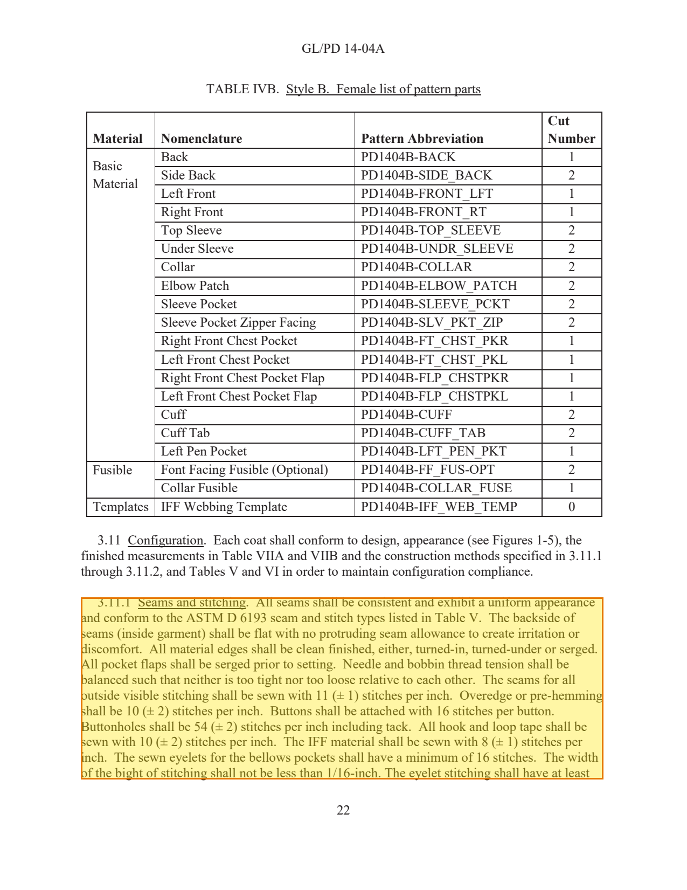
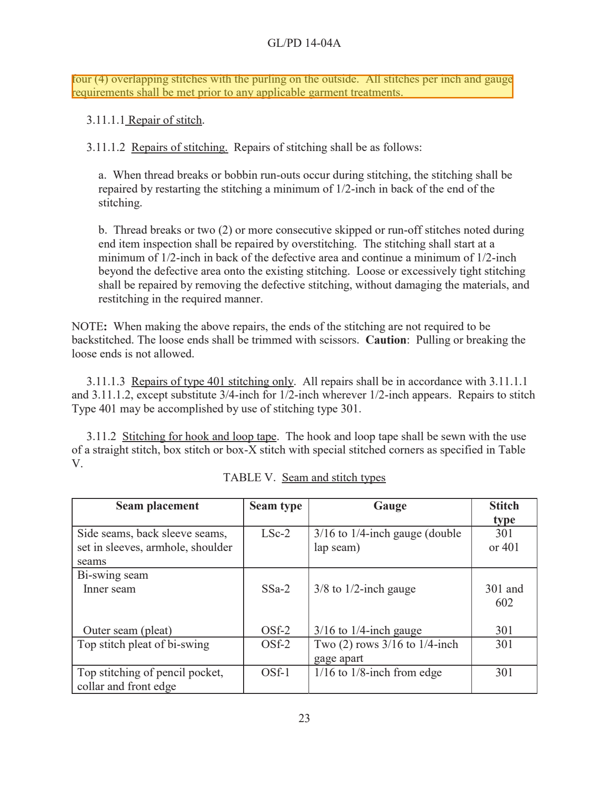
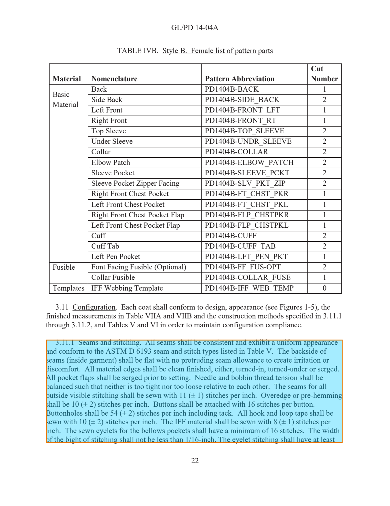
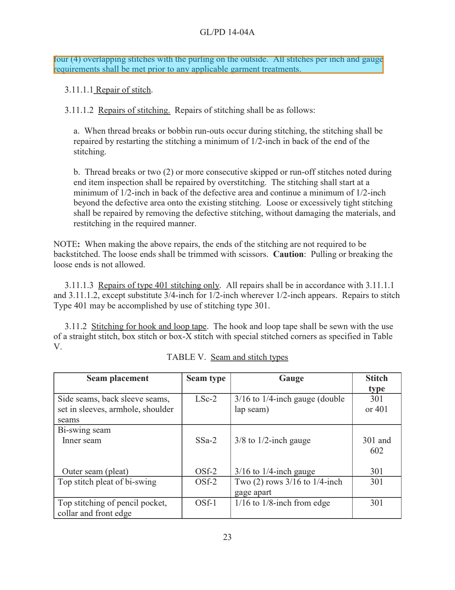
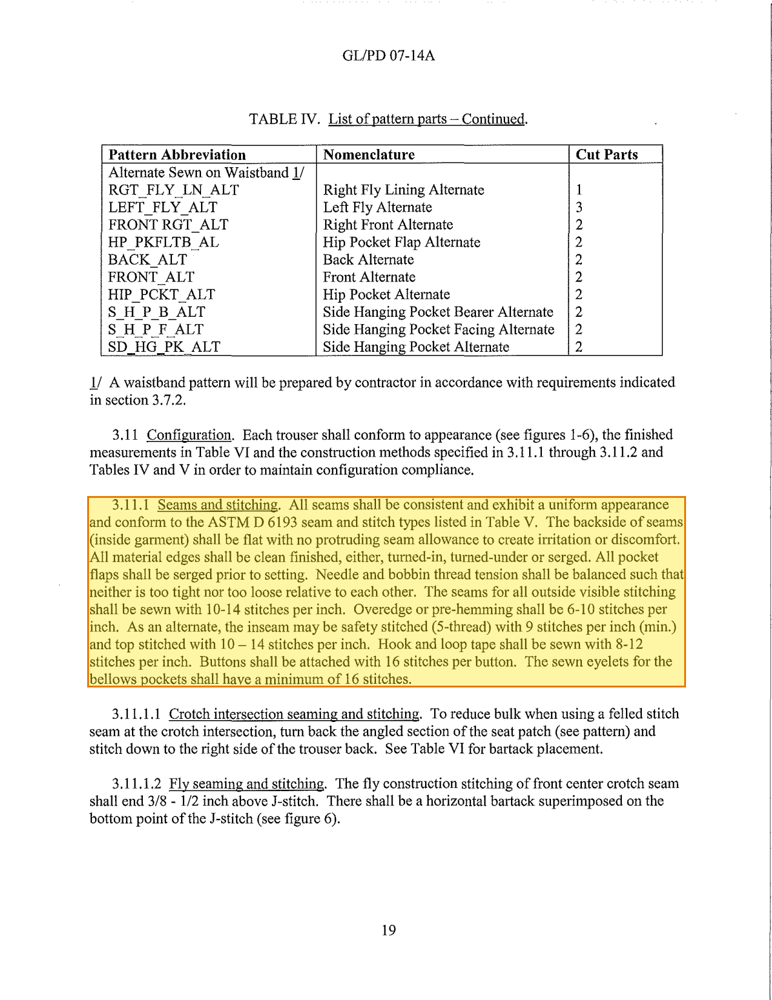
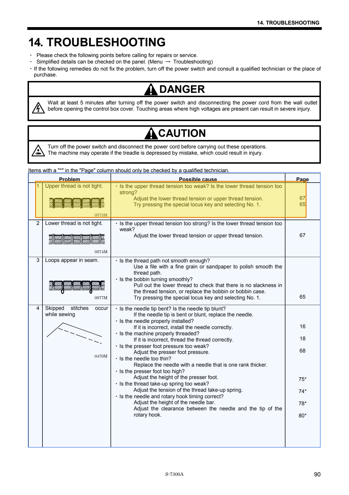

# Faz 1 denemesi raporu

_Son güncelleme: 2026-10-09 09:25_

**Amaç (Faz 1 kontrol noktası):** Bir manuelden ilgili parçayı sayfa no + bbox ile çıkarıp sayfayı vurgulu gösterebiliyor muyuz? Ayrıntılı plan: `Pre/notes/kaynak-gosterme.md`.

**Başarı ölçütü:** Sarı kutu doğru paragrafın/satırın üstüne düşüyor mu? Otomatik kontrollere ek olarak aşağıdaki görseller **gözle** kontrol edilmeli.

## Özet

| Doküman | Soru | Sonuç | Bulunan kaynak | Süre |
|---------|------|-------|----------------|------|
| `gl-pd-14-04a` | Ceketin dış görünür dikişlerinde SPI kaç olmalı? | ✅ Başarılı | paragraf, s.22, s.23 | 98.5 sn |
| `gl-pd-07-14a` | Pantolonun dış görünür dikişlerinde SPI kaç olmalı? | ⚠️ Uyarı var | paragraf, s.19 | 116.3 sn |
| `brother-s7300a` | S-7300A'da üst iplik gergin değil (upper thread is not tight), ne yapmalıyım? | ✅ Başarılı | tablo satırı, s.90 (PDF s.101) | 152.8 sn |

## gl-pd-14-04a

**Soru:** Ceketin dış görünür dikişlerinde SPI kaç olmalı?  
**Dosya:** `GL-PD-14-04A_ACU-Coat.pdf`

- Parse edilen sayfalar: s.21, s.22, s.23, s.24
- Çıkarılan öğe sayısı: 45
- Süre: 98.5 sn
- **Seçilen öğe:** paragraf, **s.22, s.23**

> 3.11.1 Seams and stitching. All seams shall be consistent and exhibit a uniform appearance and conform to the ASTM D 6193 seam and stitch types listed in Table V. The backside of seams (inside garment) shall be flat with no protruding seam allowance to create irritation or discomfort. All material edges shall be clean finished, either, turned-in, turned-under or serged. All pocket flaps shall be serged prior to setting. Needle and bobbin thread tension shall be balanced such that neither is too tight nor too loose relative to each other. The seams for all outside visible stitching shall be sew…

- ✅ Seçilen metin soruyla ilgili anahtar kelimeleri içeriyor
- ✅ Vurgu kutuları sayfanın içinde
- ✅ Seçilen metne üst/alt bilgi karışmamış
- Atılan üst/alt bilgiler: `GL/PD 14-04A`
- Sayfa geçişinde birleştirilen paragraf: 1
  - s.22 → s.23: "…/16-inch. The eyelet stitching shall have at least" + "four (4) overlapping stitches with the purling on …"

**Görseller** (sarı: bulunan kaynak, açık mavi: bağlam, örn. tablonun tamamı, turkuaz: sayfa geçişi birleştirmesi):

## gl-pd-07-14a

**Soru:** Pantolonun dış görünür dikişlerinde SPI kaç olmalı?  
**Dosya:** `GL-PD-07-14A_Combat-Trousers.pdf`  (taranmış, OCR ile)

- Parse edilen sayfalar: s.11, s.12, s.13, s.18, s.19, s.20
- Çıkarılan öğe sayısı: 59
- Süre: 116.3 sn
- **Seçilen öğe:** paragraf, **s.19**

> 3.11.1 Seams and stitching. All seams shall be consistent and exhibit a uniform appearance ans a s s ams (inside garment) shall be flat with no protruding seam allowance to create irritation or discomfort. All material edges shall be clean finished, either, turned-in, turned-under or serged. All pocket flaps shall be serged prior to setting. Needle and bobbin thread tension shall be balanced such that neither is too tight nor too loose relative to each other. The seams for all outside visible stitching shall be sewn with 10-14 stitches per inch. Overedge or pre-hemming shall be 6-10 stitches p…

- ✅ Seçilen metin soruyla ilgili anahtar kelimeleri içeriyor
- ✅ Vurgu kutuları sayfanın içinde
- ✅ Seçilen metne üst/alt bilgi karışmamış
- ⚠️ Seçilen metinde bozuk OCR şüphesi: ['ans     a    s  s']

**Karşılaştırma:** Aynı kutunun içinde PDF'in kendi (önceden eklenmiş) OCR katmanındaki metin:

> 3.11.1 Seams and stitching. All seams shall be consistent and exhibit a uniform appearance and confOlm to the ASTM D 6193 seam and stitch types listed in Table V. The backside of seams (inside garment) shall be flat with no protmding seam allowance to create irritation or discomfort. All material edges shall be clean finished, either, turned-in, turned-under or serged. All pocket flaps shall be serged prior to setting. Needle and bobbin thread tension shall be balanced such that neither is too tight nor too loose relative to each other. The seams for all outside visible stitching shall be sewn…

- Atılan üst/alt bilgiler: `GL/PD 07-14A`
- Sayfa geçişinde birleştirilen paragraf: 0

**Görseller** (sarı: bulunan kaynak, açık mavi: bağlam, örn. tablonun tamamı, turkuaz: sayfa geçişi birleştirmesi):

## brother-s7300a

**Soru:** S-7300A'da üst iplik gergin değil (upper thread is not tight), ne yapmalıyım?  
**Dosya:** `Brother_S-7300A_Instruction.pdf`

- Parse edilen sayfalar: s.66 (PDF s.77), s.67 (PDF s.78), s.68 (PDF s.79), s.89 (PDF s.100), s.90 (PDF s.101), s.91 (PDF s.102)
- Çıkarılan öğe sayısı: 92
- Süre: 152.8 sn
- **Seçilen öğe:** tablo satırı, **s.90 (PDF s.101)**

> Problem: 1 | Problem: Upper thread is not tight. 0573M | Possible cause: ・ Is the upper thread tension too weak? Is the lower thread tension too strong? Adjust the lower thread tension or upper thread tension. Try pressing the special locus key and selecting No. 1. | Page: 67 65

- ✅ Seçilen metin soruyla ilgili anahtar kelimeleri içeriyor
- ✅ Vurgu kutuları sayfanın içinde
- ✅ Seçilen metne üst/alt bilgi karışmamış
- Atılan üst/alt bilgiler: yok
- Sayfa geçişinde birleştirilen paragraf: 0

**Görseller** (sarı: bulunan kaynak, açık mavi: bağlam, örn. tablonun tamamı, turkuaz: sayfa geçişi birleştirmesi):

## Yaşanan problemler ve çözümler

| # | Problem | Ne oldu? | Çözüm | Durum |
|---|---------|----------|-------|-------|
| 1 | Test dosyası modülü yükleyemedi | faz1-test.py adında '-' olduğu için testler dosyayı yoldan yüklüyor. dataclass'lar modülün sys.modules'ta kayıtlı olmasını beklediği için yükleme AttributeError verdi. | Test dosyasında modül çalıştırılmadan önce sys.modules'a kaydedildi. | ✅ Çözüldü |
| 2 | Brother denemesi hiç tamamlanmadı | Arka planda başlatılan çalıştırma, oturum kapanınca yarıda kaldı. Brother'a ait hiçbir çıktı oluşmadı. | Yeniden çalıştırıldı. Uzun işlerin oturum açıkken bitirilmesi gerekiyor. | ✅ Çözüldü |
| 3 | Gereksiz yere 26 sayfa parse ediliyordu | Brother'da aday sayfalar birbirinden uzaktı (77-79 ve 100-102). Docling'e tek aralık (77-102) verildiği için 6 yerine 26 sayfa parse ediliyordu (CPU'da 20+ dakika). | Sayfalar ardışık gruplara bölünüp her grup ayrı parse ediliyor (contiguous_groups). Süre 2-3 dakikaya indi. | ✅ Çözüldü |
| 4 | Rapor sadece son çalıştırılan dokümanı gösteriyordu / eski çıktılar kalıyordu | Her çalıştırma report.md'nin üzerine sadece kendi sonucunu yazıyordu. Eski PNG/JSON dosyaları da klasörde kalıp raporu yanıltabiliyordu. | Her doküman sonucu result.json olarak saklanıyor, rapor hepsinden birleştiriliyor. Her çalıştırmada dokümanın eski çıktıları önce siliniyor. | ✅ Çözüldü |
| 5 | Tablonun tamamı vurgulanıyordu | Docling tabloyu tek öğe olarak veriyor. Brother arıza tablosunda soru tek bir satırla (Upper thread is not tight) ilgiliyken 4 satırlık tablonun tamamı vurgulandı. | Tablo hücrelerinden satır öğeleri (table_row) üretiliyor. Seçim satır seviyesinde yapılıyor: ilgili satır sarı, tablonun geri kalanı bağlam için açık mavi çerçeveyle gösteriliyor. | ✅ Çözüldü |
| 6 | Fiziksel ve basılı sayfa numarası farklı | Brother'da seçilen sayfa PDF'in 101. sayfası, ama sayfanın altında basılı numara 90. Kullanıcı basılı kılavuzda 90'a bakar, 's.101' görürse kafası karışır. | Basılı numara sayfanın alt/üst bilgisinden okunuyor ve 's.90 (PDF s.101)' şeklinde gösteriliyor. | ✅ Çözüldü |
| 7 | OCR bir satırı kaybetti (sessiz hata) | Taranmış pantolon şartnamesinde 'and conform to the ASTM D 6193 seam and stitch types listed in Table V. The backside of seams' satırı 'ans     a    s  s       ams' olarak okundu. Otomatik kontroller bunu yakalamadı, sadece görsele bakınca fark edildi. 'ASTM D6193' ile yapılan bir arama bu paragrafı bulamaz. | Bozuk OCR şüphesi için otomatik uyarı eklendi. PDF'in kendi OCR katmanındaki metin de rapora karşılaştırma için yazılıyor. Karşılaştırmada PDF'in kendi OCR katmanının kayıp satırı doğru okuduğu, ama kendi küçük hatalarının olduğu görüldü ('confOlm', 'protmding'). İki OCR farklı yerlerde hata yapıyor. Kalıcı çözüm açık: iki OCR'ı karşılaştırıp bozuk bölümde diğerini kullanmak, farklı OCR motoru denemek, kullanıcıya her zaman orijinal sayfa görüntüsünü göstermek. | 🟡 Açık |
| 8 | Tablo satırı metninde başlık tekrarı | Brother tablosunda 'Problem' başlığı iki sütunu (sıra no + açıklama) kapsıyor. Satır metni 'Problem: 1 | Problem: Upper thread is not tight. 0573M' şeklinde çıktı. Vurgu doğru, ama metin chunk olarak kullanılırsa gereksiz tekrar ve çizim kodu (0573M) aramayı kirletebilir. | Birleşik başlıklarda tekrarı kaldırmak, çizim kodlarını ayrı alana almak. Chunking adımında ele alınacak. | 🟡 Açık |
| 9 | Kılavuz içi sayfa atıfları basılı numarayla | Brother arıza tablosundaki 'Page' sütunu (67, 65, 16...) basılı numaraları gösteriyor. Sistem bu atıfları takip etmek isterse basılı numarayı PDF sayfasına çevirmesi gerekir (67 → PDF s.78). | Ingestion'da tüm sayfalar için basılı → fiziksel numara eşleme tablosu çıkarılmalı. | 🟡 Açık |
| 10 | Tarayıcıdaki vurgu (3a) gözle doğrulanmadı | streamlit-pdf-viewer görüntüleyicisinin hatasız açıldığı otomatik testle doğrulandı, ama vurgunun tarayıcıda doğru yere düştüğü henüz gözle kontrol edilmedi. | `streamlit run faz1-test.py -- --viewer` ile açılıp üç dokümanda kontrol edilmeli. | 🟡 Açık |
