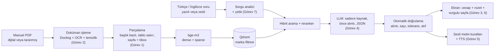
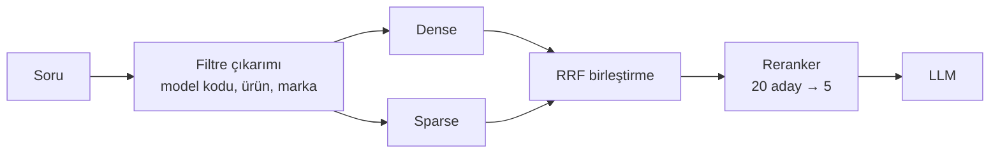
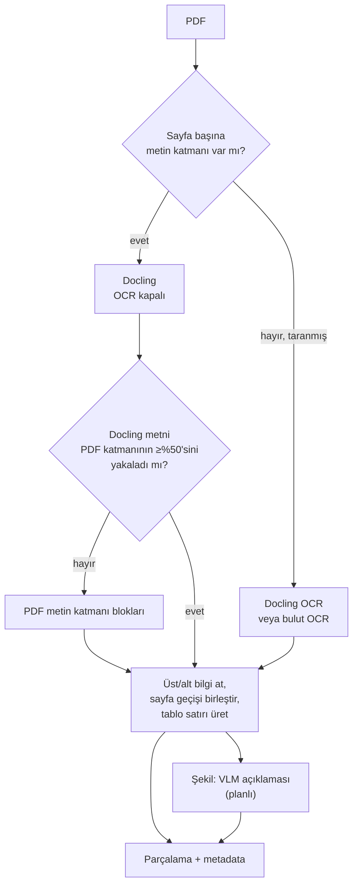
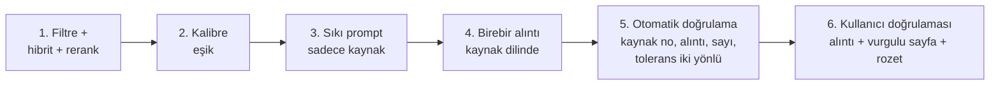
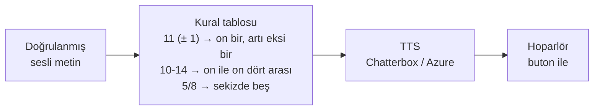
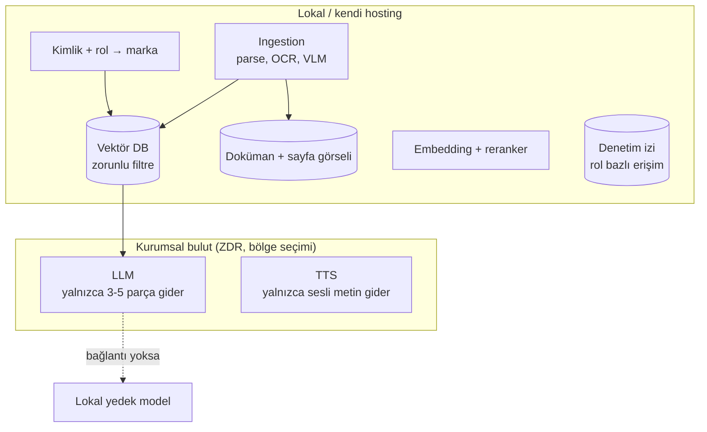
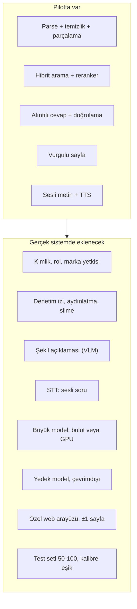
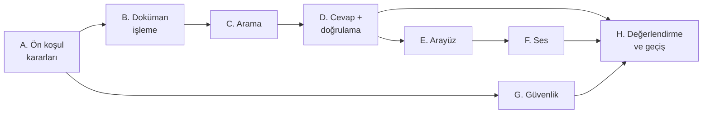

# Görev Özetleri: tasks.md'ye göre kısa karar tabloları

> **Tarih:** 2026-10-10 · **Kaynak görev:** [tasks.md](tasks.md) · **Ayrıntılı notlar:** her görevin başlığında bağlantı var
> **Amaç:** `tasks.md` "Beklenen Çıktılar" bölümü her konu için *kısa araştırma notu (özet, seçenekler, artı/eksi)* ister. Ayrıntılı notlar 400–800 satırlık öğrenme notlarıdır. Bu dosya her görevin **son karar tablosunu ve önerilen sistemi** tek sayfada verir.
> **Pilot ile ilişkisi:** Pilot, bu kararların küçük bir kısmını ölçtü. Her görevde "Pilotta gördüğümüz" satırı var. Ayrıntı: [../../PILOT-RAPORU.md](../../PILOT-RAPORU.md)

**Durum:** ✅ kararlaştı / doğrulandı · 🧪 ölçülerek kesinleşecek · ⏳ paydaş kararına bağlı · ❌ yapılmadı

---

## 0. Beklenen çıktılar denetimi (tasks.md → durum)

| tasks.md "Beklenen Çıktılar" | Durum | Nerede |
|------------------------------|-------|--------|
| Her konu için kısa araştırma notu (özet, seçenekler, artı/eksi) | ✅ | Bu dosya (§1–7) + ayrıntılı notlar |
| Önerilen mimari taslağı (akış diyagramı) | ✅ | [ARASTIRMA-SENTEZI.md §3](../../ARASTIRMA-SENTEZI.md) (Şekil 1), bu dosya §8 |
| Araç/model seçim önerileri (embedding, vector DB, LLM, TTS, arayüz) | ✅ | [ARASTIRMA-SENTEZI.md §4](../../ARASTIRMA-SENTEZI.md), bu dosya §1–7 karar tabloları |
| Kullanılacak manuallerin envanteri ve format değerlendirmesi | ✅ test seti, ⏳ gerçek doküman | [manual-envanteri.md](manual-envanteri.md) (ölçülmüş envanter tablosu eklendi) |
| Açık sorular ve riskler listesi | ✅ | [sorulacaklar.md](sorulacaklar.md), [ARASTIRMA-SENTEZI.md §8–9](../../ARASTIRMA-SENTEZI.md) |
| Uygulama aşaması için önerilen task/aşama planı | ✅ | Bu dosya §9, [ARASTIRMA-SENTEZI.md §10](../../ARASTIRMA-SENTEZI.md) |
| *Not:* Önceliklendirme 1,2,3 → 5,6 → 4 → 7 | ✅ Uygulandı | [req.md](../req.md) faz sırası |
| *Not:* Küçük pilot (tek marka, birkaç manual) uçtan uca | ✅ Yapıldı | [Pilot/](../../PILOT-RAPORU.md) |

### Önerilen sistem tek bakışta

---

## 1. RAG Temelleri

Ayrıntı: [rag-temelleri.md](rag-temelleri.md) · req.md Adım 1

### 1.1 tasks.md maddeleri ve sonuçları

| tasks.md maddesi | Sonuç (kısa) | Durum |
|------------------|--------------|-------|
| RAG mimarisi ve bileşenleri | İki hat: **ingestion** (parse → chunk → embed → vektör DB) ve **sorgu** (filtre → arama → rerank → LLM → doğrulama). Kalitenin en büyük belirleyicisi retrieval | ✅ |
| Chunking ve sayfa izlenebilirliği | Başlık/bölüm bazlı, tablo bütün ya da satır satır, her parçada `pages` + `bbox` listesi. Sayfa sınırını aşan paragraf birleştirilir, iki sayfada da vurgulanır | ✅ pilotta doğrulandı |
| Embedding (çok dilli, TR/EN) | **bge-m3** (lokal, 1024 boyut, dense + sparse tek modelden) | ✅ |
| Vector DB karşılaştırması | **Qdrant** (güçlü metadata filtresi, yerleşik hibrit). Chroma sadece hızlı deneme, pgvector alternatif | ✅ |
| Hybrid search, rerank, metadata filtre | Hibrit (dense + sparse, RRF) → **bge-reranker-v2-m3** → ilk 3–5 → LLM. Marka/model filtresi aramadan önce | ✅ kurulum, 🧪 katkı ölçümü |

### 1.2 Karar tablosu

| Konu | Karar | Alternatif | Gerekçe | Durum |
|------|-------|------------|---------|-------|
| Chunking | Başlık/bölüm bazlı, 200–900 karakter, tablo satırı ayrı parça | Recursive, sayfa bazlı | Manuallerde yapı belirgin, sayfa izlenebilirliği şart | ✅ |
| Embedding | bge-m3 | multilingual-e5-large, Qwen3-Embedding, bulut API | Çok dilli, lokal, sparse vektör de üretiyor | ✅ CPU/CUDA, MPS hatalı |
| Vektör DB | Qdrant | Chroma, pgvector | Filtre + hibrit + kolay kurulum | ✅ |
| Arama | Hibrit: dense + sparse, RRF | Sadece dense | Kodlar ve standart numaraları (E-07, D6193) | ✅ kurulum, 🧪 A/B |
| Reranker | bge-reranker-v2-m3 | Cohere Rerank | Çok dilli, lokal | ✅, 🧪 gecikme |
| Filtre | Sorudan model kodu / ürün / marka kuralla çıkarılır + arayüzde görünür marka filtresi | Sadece LLM çıkarımı | Yanlış makine riskini düşürür | ✅ |
| top-k | Aday 20–30 → LLM'e 5 | — | Kalite/gecikme | ✅ |

### 1.3 Önerilen sistem

### 1.4 Pilotta gördüğümüz
- 7 doküman → **2921 parça**, ortalama 350 karakter (1466 metin, 1455 tablo satırı).
- Türkçe soru ↔ İngilizce manual eşleşmesi dense ile çalışıyor (ilgili 0,65, ilgisiz 0,36–0,42). Cevaplanabilir 7 sorunun 6'sında doğru parça ilk 5'te (yalnızca ürünü belirtilmeyen Q07'de başarısız).
- **Hibrit ve dense aynı sonucu verdi** (5 soru): TR sorgu ile sparse kolun İngilizce dokümanda kelime örtüşmesi yok.
- Reranker CPU'da 20 aday ≈ 3–7 sn. Skor kalibre değil (doğru cevapta −5,4 görüldü).
- Uzun paragrafta değer sulanıyordu → cümle sınırından bölme eklendi.
- **Apple GPU (MPS) üzerinde embedding ve reranker yanlış sonuç veriyor** (sessiz hata).

### 1.5 Açık
Hibrit A/B deneyi, sorgu çevirisi (TR→EN) ile sparse kolu açma, Türkçe kök bulucu (Türkçe doküman gelince), reranker GPU'da gecikme, eşik kalibrasyonu.

---

## 2. Manual / PDF İşleme

Ayrıntı: [pdf-isleme.md](pdf-isleme.md), [manual-envanteri.md](manual-envanteri.md) · req.md Adım 2

### 2.1 tasks.md maddeleri ve sonuçları

| tasks.md maddesi | Sonuç (kısa) | Durum |
|------------------|--------------|-------|
| Manual formatlarının envanteri (dijital, taranmış, tablo/şekil) | 7 doküman, 611 sayfa: 5 dijital, 2 taranmış. Tablo ağırlıklı (şartnameler, arıza tabloları), şekil ağırlıklı (Brother, Bosch, Mr. Coffee). Ölçülmüş tablo: [manual-envanteri.md](manual-envanteri.md) | ✅ test seti |
| PDF parsing ve layout-aware araçlar | Docling (MIT, tablo modeli, bbox) ana parser. Marker, MinerU, PyMuPDF4LLM, bulut servisleri tabloyla karşılaştırıldı | ✅ araştırma, 🧪 deneme |
| OCR ihtiyacı ve seçenekleri | Taranmış dokümanlarda gerekli. Docling içi OCR ile başla, bulut OCR ile karşılaştır. **Sayılarda OCR hatası riski** (V2 ↔ ½) | ✅ araştırma, 🧪 deneme |
| Chunk metadata (marka, doküman, versiyon, sayfa, bbox) | Şema tanımlı. Parsing'den gelenler (sayfa, bbox, bölüm, tür) ve gelmeyenler (marka, versiyon, yürürlük) ayrıldı, ikincisi otomatik çıkarılacak | ✅ |

### 2.2 Karar tablosu

| Konu | Karar | Alternatif | Gerekçe | Durum |
|------|-------|------------|---------|-------|
| Ana parser | Docling | Marker, MinerU | MIT lisans, lokal, tablo, bbox | ✅ |
| Metin katmanı yedeği | PDF metin katmanı blokları (pilotta PyMuPDF) | pdfplumber (MIT), docling-parse | Docling tam sayfa taramayı "şekil" sayıp metni atıyor | ✅, ⚠ lisans (aşağıda) |
| OCR | Docling içi (EasyOCR/RapidOCR) | Azure DI, Surya | Önce lokal, sonra bulutla fark ölç | 🧪 |
| Şekiller | Caption + VLM açıklaması | ColPali (Görev 3) | Çizimlerde bilgi metin aramasıyla da bulunsun | 🧪 ❌ pilotta yok |
| Dijital / taranmış ayrımı | Sayfa başına metin katmanı ve kapsam kontrolü | Doküman başına | Karma dokümanlar var | ✅ |
| Kalite kontrolü | Sayı doğruluğu özel kontrol, bozuk OCR uyarısı | — | Yanlış sayı = yanlış dikim | ✅ kısmen |

> ⚠ **Lisans notu:** PyMuPDF **AGPL** (ticari lisansı ücretli). Pilot yedeği ve Faz 1 PyMuPDF kullanıyor, araştırma/pilot için sorun yok, ürüne girmeden önce pdfplumber/pypdfium2 ile değiştirilmeli veya lisans alınmalı.

### 2.3 Önerilen sistem

### 2.4 Pilotta gördüğümüz
- Docling OCR kapalı **0,8–2,7 sn/sayfa**. OCR açıkken Faz 1'de 4–6 sayfa için 98–152 sn.
- **Strickland'ın %94'ü kayboldu** (tam sayfa tarama görseli "picture" sayıldı). Kapsam kontrolü ile 143/611 sayfa yedek yola geçti (Strickland 121).
- Tablo satırı üretimi çalışıyor (1455 satır), başlık tekrarı ve çizim kodları (0573M) duruyor.
- Basılı sayfa numarası ("s.90 (PDF s.101)") okunuyor, kitapçık düzeni (Mr. Coffee) ve üç dilli Bosch'ta güvenilir değil.

### 2.5 Açık
Gerçek taranmış oran (Q3), klasör/adlandırma düzeni ve versiyon (Q7, R3), diğer parserlarla karşılaştırma, iki OCR birleştirme, şekil açıklaması.

---

## 3. Kaynak Gösterme ve Sayfa Görüntüleme

Ayrıntı: [kaynak-gosterme.md](kaynak-gosterme.md) · req.md Adım 3

### 3.1 tasks.md maddeleri ve sonuçları

| tasks.md maddesi | Sonuç (kısa) | Durum |
|------------------|--------------|-------|
| Cevaptan kaynağa izlenebilirlik | Kaynaklar numaralanır, LLM yalnızca **[n]** yazar. Sayfa ve bbox metadata'dan gelir (uydurulamaz). Cevap gösterilmeden alıntı ve sayı kontrolü | ✅ pilotta uygulandı |
| PDF sayfasını görsele çevirme | İki yol: sunucuda PNG render ya da tarayıcıda PDF.js. Gezinme/yakınlaştırma gerektiği için üretimde PDF.js | ✅ |
| Vurgulama (highlight / bbox) | Chunk bbox'ı yarı saydam kutu (başlangıç), sonra alıntıyı sayfada metin arayarak cümle seviyesi | ✅ kutu, 🧪 cümle |
| Multimodal retrieval (ColPali) gerekli mi | Görsel anlama **ihtiyaç**, ama ColPali zorunlu değil: önce VLM açıklaması (A) + cevap anında sayfa görselini VLM'e verme (B). ColPali ikinci kanal | ✅ karar, 🧪 ölçüm |

### 3.2 Karar tablosu

| Konu | Karar | Alternatif | Gerekçe | Durum |
|------|-------|------------|---------|-------|
| Atıf | Numaralı kaynak + [n] + doğrulama | LLM'in sayfa yazması | Sayfa uydurulamaz | ✅ |
| Sayfa gösterimi (pilot) | Sunucuda render (pypdfium2, 110 DPI) + bbox kutusu | `streamlit-pdf-viewer` | Basit, bağımlılık az | ✅ |
| Sayfa gösterimi (üretim) | PDF.js tabanlı özel görüntüleyici, **±1 sayfa kısıtı** | Sunucuda render | Yakınlaştırma, yetkiye göre pencere (karar) | ⏳ |
| Vurgu | Chunk bbox'ı | Cümle seviyesi metin arama | Her zaman çalışır | ✅ |
| Görsel anlama | VLM açıklaması + cevap anında görsel | ColPali | Tek arama sistemi, kontrollü maliyet | 🧪 |
| Sayfa numarası | Basılı + PDF birlikte ("s.90 (PDF s.101)") | Yalnızca PDF | Basılı kılavuzla karşılaştırma | ✅ |

### 3.3 Pilotta gördüğümüz
- Vurgu kutusu doğru paragrafın üstüne düştü (gözle doğrulandı: ceket s.22, 3.11.1 paragrafı).
- Sayfa sınırını aşan paragraf tek parça, iki sayfada da kutu.
- Modeller **[n] atfını yazmıyor** (0/10 tam doğrulama). Doğrulama "kısmen" diyor.
- Koordinat dönüşümü (point × DPI/72, sol-üst orijin) sorunsuz çalıştı.

### 3.4 Açık
Cümle seviyesi vurgu, PDF.js özel görüntüleyici, ±1 sayfa kısıtının uygulanması, VLM ile görsel arama (A+B vs ColPali).

---

## 4. LLM Seçimi ve Yanıt Kalitesi

Ayrıntı: [llm-degerlendirme.md](llm-degerlendirme.md), [prompt-taslak.md](prompt-taslak.md) · req.md Adım 4

### 4.1 tasks.md maddeleri ve sonuçları

| tasks.md maddesi | Sonuç (kısa) | Durum |
|------------------|--------------|-------|
| Model seçenekleri (bulut vs lokal) ve Türkçe performansı | LLM'in rolü bilgi kaynağı değil **okuyucu-yazar**. Kriter: kaynağa sadakat, "bulunamadı" diyebilme, TR yazma/EN okuma. 7–8B lokal modeller Türkçe doküman QA'da %49–75 (yetersiz), lokal hedef ~27–32B | ✅ araştırma |
| Prompt tasarımı (sadece kaynak, "bulunamadı") | 10 kuralı olan sistem talimatı + JSON çıktı şeması (alıntı, cevap, sesli metin, netleştirme, çelişki, bulunamadı) | ✅ |
| Halüsinasyon azaltma | 6 katman (aşağıda) | ✅ tasarım, ✅ kod katmanı |
| RAG değerlendirme (test seti, retrieval, cevap doğruluğu, RAGAS) | 50–100 soru, 8 tür, metrikler ayrı: değer doğruluğu, kaynak doğruluğu, doğru reddetme. Kendi betik + RAGAS | ✅ tasarım, 10 soru uygulandı |

### 4.2 Karar tablosu

| Konu | Karar | Alternatif | Gerekçe | Durum |
|------|-------|------------|---------|-------|
| LLM (test) | 3 bulut orta seviye + 1 küçük + 1 açık, aynı test seti | Tek sağlayıcı | Genel sıralamalar bu görevi ölçmüyor | 🧪 yalnızca lokal 7B ölçüldü |
| LLM (bulut yoksa) | Apache-2.0 açık model ~27–32B, 24 GB+ GPU | 70B (2 GPU) | 7–8B yetersiz | 🧪 ⏳ Q5 |
| Çıktı | JSON şeması, önce alıntı | Serbest metin | Otomatik doğrulama için şart | ✅ |
| Halüsinasyon | 6 katman | + ikinci model doğrulayıcı | R4 en yüksek risk | ✅ |
| Değerlendirme | Kendi betik + RAGAS + insan ("bu cevapla dikim yapar mıydım?") | DeepEval, TruLens | Kritik metrikler kural tabanlı | ✅ betik, ⏳ test seti |
| Birim dönüşümü | Kodda, "yaklaşık" etiketiyle | Modelde | Model hesapta hata yapar | ✅ tasarım |

### 4.3 Önerilen sistem: 6 katmanlı doğruluk güvencesi

| Katman | Pilot durumu |
|--------|--------------|
| 1 Filtre + hibrit + rerank | ✅ |
| 2 Kalibre eşik | ❌ kapalı (skor kalibre değil, test seti küçük) |
| 3 Sıkı prompt | ✅ |
| 4 Birebir alıntı | ✅ (7B model sık bozuyor) |
| 5 Otomatik doğrulama | ✅ 21 birim testli, uydurma alıntı ve sayıları yakaladı |
| 6 Kullanıcı doğrulaması | ✅ rozet + vurgulu sayfa |

### 4.4 Pilotta gördüğümüz
- **qwen2.5:7b → 10 soruda 5 doğru.** Değeri ve sayfayı buluyor, ama uyduruyor ("Yesil ceket"), [n] atfı yazmıyor, cevapsız soruda reddetmiyor (uçak motoru yağı).
- **qwen3:30b (18 GB) 24 GB makineye sığmadı** (GPU belleği aşıldı).
- Doğrulama katmanı uydurma alıntıları yakaladı: yanlış değer "doğrulandı" diye geçmedi.
- Doğrulama kendi kusurunu da gösterdi: model kodu rakamları (`7300`) değer sayılıyordu, düzeltildi.
- Süre: model ≈ 9 sn, toplam 14,5 sn (hedef 5 sn).

### 4.5 Açık
Büyük model ve bulut referansı (aynı test), eşik kalibrasyonu, 50–100 soruluk test seti ve uzman kontrolü, hata toleransı (A5), "genel bilgi verilebilir mi".

---

## 5. TTS (Text-to-Speech)

Ayrıntı: [tts.md](tts.md) · req.md Adım 5

### 5.1 tasks.md maddeleri ve sonuçları

| tasks.md maddesi | Sonuç (kısa) | Durum |
|------------------|--------------|-------|
| TTS seçenekleri ve TR/EN kalite | Bulut: Azure, Google Chirp 3 HD, ElevenLabs, OpenAI, Polly (hepsi Türkçe). Açık kaynak: **Chatterbox Multilingual** (MIT) Türkçe + ticari lisanslı tek güçlü aday | ✅ |
| Gecikme, streaming, maliyet, lisans | İlk ses bulutta ~0,1–0,5 sn, darboğaz LLM. Streaming doğrulama ile çatışıyor → **önce doğrula, sonra seslendir**. Maliyet 36–240 $/ay (karar verdirici değil). Açık modellerde kod, ağırlık ve veri lisansı ayrı | ✅ |
| Uzun/teknik yanıtı sesli okumaya uygun yapma | Ayrı kısa **sesli metin** (1–3 cümle, rakamla) + kural tablosu: tolerans, aralık, kesir, birim, kod | ✅ |

### 5.2 Karar tablosu

| Konu | Karar | Alternatif | Gerekçe | Durum |
|------|-------|------------|---------|-------|
| TTS (test) | Azure Türkçe sesler | Google, ElevenLabs | SSML/telaffuz kontrolü, container ile lokale geçiş | 🧪 (pilot: yalnızca lokal) |
| TTS (lokal) | **Chatterbox Multilingual** | Azure container, kendi Piper sesi | Türkçe + MIT + kalite | ✅ pilotta denendi |
| Streaming | Tam cevap + doğrulama → sonra TTS | Cümle düzeyinde doğrulama | R4: doğrulanmamış değer duyulmasın | ✅ |
| Sesli metin | LLM'den ayrı kısa metin + sayı kontrolü + kural tablosu | Ekran metninden türetme | Kısalık, değer güvenliği | ✅ |
| Normalizasyon | Kendi kural tablosu + test listesi | TTS'in kendi normalizasyonu | Türkçe hazır kütüphane yok | ✅ 12+ testli |
| Okuma tetikleme | "Soru sor / sesli oku" tuşu, ileride "hey asistan" | Otomatik okuma | Karar (cevaplar) | ✅ |
| Çıkış | Hoparlör | Kulaklık | Karar | ✅ |

### 5.3 Önerilen sistem

### 5.4 Pilotta gördüğümüz
- Chatterbox Türkçe kalitesi **iyi** (kullanıcı dinledi: "doğru seslendirilmiş").
- CPU'da 4,6 sn ses için 11,6 sn üretim (gerçek zamanın ~2,5 katı). Apple GPU'da (MPS) bozuk çıktı (13–40 sn, token hatası).
- Sayı okuma kuralları çalışıyor ve testli. Num2words "onbir" gibi bitişik yazdığı için kendi kuralımızı yazdık.

### 5.5 Açık
Aday karşılaştırması (Azure vs diğerleri), gürültüde dinleme, round-trip STT kontrolü, kod okunuşu (301, S-7300A, E-07: Q10-a), gecikme (GPU veya bulut).

---

## 6. Arayüz ve Orkestrasyon

Ayrıntı: [arayuz-orkestrasyon.md](arayuz-orkestrasyon.md) · req.md Adım 6

### 6.1 tasks.md maddeleri ve sonuçları

| tasks.md maddesi | Sonuç (kısa) | Durum |
|------------------|--------------|-------|
| Arayüz seçenekleri | Pilot: **Streamlit**. Üretim: özel web (React + FastAPI). Gradio, Chainlit, Open WebUI elendi (bbox vurgusu/sayfa görüntüleme/lisans) | ✅ |
| Soru + sayfa görüntüleyici + ses tek ekranda | Cevap solda, vurgulu sayfa sağda, aynı anda. Rozet, büyük kritik değer, doğrulandıktan sonra göster | ✅ pilotta uygulandı |
| Orkestrasyon çatıları karşılaştırması | **Çatısız modüler Python** + denetim izi. LangChain/LlamaIndex/Haystack gerekmiyor (doğrusal hat, özel adımlar) | ✅ |
| STT ihtiyacı | **İsteniyor** (ustanın eli dolu olabilir, karar). Bas-konuş + tanınan metni onay + terim listesi. Ses kaydı saklanmaz | ✅ karar, ❌ pilotta yok |

### 6.2 Karar tablosu

| Konu | Karar | Alternatif | Gerekçe | Durum |
|------|-------|------------|---------|-------|
| Arayüz (pilot) | Streamlit | NiceGUI | En hızlı | ✅ |
| Arayüz (üretim) | Özel web, tablet uyumlu, büyük dokunma alanı | Streamlit | Yetki, ±1 sayfa, senkron vurgu | ⏳ |
| Ekran | Cevap + kaynak yan yana, doğrulandıktan sonra | Akan metin | R4 | ✅ |
| Orkestrasyon | Modüler Python, `soru_cevapla()` arayüzden bağımsız | LlamaIndex parçaları | Şeffaflık | ✅ |
| Denetim izi | Her soru loglanır (kaynak, doğrulama, süre), KVKK politikasıyla | — | Karar (loglar) | ❌ pilotta yok |
| STT motoru | Bulut serbestse Azure STT, değilse faster-whisper | Whisper large-v3 | Q1, Q5 | ⏳ |
| Marka seçimi | Sesli soruda sistem sorar, yazılıda filtre butonu görünür | — | Karar | ✅ yazılı, ❌ sesli |

### 6.3 Pilotta gördüğümüz
- Streamlit hatasız çalıştı (otomatik uygulama testi). Sayfa çizici ve ses için özel kod gerekti (`streamlit-pdf-viewer` kullanılmadı).
- TTS ayrı sanal ortamda (Chatterbox kendi torch sürümünü sabitliyor): arayüz alt süreçle çağırıyor, her seferinde model yükleme ≈ 8 sn. Gerçek sistemde TTS ayrı servis olmalı.
- ~1300 satır modüler Python, 83 birim test.

### 6.4 Açık
Cihaz (Q11), STT uygulaması, özel web arayüzü, denetim izi, kullanıcı oturumları.

---

## 7. Veri Güvenliği ve Erişim

Ayrıntı: [guvenlik.md](guvenlik.md) · req.md Adım 7

### 7.1 tasks.md maddeleri ve sonuçları

| tasks.md maddesi | Sonuç (kısa) | Durum |
|------------------|--------------|-------|
| Müşteri manuallerinin gizlilik gereksinimleri | İki hukuk: manueller **NDA/ticari sır** (sözleşme), kullanıcı verisi/log/ses **KVKK**. Karar: müşteriden izin istenmeden geliştirilecek, sözleşme yasağı kontrolü (7.1) açık | ✅ araştırma, ⏳ sözleşme |
| Bulut API vs on-prem | Ingestion'da bulut = dokümanın tamamı dışarı, sorguda bulut LLM = 3–5 parça. **Senaryo B (hibrit):** parse/embedding/vektör DB lokal, LLM ve TTS kurumsal bulut (ZDR). Harici hosting kararlaştırıldı | ✅ öneri, ⏳ Q1 |
| Marka bazlı erişim yetkilendirme | **Gerekli** (karar). Yetki filtresi sunucuda, aramadan önce, her erişim noktasında. Varsayılan kapalı | ✅ tasarım, ❌ uygulanmadı |

### 7.2 Karar tablosu

| Konu | Karar | Alternatif | Karar neye bağlı | Durum |
|------|-------|------------|------------------|-------|
| Dağıtım | **B: hibrit** (adaptörlü, A/C'ye geçilebilir) | C: tamamen lokal | Q1, 7.1, Q5, bütçe | ⏳ |
| Kişisel veri | Buluta gönderilmez (kimlik yok, ses saklanmaz) | Standart sözleşme | KVKK sorumlusu | ✅ |
| Kimlik | E-posta/kod ile giriş, rol → marka | SSO | Karar (cevaplar) | ✅ |
| Yetki | Merkezi zorunlu pre-filter, varsayılan kapalı, tüm erişim noktaları | Marka başına koleksiyon | 7.3 (karar: marka bazlı) | ✅ tasarım |
| Sayfa erişimi | Yetkiye göre, en fazla ±1 sayfa | Tüm doküman | Karar | ✅ tasarım |
| Log | Aydınlatma metni + izin, erişim rollerle admin panelden | — | Karar | ✅ tasarım |
| Silme | Sözleşme bitince doküman ve tüm türevleri (chunk, vektör, görsel, log alıntıları) | — | Karar | ✅ tasarım |
| Ses | Kaydedilmez, metne dökülüp metin tutulabilir | Saklama (izinle) | Karar | ✅ |
| Çevrimdışı | Bağlantı kesilirse yedek lokal model | Hiç çalışmama | Karar (ağ kesilebilir) | ⏳ Çevrimdışı sorusu |

### 7.3 Önerilen sistem (Senaryo B)

### 7.4 Pilotta gördüğümüz
Yetkilendirme **uygulanmadı** (kapsam dışı). Arayüzde marka filtresi var ama yetki değil. Mimari adaptörlere hazır: model ve DB değişimi tek dosya.

### 7.5 Açık
Q1, Q1-a, 7.1 (NDA 8 madde), bütçe, Q5, çevrimdışı davranış, rol ve admin paneli, sözleşme bitiş otomasyonu.

---

## 8. Önerilen sistem: birleşik görünüm

Pilotun kurduğu çekirdek ile gerçek sistemde eklenecekler:

Ayrıntılı gerçek sistem mimarisi ve pilot↔gerçek karşılaştırması: [MIMARI.md, Bölüm B](../../MIMARI.md).

---

## 9. Uygulama aşaması için önerilen task / aşama planı

`tasks.md` beklenen çıktısı: *"Uygulama aşaması için önerilen task/aşama planı"*. Aşağıdaki plan pilot bulgularına göre güncellendi (önceki sürüm: [req.md 6.2](../req.md)).

| Aşama | Task | Çıktı / kabul ölçütü | Bağımlılık | Pilot durumu |
|-------|------|----------------------|------------|--------------|
| **A. Ön koşul kararları** | Q1/7.1 (bulut), Q5 + bütçe (GPU), hata toleransı | Dağıtım senaryosu (B veya C) ve model sınıfı yazılı | Hukuk, BT, kalite | ⏳ |
| **B. Doküman işleme** | Ingestion servisi: parse, OCR, yedek yol, tablo satırı, şekil açıklaması (VLM), metadata çıkarımı, basılı↔PDF sayfa eşleme | 7 test dokümanı + gerçek doküman örnekleri hatasız, bozuk OCR uyarısı, sayfa başına kapsam raporu | A | ✅ çekirdek, ❌ VLM, OCR birleştirme |
| **C. Arama** | Hibrit + filtre + rerank, sorgu çevirisi, eşik kalibrasyonu, belirsiz soru akışı | Recall@5 ≥ %90 (50–100 soru), tuzak %100 | B, test seti | ⚠ çalışıyor, ölçüm küçük |
| **D. Cevap ve doğrulama** | Model seçimi (aynı test seti ile bulut/lokal), prompt iyileştirme, doğrulama modları, denetim izi | Değer doğruluğu ≥ %98, doğru reddetme ≥ %90, "yanlış değer doğrulandı" = 0 | A, C | ⚠ 7B yetersiz |
| **E. Arayüz** | Özel web arayüzü: yan yana cevap/sayfa, rozet, ±1 sayfa, filtre görünür, tablet uyumlu | Atölyede kullanıcı denemesi, eldivenle kullanım | D, Q11 | ✅ pilot (Streamlit) |
| **F. Ses** | TTS (GPU/bulut), kural tablosu kod okunuşu (Q10-a), STT bas-konuş + onay | Kritik değer doğru okunur, ses ≤ hedef süre, ses kaydı saklanmaz | E | ⚠ TTS çalışıyor yavaş, ❌ STT |
| **G. Güvenlik** | Kimlik (e-posta/kod), rol → marka, pre-filter, denetim izi, aydınlatma, silme, admin paneli | Yetki testleri %100, silme testi, log erişimi rol bazlı | A | ❌ |
| **H. Değerlendirme ve geçiş** | 50–100 soru + uzman kontrolü, gerçek veriye geçiş kontrol listesi, yeniden ölçüm | Pilot başarı kriterleri (sentez §10.1) gerçek veride sağlanıyor | B–G | ⚠ 10 soru |

**Pilot başarı kriterleri (taslak, paydaşlarla kesinleştirilecek):** Recall@5 ≥ %90 · değer doğruluğu ≥ %98 · doğru reddetme ≥ %90 · tuzak ve yetki %100 · yanıt süresi ≤ 5 sn. Pilot sonuçları: [ARASTIRMA-SENTEZI.md §10.1](../../ARASTIRMA-SENTEZI.md).
